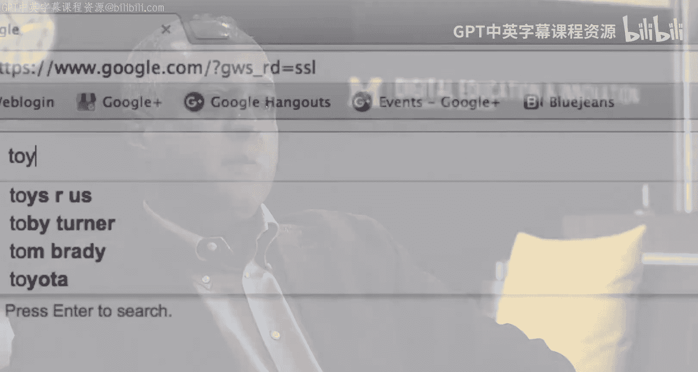

# 数据科学伦理：13：案例分析：破产后的隐私困境 🔍

在本节课中，我们将通过一个真实案例，探讨当企业破产时，其先前与客户达成的隐私协议将面临何种命运。我们将分析法律、伦理与社会共识如何在此类情境下相互作用。

---

上一节我们讨论了数据所有权的一般性问题，本节中我们来看看一个具体的法律与伦理困境：企业破产后，其持有的客户数据应如何处理。

RadioShack 是一家曾广受欢迎的电子产品销售公司。该公司在破产后停止了运营。在其资产被清算出售时，该公司曾收集了数百万客户的个人信息。进入破产程序后，该公司希望出售这些客户数据。对此，美国 36 个州的总检察长提起诉讼，试图阻止这笔交易。核心问题在于：当一家公司破产时，其在正常运营期间与客户达成的隐私协议是否仍然有效？

事实上，这并非该问题首次出现。几年前，一家名为 Toymart 的网络公司（互联网泡沫时期的公司之一）破产时，同样的问题就被提出并得到了处理。

鉴于 Toymart 案的先例，美国实际上已存在相关法律，规定了在此类情况下应如何进行破产程序。法律规定，需任命一位监察员，其职责是确保数据资产的出售方式，符合该公司在运营期间所做出的任何隐私协议。

因此，RadioShack 的债权人与提起诉讼的州总检察长们达成了一项协议。该协议包含一项复杂的“选择加入/选择退出”安排，涉及是否允许将客户数据转移给购买此信息资产的新公司。

从本案中，我们真正需要领悟的要点是：作为一种社会共识和伦理准则，我们认为，公司在正常运营期间与我们达成的协议，即使在公司停止运营并进入破产程序后，也应当持续有效。至少在某些情况和某些国家，现有法律已开始支持这一社会期望。

---

本节课中，我们一起学习了企业破产情境下的数据隐私难题。通过 RadioShack 的案例，我们看到了法律如何尝试在资产清算与隐私保护之间取得平衡，并理解了维护协议持续性的社会伦理基础。这提醒数据科学从业者，在设计数据收集与使用策略时，必须考虑数据的全生命周期，包括企业可能发生变故的极端情况。