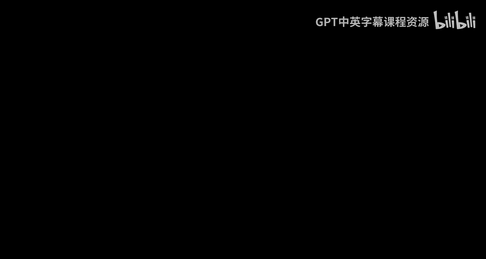
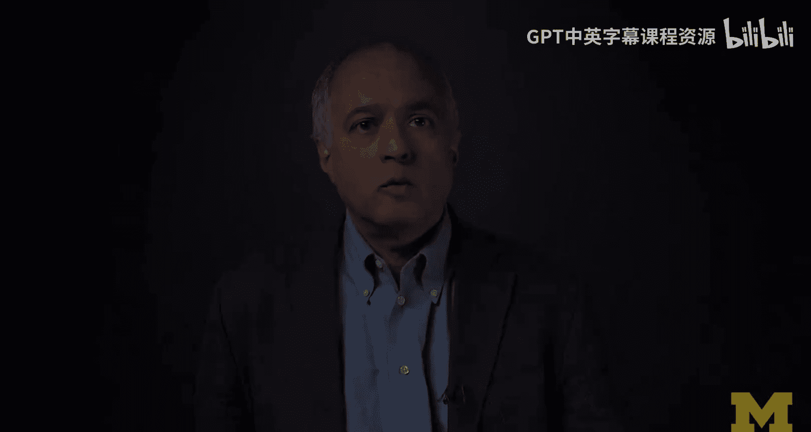
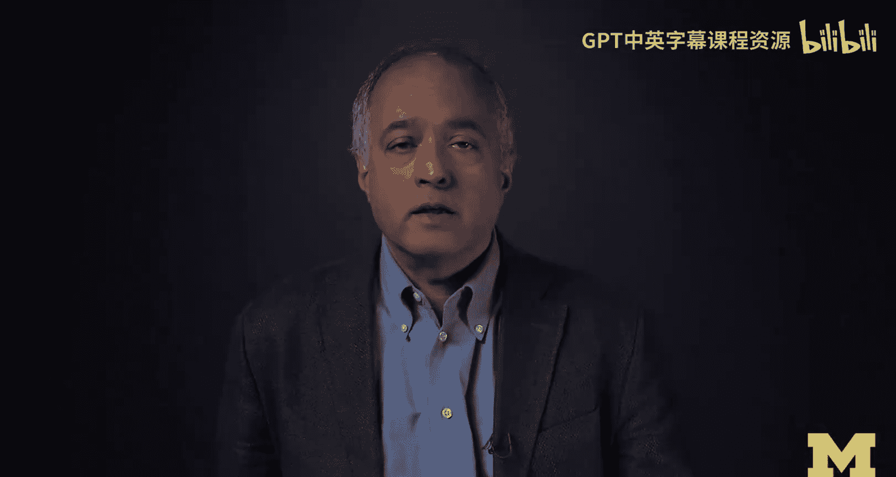

# 密歇根大学《数据科学伦理｜Data Science Ethics》中英字幕 p14 13_隐私权.zh_en -BV1EGaVzeEbQ_p14-

Welcome to this module on privacy。

To begin， let's talk about what privacy is。In terms of Greek myth， there was a giant with 100 eyes。

 Argus Penopes， who was ever watchful。Because some of his eyes would be awake when others were asleep。

Building off the Smith。Jeremy Bentham， in the 18th century， designed a prism。Called the Panopticon。

The idea was that a single guard in the centre of this complex could observe all the prisoners。

The prisoners wouldn't know whether they were being watched because the guard could look in any direction that he chose。

 And sometimes he might be looking at you other times he might not。

But since the prisoners wouldn't know whether they were being watched。

 they would behave all the time as if。They were being watched。This notion today， exists。

Here's a Mar day Panopticon in terms of a security camera or actually a bunch of security cameras in a typical house。

You don't have to have physical cameras for this purpose。

If you think about the fact that your interactions on the web。

Your interactions online with merchants are being recorded。

You end up with something that looks like this cartoon。

And we have here the Facebook guard of the Panopticon。

And it isn't that Facebook really watches everything that you do。But the question is。

 how is our behavior impacted Because we worry that things like Facebook or other companies may figure out everything about what we are doing by watching us。

They're those。In the technology world， in particular。Who see this and。Don't see it as a bad thing。

In fact， there have been articles written where。People believe that everybody would be completely honest because theres zero privacy。

 Everybody knows or could know what everybody else is doing。And that keeps everybody straight。

 There is no room for dissembling。 There is no room for deception。

This is an overly simplistic picture。Privacy。Is a basic human need。And this is true。

 even for people who have。Quote， nothing to hide。Imagine if you didn't have privacy when you went to the toilet。

 Wouldn't that make you uncomfortable。It's not that you're doing anything wrong。

 It's nothing to be ashamed of， but it's just something that。Doesn't feel right。

Besides the individual level， privacy also has societal benefits。

A central part of our democracy is anonymous voting。

You need to be able to hide your vote to be able to vote freely。

Without having to worry about pressure from other people。For all of these reasons。

 privacy is important， and we need to think about how we manage privacy in。

This complex world with big data and data analytics。

