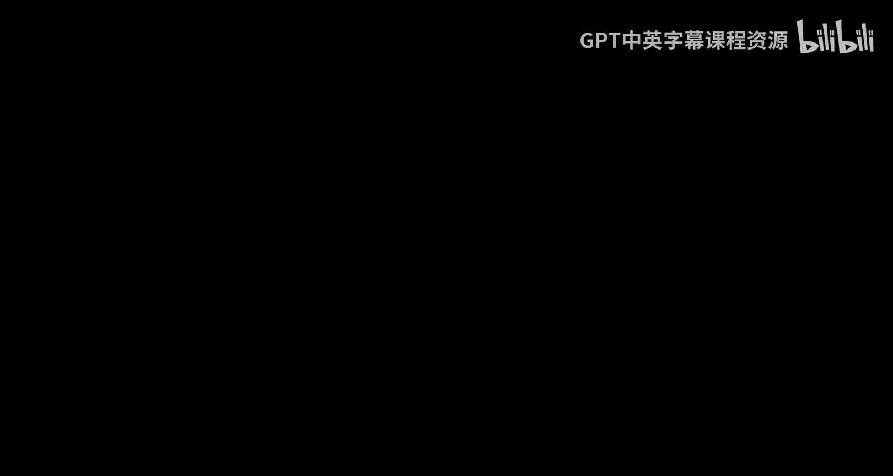
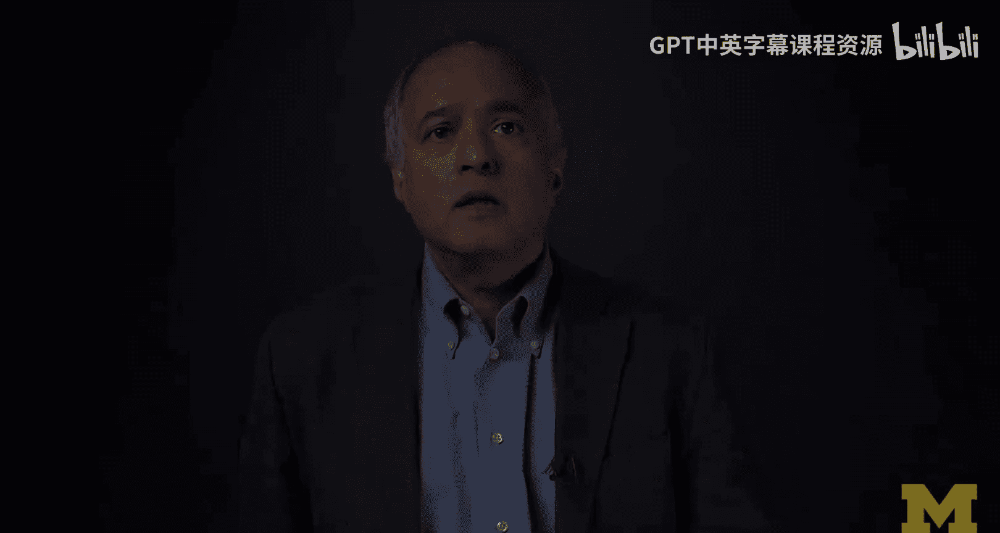

# 密歇根大学《数据科学伦理｜Data Science Ethics》中英字幕 p15 14_隐私观念的历史演进.zh_en -BV1EGaVzeEbQ_p15-

Let's talk a little bit about the history of privacy。

The first known legal definition of privacy。Was in 1604 when Edward Koke。

 then attorney general of England。Quuoting。The English common law said famously the house of every is to him as his castle and fortress。

What this meant later on was things like the Fourth Amendment in the US against protection against unreasonable search and seizure。

In terms of privacy itself。In 1888， Thomas Couley， who is a professor right here at the University of Michigan。

And a constitutional scholar。Rrote a treatise on the loft forrs。

And explicitly delineated in that a privacy right， which is the right to be left alone。In 1890。

Earl Warren and Louis Brandeis。2， grape jurs。Wrote an article at the Harvard Law Review。

And in this article， they talked about the importance of privacy。

And talked about the fact that just as people aren't required to say things that they don't want to。

If people don't want to give up。Certain things that are private to them。

 Then they should be able to retain the power to fix the limits of their publicity。This is really。

Beginning to be the modern definitions of privacy。In 1928。

There is a famous lawsuit at the Supreme Court， the US law Olmstead versus the US。

And this case was about the legitimacy of wirets。The court。

Said that a wire type wasn't an unreasonable search that it didn't need any permission。

 as wirets do today。Louis Brandeis， who was by then a justice of the Supreme Court。

 famously said in his dissent。That ways may some day be developed。Where the Government。

 without removing papers from secret drawers。Can reproduce them in court。

And that this kind of access to private material。Similar to what one would get by searching a person's home could only be done with a warrant。

The law allowed weren't less wirets at this time。Leuis Brandeis was in the minority when he expressed his opinion at the Supreme Court and the US。

In 1960， legal scholar William Prosser wrote an article in the California Law Review and defined four types of privacy torts。

And this article has been much quoted as the basis of defining what privacy means in legal terms。

In 1967。Which is now 40 years almost after the Olmsted British US decision。

John Marshall Harlan writing an opinion concurring with the majority and cats versus the US。

Deffined the test for privacy and said if an individual has an expectation of privacy。

And society is prepared to recognize this expectation as reasonable。Then。

There is a right to privacy in that circumstance。If these two things are not there。

 the individual doesn't expect privacy and society doesn't expect。

That the individual has such an expectation reasonably， Then there isn't a right to privacy。

The specific thing that was happening in this case was somebody who was making a call from a telephone booth and somebody eavesdropping with an eavesdropping device。

Just outside the phone booth。 And the question is， if the person has the phone booth door closed。

 they expect privacy， and they don't expect somebody outside or a microphone outside to try to listen to their phone call without a war。

This sort of view of privacy。And Louis Brandeis's definition。

God adopted his law by the court in Smith versus Maryland， in 1979。And to， we know that。

If you have to establish a wire tab， you need to get a warrant。In fact。In 1974。

The US Congress passed something called the Fair Information Practice Priiples Act。And in this。

 they talked about how you limit collection of data， how you must identify the purpose。

 limit the use to the specified purpose， be open about what is collected。

 give people notice about what is being collected， be accountable， keep the data secure。

Things of this nature。This fundamental act is still the basis。On witch。Data collection is governed。

In the United States。In 2006， Daniel Solive， professor at George Washington University。

 wrote an article in the University of Pennsylvania Law Review， defining a taxonomy of privacy。

And the various ways in which privacy could be eroded。And in particular。

 he defined four different places。The first three， which is information collection。

 information processing and information dissemination。

Are the things that are of greatest concern to us in the context of the data science paradigm that we are discussing in this course。

He also mentions pvaies due to invasions。 These are。thingsh like。

Somebody coming in and observing you。Where you don't expect them to。

 because they're bugging your apartment or passing laws on private actions。That are， I think。

 less relevant。One of the things that is a legal question and is something that one needs to think about a little bit。

Is if you voluntarily disclose something to others。

 then it has much less protection than something that you can keep completely to yourself。So。

 for instance。If you dial a phone number， the phone company has to know what number you dialed。

 and so you're supposed to have voluntarily disclosed to the phone company what phone number you're dialing。

And since you have disclosed this information， this metadata。

That has much less protection than the content of your conversation。

Which you did not disclose to the phone company and did not intend to disclose to the phone company。

This sort of metadata collection quickly becomes problematic。

 and theres a question of what is voluntary and what is not。

 And these are some of the issues that we're going to grapple with further as we go through this course。

To take a break from the legal arguments， let's go back。

Just in terms of culturally what privacy feels like。In small towns。

 there was little privacy because everybody in town was always poking their nose in everybody else's business。

And， famously。You knew what everybody was up to。Big cities provide anonity。Nobody cares。

 Nobody knows。 You can do what you want to and not have 100 people ask you about it。

And so there are some who believe that information technology might bring us back to the House in days in the small town where people feel cared for and。

There is less privacy as part of that。And indeed， there are changing attitudes to adapt to a new privacy real。

My kids freely post facts about their activities online that I would never dream of doing。To me。

The movie I saw last night is something private。That I'd talk about to my friends。

 but I wouldn't feel like posting online。To my kids。That's。A perfectly reasonable thing to do。

 It's so obviously fine to do。In other words， their privacy boundaries are different from mine。

But different boundaries doesn't mean no boundaries。Even in the Internet。Generation。

 even people who have exposure to the Web。Limit what they want to share。

 what they're willing to share， what they're comfortable sharing。

And I think this is with good reason。If you go back to the past。And you were in a small town。

 and he screwed up。You can get a fresh start by moving to a new place。

There was a significant cost to moving。 You wouldn't have friends。 You'd have to start over。

You wouldn't have a community。But at least there was that option。

There was also an option of staying on and waiting till the past fates。Over time。

 you could rebuild your reputation。The problem with big data is that it's universal。

 and it never forgets anything。So you can't move out of town and go to the next town。And。

You can't wait it out。The other big difference is that in a small town。

 information is mostly symmetric。I know as much about you as you know about me。

And so the fact that we know things about each other。

Keeps us fair and keeps us honest and keeps us from more easily practising the adage due unto thy neighbour。

 as you would。 thy neighbour do unto you。Data science can result in major asymmetries。

And when we have these asymmetries。You're going to。

Have more difficulty empathizing with players whose situations are very different from yours。

Talk about not forgetting anything。There is actually something called a way back machine。

 which archives pages on the Web。This archive includes almost everything that is accessible on the Web。

 everything that's not password protected。And。The intention is to retain this forever。

 because these public web pages are， for the most part。Expressions of our society and our culture。

And are things that are part of our heritage and things that people will want to look at。

 that historians and sociologists， among others， would care deeply about in the future。A side effect。

 though， is that if you have an unflattering pageri about you。

 itll survive forever ever in an archive。Even if the page itself has since been taken down。

And by the way， you really don't want to unfairly blame the way back machine。

This is just one organized archive that has a significant cultural purpose。The problem is。

 once a page is up。Many copies get made。Even if the page is taken down。

 you have no idea how many copies have been made and where these copies have been stored。And so you。

 you really don't have a way of。Deleting something once it's been published on the Web。

It's like you can't take back a secret that has begun to spread。

In an attempt to try to deal with this。In some countries。There is now a right to be forgotten。

The idea is that。In terms of。Societal expectations of redemption。

There are often laws written where a person's record is cleared after some years。For example。

In the US， and most states。If you have an accident on your driving record。

That gets expunged after three years。And so。Things that you did wrong many years ago。

 don't continue to haunt you forever and forever。The same idea applies to more significant harms。

So if you had a conviction for certain kinds of offenses， even if you served time in prison。

In many cases， there are rules about how long that stays on your record and after how much time it gets expunged from your official record。

While this is all fine with respect to the official record。

If this information happens to be on the web。How is it ever to be removed。Well。

 given what we just saw on the previous slide。You really can't remove it from the web。 It's there。

 and it's there forever。So the way that the right to be forgotten is actually implemented。

Is by saying， it's not really completely forgotten。

But it is largely forgotten because it's made hard to find。And so what one does is works with。

Intermediaries， like search engines。Who are used by most people to find things。

And making sure that the results that these search engines produce。

Don't include things that have been expunged。 Things that are meant to be forgotten。By so doing。

 even if somebody happened to have made a copy of a web page that said something unflattering about you。

 if that is no longer something that should be shown， that's something I won't find if I Google you。

