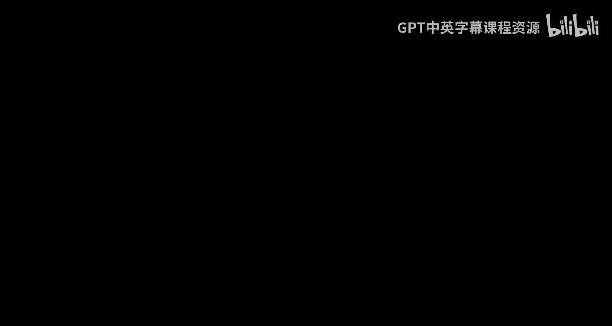
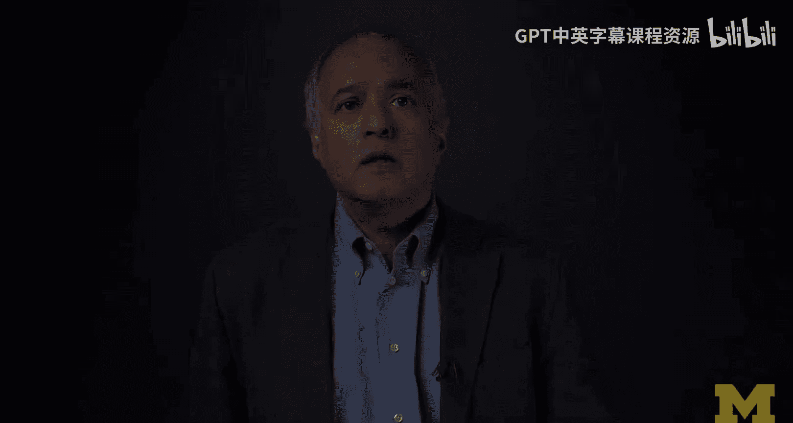

# 数据科学伦理：14：隐私观念的历史演进 🔍

在本节课中，我们将追溯隐私概念在法律与文化层面的历史演进，理解其定义如何随时代与技术发展而变化，并探讨大数据时代隐私所面临的新挑战。

## 隐私的法律定义起源

上一节我们探讨了隐私的基本概念，本节中我们来看看隐私在法律上的早期定义。

已知最早的隐私法律定义出现在1604年。当时英格兰总检察长爱德华·科克引用英国普通法，提出了著名的论断：“每个人的住宅对他而言就是他的城堡和要塞。”

这一理念后来演变为诸如美国宪法第四修正案中“保护人民免受不合理搜查和扣押”的权利。

## 现代隐私权的形成

在隐私权本身的发展上，1888年，密歇根大学教授、宪法学者托马斯·库利撰写了一篇关于侵权的论文，在其中明确划分了一项隐私权，即“独处的权利”。

1890年，厄尔·沃伦和路易斯·布兰代斯两位杰出的法学家在《哈佛法律评论》上发表文章。他们论述了隐私的重要性，并指出：正如人们无需说出自己不想说的话，如果人们不想放弃某些属于他们的私密事物，那么他们应有权划定其公开性的界限。这真正开启了隐私的现代定义。

## 关键判例与原则确立

以下是几个塑造现代隐私观念的关键法律案例：

*   **1928年奥姆斯特德诉美国案**：此案涉及电话窃听的合法性。最高法院当时裁定窃听不属于不合理搜查，无需许可（这与现今需要许可的规定不同）。时任大法官路易斯·布兰代斯在其著名的异议意见中预言：未来可能发展出某种方式，使得政府无需从秘密抽屉中取出文件，即可在法庭上复制它们。他认为，这种获取私人材料的方式，类似于搜查一个人的住宅，只能通过令状进行。当时法律允许无令状窃听，布兰代斯的观点属于少数意见。

*   **1967年卡茨诉美国案**：在奥姆斯特德案判决约40年后，大法官约翰·马歇尔·哈兰在协同多数意见时，定义了隐私的检验标准：**如果个人对隐私存在合理期待，且社会认为这种期待是合理的，那么在此情况下就存在隐私权。** 如果这两个条件不成立，即个人不期待隐私，或社会不认为个人的这种期待是合理的，则不存在隐私权。此案的具体情况是：有人在一个关闭了门的电话亭里打电话，而外面有人用窃听装置偷听。问题在于，关上门的人是否期待其通话不被外界或麦克风未经许可地窃听。

*   **1979年史密斯诉马里兰州案**：卡茨案中确立的隐私观点以及布兰代斯的定义，在此案中被法院采纳。如今我们知道，进行电话窃听需要获得令状。

## 隐私的法律分类与框架

除了判例，学者们也从理论上对隐私进行了系统化梳理。

1960年，法学家威廉·普罗瑟在《加州法律评论》上撰文，定义了四种隐私侵权类型。这篇文章被广泛引用，成为从法律术语上定义隐私的基础。

2006年，乔治华盛顿大学教授丹尼尔·索洛夫在《宾夕法尼亚大学法律评论》上发表文章，提出了一个隐私分类法，阐述了隐私可能被侵蚀的各种方式。他特别定义了四个不同的方面：

*   **信息收集**
*   **信息处理**
*   **信息传播**

以上三点，在我们本课程讨论的数据科学范式背景下，最值得我们关注。他还提到了因侵入（如窃听公寓）或通过侵犯私人行为的法律而导致的隐私问题，但这些我们认为相关性较低。

## 自愿披露与隐私界限

一个需要思考的法律问题是：如果你自愿向他人披露某事，那么它获得的保护，远比你完全保密的事情要少。

例如，当你拨打一个电话号码时，电话公司必须知道你拨了什么号码。因此，你被视为自愿向电话公司披露了你正在拨打的电话号码。由于你披露了这些信息（即元数据），它获得的保护就远低于通话内容——你并未向电话公司披露通话内容，也无意披露。

这种元数据收集很快会变得问题重重，其中存在何为“自愿”、何为“非自愿”的疑问。这些正是我们将在课程中进一步探讨的问题。

## 文化视角下的隐私变迁

让我们暂时离开法律争论，从文化角度看看隐私的感受如何变化。

在小城镇中，隐私很少，因为镇上的每个人总是爱打听别人的事。众所周知，你了解每个人的动向。大城市则提供了匿名性。没人在意，没人认识你。你可以做你想做的事，而不会有一百个人来问你。

因此，有些人认为信息技术可能让我们回到类似小城镇的日子，在那里人们感到被关心，而隐私作为其中的一部分则减少了。确实，人们正在改变态度以适应新的隐私现实。

我的孩子们自由地在网上发布他们的活动信息，这是我做梦都不会做的事。对我来说，昨晚看的电影是私事，我会和朋友谈论，但不会想发到网上。对我的孩子们来说，这样做完全合理，显然没问题。换句话说，他们的隐私界限与我的不同。

但界限不同并不意味着没有界限。即使在互联网一代，即使是那些接触网络的人，也会限制他们想分享、愿意分享和乐于分享的内容。我认为这是有充分理由的。

## 大数据时代的根本挑战

回顾过去，如果你在一个小镇搞砸了，你可以通过搬到一个新地方重新开始。搬家的成本很高：你会没有朋友，必须从头开始，没有社区。但至少还有这个选项。也有留下来等待过去被淡忘的选项。随着时间的推移，你可以重建声誉。

大数据的问题在于它是普遍的，而且永远不会忘记任何事。所以你不能搬出城去下一个城镇，也无法等待它被淡忘。

另一个重大区别是，在小城镇，信息大多是对称的。我对你的了解和你对我的了解一样多。因此，我们彼此了解的事实使我们保持公平和诚实，更不容易实践“己所不欲，勿施于人”的格言。数据科学可能导致严重的不对称。当我们存在这些不对称时，你将更难与处境和你大不相同的人产生共鸣。

## “被遗忘权”的兴起与局限

说到不忘记任何事，实际上有一个叫做“互联网档案馆”的工具，它存档网页。这个档案库包含了网络上几乎所有可访问的、未受密码保护的内容。其意图是永久保留这些内容，因为这些公共网页在很大程度上是我们社会和文化的表达，是我们遗产的一部分，是未来历史学家、社会学家等人会深切关注的事物。

然而，一个副作用是，如果有一个关于你的不光彩页面，它将永远存在于档案中，即使该页面本身后来已被删除。顺便说一句，你真的不想不公平地责怪互联网档案馆。这只是一个具有重要文化目的的有组织档案库。问题在于，一旦一个页面上线，就会产生许多副本。即使页面被删除，你也不知道已经制作了多少副本以及这些副本存储在哪里。因此，一旦某物在网络上发布，你真的没有办法删除它。这就像你无法收回一个已经开始传播的秘密。

为了尝试解决这个问题，一些国家现在确立了“被遗忘权”。其理念是，考虑到社会对改过自新的期望，通常会有法律规定，一个人的记录在若干年后被清除。例如，在美国大多数州，如果你的驾驶记录上有事故，三年后就会被清除。因此，你多年前做错的事不会永远困扰你。同样的想法也适用于更严重的伤害。所以，如果你曾因某些罪行被定罪，即使你曾在监狱服刑，在许多情况下，也有关于该记录保留多长时间以及多久后从你的官方记录中清除的规定。

虽然这对于官方记录来说都很好，但如果这些信息碰巧在网络上，该如何被移除呢？鉴于我们刚刚在前一张幻灯片上看到的内容，你真的无法从网络上移除它。它就在那里，并且永远在那里。因此，“被遗忘权”的实际实施方式是：并非真正完全被遗忘，但基本上被遗忘了，因为它变得难以找到。所以，人们所做的是与搜索引擎等中间商合作（大多数人使用搜索引擎来查找事物），并确保这些搜索引擎产生的结果不包含已被清除、本应被遗忘的内容。通过这样做，即使有人碰巧复制了一个说你不光彩事情的网页，如果那不再应该被显示，那么当我用谷歌搜索你时，就不会找到它。

---

本节课中我们一起学习了隐私概念从17世纪“住宅即城堡”的朴素观念，到现代法律中“合理隐私期待”原则的演进历程。我们看到了关键法律判例如何塑造隐私权，学者们如何对其进行分类，并深入探讨了大数据时代带来的根本性挑战——信息的永久性与不对称性。最后，我们了解了“被遗忘权”作为应对网络记忆的尝试，其本质是在无法彻底删除信息的情况下，通过技术手段降低其可发现性。这些历史与当代的视角，为我们理解数据科学中的隐私伦理问题奠定了重要基础。