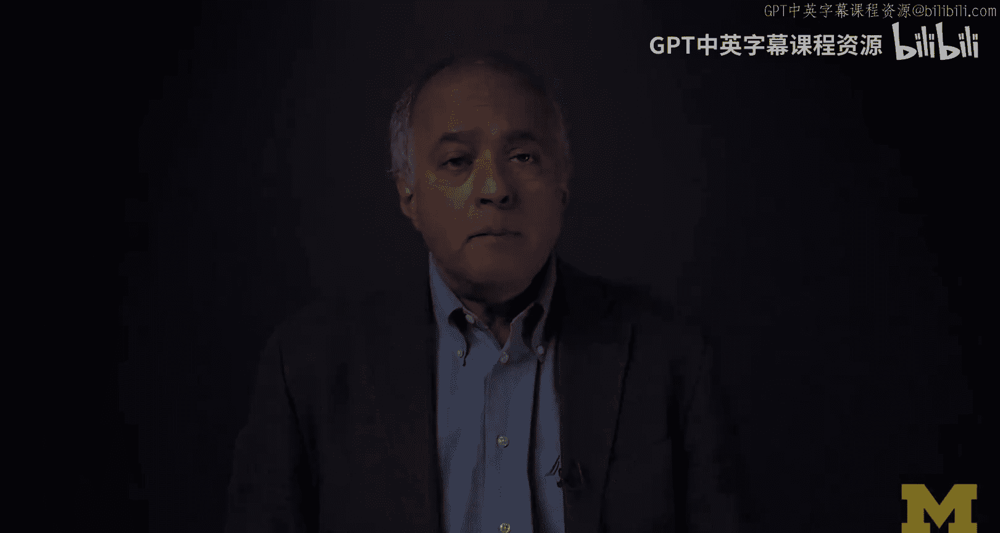

# 密歇根大学《数据科学伦理｜Data Science Ethics》中英字幕 p16 15_隐私保护层级.zh_en -BV1EGaVzeEbQ_p16-

Many people think of privacy as a black and white thing。

Something's either secret or it's not。I want to argue that there actually are degrees of privacy。

Privacy isn't complete non disclosure。For example。I have a health condition。

 I discuss it with my doctor。I didn't keep it private。

 I'm actually discussing something that is very private， to me。

But I have to discuss it to be able to get the care I need。

This doesn't let the doctor make these facts public。

There's good societal consensus and even laws regarding this。

To take a less legal thing or a less clear cut thing， I share a deeply personal story with a friend。

Again， this doesn't mean that I make the story public。

There's a certain aspect of trust and bonding in sharing that personal story。

Note that in both these cases， I might actually be O with limited additional disclosure。

It isn't that I actually want them to swear they will never tell anybody at all。 For example。

 the doctor may discuss my case with other caregivers。

And I think that would be completely reasonable。My friend may tell my story to someone one else。

 because。I need help。 And， and that's this friend's judgment。 And they think that' trying to get。

Group together to help is the right thing to do。These are reasonable things to do。

Whereas gossiping about this is not a reasonable thing to do， and that is the notion of privacy。

So let's take these personal things and move that to the world of data today。Every merchant。

Many others， many service providers， government agencies。

 whoever they have considerable data about me。At the very least。

 they have data about my interactions with them。often， they'll have much more。

And they have this because they are providing me with something。And by sharing whatever data I do。

 share with them。They serve me better。 And I'm happy for them to use this data to serve me better。😊。

But I really don't want them to share with others or to use the data in other ways that I don't want them to。

And that is where privacy comes in。So privacy， we should think of not as non disclosure。

 but rather as exercise of control。So one way in which you can control information is to say you will prevent undesired disclosure。

And that's certainly a crucial element of maintaining control。 If you can't even do that。

 then you certainly cannot maintain control。However。That in itself。

 shouldn't be the definition of privacy。In fact。This notion of all or nothing is quite problematic。

 even in the case of user agreements that we all sign when we use software， we use a website。

Because usually these things are written in such a way that we're pretty much giving up control on the shared data。

And。Our choices。Either give up all that control。And then get the service benefits， or。Just。

Don't give up control And you're not gonna get any service。And so users do this。

Complain about loss of privacy。And tot feel like they didn't get a very good deal in the process。

There is， of course， a flip side here。A lot of what we get used to in terms of services。On the web。

Services on our mobile phones。They're free。And the reason that they're free is because their advertising supported。

And so just as we may prefer to watch our TV shows without ads。

But we're willing to watch ads because we understand that that is how TV comes to be free。

We have to expect if we want to be able to get。Free services on the Web and on our phones。

That these free services will be paid for by advertising。That having been said。

 it might be a good thing for vendors to provide graduated choices。

So that users could make the trade offs they like。And choose the points in the spectrum that they're most comfortable with。

This may seem odd because there are so few examples of this， but it happens as an example。

Consider the browsers that you use。 Most browsers to provide something called an incognito browsing or private browsing mode。

Typically。When you are in normal browsing mode， the browser will remember websites that you have visited recently。

And this actually helps the browser。Fill in。Entries into the into the search bar。It helps。

 You have to type less because a browser knows what websites you tend to visit。

It also helps you go back in history and revisit websites that you had liked。

Even after you have navigated away from the page。When you do incogni browsing。

The browser doesn't remember any of this stuff。 It doesn't record these things。

 You don't get some services。That you would get if you used normal browsing。But that's a trade off。

That browser makers have chosen to give to us， and people use it in the way they see fit。

Another thing to note about privacy is that sometimes the choices aren't necessarily made by you。

So if you go to a party and your friend posts photographs that he took at the party。

Whoever sees those photographs and knows you。Reizes that you went to that party。

 And maybe you didn't want to tell people that you went to that party or you didn't want to at least tell some people that you went to that party。

But your friend didn't leave that choice to you。Because that was just the social thing。

There are other places， more serious places where the same thing can happen。

You may decide that you'd like to make your DNA public for science。

You understand that there's a lot of medical research that depends upon analyzing DNA。

 and you know that sharing this kind of information is not easy because often medical researchers don't get permissions that they need。

And so you make this decision。Now， the problem is your blood relatives share much of your DNA。

So if your DNA is public， their DNA is semi public。

It's not quite public because their DNA isn't exactly the same as yours。But。

If I know your DNA I have a pretty good idea， what your mother's DNA was like。The thing is。

 they were not involved in your decision。And they may have wanted to keep their DNA private。

And you made a personal choice about yourself that impacts their choices。

Another aspect to think about。With regard to privacy is the difference between collection and use。

Typically。Harms occur only upon use of data。Collection is a necessary first step， before use。

The existence of the collection can quickly lead to use。

But just because the data has been collected doesn't necessarily hurt you。So， the question is。

Why would anybody ever collect data and not use it？

One example where there's a strong case for this is in surveillance。

Whether it's by the government or by security cameras。By the time you know what you need。

 it is too late to go back and get it。If you're in the store and you want to see and catch the shoplifter。

You want the camera on at the precise moment that。The theft was taking place。

Since you don't know when that's going to happen。You leave the camera on all the time。

You don't look at it。 you plan not to look at it。And when you realize that a theft took place。

 you'll go look at the camera。You'd look at the footage at the approximate time and try to see what was going on。

This is standard practice with security cameras。 And I think that there is a notion of having this sort of thing be a standard practice for。

Data surveillance of many other types。So。To sum up。

The loss of privacy occurs when there is a loss of control over personal data。

I'm okay with you having certain data about me that I've chosen to share with you。

But I don't want you to share my data in ways that I do not approve。

And it is that measure of control。That's important to me in terms of maintaining my privacy。

