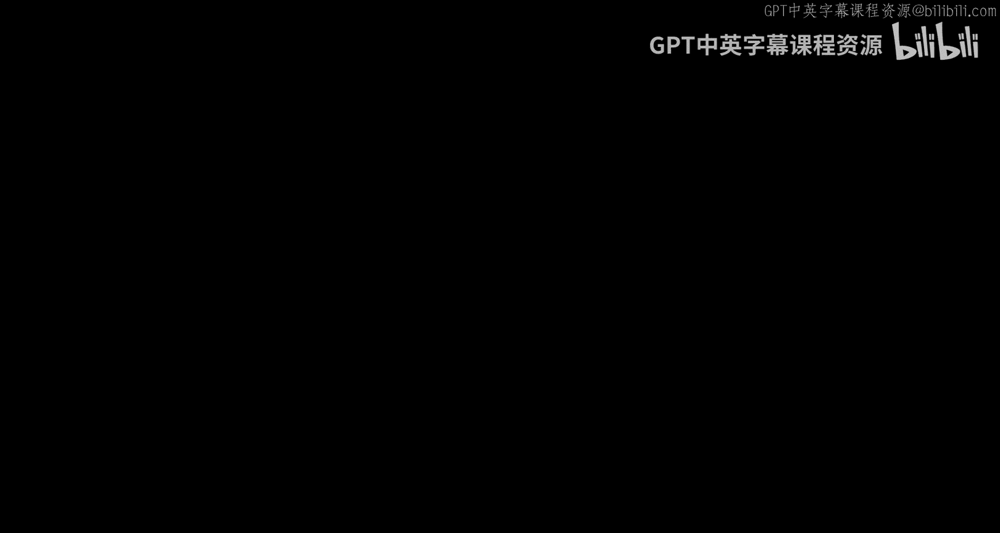
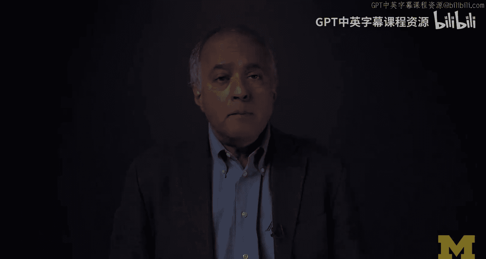

# 数据科学伦理：16：隐私保护层级 🔐

在本节课中，我们将探讨隐私的本质。许多人认为隐私是非黑即白的，但我们将论证隐私实际上存在不同的层级。隐私并非意味着完全不披露信息，而是关于对个人信息的控制。我们将通过日常生活中的例子和数据场景来阐述这一观点，并讨论如何在享受服务的同时维护个人隐私。

---

许多人将隐私视为非黑即白的事物。

他们认为事物要么是秘密的，要么不是。但我想论证的是，隐私实际上存在程度之分。

隐私并非完全的保密。例如，我患有一种疾病。

我与医生讨论它。我并未将其完全保密。

实际上，我正在讨论一件对我而言非常私密的事情。

但我必须讨论它，才能获得所需的治疗。

这并不意味着医生可以将这些事实公之于众。

社会对此有良好的共识，甚至存在相关法律。

举一个不那么法律化或界限不那么清晰的例子，我与朋友分享一个非常私人的故事。

同样，这并不意味着我将这个故事公开。

在分享那个私人故事时，存在信任和情感联结的特定层面。

请注意，在这两种情况下，我实际上可能对有限的额外披露持开放态度。

我并非真的要求他们发誓永远不会告诉任何人。例如，医生可能会与其他医护人员讨论我的病例。

我认为这是完全合理的。我的朋友可能会将我的故事告诉其他人，因为我需要帮助。这是这位朋友的判断，他们认为聚集起来提供帮助是正确的做法。

这些都是合理的做法。

而对此进行八卦则是不合理的，这就是隐私的概念。

---

现在，让我们将这些个人事务转移到当今的数据世界。每个商家、许多其他服务提供商、政府机构等，都拥有关于我的大量数据。

至少，他们拥有我与他们互动的数据。通常，他们拥有的数据远不止于此。

他们拥有这些数据是因为他们正在为我提供服务。通过分享我确实与他们共享的数据，他们能更好地为我服务。我很乐意他们使用这些数据来更好地服务我。

但我真的不希望他们与其他人分享这些数据，或以我不希望的其他方式使用这些数据。

这就是隐私的所在。因此，我们不应将隐私视为不披露，而应视为对控制的行使。

控制信息的一种方式是防止不希望的披露。

这无疑是维持控制的关键要素。如果连这一点都做不到，那么肯定无法维持控制。

然而，这本身不应成为隐私的定义。事实上，这种全有或全无的概念是相当有问题的，即使在我们使用软件、网站时签署的用户协议中也是如此。

因为通常这些协议以这样的方式书写，以至于我们几乎放弃了对共享数据的控制。

我们的选择要么是放弃所有控制，然后获得服务利益；要么是根本不放弃控制，那么你将得不到任何服务。

因此，用户这样做了，抱怨隐私的丧失，并感觉在这个过程中没有得到很好的交易。

当然，这里也有另一面。我们在网络上、手机上习惯使用的许多服务都是免费的。

它们免费的原因是它们由广告支持。因此，就像我们可能更愿意观看没有广告的电视节目，但我们愿意观看广告，因为我们明白这就是电视免费的原因一样。

我们必须预期，如果我们想在网络和手机上获得免费服务，这些免费服务将由广告支付。

话虽如此，供应商提供分级选择可能是一件好事。

这样用户就可以做出他们喜欢的权衡，并选择他们最舒适的频谱点。

这看起来可能很奇怪，因为这样的例子很少，但确实存在。以你使用的浏览器为例。

大多数浏览器提供一种称为无痕浏览或隐私浏览模式的功能。

通常，当您处于正常浏览模式时，浏览器会记住您最近访问过的网站。

这实际上有助于浏览器在搜索栏中填充条目。它有助于减少您的输入，因为浏览器知道您倾向于访问哪些网站。

它还可以帮助您回溯历史记录，重新访问您喜欢的网站，即使您已经离开了该页面。

当您进行无痕浏览时，浏览器不会记住任何这些东西。它不记录这些内容。您将无法获得使用正常浏览时会得到的一些服务。

但这是一个权衡。浏览器制造商选择提供给我们这个选项，人们以他们认为合适的方式使用它。

---

关于隐私，另一点需要注意的是，有时选择不一定由你做出。

例如，如果你去参加一个聚会，你的朋友发布了他/她在聚会上拍摄的照片。

任何看到这些照片并认识你的人都会意识到你参加了那个聚会。

也许你不想告诉别人你去了那个聚会，或者至少不想告诉某些人你去了那个聚会。

但你的朋友没有给你留下这个选择。因为那只是社交行为。

在其他地方，更严肃的场合，同样的事情也可能发生。

你可能决定为了科学而公开你的DNA。

你明白许多医学研究依赖于分析DNA，并且你知道分享这类信息并不容易，因为医学研究人员常常得不到所需的许可。

因此你做出了这个决定。现在的问题是，你的血亲与你共享大部分DNA。

所以如果你的DNA是公开的，他们的DNA就是半公开的。

这并不完全是公开的，因为他们的DNA与你的并不完全相同。但是，如果我知道你的DNA，我就能很好地了解你母亲的DNA是什么样的。

问题是，他们并未参与你的决定。他们可能希望保持自己的DNA私密。

而你做出的关于自己的个人选择，影响了他们的选择。

---

关于隐私，另一个需要考虑的方面是收集与使用之间的区别。

通常，损害只发生在数据使用时。收集是使用前必要的第一步。

收集的存在可以迅速导致使用。

但仅仅因为数据被收集了，并不一定会伤害你。那么问题是，为什么会有人收集数据而不使用它？

一个强有力的例子是监控，无论是政府监控还是安全摄像头监控。

当你意识到需要什么时，再回去获取已经太晚了。如果你在商店里，想看到并抓住小偷，你需要在盗窃发生的精确时刻打开摄像头。

由于你不知道那会在什么时候发生，你让摄像头一直开着。

你不看它，你计划不看它。当你意识到发生了盗窃时，你会去看摄像头。你会查看大致时间的录像，试图了解发生了什么。

这是安全摄像头的标准做法。我认为，对于许多其他类型的数据监控，将这种做法作为标准实践是有意义的。

---

总而言之，当对个人数据失去控制时，就发生了隐私的丧失。

我可以接受你拥有我选择与你分享的某些关于我的数据。

但我不希望你以我不认可的方式分享我的数据。

正是这种控制的程度，对于我维护隐私而言至关重要。

在本节课中，我们一起学习了隐私并非绝对保密，而是对个人信息的控制权。我们探讨了隐私的层级性，以及如何在数据共享与隐私保护之间取得平衡。理解隐私是关于控制，有助于我们在数字时代更明智地管理个人信息。