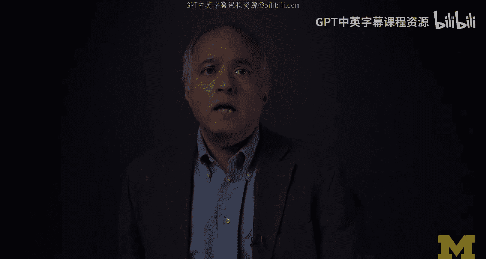

# 密歇根大学《数据科学伦理｜Data Science Ethics》中英字幕 p17 16_现代隐私风险.zh_en -BV1EGaVzeEbQ_p17-

Having understood what privacy is。

Let's talk a little bit about how data science today impacts privacy。

There are three main drivers of privacy violation。There's surveillance。

And surveillance could be government agencies doing this for national security or private enterprises。

Say security cameras。Logs of various sorts。There are also other private things。

 like private investigators， and so on。There's advertising。If a company can show you a focused。

 personalized， relevant ad， everyone wins。But if the company shows you ads that。Annoy you。

 Then it's a lot。And then。The third category， which I'm going to call introduction， really， this is。

Finding out something about a person。Whether this person be a prospective employee。

 a prospective borrower。A prospective date。You don't know somebody。

 You want to figure out what kind of person they are。

You want to find out what electronic trail they have。And again， this might be done by companies。

This is also done by individuals。 Now， people Google their blind dates。

So what are the main sources of information that we deal with。

Its data collected by merchants and service providers。There activity tracking。

 both on and off the web。There are sensors all around us， in personal devices。In infrastructure。

And there might even be other people's devices like a friend's camera or something like this。Now。

 these sources of information。Can collect vast amounts of data。And。These collected。

Data are the things that get used。To do the privacy harms or potential harms that we were talking about on the previous slide。

To understand some of the trade offs that we need to discuss， let's talk about open government。

So there are many benefits to the government being open。And indeed。

 many government entities publish detailed records。 And this is good。

This helps citizens keep track of what the government is doing。

 It prevents abuse by government officers。I'd make sure that they're doing the right job and serving us。

And in the US， there's something called the Freedom of Information Act or FOIia。

Which provides citizens access to many unpublished records。There are few exceptions that foya allows。

 one of which is where there would be unreasonable harm to an individual's privacy。

But these exceptions are fairly narrow and limited。

Think about the fact that most government records concern citizens。

1 would expect that most government records when released。Impact the privacy of some citizens。And so。

You really don't want to have a very broad definition of what privacy means and what harm to a citizen's expectation of privacy means if you're actually going to get the benefits of foer。

And so you have the balanced privacy concerns against the desirability of openness。

 And I think that this is the sort of trade off。That we will have to make repeatedly as we deal with the issues of data in today's world。

To think about one particular type of。Government data。

 driver's license and voter registration databases are maintained by government agencies。

 and they are often semi public。These documents may have associated with them important facts。

 things like age， sex and address for the individuals involved。

 There may be additional identifying information。And if these databases are available。

For the public to view。Then these databases can be used， for example， by commercial interests。

And indeed， they often are。The value of data commercially is very high。

And there's actually a business。For companies who are called data brokers。

Data brokers aggregate and link information from multiple sources to create more complete information products。

So they may pick up little piece of information about you。Pece it all together。

And now they have a valuable profile of you that they can sell to people who wish to， for instance。

 sell to you or who may consider hiring you or giving you a loan or whatever。

And a problem that we have here is that many people don't realize what can be learned about them by linking multiple sources。

 We tend to focus as individuals on the information release that we have with respect to one single individual party as part of a single transaction。

And not of that in context with what we have also released at the same time to other parties with regard to other aspects of our lives。

Another issue with regard to privacy is what I call waste data collection。So for example。

 if you go to a bar。They want to see proof of H。 You show them your driver's license。

And this is all standard。Now， let's say that this bar。Is going to scan the driver's  license。

 not have a bouncer squint at it。 They scan the driver's license as just a part of their confirming proof of age。

 This is not something you're no object to。 And this is not something that there would be any discussion。

Between you and the bar about。if they scan it。They've got a computer on which。

They've got this information。 And， hey， they choose to record it。

And so now they have a record of your name and address and date of birth。

Information that's on your driver's license。That they can use， for instance， for marketing purposes。

The next day。Another concept that we often come across is metadata。Metadata is data about the data。

And。Metaadata often has lower privacy protection than data and is often distinguished from the data content。

So for example， in the phone call。Metaadata can include information about the collar， the colgue。

 the time and data call， the duration of the call， etc ce。

But it would exclude the actual content of the call itself， the conversation that took place。

But metadata may carry much information。For a cell phone call。

 location information might be metadata。Knowing location doesn't reveal the content of the call。

And the user has to reveal their location to the cell phone company to get service。However。

 location tracking can reveal a great deal of information about the person。

If the cell phone company knows where you are every Sunday morning。

They know that you're at a particular house of worship。

 They know which religious denomination you belong to。

 and they also know that you are a very religious person。And。

That may become the basis of some discrimination down the road。

The other thing that people often do is to underestimate the power of analysis。For example。

 a smart water metertor house is recording water usage。On a continuous basis。

And it can recognize the signatures of water use。 And so it knows or can easily determine every time you flush the toilet or take a shower or wash clothes。

And if this smart water meter is communicating with your utility company。

 your utility company knows every time youll actually flush the toilet in your house。

That is something that you might consider an invasion of privacy。But it's all a part of。

Water conservation and having a better， smarter water usage system in the community。

Taking this to a further extreme。There were actually been attacks on encrypted data。

Based on observing the power consumed by chips performing encryption。The idea here is。That。

You're encrypting data into。0eros in one。 And the amount of power that flows through is just a little bit different。

And knowing what those momentary differences are。Can greatly reduce the number of combinations of。

Keys that one has to try when one is making an attack on the encrypted data。

So where does all this leave us？If you look at the traditional social norms。

 they dealt with privacy by trust。You tell me private things， because you trust me。

And what does it mean when you say you trust me， you trust me not to use what you told me in ways that you wouldn't approve。

And this is somewhat nebulous， and this is why sometimes we have misunderstandings in terms of our personal dealings。

But for the most part， we know who we trust， and we know we trust them with good reason。

 and we know that they are going to do the right things with the things that we share with them。

In the modern world， we are sharing data。With systems that we really don't have a basis to trust。

And certainly， doing this in terms of legal agreements is。

What it boils down to when you don't have trust。But this now means that you have to have privacy bit design。

We have too many players。 playersers don't trust one another。You must have data sharing。

 And so this data sharing is now contractual。And we have to make sure that these contracts are developed in ways that appropriately respect and manage privacy。

So to conclude。So privacy is a basic human need。Even for people who have nothing to hide。

And it is easily eroded by thoughtless actions。Of course， it's eroded by intention in some cases。

Weve now begun to have conversations around privacy。

And we have many stakeholders with different interests。

 We don't yet have consensus soally on where the lines should be drawn。Hopefully。

 we'll get there soon。

