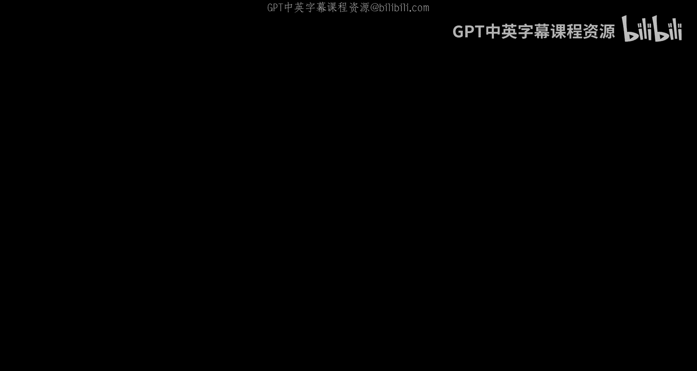
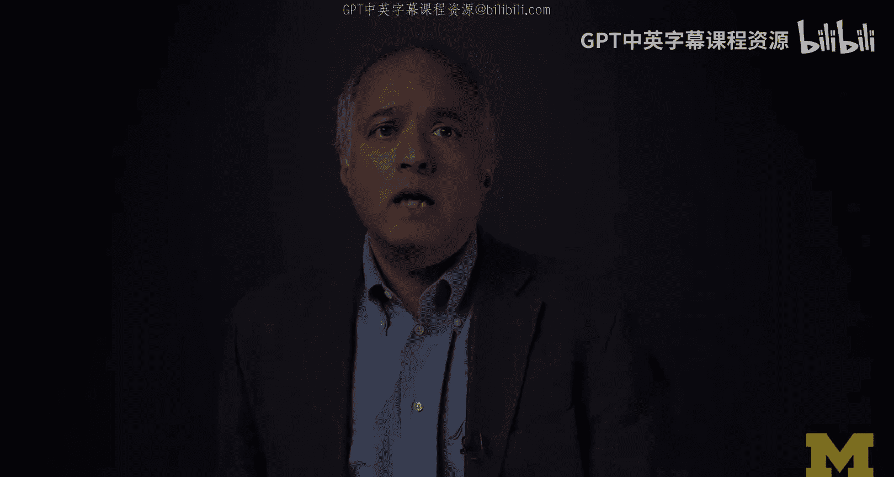

# 数据科学伦理：17：现代隐私风险 🔍

在本节课中，我们将探讨数据科学如何影响个人隐私，并分析现代社会中隐私面临的主要风险。我们将了解隐私侵犯的驱动因素、信息来源以及相关的权衡考量。

理解了隐私的定义后，现在我们来谈谈当今的数据科学如何影响隐私。

隐私侵犯主要有三个驱动因素。首先是**监控**。监控可能由政府机构出于国家安全目的进行，也可能由私营企业实施，例如安全摄像头、各类日志记录。此外，还包括私人调查等其他形式。其次是**广告**。如果公司能向用户展示聚焦、个性化且相关的广告，这似乎是双赢的。但如果公司展示的广告**骚扰**到用户，那就成了问题。第三类我称之为**探查**，这实质上是为了了解一个人。无论是潜在的雇员、借款人还是约会对象，当你对某人一无所知时，你可能会想了解他们是怎样的人，并查找他们留下的电子痕迹。同样，这可能是由公司进行的，也可能是个人行为，例如人们在约会前搜索对方的信息。

那么，我们处理的主要信息来源有哪些？以下是主要的信息来源：

*   **商家和服务提供商收集的数据**：这包括我们的交易记录、服务使用情况等。
*   **线上和线下的活动追踪**：例如网页浏览记录、应用使用习惯，甚至线下行为模式。
*   **遍布各处的传感器**：这些传感器存在于个人设备、公共基础设施中，甚至可能来自他人的设备，比如朋友的摄像头。

这些信息来源能够收集海量数据。而这些被收集的数据，正是我们上一张幻灯片所讨论的、可能造成隐私伤害或潜在伤害的根源。

为了理解我们需要讨论的一些权衡，让我们谈谈**政府信息公开**。政府公开透明有许多好处。事实上，许多政府机构会发布详细记录，这是有益的。这有助于公民监督政府行为，防止政府官员滥用职权，确保他们履行职责、服务公众。在美国，有一项名为《信息自由法》的法律，为公民提供了获取许多未公开记录的途径。该法案允许少数例外情况，其中之一是当公开信息会对个人隐私造成不合理伤害时。但这些例外情况相当狭窄和有限。

考虑到大多数政府记录都涉及公民，可以预见，大多数政府记录一旦公开，都会影响部分公民的隐私。因此，如果你真想从《信息自由法》中获益，你就不希望对隐私的含义或对公民隐私期望的伤害做出过于宽泛的定义。所以，你需要在隐私关切与公开透明的可取性之间取得平衡。我认为，这就是我们在处理当今世界数据问题时必须反复做出的权衡。

思考一类特定的政府数据：**驾照和选民登记数据库**。这些数据库由政府机构维护，通常是半公开的。这些文件可能包含个人的重要信息，如年龄、性别和住址，还可能包含额外的身份识别信息。如果这些数据库可供公众查阅，那么商业机构就可以利用它们，事实上他们也经常这样做。数据的商业价值非常高，甚至催生了一个行业——**数据经纪商**。

数据经纪商从多个来源汇总并链接信息，以创建更完整的信息产品。他们可能收集关于你的零散信息，将其拼凑起来，从而形成一份有价值的个人档案，然后出售给那些希望向你推销、考虑雇佣你或给你贷款的人。这里存在的一个问题是，许多人没有意识到，通过链接多个来源的信息，可以了解到关于他们的多少内容。作为个人，我们往往只关注在单次交易中向单一对象披露的信息，而忽略了这些信息与我们同时向其他方披露的、关于生活其他方面的信息之间的联系。

另一个与隐私相关的问题是**冗余数据收集**。例如，当你去酒吧时，他们需要查看你的年龄证明，你出示驾照，这都很正常。现在，假设这家酒吧不是让保安眯着眼看，而是**扫描**你的驾照，作为确认年龄的一部分。你可能不会反对，也不会就此与酒吧进行任何讨论。如果他们扫描了，他们电脑上就有了这些信息。如果他们选择记录下来，那么现在他们就拥有了你驾照上的姓名、地址和出生日期等信息，这些信息可以用于营销目的。

我们经常遇到的另一个概念是**元数据**。元数据是关于数据的数据。元数据通常比数据本身享有更低的隐私保护，并且经常与数据内容区分开来。例如，对于一通电话，元数据可能包括主叫方、被叫方、通话时间和日期、通话时长等信息，但不包括通话的实际内容，即对话本身。然而，元数据可能携带大量信息。对于手机通话，位置信息可能就是元数据。知道位置并不揭示通话内容，而且用户必须向手机公司透露位置才能获得服务。然而，位置追踪可以揭示关于一个人的大量信息。如果手机公司知道你每个周日上午在哪里，他们就知道你在某个特定的礼拜场所，知道你属于哪个宗教派别，并且知道你是一个非常虔诚的人。这可能成为未来某些歧视的基础。

人们还常常**低估分析的力量**。例如，一个家庭的智能水表持续记录用水情况。它能识别用水模式的特征，因此可以知道或轻易判断出你每次冲马桶、洗澡或洗衣服的时间。如果这个智能水表与你的公用事业公司通信，那么该公司就知道你家里每次冲马桶的时间。这可能是你认为侵犯隐私的事情。但这同时也是水资源保护和社区建立更智能用水系统的一部分。将这一点推向更极端的情况，实际上存在针对加密数据的攻击，其基础是观察执行加密的芯片所消耗的功率。这里的思路是，当你将数据加密成0和1时，流经的功率会有细微的差别。了解这些瞬间的差异，可以大大减少攻击加密数据时需要尝试的密钥组合数量。

那么，这一切将我们引向何处？回顾传统的社会规范，它们通过**信任**来处理隐私问题。你告诉我私密的事情，是因为你信任我。你说信任我，意味着你相信我不会以你不认可的方式使用你告诉我的信息。这有些模糊，这就是为什么有时我们在个人交往中会产生误解。但在大多数情况下，我们知道信任谁，我们有充分的理由信任他们，并且我们知道他们会以正确的方式处理我们分享的信息。

在现代世界，我们正在与**我们实际上没有信任基础的系统**分享数据。当然，在没有信任的情况下，这最终归结为法律协议。但这现在意味着你必须进行**隐私设计**。我们有太多的参与者，参与者之间互不信任。数据共享又势在必行，因此现在的数据共享是基于合同的。我们必须确保这些合同的制定方式能够恰当地尊重和管理隐私。

总结来说，**隐私是人类的基本需求**，即使对于没有秘密可藏的人也是如此。它很容易被不经意的行为侵蚀，当然在某些情况下也会被蓄意行为侵蚀。我们现在已经开始围绕隐私展开对话，并且有许多利益不同的相关方。对于界限应该划在哪里，我们尚未达成社会共识。希望我们很快能达成共识。