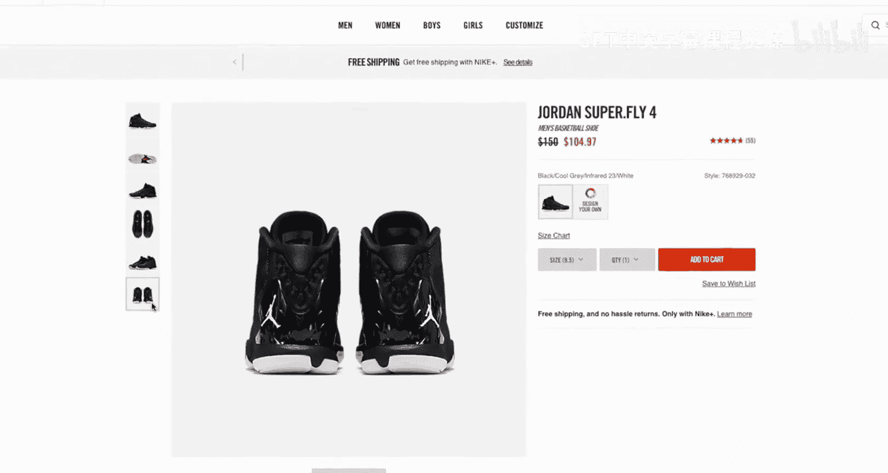

# 密歇根大学《数据科学伦理｜Data Science Ethics》中英字幕 p18 17_案例分析：定向广告追踪.zh_en -BV1EGaVzeEbQ_p18-

，Often， when you look for something on the web， you will find ads for that thing。

 say a pair of shoes。For days after you look for it。This can be annoying。The question is。

 what's our view of？This sort of behavior。In terms of a social consensus， what's ethical。

 what's not ethical？Let's take a step back and see why this is happening。

The likelihood that you'll be interested in buying a pair of shoes today。It is not that great。

 I'm just going to make up a number， let's say that there's one in a thousand chance that you might be。

Persuaded to buy a pair of shoes if you're just a random person。On the other hand。

 if you looked at a pair of shoes， even if you decided not to buy it today。

 even if you decided that was not interesting， you've indicated that at least you're open to the possibility of buying a pair of shoes。

 and this considerably increases the odds that you could be persuaded to buy a pair。

Let's say it's now a one in 10 chance Well that's a huge improvement in odds as far as a potential seller is concerned obviously advertisers now want to take that into account and try to show you different options and choose and see if there's something that catches your fancy。

The problem is， if this is overdone， this gets annoying。In the real world。

 we have centuries of experience to calibrate this kind of interpersonal behavior。

If you express interest in a store， you should expect a salesperson to suggest some options。

 suggest some alternatives that are similar and so on。

 but once you've clearly indicated that you're not interested。

You're not going to have the salesperson repeatedly pestering you over and over with the same or alternative shoes。

It's this knowing when to stop that we understand how to do in real personal interaction and that we don't yet have good enough signals for on the web。

The consequence of which is that people feel kind of irritated and pestered。At this point。

 my sense is that。There is some irritation。This is something that we probably will over the years develop better technology for。

 companies are motivated。Not to annoy potential customers。

And so they'll figure things out and we will end up with some sense of consensus around good business practices where some amount of targeted advertising is considered good and acceptable and beyond some line。

 we will say it's too much and it shouldn't happen。Up to this point we don't have that line defined。

 and so we're all targets for advertising related to things that we've looked for。

