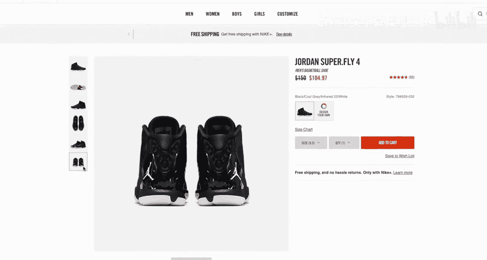

# 数据科学伦理：18：案例分析：定向广告追踪 🎯

在本节课中，我们将要学习一个常见的网络现象——定向广告追踪。我们将探讨其背后的工作原理、引发的伦理问题，以及社会如何可能在未来形成共识来规范此类行为。

## 广告追踪现象

当你在网络上搜索某物时，例如一双鞋，随后几天你可能会持续看到关于这双鞋的广告。这种现象可能令人感到厌烦。核心问题是，我们应如何看待这种行为？从社会共识的角度，哪些是合乎伦理的，哪些不是？

## 追踪背后的逻辑

上一节我们描述了现象，本节中我们来看看其背后的商业逻辑。为了理解为何会发生这种情况，我们需要退一步分析。

一个普通人在今天有兴趣购买一双鞋的可能性并不高。我们假设一个随机数字，比如，一个随机的人被说服购买一双鞋的几率可能是 **千分之一**。

然而，如果你浏览了一双鞋，即使你今天决定不买，或者觉得它不感兴趣，你也已经表明了自己至少对购买鞋子持开放态度。这极大地提高了你被说服购买一双鞋的几率。

## 概率变化与广告策略

现在，这个几率可能变成了 **十分之一**。对于潜在的卖家而言，这显然是概率上的巨大提升。因此，广告商希望利用这一点，尝试向你展示不同的选项，看看是否有能吸引你的东西。

问题在于，如果这种做法过度，就会变得烦人。在现实世界中，我们有几个世纪的经验来校准这种人际互动行为。

## 线上与线下的行为对比

以下是线上广告与线下销售行为的类比：

*   如果你在商店里表现出兴趣，你应该期待销售人员提供一些建议和类似的替代选项。
*   但一旦你明确表示不感兴趣，你就不会希望销售人员反复用相同或不同的鞋子来纠缠你。

这种“知道何时停止”的尺度，我们在现实的人际互动中懂得如何把握，但在网络世界中，我们尚未建立起足够好的信号机制来达成这一点。

## 当前困境与未来展望

其后果是人们会感到某种程度的恼怒和被骚扰。在这一点上，我的感觉是，确实存在一些不满情绪。

这可能是一个随着时间推移，我们将开发出更好技术的领域。公司有动机不去惹恼潜在客户。因此，他们会找到解决办法，最终我们将围绕良好的商业实践形成某种共识。

在这种共识下，一定程度的定向广告被认为是良好且可接受的，而超过某个界限，我们就会认为它太过分而不应该发生。到目前为止，我们还没有明确界定那条线，因此，我们都成为了与我们搜索过的东西相关的广告的目标。

## 课程总结

本节课中我们一起学习了定向广告追踪的案例。我们分析了其基于用户行为概率变化的商业动因，对比了线上广告与线下销售行为的差异，并探讨了因缺乏明确的“停止”信号而引发的伦理与用户体验问题。最后，我们展望了未来可能通过技术发展和商业实践共识来划定合理界限的方向。