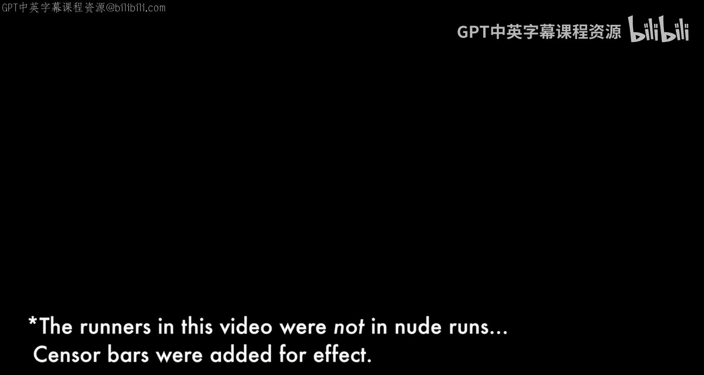

# 密歇根大学《数据科学伦理｜Data Science Ethics》中英字幕 p19 18_案例分析：校园裸跑事件.zh_en -BV1EGaVzeEbQ_p19-

。The naked Mile was a long running tradition at the University of Michigan。

 on the last day of winter term students would run through campus in the New。

Now in society we have certain shared values with regard to what's considered decent clothing The naked Mi was an event at which these standard social conventions were flouted。

But they were flouted。One time。In a certain good spirited way。

 and this was a student event that was popular and long running。It was not。

An official university sponsored thing， but it was something that was。A tolerated tradition。

During this sort of event， there were photographs taken。

 but these would be things that would sit in private albums。Where people could say， hey。

 that was the kind of thing I was doing when I was a kid in school as opposed to。

What started to happen with the web， which is to have photographs taken and then posted on the web where they're there for all to see。

And are there forever。Furthermore。This event was very much an event that was run in a spirit of youth adventure。

There was nothing。Sexual about it。The photographs that were being posted on the web。

We're often in the context of sexually explicit websites。So that。

Even the very same image now creates a different perception。

The net consequence of all this was that students whove had a certain privacy around their useful actions。

No longer had this。And participating in this sort of event could have lifelong consequences。

Potent damage to careers and so forth。Naturally。University administrators started to warn students about the dangers of this new lack of privacy and within a couple of years。

 what had been a long running tradition came to a halt。Today， the naked mile is no more。

A victim of modern day information technology。

