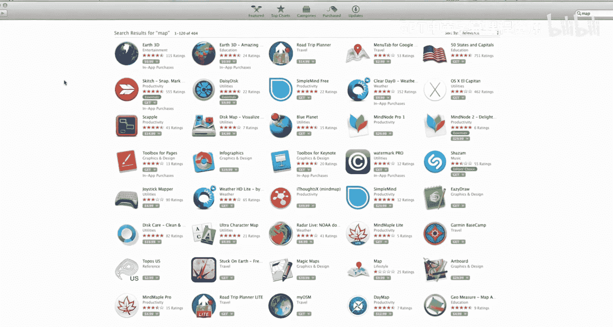

# 密歇根大学《数据科学伦理｜Data Science Ethics》中英字幕 p20 19_案例分析：隐蔽手机应用.zh_en -BV1EGaVzeEbQ_p20-

🎼。Appbss that you run on your mobile phone need data about you to operate。

And most apps collect data out here。It used to be the case that many apps wouldn't even tell you that they were collecting data about you。

In 2012， there was an uproar about this。And today it's standard practice for any app。

 at least at the time of installation。To warn you about the kinds of data that it will collect。

This is done usually by the operating system。Such as Android or iOS when the app is installed。

Furthermore， since privacy agreements are often pages and pages of fine print that is unlikely anybody would actually want to read on a small screen by industry agreement。

 these things have been reduced to a few main categories of information。And so an app。

We'll explicitly warn you that it is interested， for instance， in your contacts or your location。

What are your photos？Things like this， big buckets of information that are meaningful to the user。

Usually an app will function only if you agree that it can access all the things that it says it wants to access Sometimes apps are designed so that they can still function。

Albeit at reduced functionality。If you don't give it everything that it wants。As a good example。

 consider a map。Most map applications would like to know your location and if they know your location。

 they can tell you exactly that it's time to turn left。

Or plot a route from where you are to where you want to go。But you could。

 without giving it any location information， still use a map app simply to find a good route between two points or simply to get a map of a neighborhood。

And they are certainly able to do that without knowing exactly where you are。

This kind of thinking while it's there in these map applications or many map applications is not as prevalent in the whole range of applications。

 In fact， in my experience there are many apps that ask for far more permissions than。

They have a reasonable need for。One reason why some apps do this is because they may have intentions of future enhancements。

But a far more common reason to do this。Is not because the app itself needs the data。

 but because aware。That is not related directly to the app functionality would like to have this data。

So for example， you may have an app， say， an image management app that doesn't need your location data for any conceivable reason。

However， it would like to deliver ads to you and those ads they would like to have the location specific。

And having your location data helps them do this better。

How this actually plays out is a little tricky。On the one hand。

 we have apps that are available often for free。They are supported by advertising。

And so it's disingenuous for us to say， hey， I'd like to get the free app。

 but I don't want the advertising that comes with it。

In that sense。Having the advertisers get access to something is potentially a reasonable thing to do。

However。This can be carried to an excess。And today。

 I think that many of us feel as if we don't have enough control over our information。And that。

Apps that we run on our phones。Take our information and spread it around。

 So where we are is at a point where。We have an issue， we have concerns that are reasonable on。

Both sides and exactly where to draw the line is something around which I think we're at the beginnings of having a social conversation around。

Some companies have and the Better Business Bureau have got together and tried to develop an initial standard on how to collect information in a responsible way。

That's certainly not the last word in this conversation。

 but I think that it's a good step forward and it'd be interesting to see where this goes。

