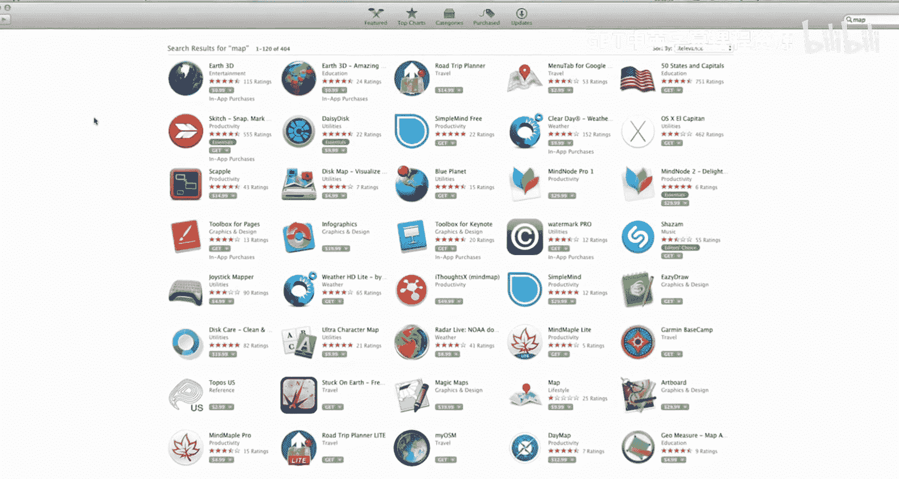

# 数据科学伦理：20：案例分析：隐蔽手机应用

在本节课中，我们将通过一个关于手机应用程序数据收集的案例，探讨数据收集的透明度、用户同意以及商业需求与个人隐私之间的平衡问题。

---

手机应用程序需要获取关于你的数据才能运行。大多数应用程序都会收集数据。过去，许多应用甚至不会告知你它们正在收集你的数据。2012年，关于此事的争议曾引发轩然大波。

如今，任何应用程序在安装时，至少会警告你将收集哪些类型的数据，这已成为标准做法。这一过程通常由操作系统（如Android或iOS）在应用安装时完成。

此外，由于隐私协议通常是冗长且难以阅读的细则，在行业共识下，这些信息已被简化为几个主要类别。因此，一个应用会明确警告你，它可能对你的联系人、位置或照片等信息感兴趣。这些对用户有意义的大类信息，通常需要你同意应用访问其声明的所有内容，应用才能完全运行。

上一节我们提到了应用需要获取权限，本节中我们来看看应用功能与权限需求的关系。有时，应用被设计成即使你不授予其所需的所有权限，也能以降低的功能性继续运行。

一个很好的例子是地图应用。大多数地图应用都希望知道你的位置。如果它们知道你的位置，就能精确地告诉你何时该左转，或规划从你所在位置到目的地的路线。但是，即使不提供任何位置信息，你仍然可以使用地图应用来查找两点之间的最佳路线，或仅仅是获取某个区域的静态地图。它们完全可以在不知道你确切位置的情况下做到这一点。

然而，这种“按需索取”的思维模式，虽然存在于许多地图应用中，但并未在所有类型的应用中普及。实际上，根据我的经验，许多应用要求的权限远超其合理需求。

以下是应用过度索取权限的两个主要原因：
1.  应用可能为未来的功能增强做准备。
2.  更常见的原因是，应用本身并不需要这些数据，但与应用功能无直接关系的第三方（如广告商）希望获取这些数据。

例如，一个图片管理应用可能没有任何理由需要你的位置数据。然而，它可能希望向你投放广告，而广告商希望广告具有地理位置针对性。获取你的位置数据有助于它们更好地做到这一点。

这种情况的实际运作有些微妙。一方面，我们有许多免费应用，它们依靠广告支持。因此，如果我们说“我想要免费应用，但又不想要随之而来的广告”，这显得有些虚伪。从这个意义上说，让广告商获取某些信息可能是一件合理的事情。

然而，这种做法可能走向极端。如今，我认为我们许多人都感到对自己信息的控制力不足。我们手机上的应用获取我们的信息并将其传播出去。

因此，我们目前处于一个两难的境地：双方都有合理的关切。究竟在哪里划定界限，我认为我们才刚刚开始一场社会性的讨论。

一些公司和商业改进局已联合起来，试图制定一个关于如何负责任地收集信息的初步标准。这当然不是这场讨论的最终结论，但我认为这是向前迈出的良好一步，并且观察其后续发展会很有趣。

---

本节课中，我们一起学习了手机应用数据收集的演变、用户同意机制、功能与权限的关联，以及商业广告模式如何影响数据索取行为。我们认识到，在享受免费服务便利与保护个人隐私之间寻求平衡，是一个需要持续进行社会对话和制定行业标准的重要议题。