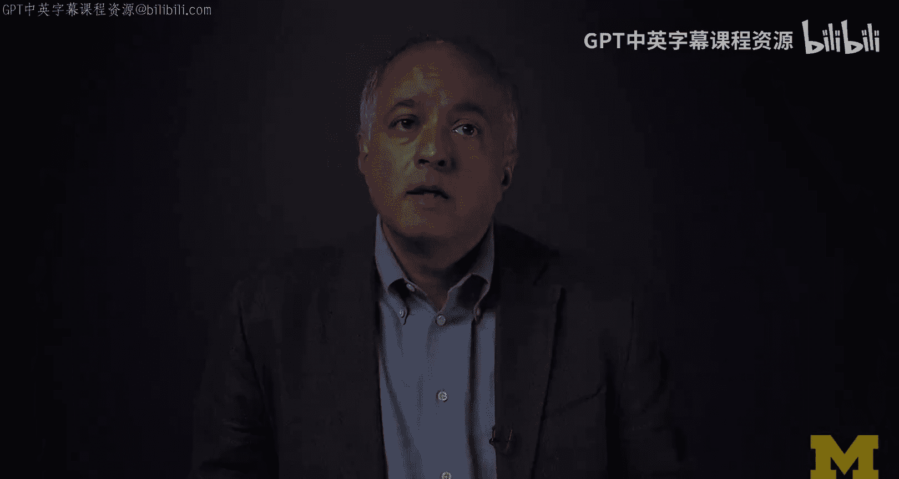

# 密歇根大学《数据科学伦理｜Data Science Ethics》中英字幕 p22 21_去标识化的有限价值（上）.zh_en -BV1EGaVzeEbQ_p22-

Didification。

Is the removal of identifiable information from data。

So the general interpretation is if in a data set， we have things like name， phone or address。

 take these things out。 And once these things are out。

 there are no personally identifying attribute values in the。Data set。

 And so the identity of the person is not immediately evident。Now。So far so good。

 the point is we need to recognize that if we have performed the identification。

 all it means is that the identity of the person is not immediately evident。

But it could potentially be determined。So let's think a little more about this。Given zip code。

 birth date， and sex。About 87% of Social Security numbers can be determined uniquely。But zip code。

 birth date and sex are not normally considered personally identifying information。Hey， because。Hey。

 zip code， I roll data up by zip code and that is used for any number of different reporting things that are aggregated by zip code。

And so。You could be very safe in terms of how you handle personally identifying information。

But you could still be revealing。Really sensitive things， because you've got。

All three of the fields above。Wch。Leads to social security number， which leads to。Everything。

 pretty much。Now， this set of fields was actually used。

In a famous Massachusetts reidification incident where the state General Insurance Commission released the identified health records。

And again， they did so because they thought they were serving a good public purpose in doing this。

And researcher Latanya Swweeeney used these to locate the health record of then Governor William Weld。

And in particular。😊，She was able to look up his diagnoses and prescriptions。

And she sent him a letter with all of this intimate health history in her letter。

 just as a way of making her point。You don't actually need to have。

Sensitive or potentially sensitive things like zip code and birth date。

To consider a more difficult scenario。Netflix organized a price competition。Where。

They released a data set。 and in this data set， they had。User I D。The date。

The movie name and the rating given by the user for that movie。And presumably， from the movie name。

One could then link to a lot of information about the movie itself。The director， the actor。

 the release date， et cetera， et cetera。Netflix thought they'd completely deidified this。

 If you think about what does somebody know about a user from this， what all one knows is a user I。

 which is a made up I。But one also knows what movies the user likes and on what date they watched which movie。

 and that's it。They thought they were safe releasing this data set。

And they offered a million dollars to anybody who could improve their movie recommendation system by more than 10%。

Now， what happened was that many of Netflix users had actually posted movie reviews on IMDB。

At the same time， as they watched the movies and raidd movies numerically on Netflix。

Some researchers were able to link users across the two systems， IMDB system。

Where the users were identified and they were actually talking about the movies they watched。And。

The Netflix system， where you could see all the movies that somebody had watched。

Now think about this。A user。Made a conscious choice to post a review about some of the movies that they watched。

This is a careful， conscious choice。 These are the movies that they decided they had something interesting to say about。

 And more importantly， these were movies that they were willing to be publicly。Kown to have watched。

Movies that they didn't post reviews on IMDB as far as these customers were concerned。

Were things that were between them and Netflix。 Nobody else should have known that they watched。

Something else。Now， if you have a sexual orientation that you wish to keep hidden。

Maybe you post reviews of big blockbuster movies。But you won't post movie reviews for， let's say。

 gay movies that you watched。And this was exactly。Something that was a problem with。

The linkage of data between Netflix and IDB。Netflix was sued by a lesbian mom who had not yet come out of the closet。

And。She claimed that Netflix was outing her by releasing this dataset set。

 and this case went through two years in more of litigation than was settled for $9 million。

The consequence of this whole saga is that Netflix canceled plans for additional rounds of its price challenge。

It did the one round。Then it got into trouble。 It had intended to do additional rounds， and so。

Technology。In terms of technology progress。Was slowed down。

Because the free sharing of data that one would have wanted couldn't take place。

And in the case of movie recommendations， maybe this isn't such a big deal。 but if this were。

Medical care and a fight against cancer。You can imagine how。We may have a。

Different notion of the social cost。That gets paid because it's important to retain people's privacy。

