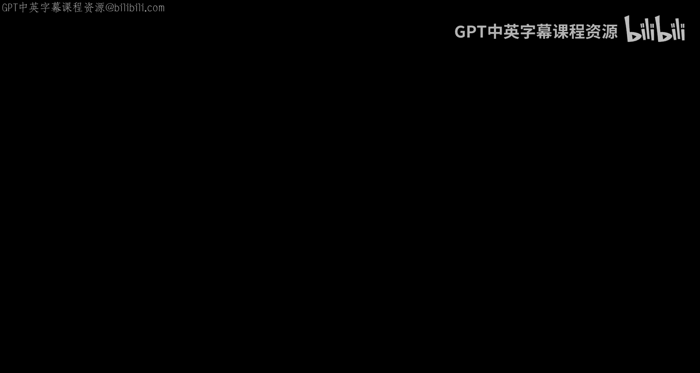
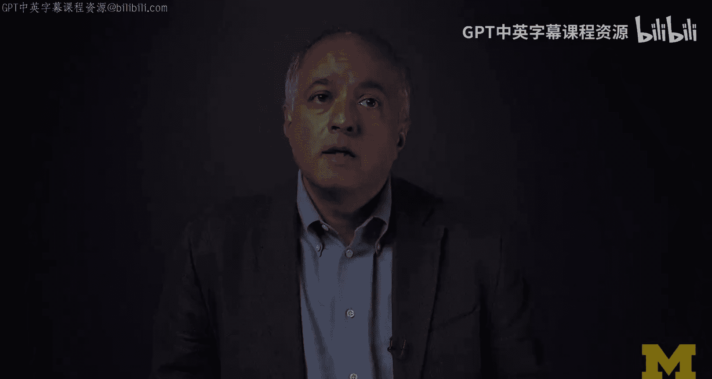

# 数据科学伦理：22：去标识化的有限价值（上）🔐

## 概述
在本节课中，我们将要学习数据去标识化的概念、其局限性以及在实际应用中可能引发的隐私风险。我们将通过具体案例来理解，为何简单地移除姓名、地址等直接标识符，并不足以完全保护个人隐私。

---

## 什么是去标识化？🧩
去标识化是指从数据中移除可识别信息的过程。

通常的理解是，如果一个数据集中包含诸如姓名、电话或地址等信息，就将这些信息移除。一旦这些信息被移除，数据集中就不再包含可直接识别个人身份的属性值，因此个人的身份不会立即显现。

## 去标识化的局限性
到目前为止，这个概念听起来不错。但关键在于我们需要认识到，即使我们执行了去标识化，也仅仅意味着个人的身份不会**立即**显现，但它**有可能**被推断出来。

让我们更深入地思考一下这个问题。

## 案例一：邮政编码、出生日期与性别
给定邮政编码、出生日期和性别这三项信息，大约**87%** 的社会安全号码可以被唯一确定。

然而，邮政编码、出生日期和性别通常不被认为是个人身份识别信息。因为邮政编码常被用于各种按地区汇总的报告。

因此，你可能在处理直接身份识别信息时非常谨慎，但如果你同时拥有上述三个字段，你仍然可能泄露非常敏感的信息。这三个字段可以导向社会安全号码，而社会安全号码几乎可以关联到一切。

这个字段组合实际上被用于一个著名的马萨诸塞州再识别事件中。当时，该州保险委员会发布了去标识化的健康记录，他们这样做是认为服务于公共利益。

研究员拉坦娅·斯威尼利用这些数据，定位到了时任州长威廉·韦尔德的健康记录。具体来说，她能够查询到他的诊断和处方信息。她给他寄了一封信，信中包含所有这些私密的健康历史，以此证明她的观点。

## 案例二：Netflix 竞赛
即使没有邮政编码和出生日期这类敏感或潜在敏感的信息，情况也可能很复杂。Netflix曾组织了一场价格竞赛。

他们发布了一个数据集，其中包含：
*   **用户ID**（虚构的ID）
*   **日期**
*   **电影名称**
*   **用户对该电影的评分**

从电影名称出发，可以链接到关于电影本身的许多信息，如导演、演员、上映日期等。Netflix认为他们已经完全去标识化了这个数据。

他们认为，从这个数据中能知道的关于一个用户的所有信息，就是一个虚构的用户ID，以及该用户喜欢哪些电影、在什么日期观看了哪部电影。他们认为发布这个数据集是安全的，并悬赏100万美元，奖励能将其电影推荐系统效果提升10%以上的人。

然而，问题出现了。许多Netflix用户同时也在IMDB上发布了电影评论。一些研究人员能够将两个系统的用户关联起来：一个是IMDB系统（用户是实名的，并且他们在讨论看过的电影），另一个是Netflix系统（可以看到某人看过的所有电影）。

请思考一下：一个用户选择在IMDB上对其观看的**部分**电影发表评论，这是一个谨慎、有意识的选择。这些是他们决定有话可说的电影，更重要的是，这些是他们愿意**公开**被人知道看过的电影。

对于那些没有在IMDB上发布评论的电影，在这些用户看来，那是他们和Netflix之间的事，不应该有其他人知道他们看了别的电影。

举个例子，如果你的性取向希望保密，你可能会发布对大型商业片的评论，但不会发布对你观看的，比如说，同性恋题材电影的评论。而这正是Netflix和IMDB数据关联所引发的问题。

一位尚未出柜的女同性恋母亲起诉了Netflix，她声称Netflix通过发布这个数据集“曝光”了她。这个案件经过两年多的诉讼，最终以900万美元和解。

## 后果与启示
这一系列事件的后果是，Netflix取消了其价格挑战赛后续轮次的计划。他们只进行了一轮，然后就陷入了麻烦。他们原本打算进行更多轮次。

从技术角度看，**技术的进步因此被延缓了**。因为人们所期望的数据自由共享无法实现。

在电影推荐的案例中，这或许不算什么大事。但如果这关乎医疗护理和抗击癌症，你可以想象，我们对于因此付出的**社会成本**可能会有不同的看法，因为保护人们的隐私至关重要。

---

## 总结
本节课中，我们一起学习了数据去标识化的基本概念及其固有的局限性。通过马萨诸塞州健康数据与Netflix竞赛两个案例，我们认识到，简单地移除直接标识符（PII）远不足以保障隐私。关联其他看似无害的数据（如观影记录、时间戳）或结合外部数据集（如公开的影评），仍然可能重新识别出个人身份，并泄露其敏感信息。这导致了法律诉讼、经济赔偿，并可能阻碍以数据共享为基础的技术进步和社会福祉。因此，在设计数据发布策略时，必须对去标识化的“有限价值”有清醒的认识。