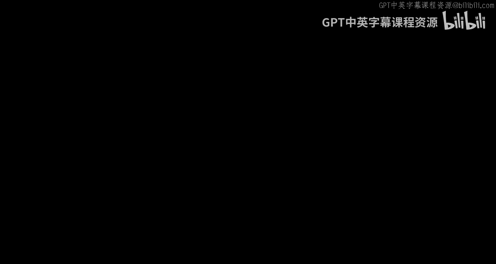
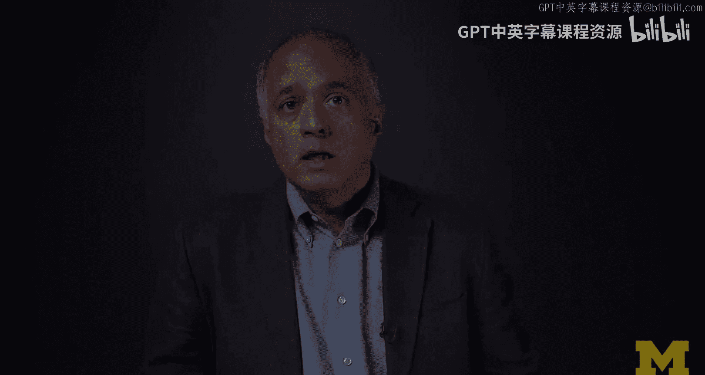

# 密歇根大学《数据科学伦理｜Data Science Ethics》中英字幕 p23 22_去标识化的有限价值（下）.zh_en -BV1EGaVzeEbQ_p23-

Let's take a minute to look at how the identification works。

You can do this by having fields that you retain。In the identified data。

And when you have these fields， they may have identifying data that the deidification algorithm missed。

So， for example， there's the physician notes field in your medical record。 That's a text field。

 and that would be retained because that is not personally identifying information。

 And the physician carelessly mentioned a patient's name in the text field。 Now， John came in with。

A big headache。Well， now you know that the patient's name was John。Often， data is structured。

Ass a network or a graph。And even if you've taken away the labels that tell you which node in the network is what。

If you can match the structure of a graph with the structure of another graph。You can figure out。

 thanks。Other ways in which the identification is defeated is by combination of multiple partial identification。

So the examples we looked at with AolL and the Massachusetts health information are things where。

The attackers。Had a partial identification of the user from each individual piece of。

Data that was retained。And then。One could use external data sets and the Netflix example。

 the IMDB data set。Is the one that resulted in the deidentification being defeated。

When you defeat the identification。There are four different types of leakage that can take place。

The one that we focused on thus far is revealing identity。

But there might be other things that one is able to reveal that are less than revealing the full identity。

 but could nevertheless be extremely damaging。 so you could reveal the value of a hidden attribute。

So I don't know exactly all the details of your medical record， but I know that。You have cancer。

That was an attribute that you didn't want to have revealed， and I managed to figure that out。

I may be able to reveal the link between two entities。So if I have phone called metadata。That is。

 I know who called who， even though I don't know what they talked about。

That might be enough for me to figure out。What the friendship circles are by networks of phone calls。

And that might tell me what。People are friends and， and therefore， what entities are related。

I may be able to reveal group membership。And this is not just network group membership， but if I'm。

 for instance。Tracking your cell phone location。And I see where you are。Every Sunday morning。i。

Can from there determine。Firstly， that you're religious and exactlyly what your religious denomination is because I know precisely which house of worship you are at every Sunday morning。

In terms of。Data that you think is private， that actually becomes public。

It isn't just algorithms doing this or attackers doing this。

Even your friends and relatives can play a role。So you go to a party。

 you don't tell people that you were at this party， but a friend posts photos of her party。

 and in some of those photos， you're there。And so everyone who sees these photos know you were at the party and。

You have no control over what photos your friends chose to post。To take another example。

 one might say it's an individual choice， and some people may be willing to make their DNA public。

For example， because they wish to promote medical research， but。If I know your DNA。

I also have a pretty good idea。About the DNA of your close blood relatives。

I don't know exactly what their DNA is， but we know in terms of genetics that your parents and your children。

 your siblings have DNA that is in many ways， very similar to yours。

And so their DNA is now not quite public because it is some uncertainty， but it's semi public。And。

They didn't play any role in that happening because you made your choice about making your DNA public。

So to。Bring all of this together。 I think that a way to think about this is that anonymity is virtually impossible。

There's enough other data in the world。And so if you think that something is going to be anonymized because you have a diverse entity set。

You can probably eliminate that by joining with external data。

There are techniques for anonymization where the idea is to do random perturbation。

But those techniques work if you can only guarantee a one time perturbation。

If I can repeatedly do this， then on average， the randomness should disappear。

Aggregation works only if there's no known structure among the entities aggregated， otherwise。

 the biases show up。In terms of image data faces can be recognized。

 and the technology for face recognition has been improving by leaps and bounds。

 and now were able to do this even under challenging conditions and even with things like partial occlusion。

The net result of this is we really shouldn't assume that we have an anity。And we should design。

Other parts of our system。To work。Assuming that anonymity can be breached by somebody who really wants to。

So a knee jerk reaction then is to say， oh， anonymity isn't possible， let's not publish the data。

But access to data is crucial for many， many desirable purposes。We've talked about medical research。

You're going to have public watchdogs， you want government agencies to publicize a lot of their data。

And if the fears of。Revealing personal sensitive data prevents that from happening。

 we lose the benefits in terms of medical advance or in terms of having watchdog watch over。

How our government。Invest resources。So what can we do。I think that。Really， the issue here is。

If you've got the identified data。It is equivalent to。You're putting。A lock on the door near home。

So now I came here today。 I locked the door in my home。 And what that means is that a passer by。

Wouldn't casually just be able to enter。It doesn't mean that I've got a door that couldn't be broken down or a lock that couldn't be picked or a window that couldn't be broken and used to force entry。

It certainly isn't the case that my home is。Guaranteed， invulnerable。

But there still is value to locking the door when I leave the home。

And I think that's the way we want to think about the identificationification of data。

You have the identifiedified data， and this means that casual identification isn't possible。

Somebody who' is sufficiently committed to it。Willll be able to reident it。

 And what we want is to make it hard for such people to access the data。And so you want to have data。

That you want to make public， but you want to make it public through a licensing regime。

And this license can be a contract of some sort， or it can be a thing that is enforced as a professional standard。

And。Just the fact that people aren't idly trying to。Reid de identified data sets。

 I think is going to work。For a lot of purposes that we worry about identification。

So the general idea here is。You want to be in control of how you're represented on the Web。

That is your notion of identity。It's very hard to manage。

An anymity is possible only in very limited narrow situation。

And so we have to come up with a mechanism。To be able to。Get。😡，Value from our data。

While realizing that an anity is going to be limited。And the identification。

Has a role to play in this regard， imperfect， though it might be。

