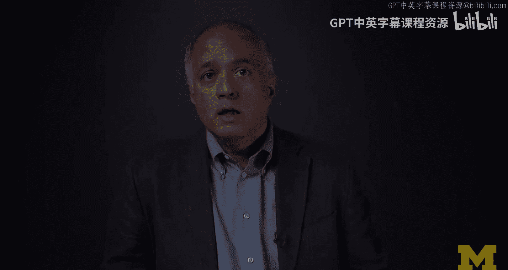

# 数据科学伦理：23：去标识化的有限价值（下）🔐

## 概述
在本节课中，我们将深入探讨去标识化技术如何被攻破，以及数据在看似匿名的情况下可能泄露哪些敏感信息。我们将分析身份重识别的具体机制、可能泄露的数据类型，并思考在无法实现绝对匿名的现实下，应如何负责任地处理数据。

## 身份重识别如何运作
上一节我们讨论了去标识化的基本概念，本节中我们来看看攻击者具体如何实现身份重识别。

重识别可以通过保留在“已去标识”数据中的字段来实现。这些字段可能包含去标识算法遗漏的识别信息。

例如，医疗记录中的“医生笔记”字段是一个文本字段，它通常被保留，因为其本身不被视为个人身份信息。然而，如果医生在笔记中不经意地提到了患者的名字（例如：“约翰今天因严重头痛就诊”），那么攻击者现在就知道该患者名叫约翰。

数据通常以网络或图的结构组织。即使去除了图中节点的标签，如果能将某个图的结构与另一个图的结构匹配起来，也能推断出节点的身份。

## 组合攻击与外部数据
身份重识别被攻破的另一种方式，是通过组合多个部分识别信息来实现。

我们之前看过的美国在线（AOL）和马萨诸塞州健康信息案例，就是攻击者从每个被保留的数据片段中获得对用户的**部分识别**，然后进行组合。

此外，攻击者可以利用外部数据集。在Netflix的案例中，正是与IMDB数据集的结合，导致了去标识化的失效。

## 数据泄露的四种类型
当去标识化被攻破时，可能发生四种不同类型的泄露。

我们目前主要关注的是**身份泄露**。

但也可能存在其他泄露类型，它们虽未完全暴露身份，却仍可能造成极大损害。

以下是可能泄露的信息类型：
*   **隐藏属性的值**：我可能不知道你医疗记录的所有细节，但我能推断出你患有癌症。这是一个你本不希望被泄露的属性。
*   **实体间的关联**：如果我拥有通话元数据（即知道谁给谁打了电话，即使不知道谈话内容），这可能足以让我通过通话网络分析出社交圈，从而了解哪些人是朋友、哪些实体之间存在关联。
*   **群体归属**：这不仅指网络群体。例如，如果我追踪你的手机位置，发现你每个周日上午都在某个特定地点，我就可以推断出你信仰宗教，甚至能精确判断你的教派，因为我知道你每周日上午所在的确切礼拜场所。
*   **私人信息的公开化**：这不仅仅是算法或攻击者所为。你的亲友也可能在其中发挥作用。例如，你参加了一个聚会但没有声张，但一位朋友发布了她的聚会照片，而你在其中一些照片里。所有看到这些照片的人都知道你参加了聚会，而你无法控制朋友选择发布哪些照片。

再举一个例子：有人可能自愿公开自己的DNA数据以促进医学研究，这是个人选择。但是，**如果我知道了你的DNA，我也能相当准确地推测你近亲的DNA信息**。虽然不能完全确定，但从遗传学可知，你的父母、子女、兄弟姐妹的DNA在许多方面与你非常相似。因此，他们的DNA现在也并非完全私密，而是处于一种半公开状态，而他们本人对此可能并无选择权。

## 总结与启示
综合以上所有内容，我们可以得出一个结论：**绝对的匿名性几乎是不可能的**。世界上存在足够多的其他数据，如果你认为一个多样化的实体集合可以实现匿名，攻击者很可能通过连接外部数据来消除这种匿名性。

存在一些匿名化技术，例如**随机扰动**，但这些技术仅在能保证一次性扰动的情况下有效。如果攻击者能重复进行尝试，随机性平均而言会消失。**聚合**数据仅在聚合实体间没有已知结构时才有效，否则偏差就会显现。对于图像数据，人脸可以被识别，且人脸识别技术正在飞速进步，现在即使在有挑战性的条件下（如部分遮挡）也能实现识别。

最终结果是，我们真的不应该假设自己拥有匿名性。我们应该设计系统的其他部分，使其在**假设匿名性可能被有意者攻破**的前提下仍能正常工作。

## 应对策略：从“锁门”思维到许可控制
一个下意识的反应可能是：“既然匿名不可能，那就不要发布数据。”然而，数据访问对于许多重要目的至关重要，例如医学研究、公共监督、政府数据公开等。如果对泄露个人敏感数据的恐惧阻碍了这些，我们将失去医学进步或政府资源监督所带来的益处。

那么我们能做什么？我认为，关键在于转变思维。

**拥有已去标识的数据，就如同离家时锁上门**。今天我锁了家门，这意味着路人不能随意进入。但这并不意味着我的门无法被撞开、锁无法被撬开、窗户无法被打破以强行进入。我的家并非绝对安全。然而，离家时锁门仍然有其价值。

我认为，这就是我们看待数据去标识化的应有方式：对数据进行去标识化处理，意味着**随意的身份识别不再可能**。但那些**决心足够大的人**仍然能够实现重识别。我们的目标是让这类人难以访问数据。

因此，对于你想要公开的数据，应通过**许可制度**来公开。这种许可可以是一份合同，也可以是一种强制执行的专业标准。只要人们不会随意尝试对去标识化的数据集进行重识别，我认为对于许多我们担忧识别问题的场景，这就能发挥作用。

## 核心结论
本节课中我们一起学习了去标识化技术的局限性和应对思路。总的理念是：**你希望控制自己在网络上的形象呈现，这是你对身份的定义，但这很难管理**。

**绝对的匿名性仅在非常有限、狭窄的情境下才可能实现**。因此，我们必须建立一种机制，在认识到匿名性有限的同时，依然能够从数据中获取价值。去标识化在这方面可以发挥作用，尽管它并不完美。