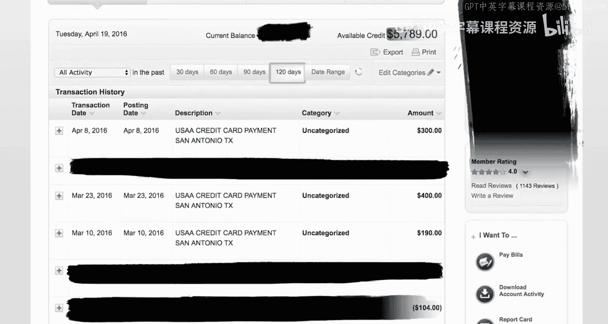

# 密歇根大学《数据科学伦理｜Data Science Ethics》中英字幕 p24 23_案例分析：信用卡账单事件.zh_en -BV1EGaVzeEbQ_p24-

Sometimes I'll have a business expense for which I don't have a receipt showing proof of payment。

 one way in which one can address this is to present the credit card statement showing the expense was made and charged。

Well， it turns out that credit card statements are actually intensely personal。

If you were to see my credit card statement， there are many things you could find out about me that you might not otherwise know。

🎼For example。There may be a purchase at a cigar store or a liquor store that might tell you about personal habits。

If I have a donation to a religious organization， you might learn something about my faith。

These are personal things about me that I may otherwise not want to share with you and therefore showing you my credit card statement is allowing you to take a peek at at least some aspects of who I am。

🎼So how does。A company or by university deal with。🎼This。Conflict or balance these conflicting needs。

The way that the University of Michigan does this is to say that we should blank out all irrelevant parts of the credit card statement and furthermore。

 even after that has been done， there is。

The unwritten but implicit guarantee that my credit card statement isn't going to show up on the web for all to see。

That it will be seen only by a handful of people who are responsible for processing the expense voucher。

Possibly some downstream accounting or auditing or groups like that。

 but people who have a business need and they are。Small in number， and that gives me。The kind of。

privaivacy guarantee that has been comfortable sharing something as intensely personal as a credit card statement in this manner。

 I believe that we should try to find a good balance between information need and what is done with it。

And often companies do establish voluntary limits on how they will share information。To oil。

 to wheels of business。