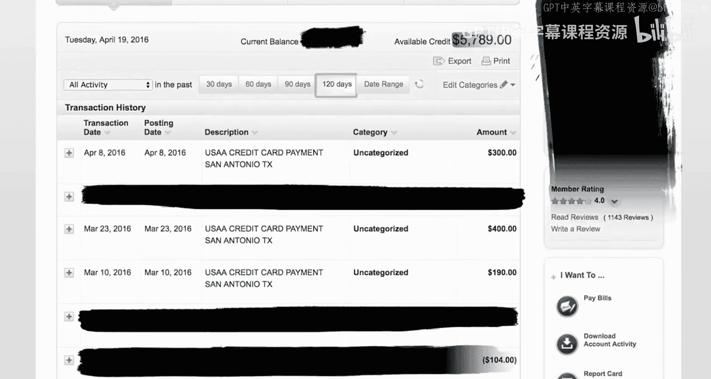

# 数据科学伦理：案例四：信用卡账单事件

在本节课中，我们将通过一个具体的案例——信用卡账单报销事件，来探讨如何在商业需求与个人隐私之间寻求平衡。我们将分析其中涉及的隐私风险，并讨论组织可以采取哪些措施来保护个人信息。

---

有时，我会有一笔无法提供付款凭证收据的业务支出。

处理这种情况的一种方法是，出示显示该笔消费已产生并扣款的信用卡账单。

然而，事实证明，信用卡账单实际上包含了高度敏感的个人信息。

如果你看到我的信用卡账单，你可能会发现许多关于我的、原本无法得知的信息。

例如，一笔在雪茄店或酒类商店的消费，可能会透露我的个人习惯。

如果我有一笔对宗教组织的捐款，你可能会了解到我的信仰。

这些都是关于我的私人信息，我可能并不想与你分享。因此，向你展示我的信用卡账单，就等于允许你窥探我身份的某些方面。

那么，一家公司或大学应如何处理这种冲突，或者说，如何平衡这些相互矛盾的需求？

密歇根大学的做法是，规定我们应该遮盖信用卡账单上所有不相关的部分。

并且，即使完成了遮盖处理，还存在一个虽未明文规定但心照不宣的保证：我的信用卡账单不会出现在网络上供所有人查看。

它只会被少数负责处理报销凭证的人员看到。

可能还包括后续的会计、审计或类似部门的人员。

但这些人都出于业务需要，且人数有限。这给了我一种隐私保障，让我能够放心地以这种方式分享信用卡账单这样高度私密的信息。

我认为，我们应该努力在信息需求与信息使用方式之间找到一个良好的平衡点。

通常，公司会自愿设定信息共享的限度，以确保商业活动能够顺畅进行。

---

本节课中，我们一起学习了信用卡账单报销这一案例。它揭示了商业流程中无意间可能暴露的个人隐私风险。关键在于，组织需要建立明确的规则和隐性承诺，在满足必要信息需求的同时，严格限制信息的访问范围和使用方式，从而在效率与隐私保护之间取得平衡。