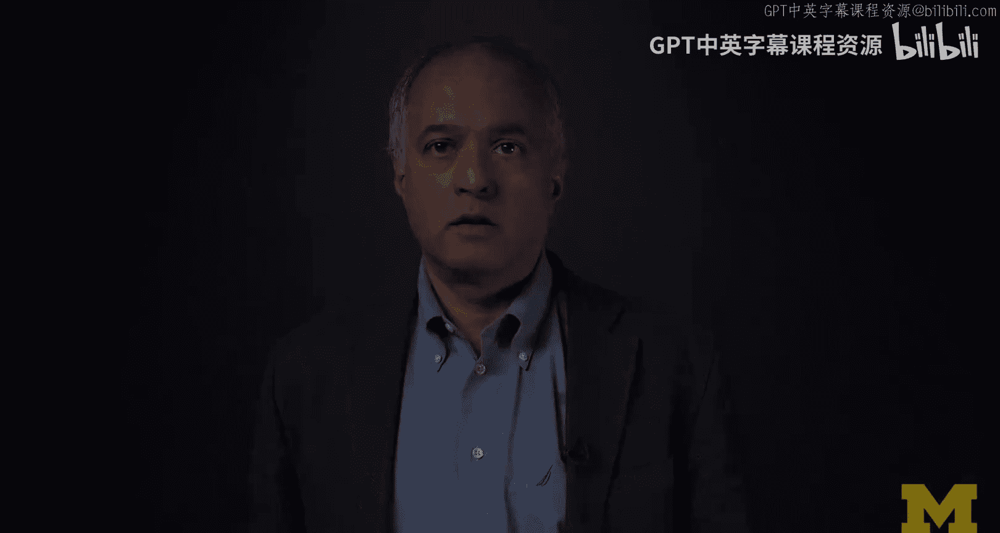

# 密歇根大学《数据科学伦理｜Data Science Ethics》中英字幕 p25 24_数据有效性.zh_en -BV1EGaVzeEbQ_p25-

There are many reasons。Why you could have errors in your data analysis。

Bad data and bad models lead to bad decisions。 So it's important to understand what the sources of error are and to remove them。

If decision making is aaque， the results can be bad in the aggregate。

It can be catastrophic for an individual。The consequences of having errors。Can be really bad。

For example。What if someone has a loan denied because of an error in the data analyzed。

Or maybe because of an error in the analysis method design。

We have actually harmed somebody because we have conducted data science in a less than perfect way。

There are many different sources of error。That we're going to talk about。

 Let's begin by talking about the first of them， which is choice of representative sample。

There is the apocryphal story of the drunk looking for keys under the lamppost。

Because that's where he can see。Similarly， we are often limited by what data we have as data scientists。

We often cannot choose the data that we would like to have。

And so we just analyze what data we do have。And hope for the best。

This is actually not that much different。From looking for keys under the lamppost。

 because that's where we can see。The keys happened to be under the lamppost。

 We might actually find them。But if the keys are elsewhere。We are out of luck。

Let's look at a concrete example。The Twitter universe， a Twitterverse。

 is a popular source of analysis of public opinion。

But are Twitter users representative of the population as a whole。Surely we know that they aren't。

Surely they are younger and more tech savvy。Ricer than the average population。Furthermore。

 even if we know。What the characteristics are of Twitter users are tweets representative of the opinions of Twitter users as a whole。

Most Twitter users don't tweet at all。They just watch the tweets go by。

So what we're really hearing are the opinions of opinion makers。And that may or may not have。

A good representation of what the population thinks about as a whole。

Think about what a lot of companies do in terms of establishing a web presence。

They listen to customer response on a forum that they establish or that other third parties have established。

And in this sort of situation。It may actually be a reasonable thing to do。A company may care about。

Complaints that they hear about their products。And they may care irrespective whether this opinion is representative of the population。

Maybe be enough for them to know that there is an opinion that's representative of a segment of the population。

That is pointing out some。Problem with their product。 And they act to fix it。

 I think that's a good thing。 And that's good for everybody。

 And the fact that they're dealing with data that's not representative is not a problem in this case。

As long ago as 1963。There is a famous quotation。By William Cameronron。

 who said not everything that can be counted counts and not everything that counts。Can be counted。

This distinction between。The data that we have and the data that we wish we had is something that's important to keep in mind。

When we don't have exactly the data that we would like。

 there are statistical techniques that help us weight the samples that we have。

To be able to balance at least the important attributes。

 So the attributes that we think are likely to matter。For whatever be the question at hand。

So if we think that opinions may differ by race or gender or age。

We could try to make sure that the samples that we are collecting are balanced with respect to these。

 and to the extent they're not balanced， that they're weighted to be able to give us an effective mathematical balance。

And。Sometimes it's hard to know what。These attributes should be。For example。Biology experiments。

 often。Have been conducted with mice of a single sex， typically male。

It's only recently that the National Institutes of Health have instituted a policy requiring。

Female mice in biology experiments。So to think about how balancing may work。

Here's a chart of American Idol Semifinalists across a number of years that this show is popular。

And the color of each state shows how underrepresented or overrepresented is。In the semifinalists。

Of course， normalizing for the population of the state as a whole。

And what we find is that most states on the west coast and in the south are fairly represented。

 That's green on the spectrum。However， if you look at the Midwest and the plain states。

These are all blue， which means there are very few semifinalists。

Compared even to these generally low population states。And the same is true of New England。

And if you really want to be a semifinist at American Idle， you want to be from Hawaii。

 which is a brilliant red and seriously overrepresented。

That was a little fun place of trying to obtain balance in your data。

Here's a much more troubling situation。 Google， when it was developing its image recognition technology。

Mistkenly labeled this photograph， gorillas。Now， naturally。

 this was a thing that caused considerable distress。And they immediately fixed it。And。In some sense。

 that incident was a small teething problem in。A fast developing technology。The question is。

 why did that kind of problem arise at all in the first place。

 and that has to do with the training data that was used to。Teach the labeling algorithm。

And since the training data involved very few faces that were as dark as that of the woman in this photograph。

 the。Learning algorithm wasn't appropriately trained to recognize dark human faces。

Training data is also a problem when you want to deal with systems that are going to work with the future population。

If the future population is different from the past population。By definition。

 we are training on what we had in the past and what we are going to use is on something in the future。

If these are the same， it's not a problem。When the future doesn't resemble the past。

Which happens from time to time。We have to watch out for those singularities。

A much harder thing to watch out for is gradual drift。As。Society changes。Over time。

The nature of our population may shift the way we use language or the way we dress or the way we speak。

And。Things that were trained a while ago will no longer work because we would have drifted away from that that they were trained on。

Managing this kind of drift in termss of how things are retrained is an open question。

