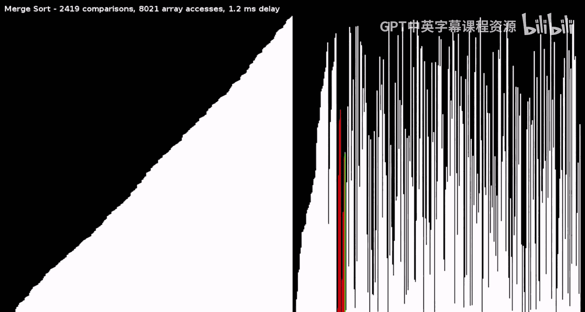
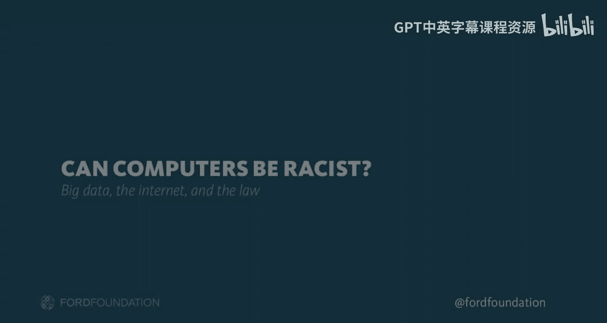
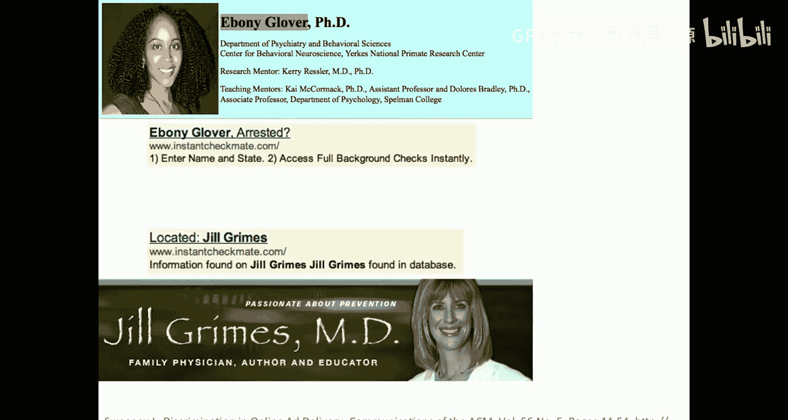
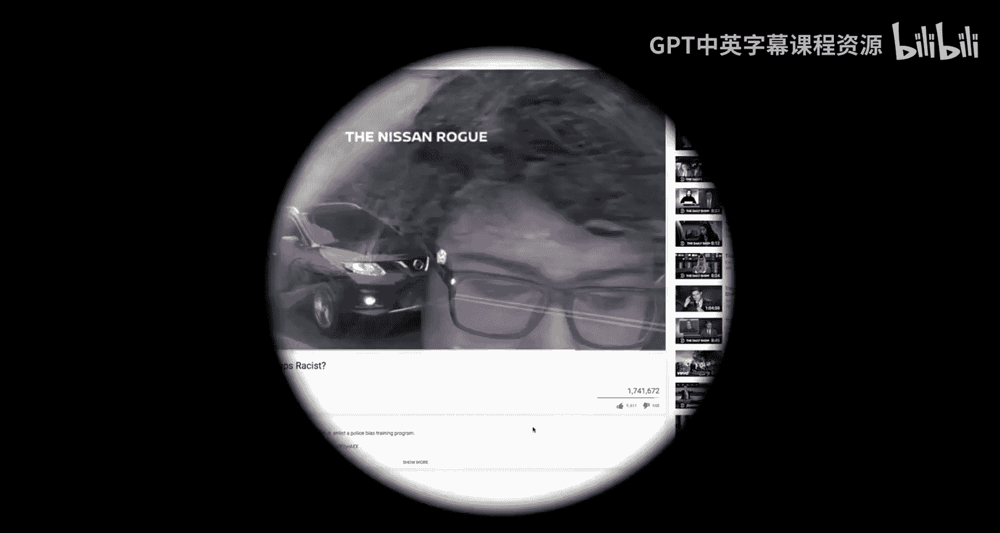
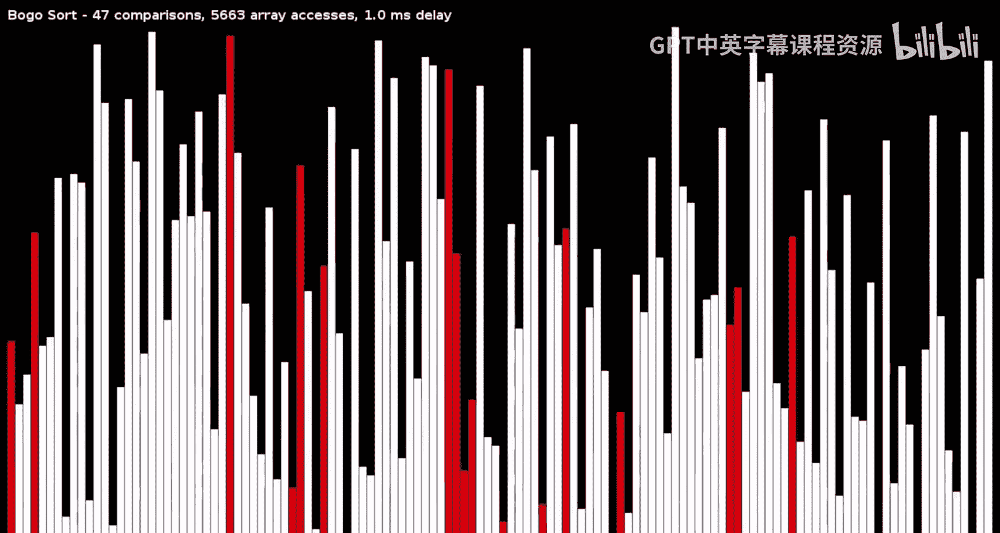

# 密歇根大学《数据科学伦理｜Data Science Ethics》中英字幕 p31 30_案例分析：算法与种族偏见.zh_en -BV1EGaVzeEbQ_p31-

Most people who write algorithms aren't racist and don't want to write algorithms that have a racist consequence or make racist decisions。

In fact， race may be farthest from their minds when they wrote the algorithm。Nevertheless。

 the way the algorithms actually operate could have significant racial implications。For an example。

Let's watch this video clip。Of Professor Latanya Sweeeney， leading researcher on computer privacy。

One day， I'm sitting in my office and a reporter was there and he types in my name into Google because we were looking for an old paper of mine and up pops this ad that implied I had an arrest record。

 Meanwhile， I show him where the result we were looking for。 He says， no， no。

 tell me about this arrest。 And I said， and I said， well， I've never been arrested。 And he says。

 then why is why does it say this。 And we go on and on， and we began searching more and more names。

 and we started noticing this pattern。 And he jumps to the conclusion。

 it's because you have one of those black names， he says and I said， oh， that's ridiculous。

 It's a computer。 computers can't be partial。 So and I would spend hours and hours trying to show him that he was wrong and eventually I do this cross country  hundred 20000 ad research project。

 when I actually learned that it was absolutely true that these ads showed up implying an arrest had nothing to do with whether or not the company or there was an arrest record under that person。

Name，But if you had a name that was primarily assigned to black babies。

 you were more likely to get an ad in indicating arrest than if you had a name more assigned to white babies。

So let's think a little bit about why。What we saw may have happened。

When search engines choose what ads to show， they do so based on the ads that are likely to be of interest that the users are likely to respond to。

And if they have figured out。That somebody who has a name of Latanya。

 or somebody who's looking for a search term called Latanya。

Is likely to be interested in services that might be provided to criminal defendants。

Such as a bail bond service or something that you might want if you were arrested。

That's a reasonable ad to show， that's an ad that this person who you don't know is more likely to respond to than thousands of other ads that you could possibly be showing。

This decision is purely a statistical frequency type of decision that the algorithm has made。

With no thought whatsoever towards race or even racial implications of certain names like Lattania being。

More prevalent in the African American community。🎼Nevertheless。

 there can be real implications as we just saw in this video clip。

And understanding these real implications of supposedly neutral algorithms that are operating in a completely data driven manner。

Is something that anybody who writes。Algorithms or practices data science needs to think about。

Own the consequences of。