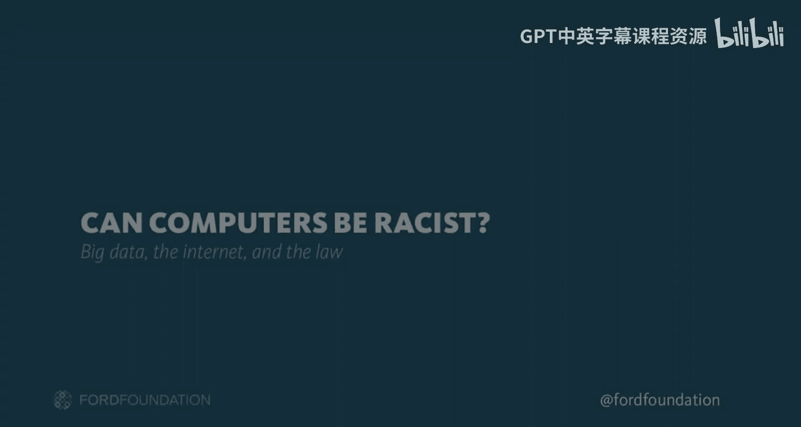
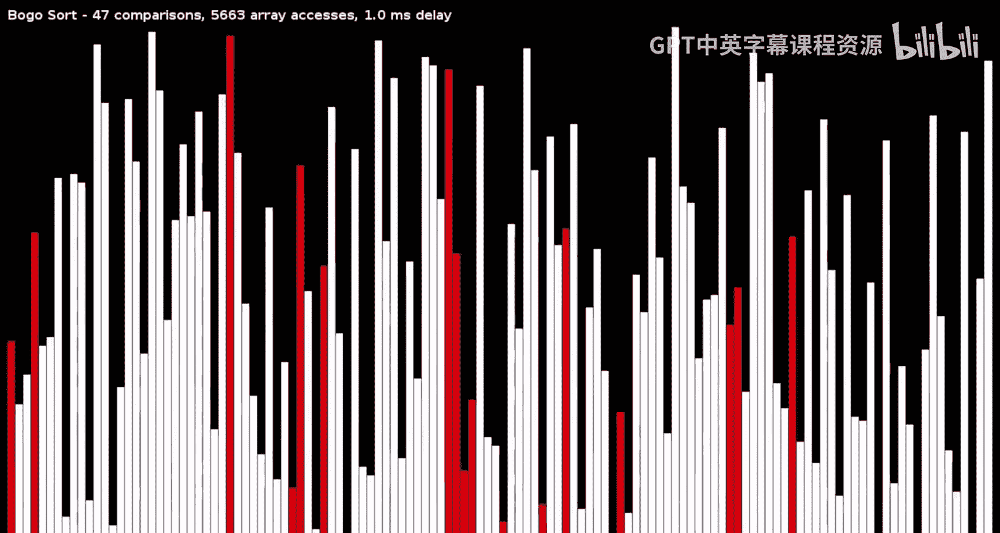

# 数据科学伦理：案例三：算法与种族偏见

在本节课中，我们将通过一个具体案例，探讨算法如何在不经意间产生种族偏见。我们将看到，即使算法设计者没有主观偏见，算法运行的结果也可能对特定种族群体产生不公平的影响。

## 案例背景

大多数编写算法的人并非种族主义者，他们也不希望自己编写的算法产生带有种族偏见的结果或做出带有种族偏见的决策。

事实上，他们在编写算法时，可能完全没有考虑种族因素。然而，算法实际运行的方式可能会产生重大的种族影响。

## 案例分析：谷歌广告中的发现

为了理解这一点，让我们来看一个由计算机隐私领域的领先研究者拉塔尼亚·斯威尼教授分享的真实案例。

一天，斯威尼教授在办公室与一位记者会面。记者在谷歌上搜索她的名字，试图找到她的一篇旧论文。然而，搜索结果中却出现了一则暗示她有犯罪记录的广告。记者对此感到困惑，并反复询问她关于“逮捕”的事情。斯威尼教授澄清自己从未被捕，两人便开始搜索更多名字，并注意到了一种模式。记者得出结论：这是因为你有一个典型的黑人名字。斯威尼教授起初认为这很荒谬，因为计算机不可能有偏见。为了证明记者的错误，她最终进行了一项覆盖全国、涉及数千条广告的研究项目。研究结果证实，广告是否暗示逮捕记录，与该人是否真的有逮捕记录无关，而是与名字有关。

研究发现的核心是：**如果你有一个主要被赋予黑人婴儿的名字，你更有可能看到暗示逮捕的广告；而如果你的名字主要被赋予白人婴儿，则这种可能性较低。**

## 算法决策机制解析

上一节我们看到了算法偏见的具体表现，本节中我们来看看这种现象背后的原因。

搜索引擎在选择展示哪些广告时，其依据是**用户可能感兴趣并可能点击的广告**。

算法可能通过数据分析发现：名叫“拉塔尼亚”的人，或者搜索“拉塔尼亚”这个关键词的用户，更有可能对面向刑事被告的服务（例如保释金服务）感兴趣。因此，向这类用户展示相关广告是一个合理的商业决策。在成千上万条可能的广告中，这是该用户更有可能回应的广告。

这个决策纯粹是算法基于**统计频率**做出的，完全没有考虑种族因素，甚至没有考虑像“拉塔尼亚”这类名字在非裔美国人社区中更为普遍所可能带来的种族影响。

## 对数据科学实践的启示

尽管如此，正如我们在视频片段中看到的，这会产生真实的影响。理解这些表面上中立、完全以数据驱动方式运行的算法所带来的真实影响，是每一位算法编写者或数据科学实践者都需要思考并**对其后果负责**的事情。

## 总结

本节课中，我们一起学习了算法中无意识偏见的典型案例。我们看到，算法决策基于统计模式，即使设计者没有恶意，也可能因为训练数据中存在的现实社会偏见（如名字与种族的关联性），而将不平等的结果固化并放大。这提醒我们，在数据科学工作中，必须保持警惕，主动审视算法可能带来的社会伦理影响。