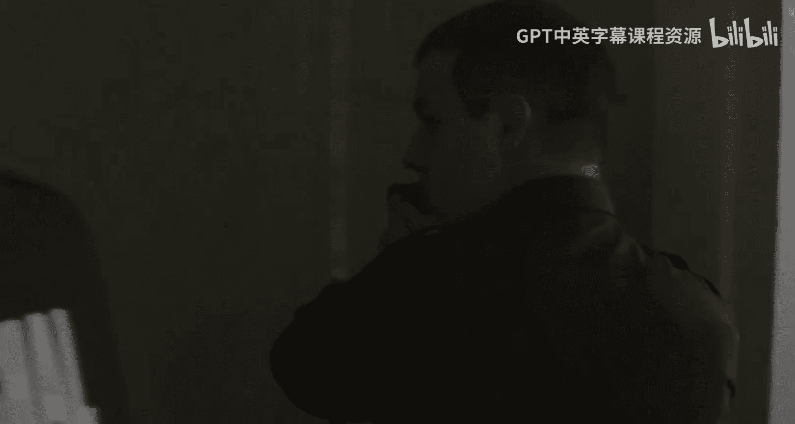

# 密歇根大学《数据科学伦理｜Data Science Ethics》中英字幕 p33 32_案例分析：德国之翼空难.zh_en -BV1EGaVzeEbQ_p33-

Andreas Lubititz。🎼Crash German wings flight 9，5，7，5 into the French Alps。

The initial findings indicate that Lubititz practiced the crash during the flight immediately preceding the one in which he crashed the plane。

 Ki all 150 passenger support Lus crashed the jet on the next flight German police later discovered that he'd researched suicide methods and the locking mechanism of the cockpit door online The interim report also shows that air traffic control attempted to contact flight 952511 times on three different frequencies before it crashed。

Andreas Sbititz。Had severe psychological problems。And there is no question that he should not have been。

Flying a plane that day。There was。🎼A great deal of。Discussion in the press following the crash。

We need to have clear rules about those who provide this service information with the competent authorities about the health。

 as well as public security and protecting the patient。

Most of the other recommendations of the report also deal with the mental health of pilots and how to make sure that the mental health of pilots does not become an issue for airline safety。

About how German privacy laws prevented。🎼The airline from knowing about。His mental condition。

That if only the privacy laws weren't so strict， perhaps they would have known。

 and perhaps he would not have been allowed to fly。

Well it's true that he shouldn't have been allowed to fly。

 let's take a step back and look at what the consequences are of having weakened privacy laws There are many professions where we wouldn't want people who are in psychiatric difficulty to be at work。

You don't want a police officer who's having mental difficulties potentially armed to be at work。

 you wouldn't want your barber who's potentially holding a blade next to your face。

How are these people to be prevented from doing their jobs？When they're a danger to others。

While not intruding upon。Their lives in the ordinary course。Systems are only as good as the data。

And if the data are of poor quality， you're going to end up with poor results。

If the data that we have in any system。iss going to be used for a certain purpose that is potentially harmful to the data provider。

 then the data provider is incentivized to modify the data that is provided or to suppress certain data and the quality of the data will suffer。

If somebody is to seek medical treatment for a mental condition。They need that guarantee of privacy。

So that they can be open about their condition with their care provider if they're worried that discussing whatever their mental situation might be。

Can cause them to lose their job。then they just won't do it。

 or they will do it outside the system and the consequences many people who may have， for instance。

 minor mental conditions that were easily treatable may end up not seeking treatment。

The quality of data would suffer。🎼And it isn't clear that。

We would actually be safer in terms of having a guarantee that the pilots flying our planes were in good mental health。

So how do we fix this problem？Well， actually， in a parallel sort of situation， we do have a fix。

So we expect pilots flying our planes not to be drunk。And we expect that sobriety is tested for。

And indeed， there is a process for random spot checks of alcohol use by pilots when they show up to work。

Certainly， if somebody showed up to work and were behaving in a manner that suggested that they were drunk。

 one would expect that coworkers would。Refer them for additional testing before they could fly。

I believe that similar things could apply to the mental health situation。

There are pilots who have alcohol abuse problems。These problems are dealt with and this is something that they can put on their employment records。

 that they can have in their medical records， that they are able to get treatment and help。

to get past their alcohol problems and to become and remain productive members of society and to continue to fly planes as long as they're able to deal with the problems at a time when they're not flying and they're sober when they show up to fly。

I think that we should draw lessons from。This kind of separation between what one does in terms of how one helps somebody and how they get medical treatment in terms of privacy。

From how we test people。To make sure that they're fit to do the jobs that they show up for。

