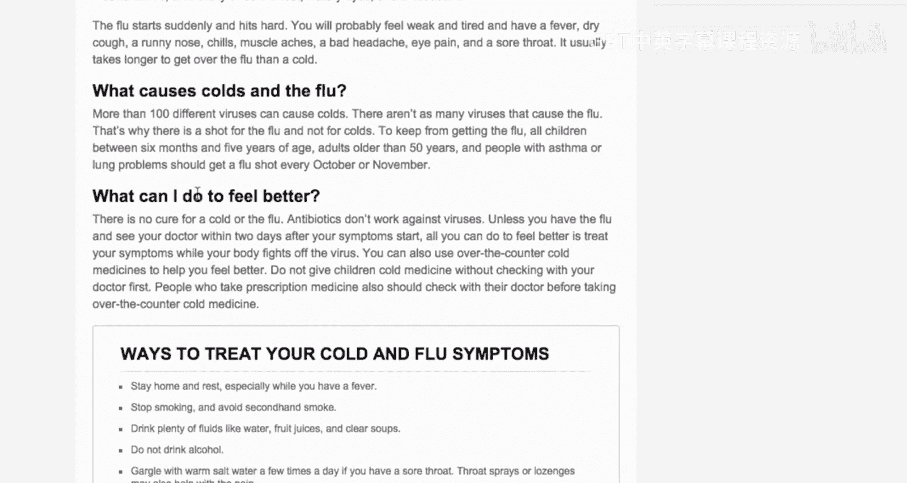

# 密歇根大学《数据科学伦理｜Data Science Ethics》中英字幕 p34 33_案例分析：谷歌流感预测.zh_en -BV1EGaVzeEbQ_p34-

With big data， we have a lot of information about a lot of things。

 and it is often possible to combine information in unexpected places to learn about things that are of interest to us。

 a really visible example of this and one that has been widely discussed。Is Google F trendsrens。

First introduced in 2008， the idea of this product was that Google would use search terms that were entered into their search engine。

To estimate the prevalence of flu。This is remarkably successful in the initial years。However。

 over time。Google F trendsren。Started to do poorly。

And consistently overestimate the prevalence of flu。To the extent that after a few years。

It was abandoned completely as a project。So let's look at what happened。

 why was it initially successful？And what went wrong？The entire system was based upon。

A certain set of words that were correlated with the occurrence of flu。Now。

 some of these words may have been things that could be possible explanations for others were presumably things that were just noticed in the data and there wasn't even a good explanation for。

There was yet another class of words。That the Google team actually told us about。

 that they had to correct for and adjust， which is that。

The flu is more prevalent in the winter than in the summer。And therefore。

 terms that are more winter oriented in terms of the search terms。

Were likely to be correlated with flu and this correlation was not because there was more flu when these terms were searched for。

 but rather because both of these things happen in the winter， for example。

Basketball tournaments tend to happen in the winter and so searches for the NBA happen to be correlated with occurrences of flu。

They got rid of these sorts of correlations where they could see that they were being inappropriately mediated by some other factor。

Presumably the terms that they did keep。Were ones where they couldn't see。

That there was this kind of obvious mediation through some confounding factor。

But that doesn't mean there wasnt what。And we can't tell because the set of terms is not public。

We live in a world that is not constant， things change。🎼Google search algorithms change。

People's reactions to。How they search things change。As Googles search engine has evolved。

🎼They have tried to make their search responses。More useful to people。And whereas。In 2008。

 a search for， let's say， a search for。A runny nose。

Wouldn't bring up anything directly related to the flu。Today。

Google might try to be more helpful and tell you， oh， you have a runny nose， you have a cold。

How to tell a cold from a flue。And this kind of minor change in terms of the types of search results presented might then impact the kinds of follow up searches that users do。

The consequence of which is that the terms looked for。

Today may not be the same as the terms that were looked for in 2008 when the system was initially designed。

So the question then becomes， is this all useless？I don't think so。

 but I think that the mathematics of doing this。🎼Well。Is still being worked out。The general。

🎼Consensus opinion seems to be that you need to have some。Ground truth to be able to calibrate to。

 such as the Centers for Disease Control metric of how many flu cases there were。

 but if you have that kind of calibration in hand， you could use that and use the additional information that you get from the search terms。

To be able to get information at a finer granularity in time， in location。

 things of this nature that you could not possibly get using the traditional approaches。

 And then once you have the finalr granularity information。

 those could actually be useful in terms of。building better epidemiological models。

 being able to predict the spread of a flu epidemic。

 things of this nature that would be very hard to do if one relied solely on the CDC data。

