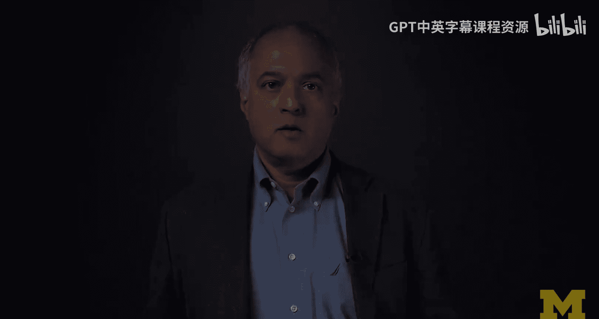
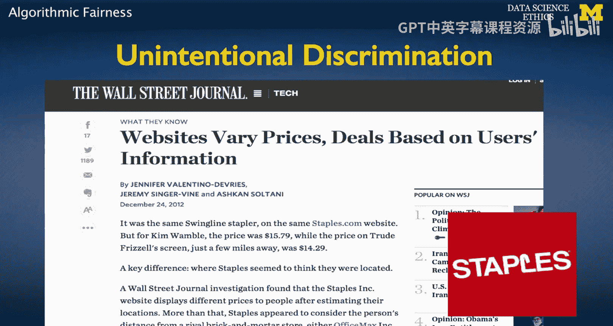

# 密歇根大学《数据科学伦理｜Data Science Ethics》中英字幕 p35 34_算法公平性.zh_en -BV1EGaVzeEbQ_p35-

Welcome to this mar on algorithmic fairness。

Often， we say， let the data speak for themselves。What could be less biased？What could be more fair。

Then just following the data and letting the data take us wherever they may lead。Well， it turns out。

That algorithms can be biased。And there are many ways in which these biases can arise。

 can have these biases because the training data set isn't representative of the population。

Because the past population is a representative of the future population。

 because they are confounding processes that lead to correlations that are flukes。

Let's begin by considering a simple example。So here's a company that has only 10% women employees。

 and it has a boys club culture that makes it difficult for women to succeed。

The hiring algorithm is trained on current data。And based on current employee success。

 it scores women candidates lower。The algorithm。Is fairly representing。What happens today。

It's fairly representing。That women have difficulty succeeding in this company because of the boys club culture。

But the net consequence of this is that the algorithm is scoring women applicants lower。

 and so the company ends up hiring even fewer women。

This is an algorithmic vicious cycle that arose because of a bias in the algorithm。

 and a bias arose in the algorithm because of the data that it was trained on。

The net effect is nicely captured in this cartoon。If you've got a cyber cafe for Max。

 you're not going to get any data about Ps。And you don't know what kind of services to provide if you're going to make a PC user happy。

This kind of thing is now being recognized。 and it's even there on TV。

Such as an episode of the CB S serial， a good wife。So。What are things that can give us。Bad results。

From good data。Want to talk about three。Different thanks。First。A notion of correlated attributes。

A second， a notion of misleading results。Even if they're correct， and third。

 a more technical thing of be hacking。Let's begin by talking about correlated attributes。

Racial discrimination。Has been a major historical problem in the United States。

And there are many laws concerning racial discrimination。On the one hand。

 you have laws that prohibit consideration of race for some things。For example。

 universities are prohibited by law from considering race and admissions。

At least some universities in some states。Now universitiesivers may value diversity。

 may want to consider race， may have affirmative action interests in mind。And so。

The way that they can deal with this law is to find other features that can get them。

The diversity that they seek without violating the law。Famously， for example。The University of Texas。

Completely changed the notion of how they were considering race in admissions。

And they completely took it out and simply said they take the top 10% of the class。

In any school in Texas。And given the strong degree of racial segregation in Texas high schools。

They knew that there would be many high schools。That had minorities。As essentially。

 the population of the school and therefore minorities in the top 10 per cent。

And this would give them the diversity of。Student body that they sought without in any way。

 breaking the law。Now the same notion of racial discrimination。

That intent is a problem that we've had with lenders in the past。

 didnn't want the lend two Borers were black and。Laws were passed to prevent them from such discrimination。

So they found a technique of using surrogates。Specifically by redlining neighborhoods in the city that were。

Primarily， minority。And。They could use that idea。To get them very close to the racial discrimination that they wish to do。

And so now the laws prohibit lenders from explicitly redlining either。That。

Stops one specific notion of surrogate attribute。The point really is that， in general。

 proxy attributes can be found。 And if you were a lender who wished to discriminate on the account of race。

 it's probably not too hard for you to find other attributes that are highly correlated with race and that you can use legally。

And you could use that to discriminate if that were your intent。

So really the point is big data provides the technology to facilitate such proxy discrimination and the saving grace is that big data also provides the technology to detect and address such discrimination。

And so it is up to us as responsible data scientists to make sure that we are using the power of the technology we have。

To do the right thing。One of the things that we want to do is to stop unintentional discrimination。

There is。A well known case of the Stapled store。That unintentionally discriminated。

Based on user zip codes。 And this kind of thing could have been stopped if the right discrimination analyses had been done ahead of time。

So in short， intent matters when one is considering discrimination。

And one has to be clear about what kind of discrimination one wants to avoid。So to talk about this。

 let's talk about discrimination as one target group versus everyone else。

So what we want to consider as discrimination is if an individual from the target group gets treated differently from an otherwise identical individual。

 not from the target group， so you have a black person or white person with identical qualifications one gets a callback and the other one doesn't for a job interview。

Well， we can all agree that that is discrimination。

But that is discrimination at the individual level。

There is also a question of discrimination in terms of aggregate outcome。

And here it's a broader definition of discrimination， so you can say。

What's the percentage success of the target group。Measured with respect to the control。

 which is a general population。 And you can compare this amongst the candidates。

 We can compare this as a ratio of the full population universe。

 as a ratio of the qualified candidates。And the exact results that one gets in each of these is a little bit different。

 but they all show to what extent we are managing the societal outcomes with respect to discrimination。

Another thing to keep in mind is that unintentional discrimination。Is hard to avoid。It happens。

And we need to use our data analytic techniques。To be able to avoid these better。In 2015。

Experiments at Carneinggie Mountain University showed。

That significantly fewer women than men were shown online ads。For high paying jobs。This happened。

 presumably， because。The ads that were shown were selected based on recent past history of clickthroughs。

 and presumably， men were clicking on these ads for high paying jobs more often than women were。

And so this was， again， not。Intentional discrimination on the part of some company in their choice of ads。

Let rather。Alrithmic discrimination that took place， because。It was promulgating the status quo。

