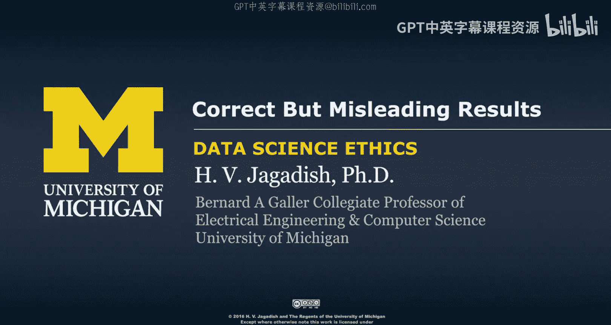
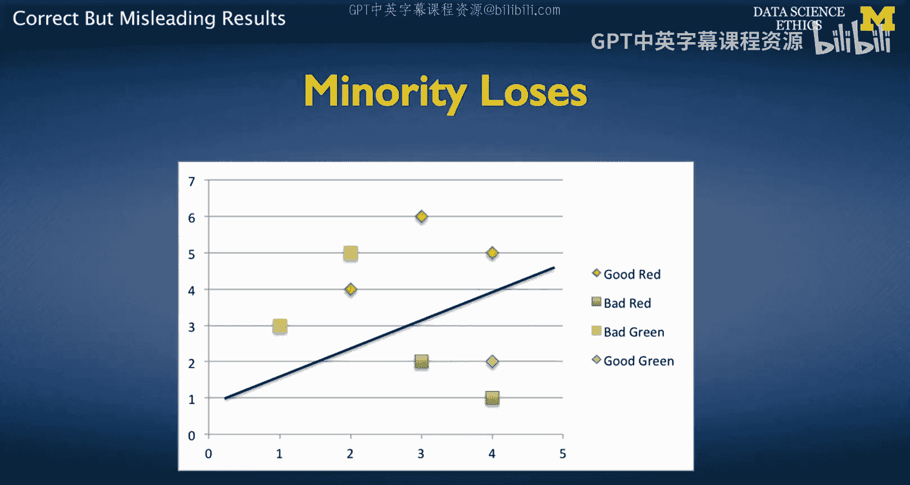

# 密歇根大学《数据科学伦理｜Data Science Ethics》中英字幕 p36 35_正确但具误导性的结果.zh_en -BV1EGaVzeEbQ_p36-

One issue for fairness is where we have correct results。But， they're misleading。

But they unfair in some way。Here's an obvious thing。

There's a question of how you visualize the results or how you present them。So here's this company。

And we're looking at their sales year over year。 It looks like a fantastic growth curve。

 a nice hockey stick with a little upward tech。😊，Looks really great， isn't it。

Now that's the visual effect。But if you look at the scale on the left hand side。

 the scale along the Y axis， we see that really what's happened is over a six year time period。

Sales have gone from 100。205。If you look at this data plotted in a normal， unsscaleed way。

Might look more like the graph on the right。What we see is a company。That's had a perfectly。Solid。

 decent performance。Consistent， year over year。But certainly no explosive growth at all。

Scott a small， very small， in fact，5% cent growth over a six year period。

 Nothing to write home about。Visualization。Is， perhaps。most obvious place。

Where one can have misleading representation of。Data。There are many other places that one sees this。

Consider a reputation system， a travel system where we are looking at user reviews and using that to choose a hotel to go on a vacation at。

A lot of these systems exist， and they typically give you a rating between one and5。

So we have two hotels here， Hotel A that gets an average rating of 3。2。And this 3。2， it turns out。

 comprises a mix of mostly threes and fours。 There's another hotel B。

 which also gets an average of 3。2。But this 3。2 is a mix of mostly ones and fives。questionion is。

 which hotel would you prefer。Many reputation websites will focus just on the average。

 and that's what didd be ranking hotels by。 That's what you might order your search results by。

 and so on。And this important difference between the two hotels。

Is going to be obscured unless you really look into it。My point is that something like a hotel B。

 which people either love or hate， is a hotel that could either be exactly the perfect hotel for you。

Or hotel that you're going avoid by a mile， depending on whether you're more like the people who rated a5 or more like the people who rated a one。

Calling it a 3。2 is not right because it's either a five or a one for you， depending on who you are。

And figuring out which of the two you are is not easy。Without extra work。

And it's certainly not there in the single score that we see。

Single scores are a problem for another reason， so here's Hotel A different example that gets an average of 4。

5 based on two user reviews and a hotel B that gets an average of 4。4 based on 200 user reviews。

Which would you prefer。You're me。Id probably say I prefer Hotel B， and actually。

 I'd prefer B by a lot。4。4 is less than 4。5。And so in terms of a sort order， 4。5 might come first。

However。We all know that it's too easy on most sites to place a few false， positive reviews。

And so we're kind of worried about that 4。5。Whereas the 4。

4 seems like a much more solid number that we can rely on。 And that's why I would pick B over A。

 Even though the single score that is reported is lower。Let's look at this slightly similar example。

 even further。Let's say now that Hotel A gets an average of 4。

5 with 10 reviews and Hotel B gets an average of 4。4 with 500 reviews。Well， if this was all you knew。

 you'd prefer Hotel B， as we were just discussing。But now。

 if you also know that Hotel A has just five rooms。Well， hotel B has 500 rooms。

Does that change your decision。And my sense is that at this point。

 we probably prefer hotel A and by a lot。Since Hotel A has fewer customers should expect it to have fewer reviews。

And so the fact that it has fewer reviews is something you shouldn't hold against it。

Given that it's so much smaller than hotel be。So where does all of this lead us？

If you're going to tell me something about the results of the data。

 often you have to boil it down because that's what one has to do to be able to complete the analysis。

And this is particularly the case where the consumer of whatever you're doing is a downstream algorithm。

 yet another algorithm is going to do something more with it。However， doing so often suppresses。

A lot of the richness in the data that might be important for decision making。

Here's another place where data of importance may get suppressed。

So we know that the world has right handed people and left handed people。

And just to keep things simple， let's say that the world is divided between exactly these two types of people。

 and we leave out， you know， people who are missing a hand or people who are ambexxterrous and so on。

 So let's just say the world is divided between right and left handed people and that there are far more right handed people and there are left handed people。

Well， given that's what the world looks like。Designers of products， if they have to make a choice。

 will design their products to support right handed people， even if that means that。

Knoobbs and levers and things that need to be manipulated are less conveniently placed for left handers。

Where products can be made in right handed and left handed versions。

 people may make both versions of products。Now， in the case of right handed and left handed。

 this is a simple scenario。 and we all know what this means， and we can actually observe。

How people make these choices。Where these same properties are less clearly understood。

These things are much harder to deal with。So let's look at a world where we have a red majority。

And a green minority。And we are trying to separate the good from the bad。Now。

 diamonds are good and squares are bad。And if we look at the majority alone。

We will end up with a nice separation line like this。 All the diamonds are above the line。

 All the squares are below the line。Unfortunately， this division is exactly the wrong division。

For the green group of people。Now， in my example here。

 there are only a few red dots and a few green dots。

So the effect of the majority is not that obvious， but suppose you had a harder times as many red dots as you had green dots。

Well， this is the kind of line that your algorithm would draw。And。Green would just lose。

And so you have this hiring algorithm that is looking at some attributes and choosing the attributes on the basis of which to hire。

And the criteria that this algorithm is using have been tuned to fit the majority。Now。

 if the criteria happened to be different for some minorities。

At least if the optimal criteria for some minorities may have been different。

And the algorithm is going to perform poorly on these minorities。

And because this algorithm performs poorly on these minorities。We have a few different problems。

 First， the best minority applicants may not be hired。As we saw。

The green dots are being classified the wrong way。

And。We now have a very qualified minority applicant who would actually do very well。But。

Because our algorithm is badly tuned， this person gets rejected。There is a further problem。

 which is that the hired minority employees are now not the best because of the poorness of our algorithm training。

And because they're not the best， they end up performing not as well。And in consequence。

 they unfairly besmirched others in the minority because now the algorithm is going to learn。

That minorities don't do as well。And so。We began by suppressing diversity。

 and ended up discriminating。It isn't just with respect to hiring。

 Let's look at this in a medical scenario。We have a clinical trial of a new drug to treat diabetes。

And it turns out that there are actually two quite distinct groups of patients。

Who have been pulled together because in terms of what we know about medicine today。

Both groups of patients have similar glucose regulation issues， so what we know。

 we put them all in one pool。And because the disease mechanisms are different in the two patients。

 the drug is very effective for patients in Group A， but is worthless for patients in Group B。

So let's see what happens in this clinical trial。If group A is a majority。

 then the drug will be found to be effective。And will report some significance level will say this drug is effective and this drug will be prescribed for anybody with that kind of diabetes。

 and patients in group B for whom this drug is worthless will also be given this drug。

On the other hand， if group B isn't the majority。Then the drug is not found effective with sufficient significance over the whole population。

And we will simply end up not approving the drug。And even though there is a minority of patients。

 the patients in group A who could have benefited from this life saving drug。

 it's never going to be marketed。 It's never going to be approved。 In short， having。

The right results， But doing so in an overly simplistic manner。

Can lead to very significant societal consequences。

