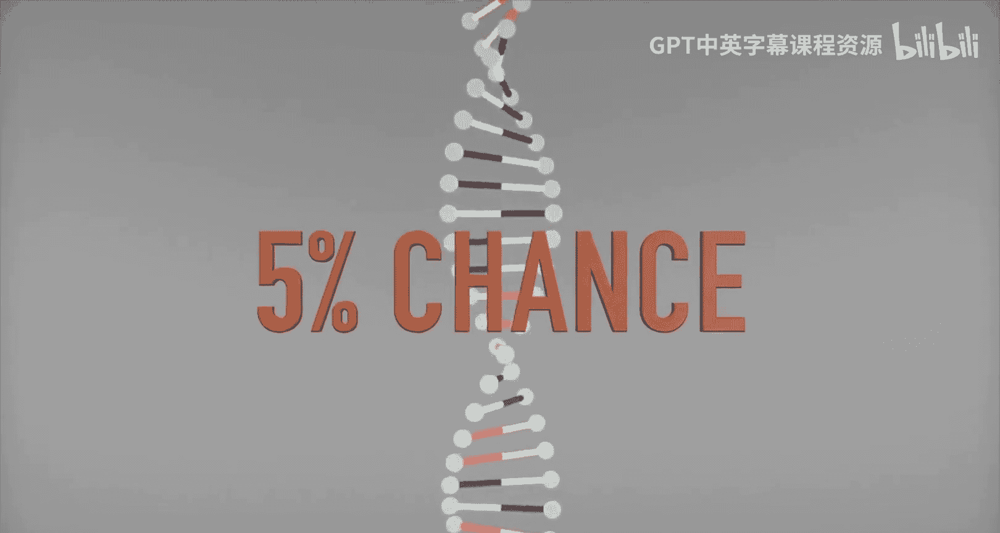
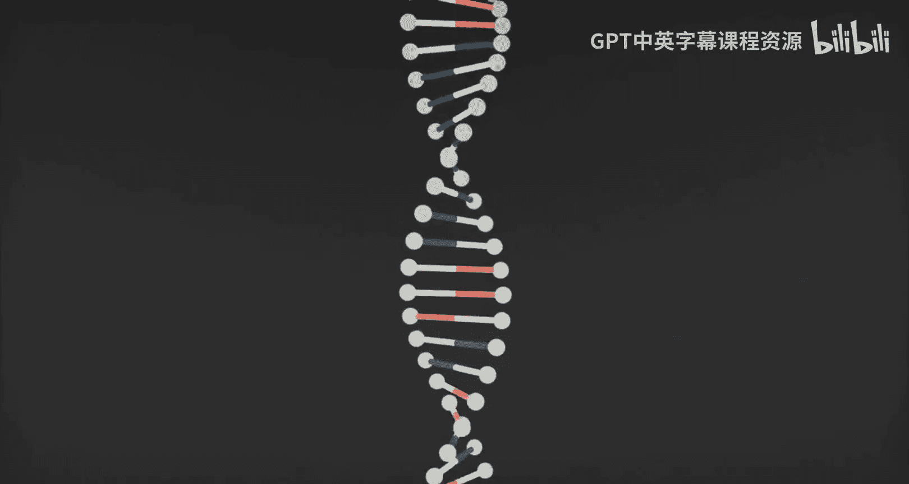

# 密歇根大学《数据科学伦理｜Data Science Ethics》中英字幕 p38 37_案例分析：高通量生物学研究.zh_en -BV1EGaVzeEbQ_p38-

🎼Traditionally， biologists worked at a bench and investigated individual biological entities of interest。

Today， we have something called high throughput biology。

And the way this works is that on a single gene check， you can have thousands of genes。

All of which can be measured at the same time。And so what you're going to do is take a few samples of one type of tissue。

 let's say healthy tissue， and a few samples of let's say disease tissue。

And you just measure the level of gene expression in each for every gene。

Comparing the levels of gene expression in the two tissues。

 you can look to find genes where there was a substantial difference in the expression level between the healthy tissue and the disease tissue。

And you can then have something to do with that disease process。🎼You could investigate that further。

This kind of high throughput biology has been extremely effective in giving us clues to。

Many disease processes that we didn't understand。🎼Before， however， from a statistical perspective。

🎼There are some issues we should think about。When you want to compare samples from two populations。

The way that you do this usually is by means of a P test。And let's say that you take a P value of 0。

95。What this says is。That there is a 95% chance。That the difference that you're seeing in the expression levels across the two populations is something that。

Was not due to chance that there is only 5%。Probability that it is due to chance。

Now this is true for any one single gene。Where the expression level is different in terms of the P value that we just talked about。

But now we do this for 25，000 genes。If for any one single gene。We have a 5% chance that。

The difference we're seeing is purely to your chance。Then if you look at 20 genes。

One of them， on average， is going to have a difference purelyly to chance。And if you look at 20。

000 genes， a thousand00 of them on average， are going to have a difference in expression purely due to chance。

The actual number of genes that are involved in the disease process。Maybe only a few dozen。

And so we have a few dozen genes of interest where the expression level is different because there is a real biological difference。

And possibly a few hundred， maybe a thousand genes where the expression levels are different。

Purely due to chance。In other words， you've got some information there。

 but you've also got a lot of noise。And how to separate this information from this noise requires。

Careful downstream analysis。As opposed to taking。🎼What one sees as。The gospel truth， simply because。

It meets some P value criteria。