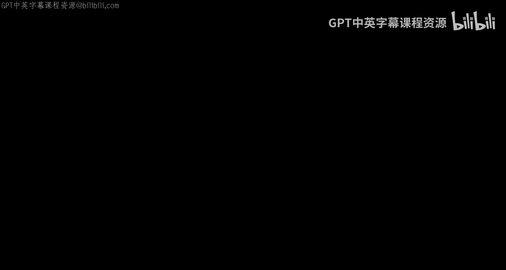
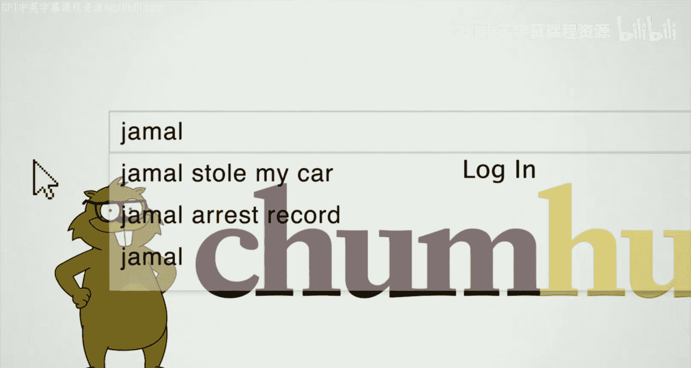
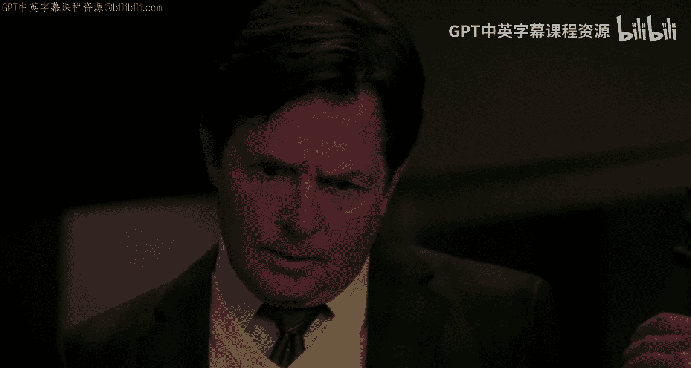
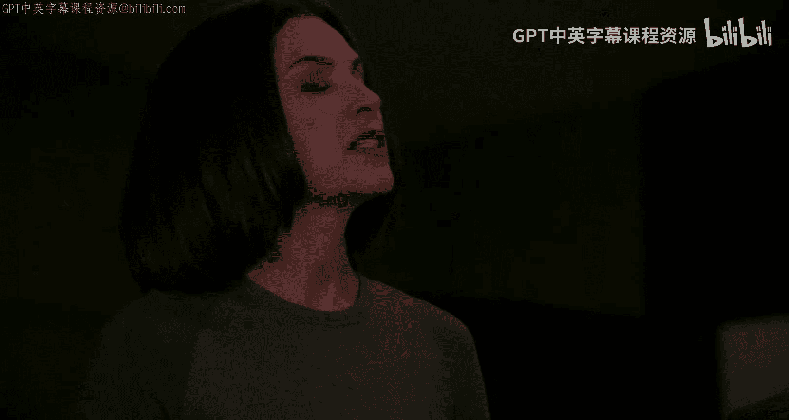
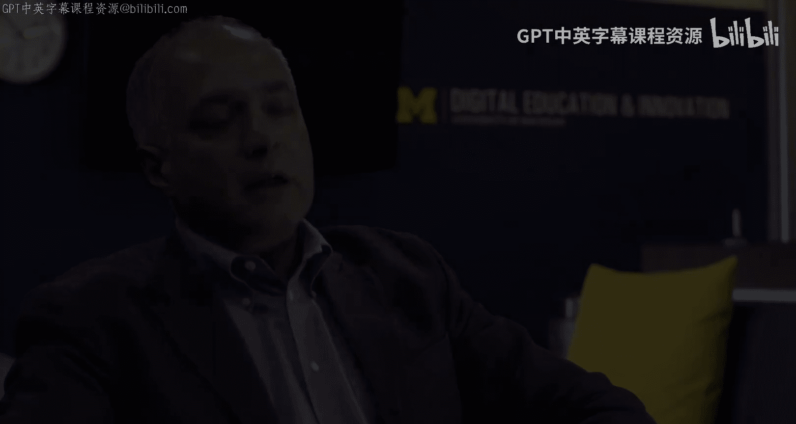
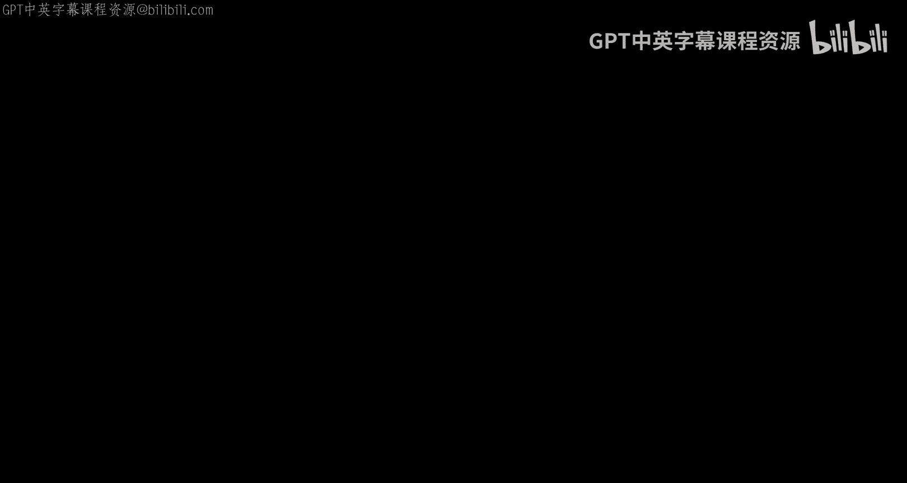

# 密歇根大学《数据科学伦理｜Data Science Ethics》中英字幕 p40 39_案例分析：安全与收益的博弈.zh_en -BV1EGaVzeEbQ_p40-

Sometimes television can do a better job of reflecting hard truths than real life。

 Let's watch some video clips from the CB B S series。 the good wife。 This is a series set in Chicago。

 and its law oriented。The point that we want to look at is this company that they feature called Chmham。

Which is a large。Information Technology company。Sort of Google like in terms of what it does。

And specifically， a maps product that it has put out。Let's watch。We used to book up weeks in advance。

 our venison pot piee was written up in the trip， we were zgged rated。

Then people just stopped coming it's hard not to take it personally when it's your baby and why is chum on responsible their maps program chummy maps。

 it's supposed to help users stay safe by giving them directions to avoid the dangerous parts of the city green safe the yellows so so and red means stay away when the filters on driving directions avoid the red areas filters always on by default。

You have to manually turn it off so you lost your foot traffic and this watch when I toggle the filter on and off doesn't show businesses in the red parts of the map when this came out。

 it was like I didn't exist。 It says this is an unsafe area Yes， a red zone。Doesn't feel unsafe。 Yes。

 except for one thing。Too many people of color。What we just saw is a case where there is real life impact on this particular restaurant owner on account of something that。

Chumham created in their product as a service to its user community。

Let's look at the next clip to see what Chmhamm was thinking when they did this。

Our maps are not racist。 It's run by an algorithm and math is not racist。

 Chm is very proud of its diversity and opening theres safe filter deter tourist people from patronizing businesses an African American neighborhood。

 is's not responsible for the actions of those who respond to its software。 was M。

 Feldman's choice to open a four star restaurant in a marginal neighborhood。

 not It isn't a marginal neighborhood。 It's a black neighborhood both。

 which really isn't that uncommon。 Wait， what he's not saying anything that unusual。

 Look a crime rates。 Look at home Valley look at the biracial lawyer pimping for a racist Excuse me。

 Are you That's not wait，y， wait。Chumho will admit no wrongdoing。

 but in the spirit of making this world a better place， Mr。 Harmon is willing to offer M Feldman $50。

000 to open a new restaurant anywhere she wants What is that The finger Chumho is worth 300 billion how much my company is worth thank you that because your stock dropped 22% since you became CEO you you know what you know what。

You guys a piece of work，ly for you， the laws on his side。 we'll see。

You're suing Chumham for torious interference with prospective economic advantage Yes Your Ho Chumham's safe filter creates a racist geo fencing effect that disadvantages business owners and African American neighborhoods Your Ho Torious interference requires proof of either purposeful or knowing interference and there is none we believe there is I'd like to call a witness to show that the intent requirement is not met。

Mr。 Harmon， is it possible for Choumham's safe filter to have a racist intent No the filter is powered by two things and two things only objective third party statistics crime rates for example。

 and user generated feedback did like comments and reviews yes exactly which is entirely in the user's hands I mean there's no way that anyone at Chumham could use a safe filter to purposefully interfere with plaintiff business No not even if we wanted to thank you Mr。

 Harmon is it true that chummy mapps is only available on COs Chumham's own operating system Yes this is a recent study done by the Internet research foundation。

Could you read what it says right there COS users are 71%？

Caucasian and what percentage of COs users are African American does it say 11% and do those numbers match your own market research Chham is not to blame for socioeconomic disparity？

So we saw here that there is。A social impact of the decisions that this algorithm from Chamham。

The decisions that this algorithm makes。The question is。

What kinds of inputs are reasonable for Cheummy maps to consider。If it is objectively considering。

 let's say only crime statistics。And just objectively saying。

 these are neighborhoods with higher crime。Is that okay or is that not okay？I don't know the answers。

This is a question of。Having an overall social consensus over what is okay to say。Potentially。

 let's say that that is considered reasonable。There is then a different question， which is。

Is it okay for Chami Mas to consider as input what people think is a safe neighborhood？As opposed to。

 starting with。Actual crime statistics。And now this is a subjective assessment of I feel safe in this neighborhood。

Which depends very much on who the speaker is。And the problem that we saw in this episode is that the subjective assessments that chummy mapps is aggregating。

Is subjective assessments。With a highly skewed user population。

 with the majority of the assessments coming from。Caucasians。And therefore， reflecting。Whatever。

Racial biases， there might be in terms of personal assessments or what's a safe neighborhood。

This kind of hidden。Racism。In algorithms。Can show up in many other places。The next clip。

Is a riff on an actual incident that took place with Google's image recognition a few years ago。

When he typed in his name， Jamal， the autocomp， offered to finish the sentence with Jamal stole my car or Jamal arrest record。

 so good。

But it's nonrespon really how do you figure it's customer based I mean the autocomp is based on the most use search requests so obviously more people who type jammal were interested in arrest reports than anything else So Tom hum's not racist Its users are won't argue that it's racist to override the results。

Okay， we need to deal with the animal incident。 I like the sound of that。

 Chum hum has photo identifying software。 It sorts your photos into categories， camping trip。

 Disneyland graduation。 One of the customers pointed out that it had tagged photos of her friends。

This is Josh， you can speak a little more specifically as to you know。Yeah。

 so the photo wasn't tagged by a person， it was tagged by an algorithm and the algorithm can't tell the difference between an African American woman and an animal。

Well， it can now， but。Three years ago， we hadn't given enough examples。

 it had real trouble with light and shadow。It got a lot of other stuff wrong， too。

 just nothing else that looked so。Racist， right。It's gotten better。 Google had this problem too。

 Did the algorithm ever mistake a white person for an animal。

Why would I do that because it mistakes white people for color bears or white seals No， not so far。

 Why not？Why does it have trouble identifying African Americans， but not Caucasians？I guess。

Because we hadn't given it enough examples。 we're not racist， I'm not saying you are。

I'm just looking around your workplace。We have repeatedly discussed in this class the importance of。

Sampling data correctly。So that you have the correct population that you use as a basis to train any algorithm。

What we saw in this clip。Is a poor choice of training data。

In that there weren't enough African American faces。That the algorithm was strained on。

Whether or not the consequences。Had a discriminatory result of whether or not this was a race issue。

Which it did in this example and therefore makes it more salient。

I think that it's pretty straightforward to say that。In this example， the designers of the algorithm。

Messed up in that。They didn't。Use the right training data。

It is easy to see how someone could have made such a mistake。

The point is to watch out and try our best not to do so。

