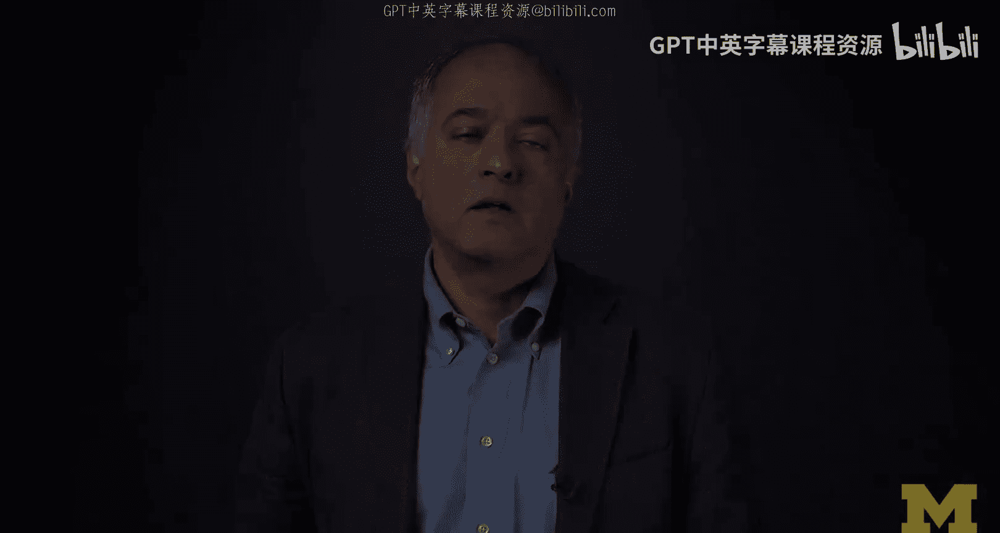

# 密歇根大学《数据科学伦理｜Data Science Ethics》中英字幕 p41 41_社会僵化现象.zh_en -BV1EGaVzeEbQ_p41-

Another societal issue that one needs to think about as a data scientist is what I call osification。

In the media world， we know about something called the echo chamber。

The idea is people are selective about the websites they visit and the news channels they watch。

 the talk shows they listen to， and so by self selection。

 there's a reinforcement of opinions by others with similar views。

And so we don't hear the conflicting views。 We don't hear the other points of view。

 And so we just reaffirm whatever our preconceived notions are。

 rather than hear a variety of opinions and then possibly change our minds。In data science。

 analytics has a possibility of making it harder for people to break out of stereotypes because these things get baked into the algorithms。

So to see an example of this。Let's look at what happens when you hire by algorithm。

A lot of companies use algorithms to rate applicants and then look at only the top scoring applicants。

And these algorithms might be based on things that are known about the applicants in terms of their CV。

 or it could be based on tests that are given to them when they apply。In any event。

 consider a talent matching company that has its proprietary algorithm that's recommending candidates on the basis of whatever it knows about the candidates。

How does it choose， who to recommend？ Well， its goal is to find candidates who meet the demonstrated interests of their client。

 the employer。And so if I've shown you some candidates before。And you've decided。

To interview a few of them。I get feedback。Oh， this person I recommended to you。

 You didn't interview this other person I recommended to you。 You liked that person。

 and you interviewed this person。 and you hired that person。And so。

This is something that I'm going to use to tune my algorithm so that I can make better recommendations to you。

 You'll appreciate my recommendations more if I tune them to match what you like。😊。

So all of this sounds like a very reasonable thing to do。

But a consequence is that the recommendations being given by this algorithm。

That the talent matching company is tuning。Now reflect existing biases in the interests of an employer。

In other words， the recommendation engine， which is completely value neutral。

Has learned to cater to the employer's prejudice if there was one。Now。

 if the employer changes their policies or there's a different hiring manager。

What happens is the recommendation engine has baked into itself the biases from the past。Over time。

 presumably。It can fix itself。But。We've basically added a considerable delay， at the very least。

And made it more difficult for。The employer to get rid of past discrimination。

Because the algorithm is a force towards maintaining the status quo。

Thinking about the same problem from a different perspective。

We do know that humans have deep rooted biases。 Many of these are unconscious。

 and will act in certain biased ways， even。If you're making a conscious attempt not to。

And we know that humans tend to have mostly similar people in their networks。

 and they tend to feel more comfortable with similar people。

 And so if we rely on purely human notions of hiring。

 we are far more likely to have a lack of diversity in our hiring。And so algorithms can be written。

To overcome these biases， explicitly。And by doing so， we can actually have algorithms that。

Result in greater diversity。 It's just that one has to make sure that this is explicitly written into the algorithm design。

Let's look at another aspect of hiring to see some of the issues that can arise。A thing that。

Some companies have discovered is that employees who have a long commute to work are more likely to quit sooner。

One can easily understand why this might be the case。

If somebody finds an alternative job with a short compute， of course， they're likely to prefer that。

So。If somebody is deciding who to hire， it's not unreasonable to factor commute time into the algorithm for rating job candidates。

 After all， a company wants to hire employees who are likely to be happy， likely to stick around。

 You don't want to spend a lot of resources hiring somebody who's going to get to work tired after a long commute and is likely to quit。

In a short while after they。Undergrne initial training and and settled into their job。

A problem with this in terms of societal implications is that many employers are in expensive neighborhoods。

And there may be no cheap housing in the vicinity of the employer。

And so if one prefers employees who live nearby and have shorter commutes。

This may actually bias the hiring against poorer applicants who live farther away because they don't have a choice。

Xerox， one of the companies that was in this sort of situation。

 noticed the societal consequence when they were implementing hiring with algorithms to decide who to interview。

And made a public statement about explicitly not considering commute time in their hiring algorithm because they felt that it had an undesirable societal consequence。

It's this kind of ownership of the consequences that。We need to do on a consistent basis。

So that we can get the benefits of。Data science， without。Having harms that we didn't intend。

