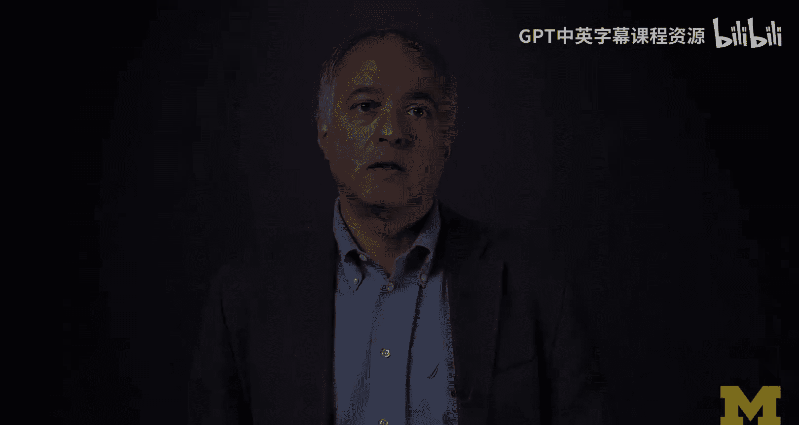

# 密歇根大学《数据科学伦理｜Data Science Ethics》中英字幕 p42 42_监控社会.zh_en -BV1EGaVzeEbQ_p42-

Let's talk for a moment about surveillance。We are collecting more and more data about us。

 and this is just going to keep increasing。We have video cameras， of course。

 but we have smart meters that are recording data about what's happening with our utility consumption in ways that old style mechanical meters just didn't do。

We have things like Fitbits that are recording。Every activity that we participate in and every move we make literally。

 as this continues， we are going to get a record of everything that we do， every breath that we take。

And we do this because we get benefits as individuals from the data that we collect about ourselves。

If you wear a Fitbit， you do so because you want the health benefits from monitoring your exercise。

There are societal benefits too， from the collected data。For example。

 law enforcement may get benefits from looking at some of these detailed records。

 Medical science may get benefits from analysis of large numbers of electronic medical records。

So potentially at one extreme， we could decide as a matter of policy that we want all this information record。

To be completely open， to be accessible to everyone。

To live in a world where everybody knows everything。 And there's no deceptions。The problem with that。

Is that deceptions actually may matter。We need deceptions。

We have an explicit notion of expunging past history， for a fresh start。

People's records are cleared of their prison time for many offences after seven years in the US of driving offences after three years。

We know that personal relationships are hard。And sometimes， having a fresh start is important。

Just in termss of our social interactions， we tell little white lies all the time。

 We would need to adjust dramatically if we needed to live in a world where these little white lies weren't possible。

 and we had the star glare of complete honesty。This is another issue to remember。

 the process of quantification。Loses meaning。There's often a lot of richness in understanding the actual data。

But when it's reduced to a number。That number may not reflect what we actually had in that rich data。

 We should be wary of over reliance on such quantified numbers。

 which is often the record that we create。So these are a few reasons why deceptions matter。

There are more obvious and more serious things， too。

 where if you live in a country with an authoritarian government。

 then small deceptions may actually be necessary， even just to lead a normal life。

So for all of these reasons， we've got to figure out as we create this valuable and enormous record of data。

How we are going to control who has access to what。And。There are difficult choices to make。

And it's particularly hard。Because of the anonymity conundrum。

Which is that much value can come from the analysis of anonymized dataset sets。

But anonymization can be broken with sufficient effort， in most cases。

And so we have to worry about shading of any sort because unrelated patterns can provide identification as an example。

Netflix released。D identified data of movies that people had。Rented and the scores that they。

Gave to those movies。Some of these people， for some of these movies。

 had also posted reviews on social media。And correlating these was enough。To reidify。

