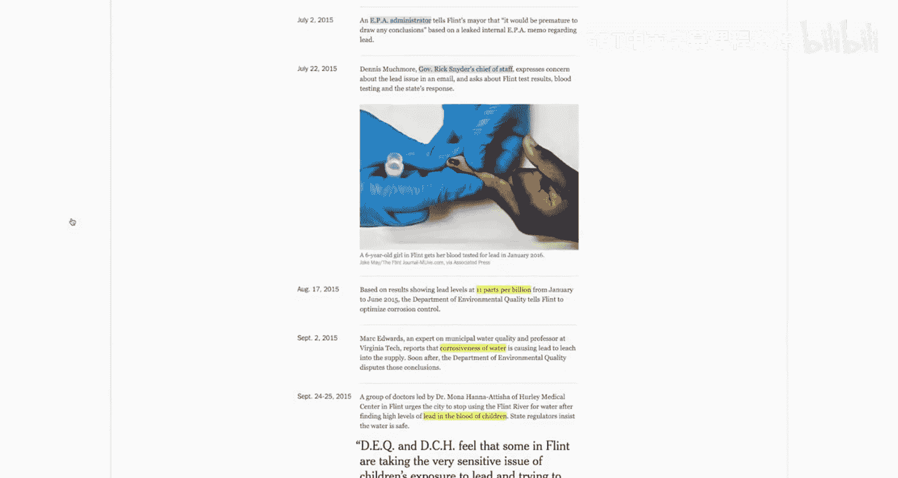
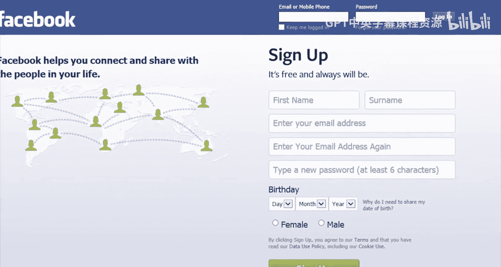

# 密歇根大学《数据科学伦理｜Data Science Ethics》中英字幕 p43 43_案例分析：社会信用评分体系.zh_en -BV1EGaVzeEbQ_p43-

In the United States and in many other countries。🎼People have something called a credit score。

 which is a single number that represents how likely they are to repay any loans that they might take out。

 This credit score gets used by merchants， when they offer goods on credit。

 by credit card companies and banks when they are offering cards， mortgages， things of this nature。

 It's even used by things like landlords when they want to offer an apartment for rent。

 So they are real financial consequences。What goes into making a credit score？

🎼Is also more or less public， and people know that having a good history of making payments on time is important。

 not having too many inquiries is important。 This idea。Is something that。

China has recently announced they would like to expand。

To create what they're calling a social credit score。

All details of this social credit score are not yet announced。And as far as I know。

 are actually not even completely determined。However， we have。Some indications。

There are already some locally created credit score type things that Chinese merchants have been doing and that the government is promoting the creation of as a trial balloon towards the social credit score。

Alibaba， for instance， has something called their Sesame credit。Looking at what these。

Credit systems do。 and what the government is saying。 There are a few things that one can take away。

It appears that your credit score。For the social credit system will depend not only on your reliability in making payments。

 etc ceter， but also on other things， for example， on what you buy。

🎼If you buy a lot of video game time， for instance。

It is likely that youre somebody who just ws away their time sitting on a couch。On the other hand。

 if you're buying diapers， let's say。Then you're probably a parent of a young child and if you're responsible enough to。

Take care of a young child and remember to buy diapers for your child。

 then you're probably a responsible person and therefore deserve a higher score。It is。

Not just what you buy， but also the kinds of things you do with things you buy。

 so for example you may have the right to return a product that you bought online if you're not satisfied with your purchase but every time you do a return that may damage your credit score and so this is something that。

You might be encouraged to use as a last resort if you're really unhappy。With your purchase。

 but it's not something that you can afford to do on a regular basis because if you frequently purchase and return things。

 then you will end up with a low social credit score and you may no longer qualify for online purchases or purchases that come with。

呃。Return guarantee。Non commercial transactions are also things that。二。

Expected to be included in this notion of a social credit score。So in particular。

 what you do on social media can make a difference。

If you link to articles that the government would consider。Good citizenship。

🎼Or if you point your friends to articles of this type， then you can get social credit points。

 whereas if you do that to articles that are more controversial。

 you might lose social credit points all of these things have people troubled and given。

That China is not a democracy。It is easy to see many ways in which this kind of system。

Could be abused。But let's take a step back and look at。Some parallels with things that are。

Happening in other places such as the United States。We have。For a long time， had insurance companies。

That would pay you whatever you were insured for。But charge you a higher rate。For having。

Exploited your insurance policy。And that is considered。

A perfectly reasonable thing to do so for example， if you have an auto policy。

 you have a certain premium that you pay initially， if you have an accident。

 they will pay for their repairs and then they will charge you a higher insurance rate the next time。

The justification is that。In terms of probability models。If you've had one accident。

 you're more likely to have a second accident than the average person。

And so it's a well justified thing。But the question is。

 is that that much different from somebody who has returns on a product。

 if somebody returns a product once， they're more likely to return a second product than a random person who's never done a return？

Now that we have sensors that can be mounted on cars。

Insurance companies are looking at having these sensors report to them。Your driving habits。

And your insurance rate will be tied to how well you drive and so even if there is no claim made。

 if you drive in a rough manner， if you break suddenly， you go over the speed limit。

 all of these things are things that will drive up your insurance rate and there's a question of how societal acceptance will be。

For these kinds of products in the financial world。

It used to be the case that credit scores were the standard thing that everybody took into account。

But today we have a number of new financial entities that are building more complex and more interesting financial models。

 taking into account a wide range of data that they have access to about you， including for instance。

 your social media postings and now they have something that gives them a better basis to choose your。

Credit worthiness than just your credit score。🎼So yes。

 the only place that this is making a difference is in terms of giving you a virtual credit score that some startup financial company has for you that's different from your official credit score。

 But how do you feel about。All aspects of your life or all aspects of your life that they have access to。

Folding into their construction。Using a completely proprietary algorithm of a credit score that they use to decide whether to do business with you。

Vast amounts of data and multiple sources that are。

Available and even more going to be available in the future。And as a society， we have to decide。

Which of these makes sense to do and how much control individuals should have about how these data get used。

