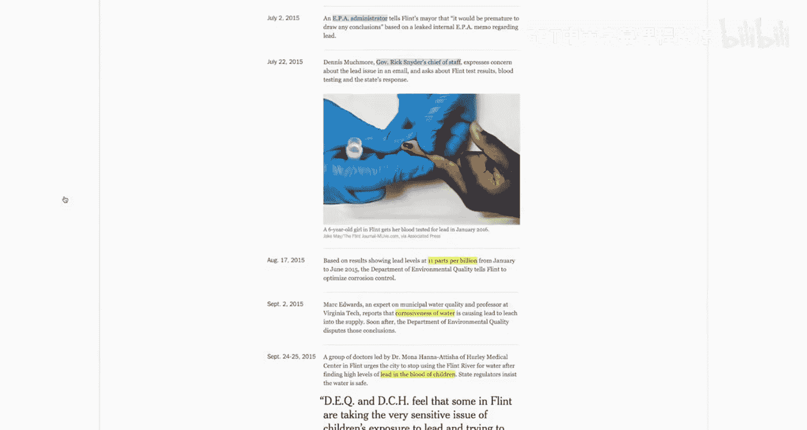

# 数据科学伦理：4.3：案例分析：社会信用评分体系 🏛️

在本节课中，我们将要学习一个关于数据应用的现实案例——社会信用评分体系。我们将探讨其基本概念、运作方式，并将其与其他国家的类似系统进行比较，以深入理解数据科学伦理中的核心问题。

---

在美国和许多其他国家，人们拥有一种被称为**信用评分**的东西。

这是一个单一的数字，代表他们偿还可能申请的贷款的可能性。

商家在提供赊销商品时会使用这个信用评分，信用卡公司和银行在提供信用卡、抵押贷款等产品时也会使用它。

甚至房东在出租公寓时也会参考它。

因此，信用评分会产生真实的财务后果。

信用评分的构成要素也基本是公开的，人们知道拥有良好的按时还款记录很重要，过多的信用查询记录也很重要。

这个概念，是中国最近宣布希望扩展的领域，旨在创建他们所谓的**社会信用评分**。

社会信用评分的所有细节尚未公布。据我所知，甚至还没有完全确定。

然而，我们有一些迹象。

中国商家已经在实施一些地方性的信用评分类系统，政府也在推动创建这些系统，作为社会信用评分的试验。

例如，阿里巴巴有一个名为“芝麻信用”的系统。

观察这些信用系统的做法以及政府的表态，我们可以得出几点结论。

---

上一节我们介绍了社会信用评分的基本概念，本节中我们来看看其可能的评估维度。

你的社会信用体系评分似乎不仅取决于你的还款可靠性等，还取决于其他因素，例如你的**购买行为**。

举例来说，如果你购买大量游戏时间，你可能被视为一个浪费时间、躺在沙发上的人。

另一方面，如果你购买尿布，那么你很可能是一个年幼孩子的父母。如果你有责任心照顾孩子并记得为孩子购买尿布，那么你可能是一个负责任的人，因此应获得更高的评分。

评估不仅包括你购买什么，还包括你如何处理所购物品。

例如，如果你对在线购买的产品不满意，你可能有权退货。但每次退货都可能损害你的信用评分。

因此，这可能是你在确实对购买不满意时，被鼓励作为最后手段使用的方法。但你不能经常这样做，因为如果你频繁购买并退货，最终会获得较低的社会信用评分，可能不再有资格进行在线购物或享受退货保障的购买。

非商业交易也被预期纳入社会信用评分的概念中。

具体来说，你在社交媒体上的行为会产生影响。

如果你链接或向朋友推荐政府认为体现良好公民行为的文章，你可以获得社会信用积分。

反之，如果你对更具争议性的文章这样做，可能会失去社会信用积分。

所有这些都让人们感到困扰。

---

考虑到中国不是一个民主国家，很容易看出这类系统可能被滥用的多种方式。

但让我们退一步，看看与其他地方（如美国）正在发生的事情的一些相似之处。

长期以来，我们一直有保险公司，它们会支付你的保险索赔，但会因为你使用了保险政策而向你收取更高的费率。

这被认为是完全合理的事情。例如，如果你有一份汽车保险单，你最初支付一定的保费。如果你发生事故，保险公司会支付维修费用，但下次会向你收取更高的保险费率。

其理由是，根据概率模型，如果你发生过一次事故，你比普通人更有可能发生第二次事故。

因此，这是有充分理由的。但问题是，这与某人退货的行为有多大不同？如果某人退过一次货，他比一个从未退过货的随机人士更有可能退第二次货。

现在，随着可以安装在汽车上的传感器的出现，保险公司正在考虑让这些传感器向他们报告你的驾驶习惯。

你的保险费率将与你的驾驶表现挂钩。因此，即使没有提出索赔，如果你的驾驶方式粗鲁、急刹车、超速，所有这些都会推高你的保险费率。这里存在一个社会接受度的问题。

---

在金融领域，过去信用评分是每个人都考虑的标准。

但今天，我们有许多新的金融实体正在构建更复杂、更有趣的金融模型。

以下是它们可能考虑的数据维度：

*   **社交媒体发帖**：它们会考虑能够获取的关于你的广泛数据，包括例如你的社交媒体发帖。
*   **多源数据整合**：现在它们拥有比单纯信用评分更好的基础来评估你的信用价值。

是的，目前这产生影响的地方仅在于，一些初创金融公司为你提供了一个不同于官方信用评分的虚拟信用评分。

但你对于生活的所有方面——或者说他们能获取的你生活的所有方面——被纳入他们使用完全专有算法构建的、用于决定是否与你做生意的信用评分中，有何感受？

---

本节课中我们一起学习了社会信用评分体系这一案例。我们看到了海量数据和多种来源的数据已经可用，并且未来会有更多数据可用。

作为一个社会，我们必须决定哪些做法是合理的，以及个人应该对数据如何使用拥有多大的控制权。这引出了数据所有权、算法透明度和社会监督等核心伦理问题。