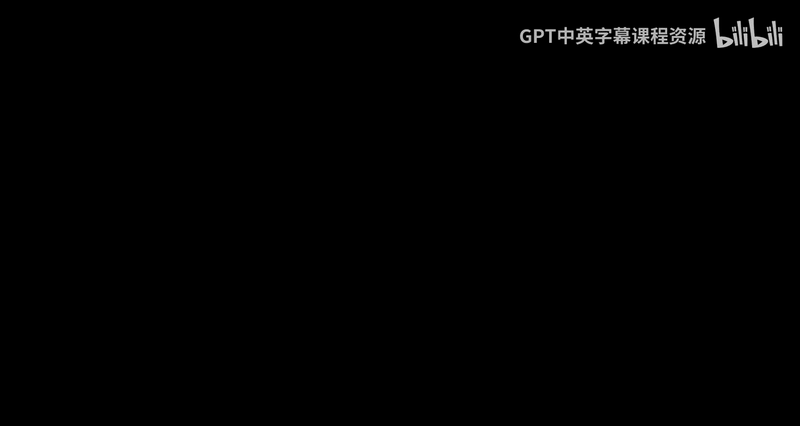
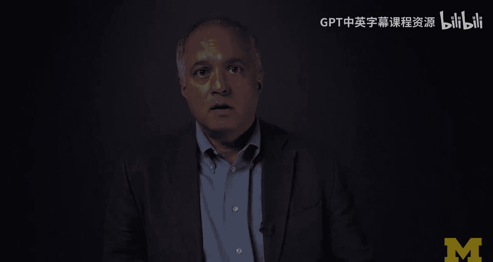

# 密歇根大学《数据科学伦理｜Data Science Ethics》中英字幕 p45 45_伦理准则体系.zh_en -BV1EGaVzeEbQ_p45-

Profession codes。Are there in many professions。 And let's begin by talking about these。

The Hipppocrates， for instance。Was a Greek doctor who introduced this notion of the Hippocratic oath。

In medicine。And there are a number of things that this says， including very famously， first。

 do no harm。Many other professions， lawyers， journalists， et cetera。

 have oaths that they take in codes of conduct that have been established for their behavior。

I believe that we need a similar code for data scientists。Let's look at what the options are。First。

Regulation is not the answer。Technology advances quickly。Regulation moves slowly。

If we rely on regulation， we'll be regulating yesterday's technology。

And because we're regulating yesterday's technologies will allow many abusers because they comply without date regulations that the companies have just been smart about thinking through new ways of exploiting new technology and might be years。

Before these things get stopped。Also， there might be benefits that flow from new technologies。

 and these benefits might get disallowed because they clash without dated regulations or needlessly broad regulations。

And so in general， I think that it is a good idea。To have regulations。Following。

For the Lord of follow。Things that are already a matter of societal consensus that has been established on the basis of ethics。

As an example of regulations being slow， here is a sign at an amphitheater。

It says unauthorized use of tape recorders in cameras is not allowed。So what they mean， presumably。

 is an not authorized recording of any sort is not allowed， but they said tape recorders and cameras。

And the question is， if I want to record。A concert and I recorded on my cell phone。Is that okay。

 My cell phone is not a tape recorder。And by the letter of the law here。That is probably fine。

And I'm sure it's this kind of situation that lawyers can have a field day with。

 and this is an issue of。Wording laws precisely in a world where the technology shifts fast。

The flip side of regulation is compliance。Companies and individuals must comply with laws。And。

Most large companies have units that are responsible for making sure that the companies are compliant with the relevant laws。

But this is not a positive approach。If your goal is to think about compliance。

 you're often thinking about what is the minimum required to meet the letter of the law。

And the law is。As we've been saying， something that follows and is slow in terms of adapting to technology。

And so if one I try to do the minimum to meet the letter of the law， one isn't being forward looking。

One is thinking about yesterday's battles。I think that the right thing for companies to do and a thing that is actually going to。

Put them in a better position， in the future。Is if they're thinking about。

What the intent of the law was or is。And that is the societal consensus and what the ethical position is。

And then they do the right thing， according to this。And companies know this。

 Companies know that they lose if they annoy customers。And so they are motivated to self regulate。

 and there are a number of trade associations。That have been formed。

To help with this sort of question。 So， for example。

 here are a few that are focused on advertising related matters， particularly on the Internet。

 And each of these associations tries to formulate principles of things that are rules for us。

 the companies versus them， the customers and what companies want from these trade associations are actionable rules。

And so to the extent that these trade associations can be more nimble than Congress。

They can have rules that are。Less late。Then legal regulation。But there' are still rules that follow。

 usually， rather than lead。There are some forward thinking corporate lawyers who've been thinking about where the future will go。

 And so it certainly isn't the case that companies aren't thinking about what the future holds in terms of technology and how they can be responsible citizens。

But again， I think that。We， as data scientists， should own our own destiny。

 We shouldn't have corporate lawyers defining this for us。I am proud of being a data scientist。

I'm excited about the good things the data science can do。

And I want us as data scientists to act ethically。So that I can continue to be proud of what I do。

 and we， as a field， can continue to be successful。😊，In terms of society appreciating us。

And valuing the benefits that our work provides to them。

So I want us to own the direction in which we take this field。And to this end， I have a very。

Simple two point code of conduct。 There are just two overriding principles1。Do not surprise。

Do not surprise the subject of the data that you're recording collecting， using analyzing。

Maybe you get surprising results from your analysis。That's fine。Those results are。

Surprising to the person who wanted the analysis done。The point really is。

 you don't want the subject of the data to be surprised because they didn't expect you。

To be collecting or using their data in certain ways that you decided to do。And note that when I say。

 do not surprise， this is。A general statement of duarch's surprise and not satisfied， for instance。

 by it was in。The multi page fine print consent statement that the data subject signed。

 and therefore， it is not a surprise， or it should not have been a surprise。

 Do not surprise means there is no surprise in terms of how most people act and behave and think。

Second principle， on the outcomes。As data scientists。We are。Unleashing a technical process。

 this technical process has societal impact。And so it isn't enough for us to say there is nothing wrong with the technical process。

 We don't have a bug in our code。 We take the data that we get in， we spit out whatever results。

 The algorithm spits out from that data。 and there's nothing wrong with the algorithm。

 That's not enough。We need to understand the outcomes。 We need to own the outcomes， and if。

The process is leading to undesirable outcomes。 We need to figure out how to fix the process。

Other professional societies have their own codes of ethics。 There have been many codes。

For data science that have been proposed by others， the coverage of these codes vary。

I believe that if you have a code with a lot of points and a lot of detail。

 that can be a very specific plan of action。But then， it's not memorable。I think that。

Other things that one might have are things that will flow from these。And。

 and so what I want you to take away。Is just a simple two point code。6 words that you'll remember。

 Do not surprise。Own the outcomes。And then these things。

Should then lead to further thinking about the kinds of things that we are discussing in this course。

So do not surprise， covers things like who owns the data。

 what the data can be used for things of this nature。

On the outcomes includes things like what is valid， what is fair， what are the social consequences。

