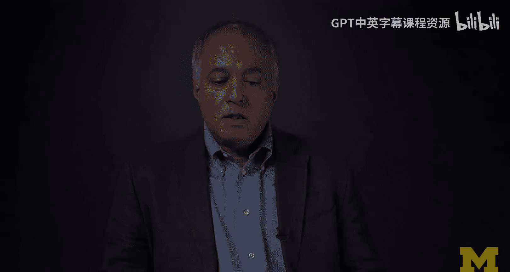

# 密歇根大学《数据科学伦理｜Data Science Ethics》中英字幕 p46 46_课程总结.zh_en -BV1EGaVzeEbQ_p46-

So or wrap up。

Ethics matter。Data science has great power。It is great power to harm and great power to help。

A thing that every powerful person or powerful community has。Is the responsibility。

To be careful about how this power is used。Data scientists cannot hide behind the claim of neutral technology。

And ignore how this technology is actually。Being applied。I think that we're all better off。

If we understand this power。And limit how this power is used。So that it's focused to doing。

Good things。 And minimizing the harms that it can result in。In a complex world。

Ethical analysis isn't easy。In any real situation。It may not be easy to see where the problem lies。

I had to define the limits。And how to decide whether something is right or wrong。

This course provides a framework to think about the ethical questions to consider。

And these are the questions that I would really like you to think about as you try to define these limits as you practice your data science on a day to day basis。

To conclude。Like to quote Eric Anderson， who said。Doing the right thing doesn't automatically bring success。

But compromising ethics almost always leads to failure。I hope that this course has given you。

Some tools to think about。The ethics of your actions。As data scientists。Go forth， be successful。

 and be ethical。Thank you。

