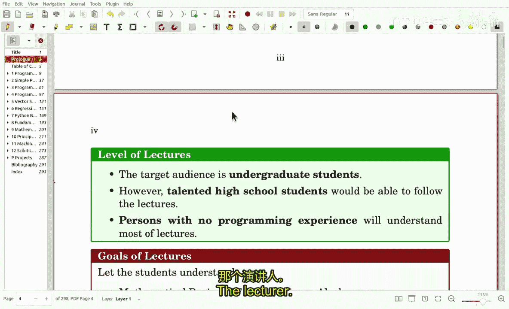
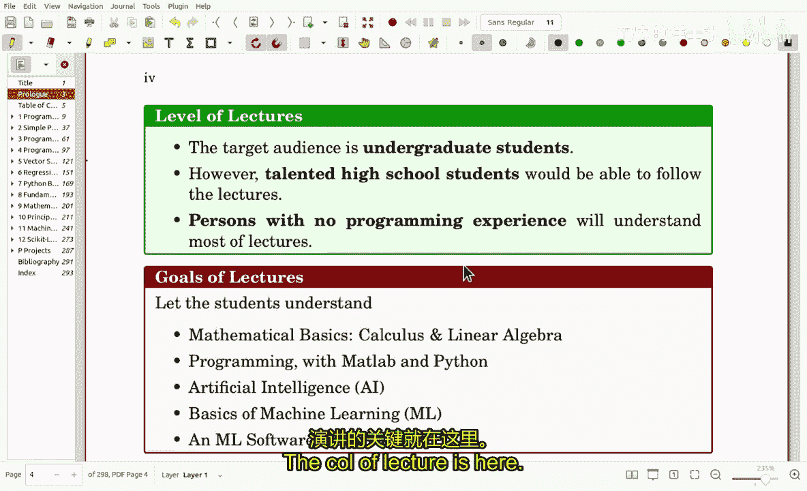
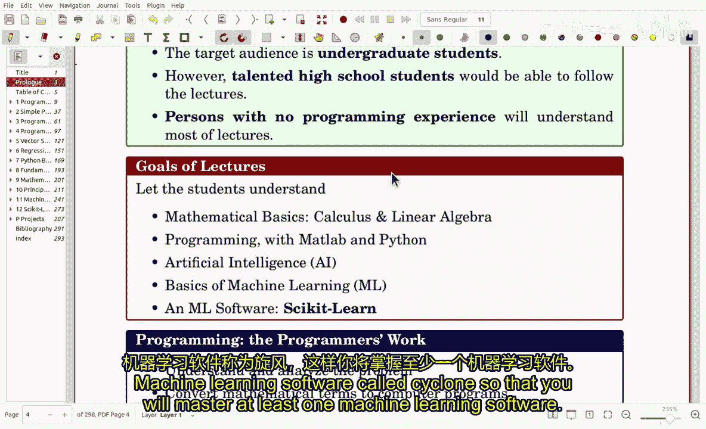
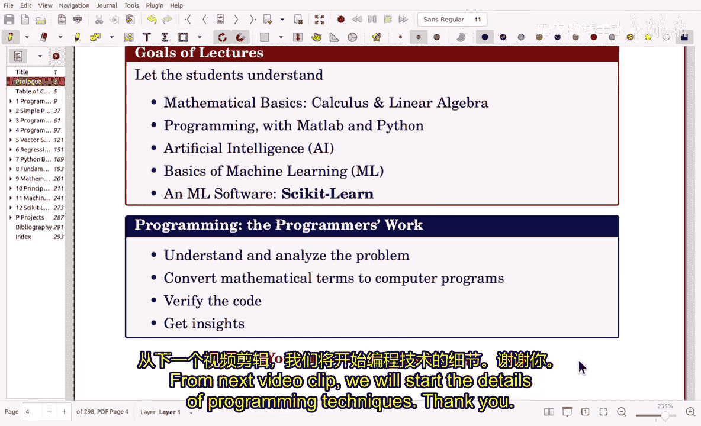

# 001：科学计算与编程导论 🚀

在本节课中，我们将要学习现代科学计算的基础，并了解本课程的整体范围与目标。课程将使用MATLAB和Python两种语言，旨在帮助初学者掌握编程逻辑，并最终应用于人工智能领域。

---

我是T. Soja Kim，密西西比州立大学的数学教授。让我们从课程的范围开始讲起。

我们使用的教材名为《编程基础与人工智能》，涉及MATLAB和Python。

如果你开始学习编程，计算机语言必须简单。如果它很复杂，你将很难专注于数学逻辑。编程与简单的埃及语言MATLAB一起学习。你学习编程，专注于数学逻辑，然后学习Python，以成为一名更好的程序员。

电子版课程并非完全版，我后来添加了一些主题。然而，尽管方式如此，它将免费提供。

讲座将以此种形式进行。目标受众是本科生，然而，有天赋的高中生也能够跟上课程。没有编程经验的人将能理解大部分讲座内容。

课程大纲如下。

我希望你们理解数学基础，特别是微积分和线性代数。

我希望你们理解使用MATLAB和Python的编程，以及人工智能。我们会学习一些机器学习的基础。最后，讲座将涉及一个名为Cyon的机器学习软件，以便你们至少掌握一种机器学习软件。

在这里，编程是为了理解和分析问题，并将数学术语转换为计算机程序。

并且，或者最终验证代码。你必须获得洞察力，以便随着洞察力的获得，你可以扩展你的知识和编程能力。

通过本课程，你将学习编程。好的，介绍到此结束。从下一个视频片段开始，我们将开始编程技术的细节。

谢谢。

---

本节课中我们一起学习了本课程的目标、使用的工具（MATLAB和Python）以及核心学习方法：从简单的语言入手专注于数学逻辑，再过渡到更强大的工具，最终应用于人工智能和机器学习。编程的本质在于**理解和分析问题**，并将其转化为可执行的程序以获得洞察。下一讲我们将开始具体的编程技术学习。