# 003：函数的泛化与可复用性

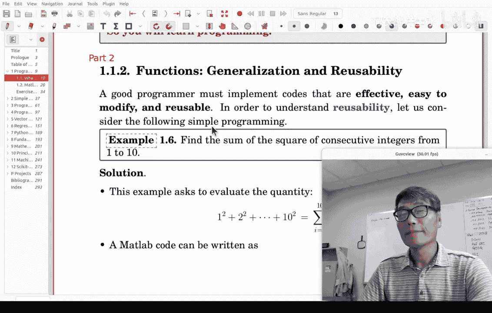

在本节课中，我们将要学习如何编写具有良好泛化能力和可复用性的函数。我们将通过一个具体的例子，从一段简单的代码开始，逐步将其改进为一个可复用的函数。

## 概述

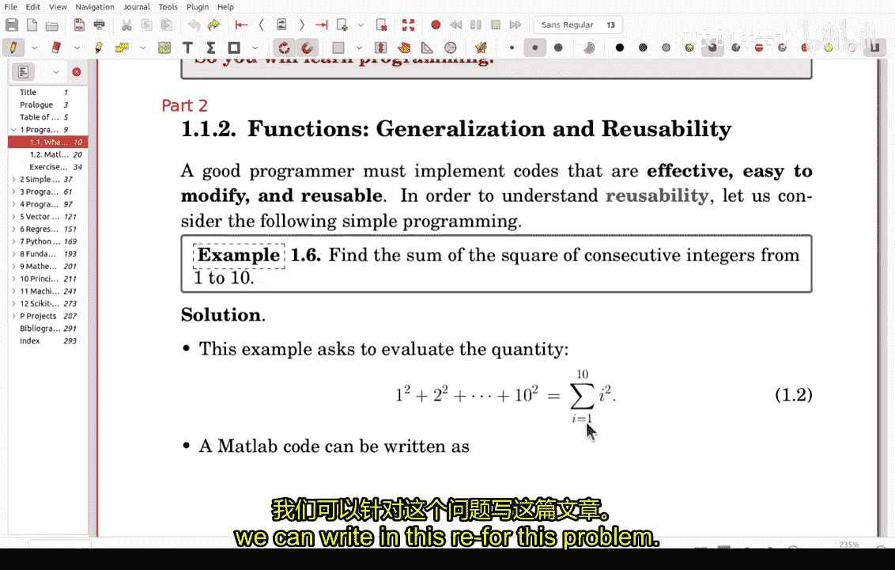

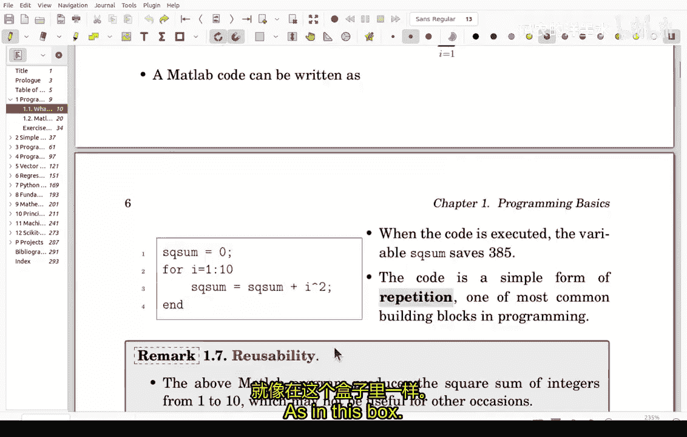

一个好的程序员会编写出易于修改和复用的代码。为了理解可复用性，让我们考虑以下简单示例：计算从1到10的连续整数的平方和。这个问题要求计算 `1² + 2² + ... + 10²` 的值。

用求和符号表示，可以写作：
```
S = Σ (i²)， 其中 i 从 1 到 10
```

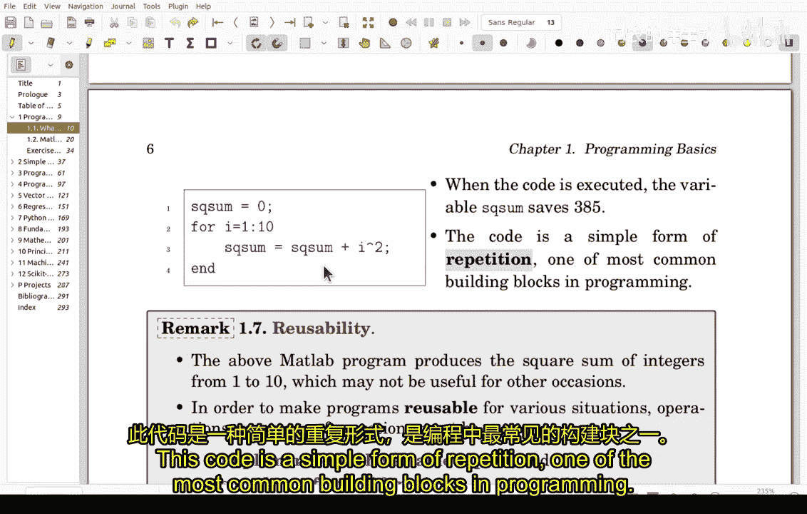

## 从简单代码到可复用函数

### 初始的非复用代码

我们可以编写一段MATLAB代码来解决这个问题，如下所示：

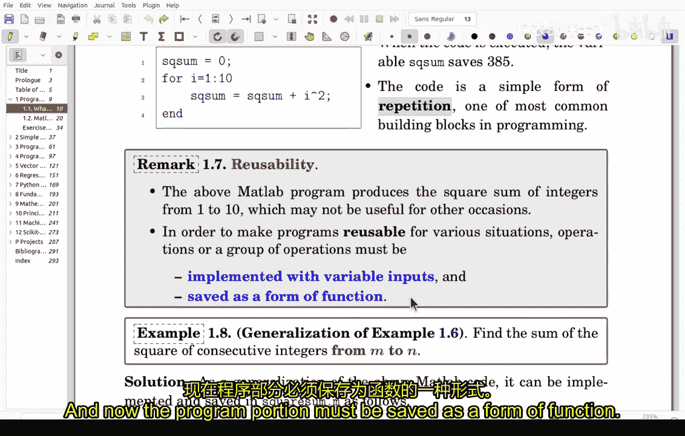

```matlab
s = 0;
for i = 1:10
    s = s + i^2;
end
```

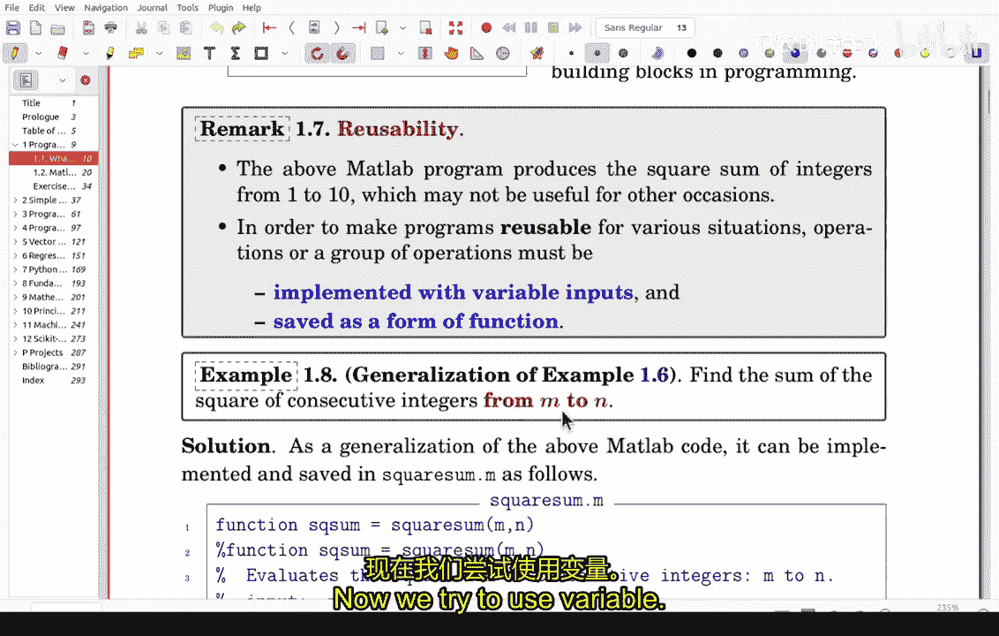

这段代码首先将变量 `s` 初始化为0，然后通过一个 `for` 循环，将1到10的平方依次累加到 `s` 中。执行后，`s` 的值将为385。这段代码是编程中最常见的构建块之一——循环的简单形式。

然而，这段代码的复用性很差。如果你需要计算其他范围的平方和，例如从10到20，或者从1到100，你必须重新阅读并修改代码中的数字（`1` 和 `10`）以适应新任务。

### 创建可复用的函数

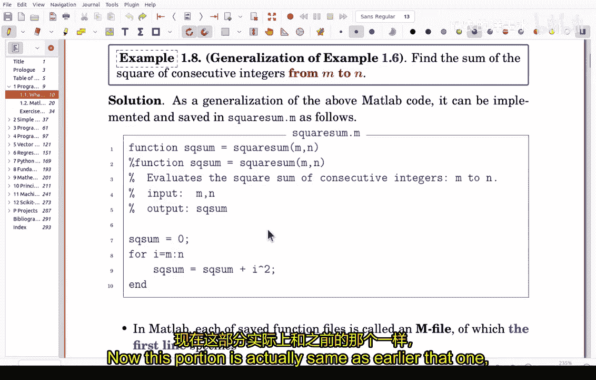

为了使代码可复用，我们需要实现一个可以接受可变输入的程序，并将其保存为函数的形式。让我们尝试将上述程序通用化。

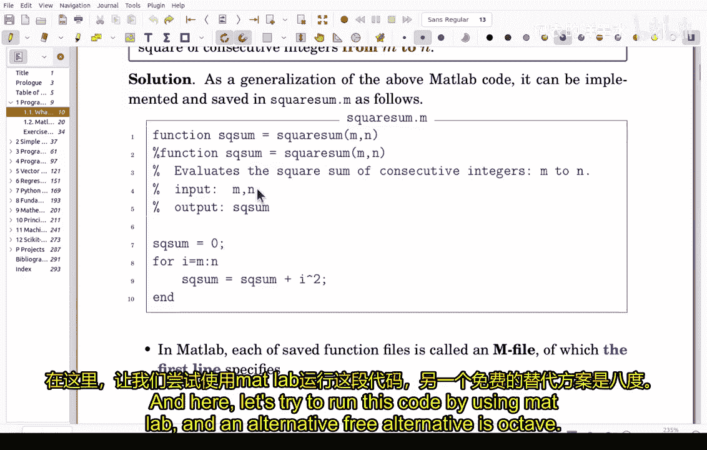

现在，我们创建一个名为 `ssum.m` 的M文件，其中包含一个函数。函数定义如下：

```matlab
function sq_sum = ssum(n)
% SSUM 计算从1到n的整数平方和。
%   语法：sq_sum = ssum(n)
%   输入：n - 求和的上限（整数）
%   输出：sq_sum - 从1到n的平方和

sq_sum = 0;
for i = 1:n
    sq_sum = sq_sum + i^2;
end
end
```

在这个函数中：
*   第一行 `function sq_sum = ssum(n)` 声明了函数。`ssum` 是函数名，`n` 是输入参数，`sq_sum` 是输出变量。
*   第2至5行是帮助文档。在MATLAB或Octave中，使用 `help ssum` 命令可以查看这些说明。
*   第7至10行是算法的主体部分，其逻辑与最初的代码完全相同，但循环上限 `n` 现在是一个变量。

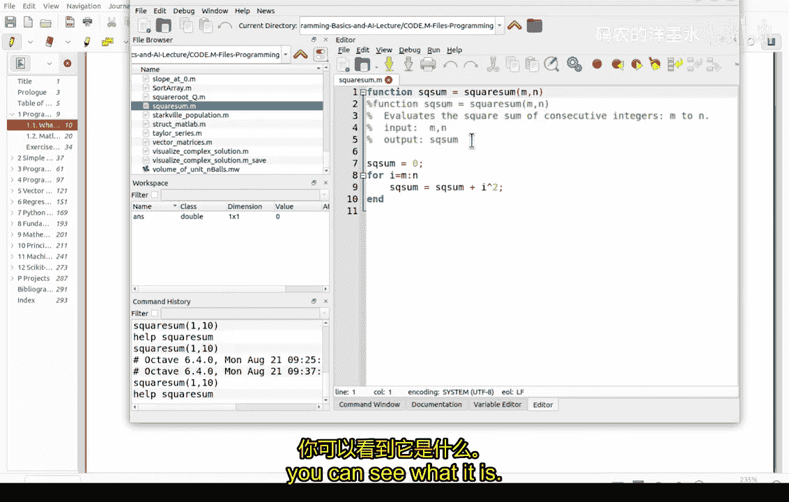

通过将代码包装在函数定义中并保存为独立的M文件，我们就创建了一个可复用的函数。

### 使用函数

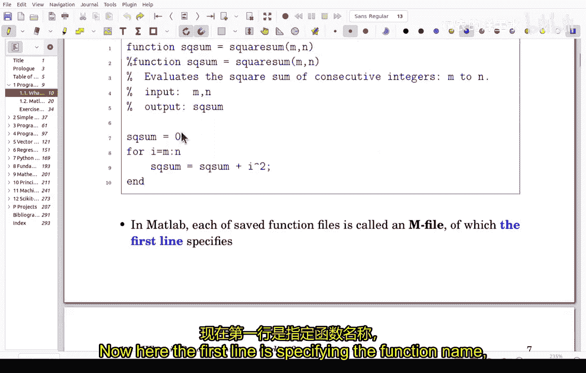

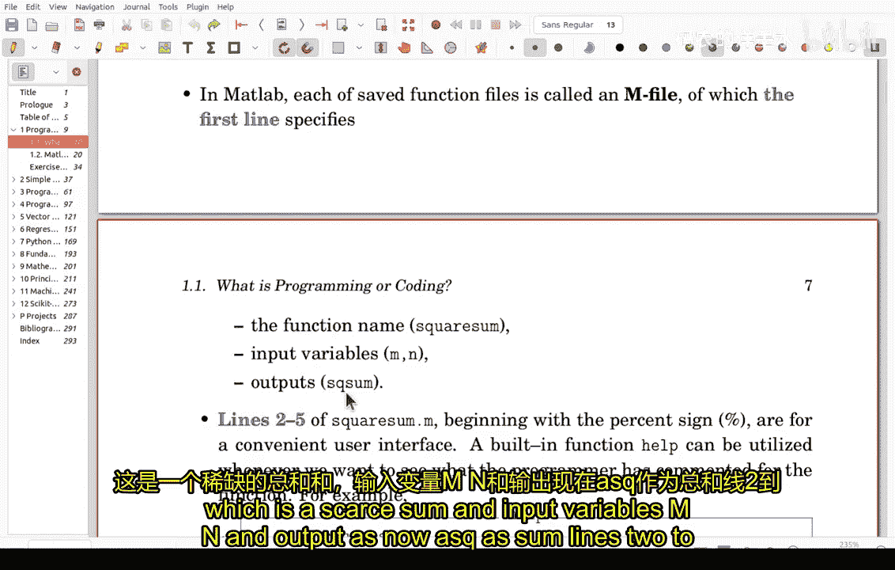

在命令窗口中，我们可以像使用内置函数一样调用 `ssum`：
```matlab
>> result = ssum(10)
result = 385

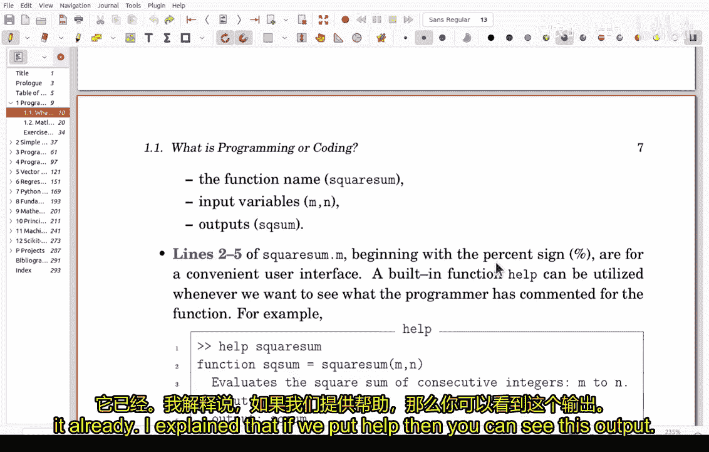

>> result = ssum(100)
result = 338350
```

现在，要计算不同范围的平方和，我们只需在调用函数时改变输入参数即可，无需修改函数内部的代码。这大大提高了代码的复用性。

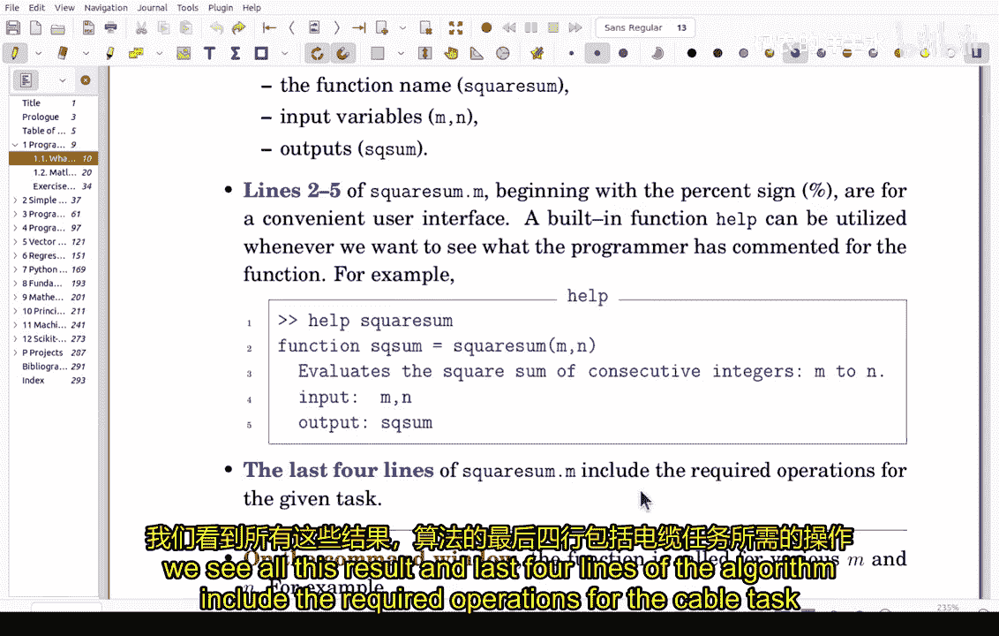

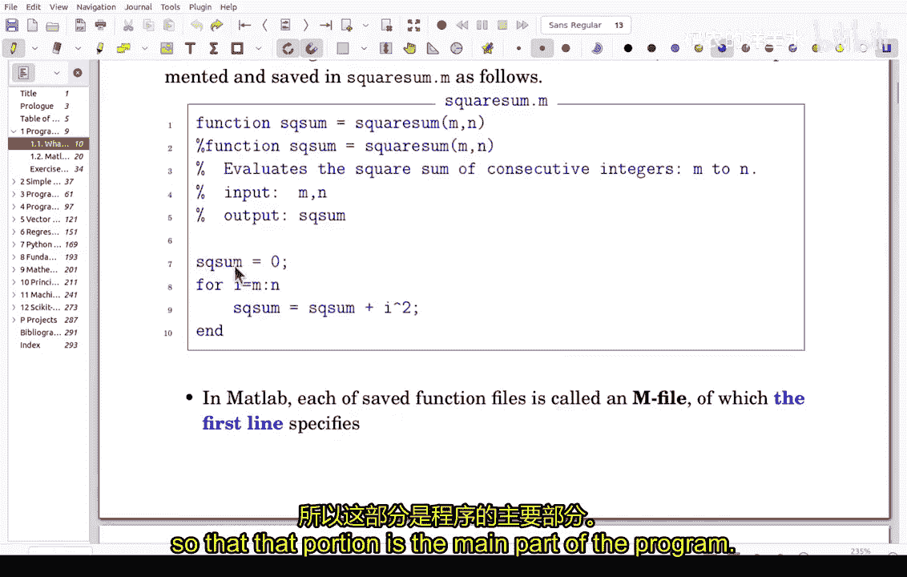

## 总结

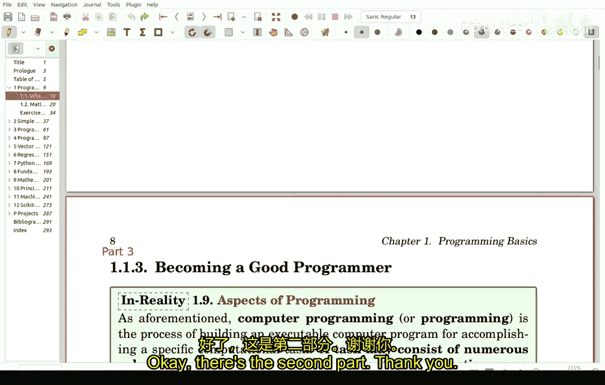

本节课中，我们一起学习了如何提升代码的泛化与可复用性。我们从一个解决特定问题（计算1到10的平方和）的硬编码脚本出发，分析了其复用性不足的问题。接着，我们通过引入输入参数，将核心算法封装到一个独立的函数中，从而创建了一个可以处理不同上限 `n` 的通用解决方案。关键步骤包括：定义函数头、编写帮助文档、以及将核心逻辑置于函数体内。最终，我们得到了一个可以通过简单改变输入值来重复使用的函数，这是编写高质量、易维护代码的重要基础。