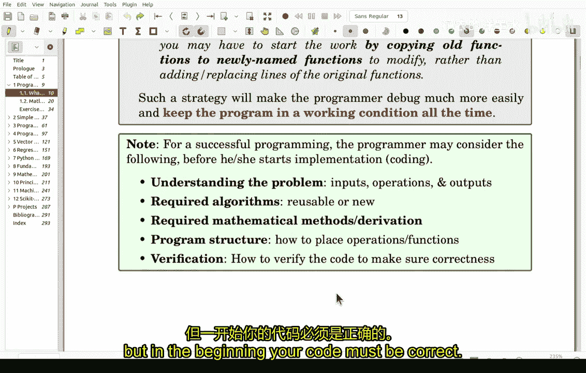
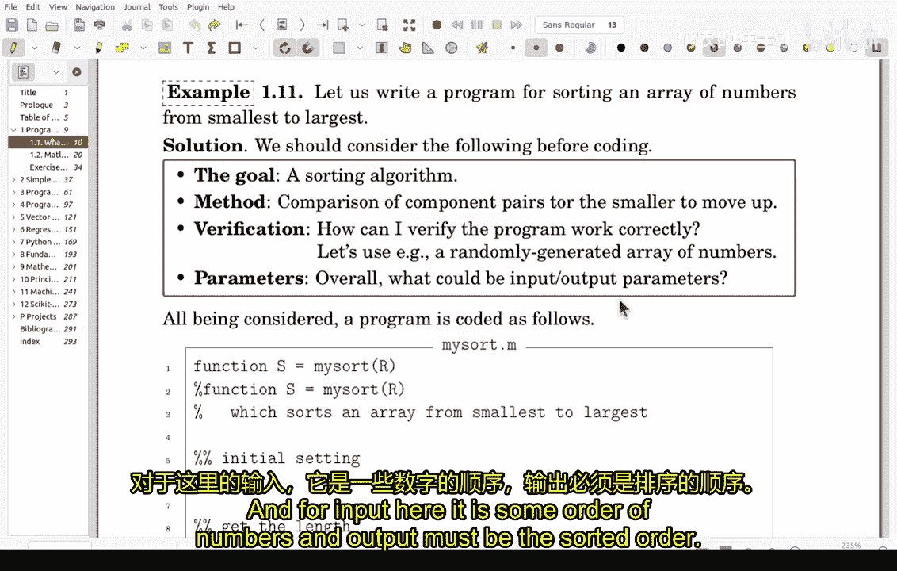
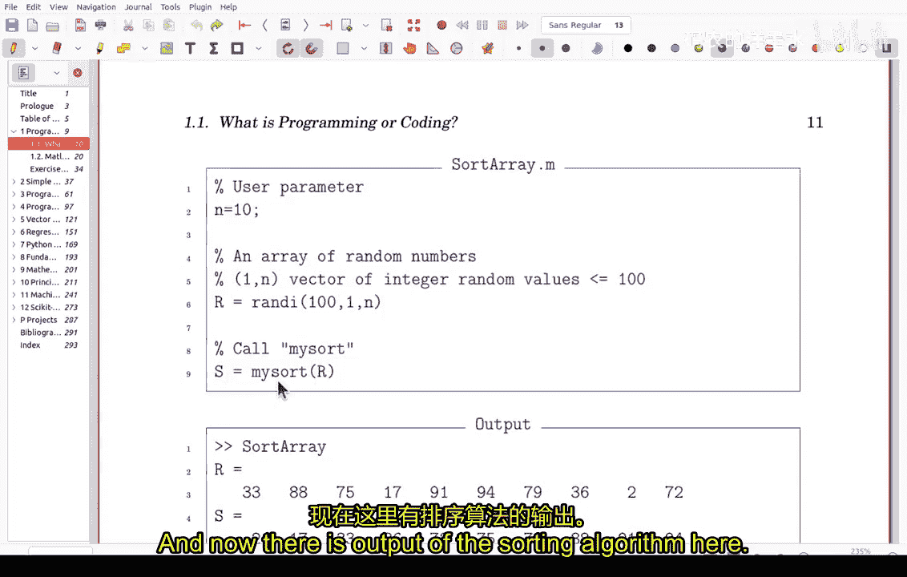
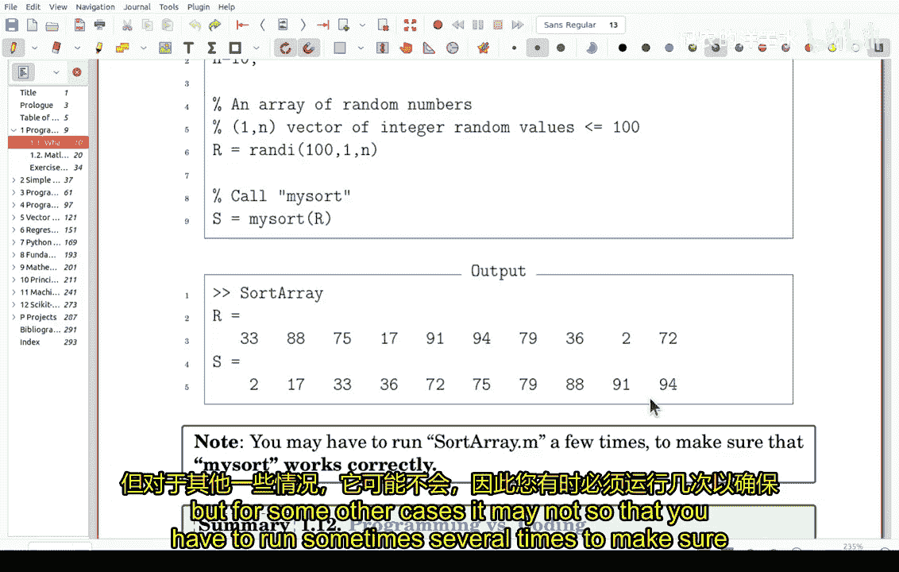
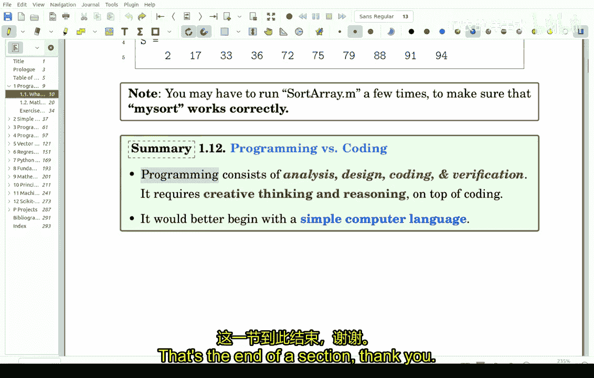

# 004：成为一名优秀程序员 💻

在本节课中，我们将探讨如何成为一名优秀的程序员。我们将从编程的核心概念入手，分析编程过程的各个关键方面，并提供一些实用的编程技巧。

## 概述

编程，或称计算机编程，是构建一个可执行程序以解决计算任务的过程。一个任务可能包含许多子任务，每个子任务都可以实现为一个函数。在程序中，某些函数可能会被多次或重复使用。

## 编程的关键方面

在开始编码之前，你应该考虑编程的以下方面。

### 任务模块化

任务模块化是关于将给定任务进行分解。给定的计算任务可以被划分为几个较小的子任务，每个子任务称为一个模块。每个模块都应该是易于管理、便于实现，并且在数学分析和计算机实现上都高效的。这意味着每个模块都易于处理和实现。任务模块化的主要核心是构建程序的骨架。任务模块化非常重要，你必须将给定任务分解为小的子任务。

### 算法开发

现在，你必须考虑算法的开发。对于每个模块，你需要开发一个计算算法，并将该算法保存为函数。实际上，为了实现一个程序，你必须选择一种计算机语言。你可以选择一种计算机语言，以便能够高效且方便地实现。有时，你可能会使用不止一种计算机语言来实现子任务。通过这样做，你可以最大化最终程序的性能，同时最小化你的人力投入。如果你将一个给定任务分成几个子任务，那么对于某些子任务，可能已经有现成的程序或函数可用，你就可以使用它们。但程序可能是用其他语言编写的。例如，你可能想使用C语言，但对于某些任务，与其编写C代码，不如下载现成的Fortran代码并使用它。为了最小化人力投入并最大化性能，你可能会在这里使用不止一种语言。顺便说一下，Fortran是科学计算中最快的语言。Fortran比C语言快大约20%。这里你会使用MATLAB，但在许多情况下，MATLAB比C语言慢大约两倍。即使是脚本语言，MATLAB现在也非常快。在没有编译的情况下，我们使用MATLAB脚本，现在它比C语言慢大约两倍，这真的很惊人。MATLAB的速度非常好。如果我们使用Python，那么它可能比C语言慢50倍甚至100倍。因此，Python的内部和核心部分是用C或Fortran实现的，以便我们可以加速性能。在许多软件包中，核心部分通常使用非常高效的语言实现。所以最终，即使你以后使用Python，你也不仅仅在使用Python，同时也在使用一些非常高效的语言。

### 验证与调试

一旦你实现了一个程序代码，现在你必须验证其正确性和有效性。这种在计算机程序中查找和解决缺陷或问题的过程称为调试。有时，验证和调试所花费的时间比实现本身要长得多。对于一个小的程序，你可能在一天内完成实现，但有时调试可能需要超过一周，甚至超过一个月。因此，你必须从相当清晰的数学逻辑开始。如果你的思维不具逻辑性，那么你很容易犯错误，并且因为你的逻辑不清晰，很难找到错误所在的位置。所以你必须进行逻辑思考，有了清晰的逻辑，你就能更有效地编写程序。

## 编程技巧

以下是一些编程技巧，它们相当简单。

如果你想添加函数，那么尝试逐个添加函数。构建程序不是一个简单的问题，而是一个困难的项目，特别是当程序需要从零开始构建时。一旦你从零开始，一个有效的编程策略是在模块化分解后，逐个添加函数。每个模块都可以实现为一个函数，所以逐步添加函数，并在每次添加后检查程序是否正确。在这种情况下，你将专注于刚刚添加的最后一个函数，检查该函数是否正确，然后转向下一个函数。通过这种方式，程序员应该在整个实现期间保持程序处于工作状态。这样，你可以最小化错误，从而最小化调试时间。

此外，使用函数的修改版本。有时你必须修改和使用所有先前使用过的函数。当遇到类似情况时，你可能需要通过复制所有函数并适当重命名来开始工作，以修改函数，而不是在原始函数中添加或删除代码行。如果你尝试保留原始函数，那么调试会相当容易。这样，你也能更容易地始终保持程序处于工作状态。原因是，因为你有了原始版本作为基础，一旦新版本不工作或产生一些意外的结果，你就可以检查你的逻辑和编程，从而通过使用旧版本更容易地使其正确。所以不要试图替换原始函数或向其中添加代码行，只需将其复制并适当重命名函数即可。例如，如果你尝试复制一个函数，比如我们之前考虑的 `S_sum`，将其复制为 `S_sum2`，然后尝试调整 `S_sum2` 并保留原始的 `S_sum` 函数。

## 成功编程的考虑因素

为了成功编程，程序员在开始实现之前可以考虑以下几点。

首先，你必须理解问题。然后，你必须考虑可能涉及哪些输入、哪些操作以及哪些输出。同时，你必须为每个模块组织所需的算法。有时对于某些模块，你可以使用现成的函数，但有时你必须重新实现。

其次，为了使程序高效且正确地工作，你必须推导数学方法和数学判断，以便更有效地设计算法。此外，你必须考虑程序结构。实际上，你必须将操作和函数以正确的顺序放置在正确的位置，所以你必须考虑程序结构。

完成实现后，你必须验证你的程序。因此，你必须考虑如何验证代码以确保其正确性。在开始时，代码至少必须是正确的。之后，当你处理真实数据或海量数据时，如果效率不足，你可以修改你的程序以提高效率。但在开始时，你的代码必须是正确的。

## 示例：排序算法

让我们考虑这个例子。让我们编写一个程序，将一组数字按从小到大排序。这是一个计算任务。在编码之前，你必须考虑以下几点。

核心是什么？核心是获得一个排序算法。排序背后的原理不是比较所有可能的数对，而是比较相邻的数对，让较小的数向上移动。这是因为我们要从小到大排序。所以方法必须是：遍历这个数组，对每两个相邻的数字进行比较，然后较小的数会移到前面。

现在，如果你写下一个代码，那么你必须问自己：如何验证程序工作正确？这里，你可以使用一个随机生成的数字序列进行测试。

当我们实现代码时，你还必须考虑参数：输入和输出参数可能是什么。对于输入，它是一个数字数组，输出必须是排序后的数组。

我们可以这样实现一个排序函数。第一行有一个函数名，你必须指定清晰的函数定义，即函数名、输入和输出。现在我们有这个文档部分。当你使用 `help` 命令时，你会看到这部分。一旦输入数组 `R` 被给定，我们将其复制到 `S`。现在我们检查长度。然后，从最后一个元素开始，到第二个元素，我们比较两个连续的值。如果前一个值大于后一个值，我们就交换它们的位置。在MATLAB中，你必须这样做：将一个值保存到临时变量中，然后将后一个值赋给前一个位置，再将临时变量的值赋给后一个位置。通过这种方式，我们可以交换。经过这行代码后，后一个值会变得更大。对于每个 `J`，数组的前面部分试图获取最大的值，所以最大的值会被保存到位置 `J`。我们重复 `J` 从 `n` 递减到 `2` 的过程，最终最大的值会位于最右边的位置 `n`，最小的值会在开头。

这就是实现。现在，我们将尝试验证我们实现的函数。这里我们选择 `a1`。我们尝试生成一个包含10个值的随机序列，每个值在1到100之间。所以 `a1` 是一个1x10的向量，`n` 是10。然后，每个值在1到100之间。`a1` 是这样生成的，然后通过 `my_sort` 函数。现在，输出 `R` 是在这个范围内随机生成的。在调用 `my_sort` 之后，它从小到大排序。对于这个序列，它工作得很好。但你可能需要多次运行这个 `my_sort` 算法，通过使用 `sort2array.m` 脚本，你可能需要多次调用这个 `sort2array.m` 来确保 `my_sort` 工作正确。一旦它正确工作，但对于其他一些情况，它可能不行，所以你必须有时运行多次以确保你的代码工作正确。

## 总结

在本节课中，我们一起学习了编程的各个方面。编程包括分析、设计、编码和验证。它需要在编码之上进行创造性思维和逻辑推理。所以编码仅仅是构建代码，而编程则需要更多。实际上，你必须进行非常创造性的思考，同时也需要一些清晰的推理，因此数学逻辑是主要的事情。最好从一种简单的计算机语言开始，以便更专注于分析、设计和验证。如果你的语言很复杂，那么你将在调试上花费更多时间，导致你的分析和设计不够出色。因此，本课程将在开始时使用MATLAB。

本节内容到此结束，谢谢。