# 005：第5讲 - Matlab/Octave入门 🚀

在本节课中，我们将学习Matlab和Octave的基础知识。Matlab是一种强大的数值计算环境和编程语言，而Octave是其免费的开源替代品。我们将从最基本的向量和矩阵操作开始，逐步介绍如何构建和操作数据，以及如何进行数据可视化。

---

## 1.2 Matlab：一种强大的计算机语言 🧠

Matlab是“矩阵实验室”的缩写。它是一种多范式的数值计算环境和专有编程语言，由MathWorks公司开发。Matlab不是免费的，但它非常灵活，可以进行数值计算和符号计算。它易于学习和使用。

在Matlab中，你可以进行矩阵操作、函数和数据绘图、算法实现、创建用户界面，并可以调用其他语言（如C、C++、C#、Java、Fortran和Python）。Matlab尤其擅长矩阵操作和符号计算，可以说是最方便学习和使用的计算机语言之一。

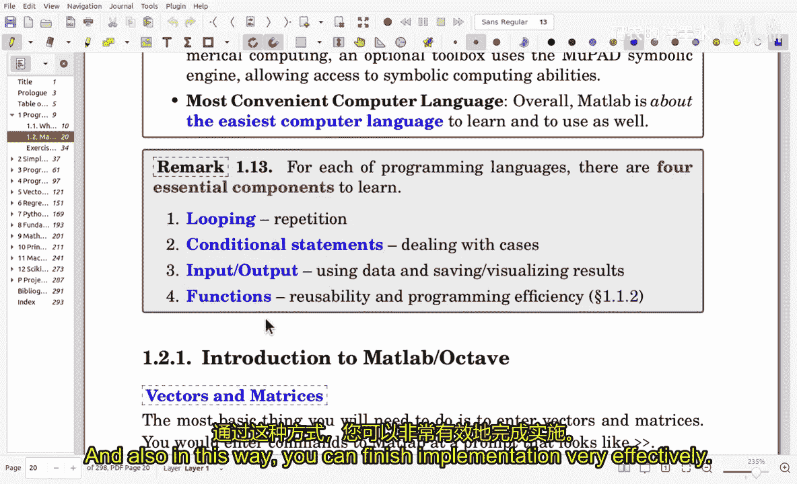

学习任何编程语言，都需要掌握四个基本组成部分：
*   **循环**：处理重复操作。
*   **条件语句**：处理不同情况。
*   **输入/输出**：与用户或文件进行数据交互。
*   **模块化与函数**：将代码封装成函数，以提高代码的**可重用性**和实现效率。

---

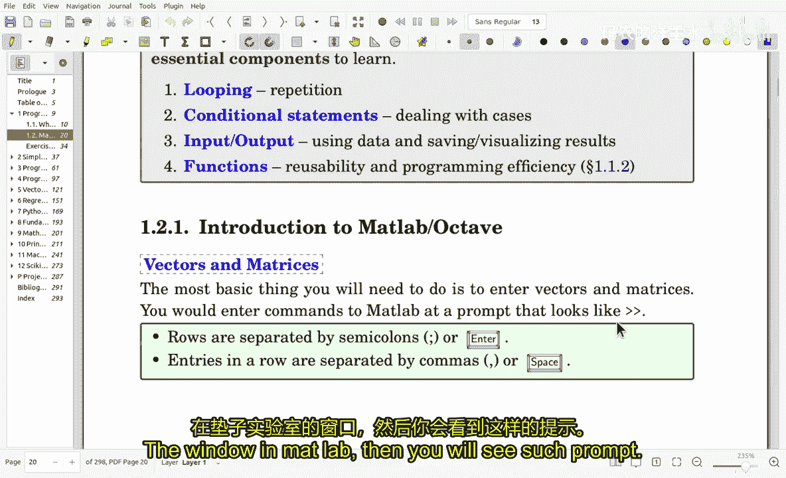

## Matlab或Octave简介 🔄

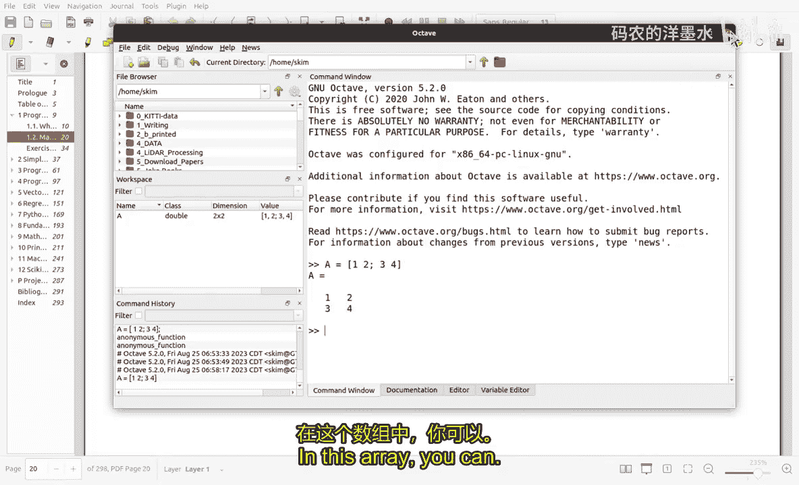

Octave是Matlab的一个免费替代品。在大多数情况下，Matlab程序可以在Octave中运行而无需修改。虽然两者并非完全相同，但对于初学者级别的任务，它们基本兼容。

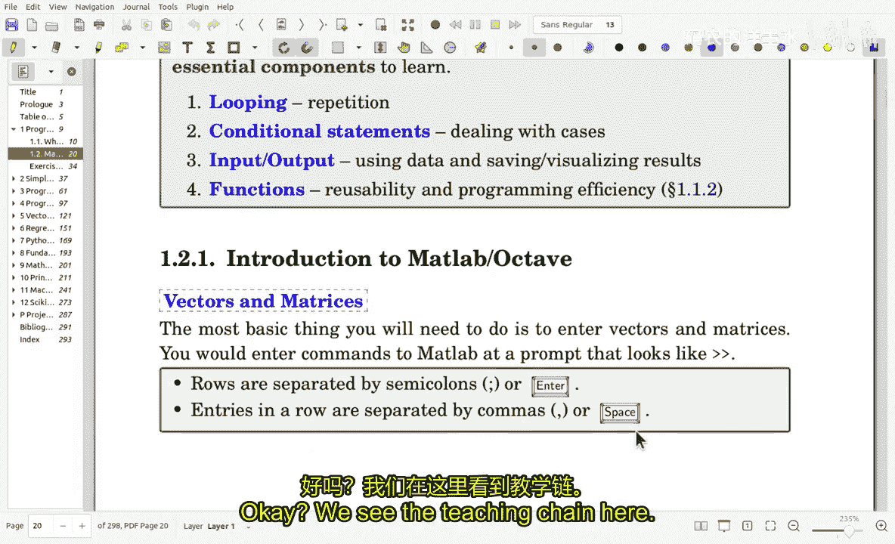

---

## 向量和矩阵 📊

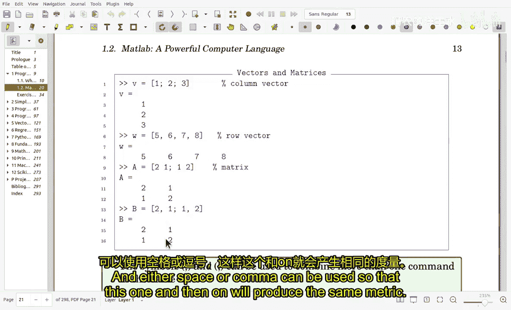

最基本操作是输入向量和矩阵。在Matlab的命令窗口中，你会看到提示符 `>>`。在Octave中，提示符是 `octave:1>`。

定义矩阵的方法如下：
```matlab
A = [1, 2; 3, 4]
```
这将创建一个2x2的矩阵A。行与行之间用分号 `;` 或换行分隔，行内的元素用逗号 `,` 或空格分隔。

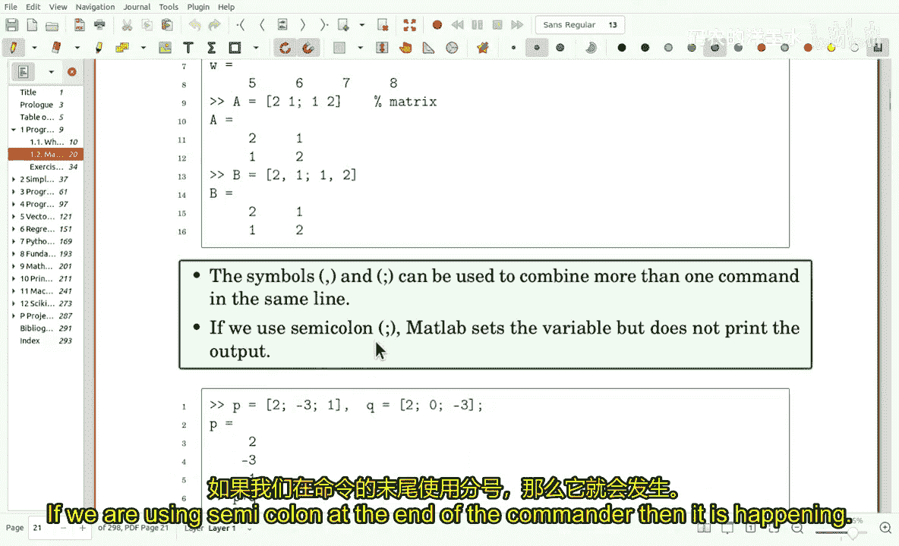

以下是更多示例：
*   `v = [1; 2; 3]` 创建一个列向量（垂直向量）。
*   `w = [5, 6, 7]` 创建一个行向量（水平向量）。
*   `M = [2, 1; 1, 2]` 创建一个2x2矩阵。

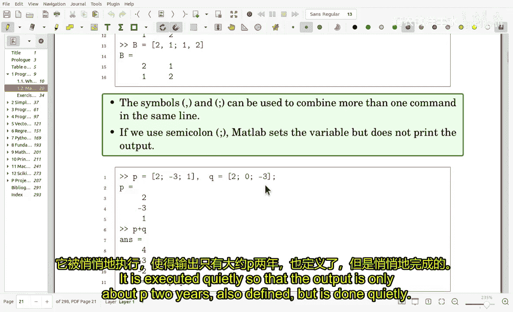

逗号和分号也可以用于在同一行组合多个命令。如果在命令末尾使用分号，Matlab会执行该命令但**不打印输出**。

示例：
```matlab
p = [2; -3; 1];
q = [2; 0; -3];
d = p' * q; % 计算点积并静默保存到d
p_q = p + q % 计算p+q并显示结果
```

---

## 逐步构建矩阵 🧱

除了直接输入，还可以从其行或列逐步构建矩阵。

示例：
```matlab
c1 = [1; 2];
c2 = [3; 4];
M = [c1, c2]; % 组合成2x2矩阵

c3 = [5; 6];
M = [M, c3]; % 在右侧添加新列，扩展为2x3矩阵

r3 = [7, 8, 9];
M = [M; r3]; % 在底部添加新行，扩展为3x3矩阵
```
通过这种方式，可以灵活地构建和扩展矩阵。

---

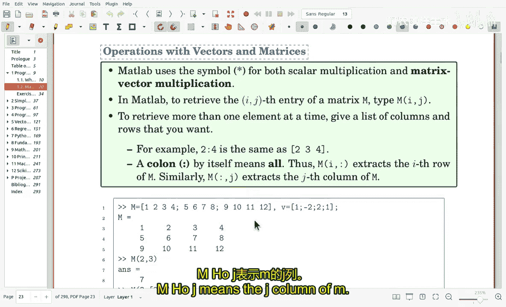

## 访问矩阵元素与运算 🔢

在Matlab中，使用星号 `*` 进行标量乘法和矩阵向量乘法。

访问矩阵 `M` 中第 `i` 行第 `j` 列的元素，使用 `M(i, j)`。

要一次检索多个元素，可以指定行和列的列表。例如：
*   `M(2, 3)` 获取第2行第3列的元素。
*   `M([2, 4], :)` 获取第2行和第4行的所有列。冒号 `:` 表示“所有”。
*   `M(:, 2)` 获取第2列的所有行。
*   `M(2:4, :)` 获取第2到第4行的所有列。`2:4` 等同于 `[2,3,4]`。

示例：
```matlab
M = [1, 2, 5, 6; 3, 4, 7, 8; 9, 10, 11, 12];
element = M(2, 3) % 返回 7
rows = M([2, 4], :) % 返回第2行和第4行（如果存在）
col = M(:, 2) % 返回 [2; 4; 10]
```

使用 `eye(n)` 命令可以创建 `n x n` 的单位矩阵。矩阵乘法同样使用 `*` 符号。可以使用 `inv(A)` 计算矩阵 `A` 的逆。

示例：
```matlab
A = [1, 2; 3, 4];
B = [5, 6; 7, 8];
C = A * B; % 矩阵乘法

I = eye(3); % 3x3单位矩阵
D = rand(3); % 3x3随机矩阵
invD = inv(D); % D的逆矩阵
check = D * invD; % 应近似等于单位矩阵
```

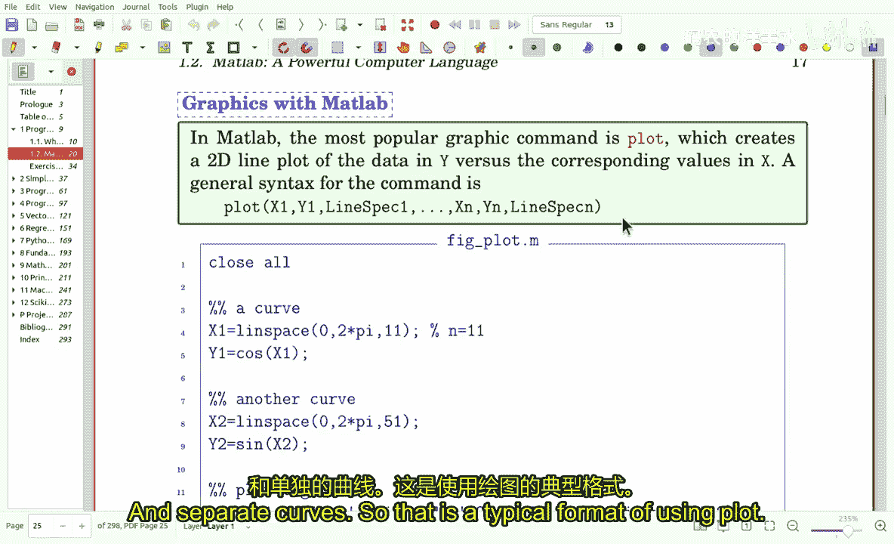

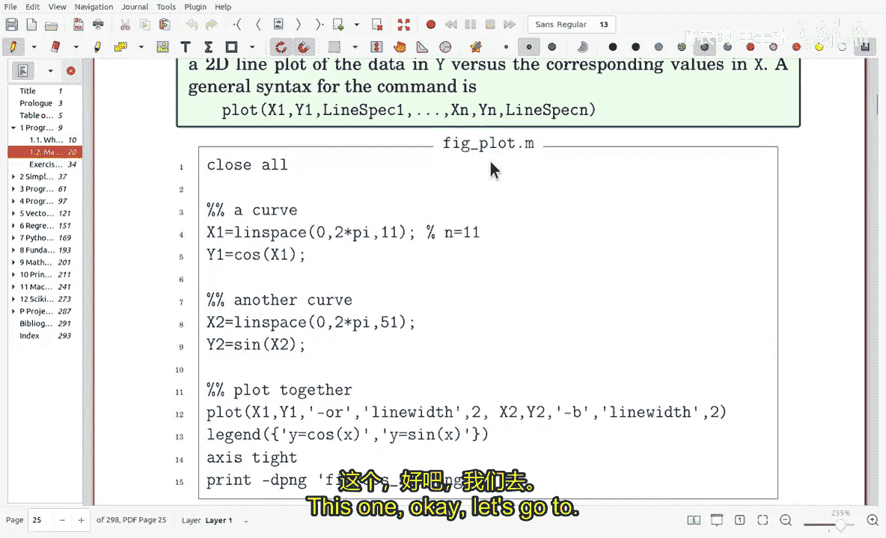

---

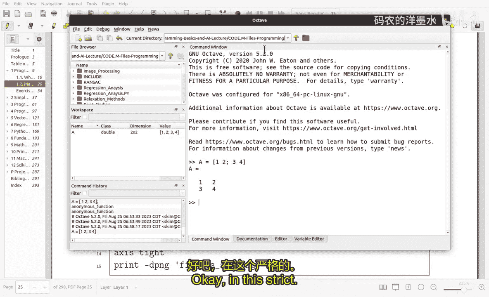

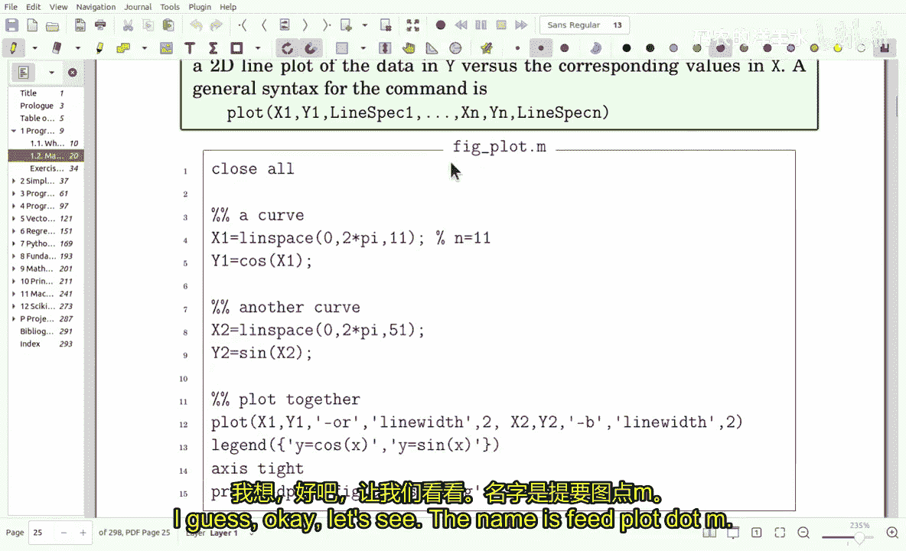

## 使用Matlab绘图 📈

Matlab中最常用的绘图命令是 `plot`，用于创建二维线图。基本语法是 `plot(X1, Y1, LineSpec1, X2, Y2, LineSpec2, ...)`，可以在一张图上绘制多条曲线。

以下是一个绘图脚本示例 (`figure_plot.m`)：
```matlab
close all; % 关闭所有图形窗口
clear; clc; % 清空工作区和命令窗口

% 生成第一组数据点（较稀疏）
x1 = linspace(0, 2*pi, 11); % 在0到2π间生成11个点
y1 = cos(x1);

% 生成第二组数据点（较密集）
x2 = linspace(0, 2*pi, 50);
y2 = sin(x2);

% 绘图
figure; % 新建图形窗口
plot(x1, y1, '-ro', 'LineWidth', 2); % 红色实线，圆圈标记，线宽2
hold on; % 保持当前图形，以便添加新曲线
plot(x2, y2, '-b', 'LineWidth', 2); % 蓝色实线，线宽2

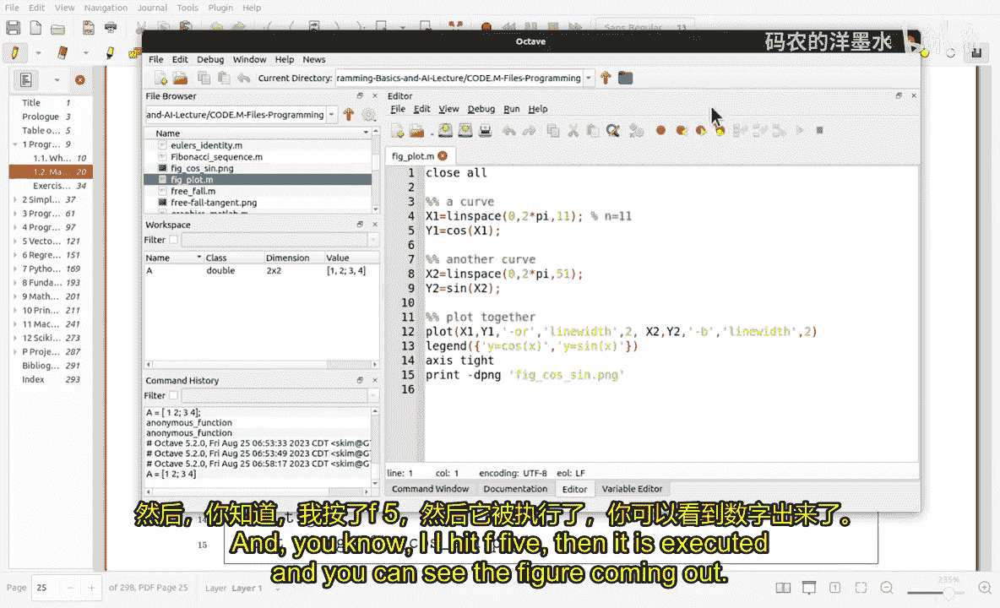

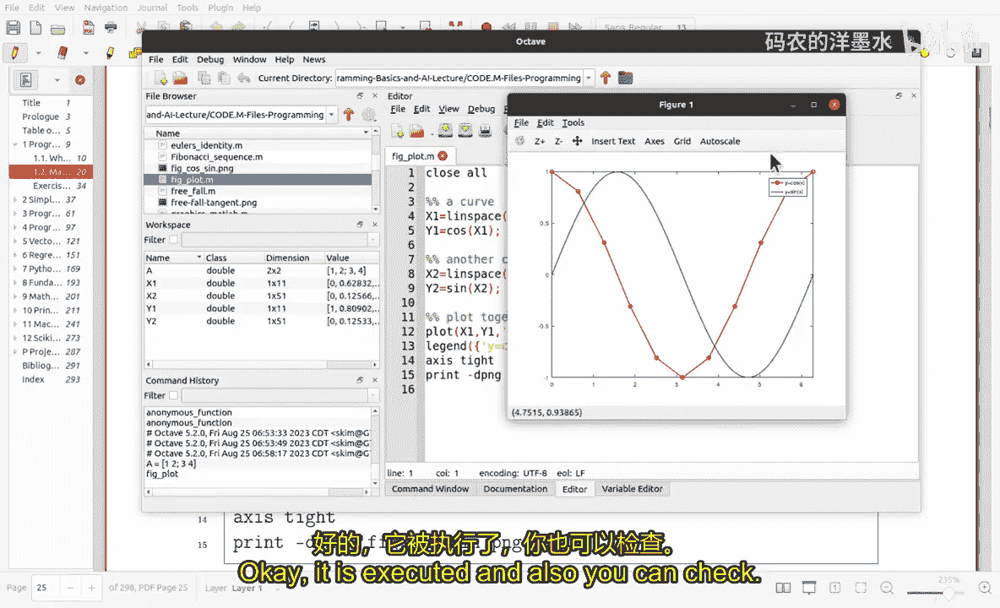

% 添加图例和标签
legend('cos(x)', 'sin(x)');
xlabel('x');
ylabel('y');
title('Cosine and Sine Functions');
grid on; % 显示网格
```
运行此脚本（在编辑器点击运行或按F5）将生成一个显示余弦和正弦曲线的图形。

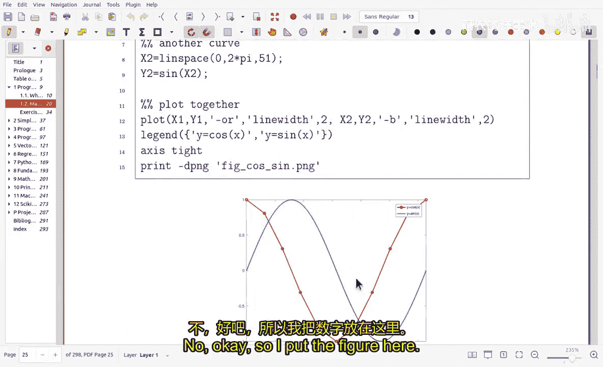

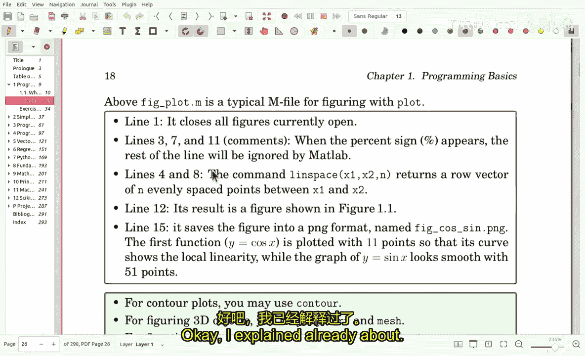

对于更高级的可视化，Matlab还提供：
*   `contour`：绘制等高线图。
*   `surf` 和 `mesh`：绘制三维曲面图。
当拥有函数表达式而非离散数据点时，可以使用 `fplot` (二维) 和 `fsurf`/`fmesh` (三维) 直接绘制函数图形。

---

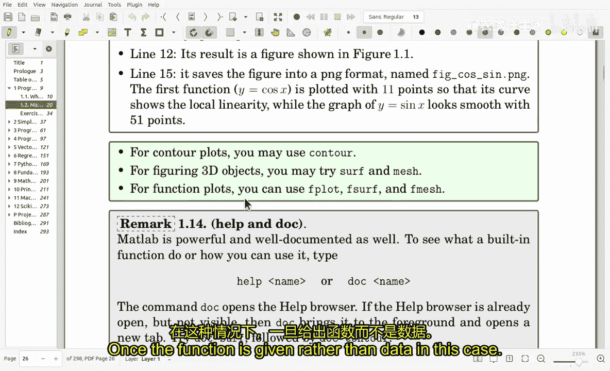

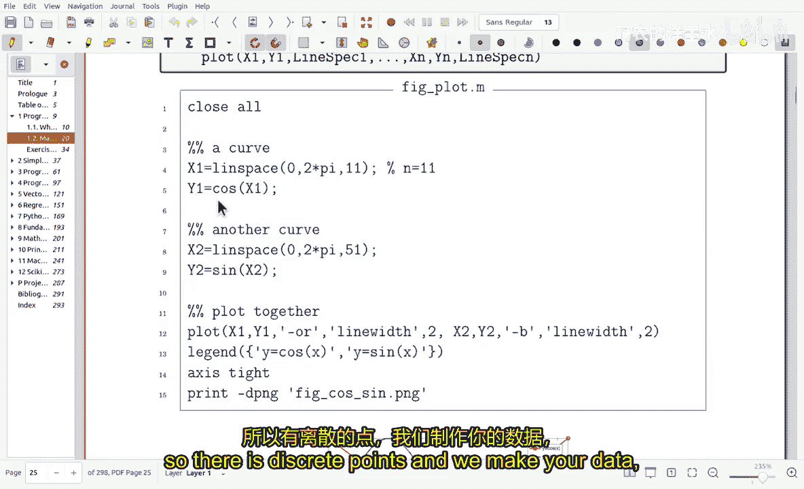

## 获取帮助 ℹ️

Matlab功能强大且文档齐全。要了解任何命令的用法，可以使用 `help` 命令。


例如，在命令窗口输入：
```matlab
help plot
```
这将显示 `plot` 函数的详细帮助文档，包括语法、选项和示例，帮助你根据需要定制图形。

---

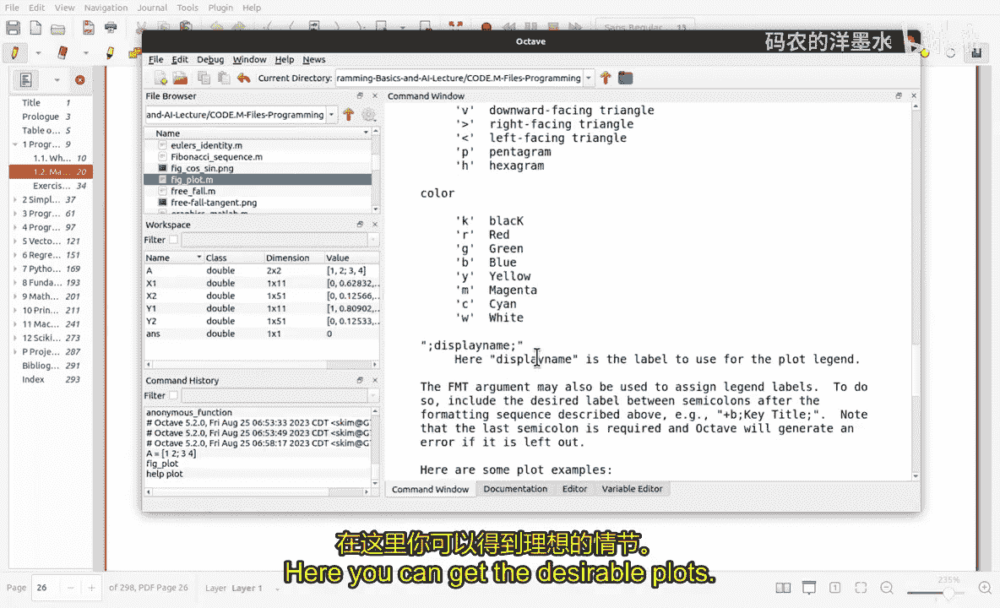

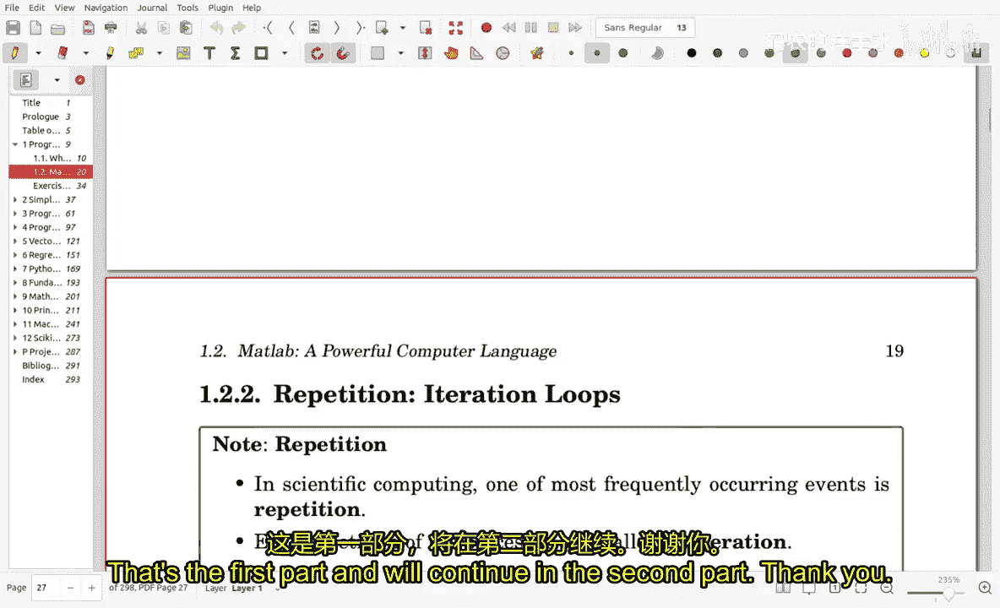

本节课中，我们一起学习了Matlab/Octave的基础知识。我们介绍了如何创建和操作向量与矩阵，包括逐步构建和访问元素。我们探索了基本的数学运算，如矩阵乘法和求逆。最后，我们掌握了使用 `plot` 命令进行数据可视化的方法，并了解了如何通过 `help` 命令获取帮助。这些是使用Matlab/Octave进行科学计算和数据分析的核心技能。