# 006：重复迭代循环（第二部分） 🚀

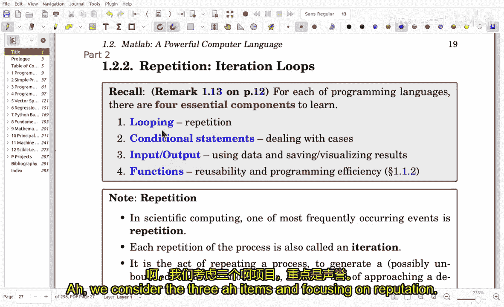

在本节课程中，我们将深入学习编程中的核心概念——循环。循环是执行重复任务的基础，对于科学计算和数据处理至关重要。我们将探讨循环的不同类型、控制语句以及如何在MATLAB中应用它们。

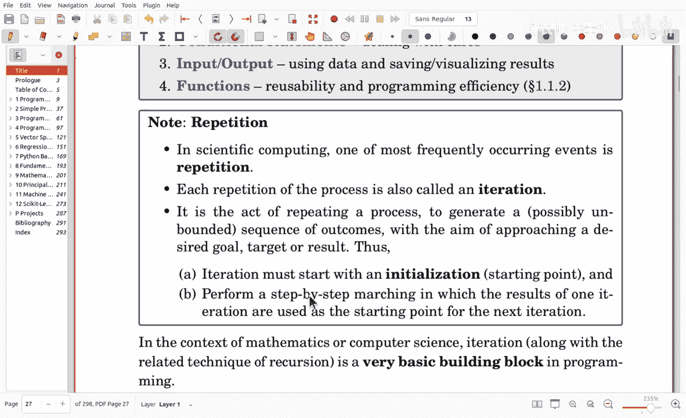

## 循环的基本概念 🔄

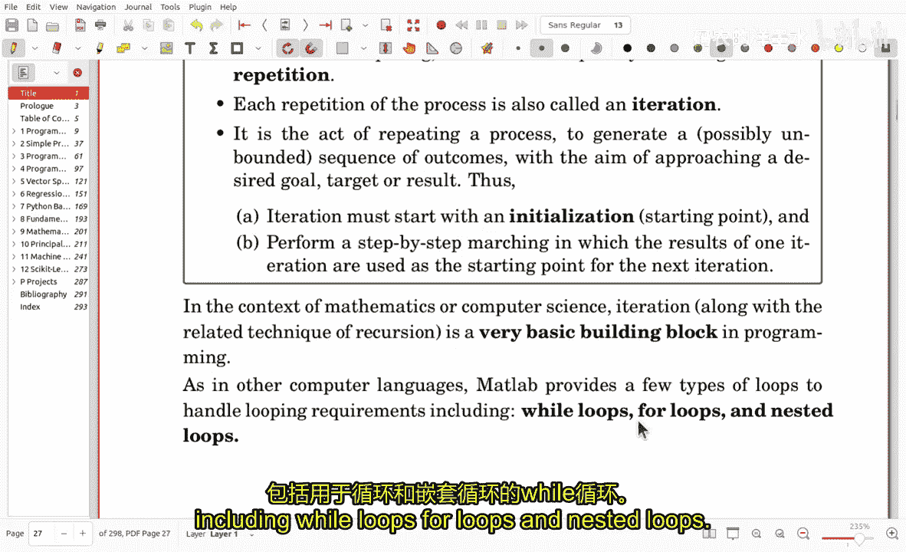

在科学计算中，重复是最常见的操作之一。每次重复的过程称为一次迭代。迭代是指重复一个过程以生成一系列结果或得到最终数值的行为。因此，迭代必须从初始化开始，并逐步执行以获取结果。

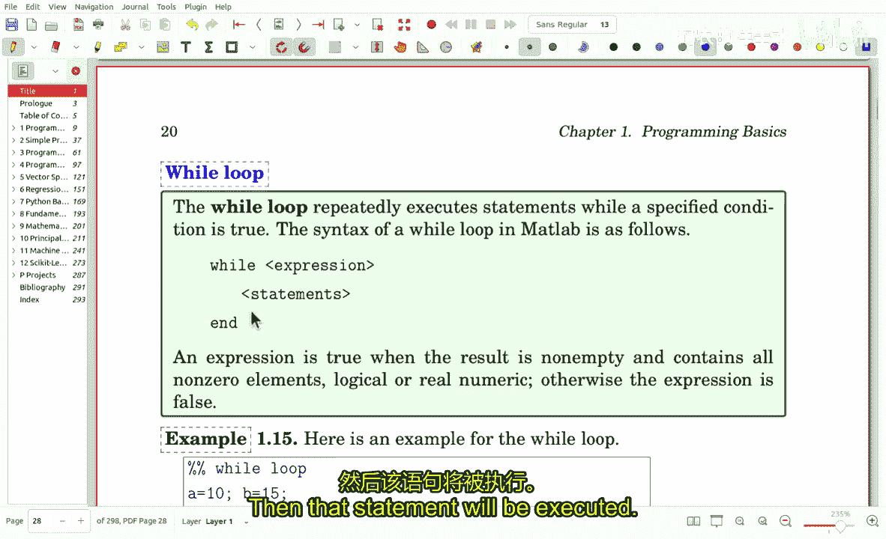

## MATLAB中的循环类型

循环是编程中非常基础的构建块。MATLAB提供了几种类型的循环来处理循环需求，包括 `while` 循环、`for` 循环和嵌套循环。

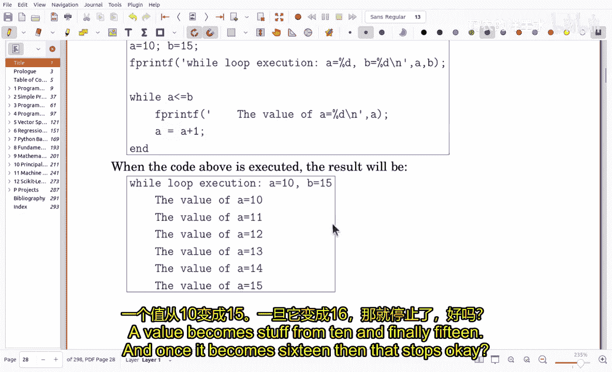

### While 循环

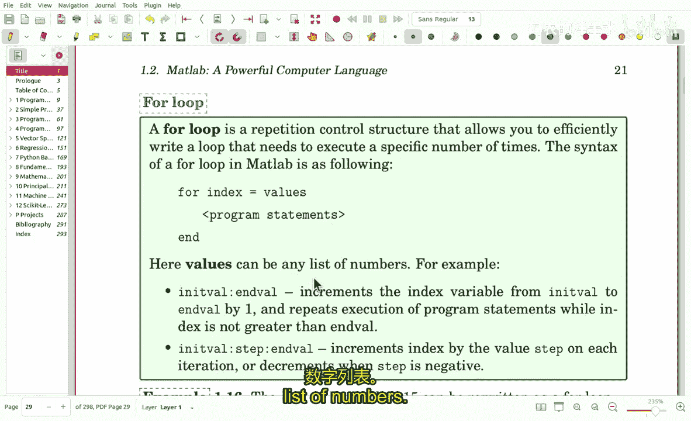

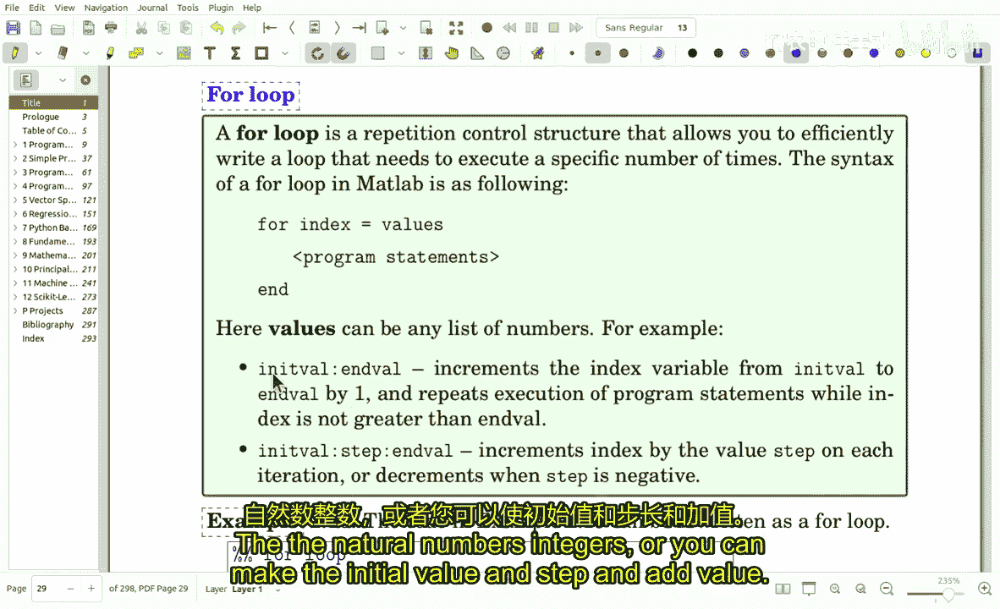

`while` 循环的格式如下：`while` 一个表达式，执行语句，以 `end` 结束。一旦表达式为真，语句就会被执行。

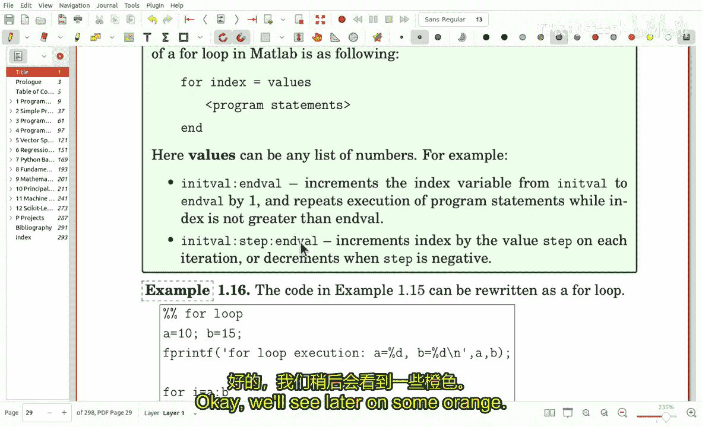

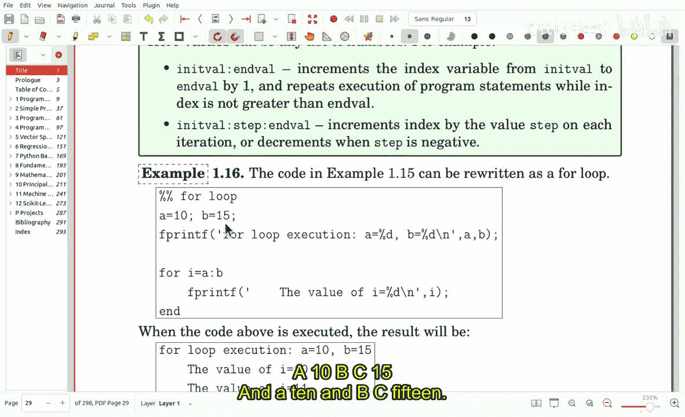

让我们看一个例子。假设 `a = 10`，`b = 15`。在打印出 `a` 和 `b` 的值后，给出 `while` 循环：如果 `a` 小于等于 `b`，则打印出 `a` 的值，然后 `a` 增加1。每次迭代，`a` 从10开始增加，变成11、12、13，直到15。当 `a` 变成16时，条件不再为真，循环停止。因此，这个循环会打印出从10到15的值。

### For 循环

`for` 循环针对列表中的每个值执行。对于列表中的每个成员（现在成为索引），程序语句将被执行。值可以是任何数字列表。例如，你可以设置初始值和结束值，如 `1:4`，这将生成从1到4的列表。

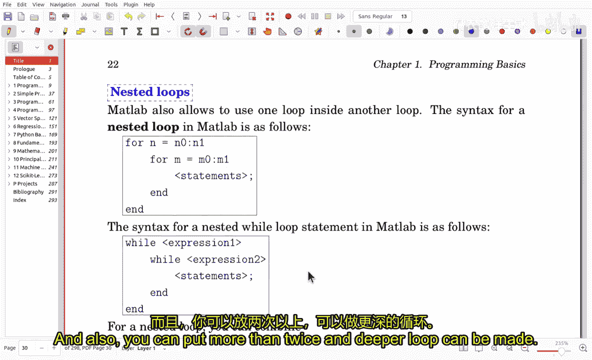

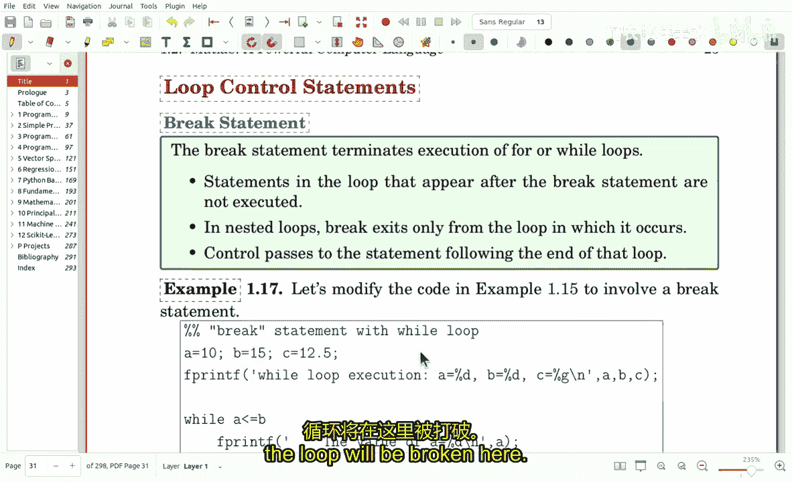

我们来看一个类似环境的例子。`a = 10`，`b = 15`。在打印出 `a` 和 `b` 的值后，`for` 循环如下：`i` 从 `a` 到 `b`。所以 `a` 是10，`b` 是15，因此 `a` 到 `b` 的列表与数字10、11、12、13、14、15相同。`i` 将从这个列表中选择。开始时，`i` 是10，然后是11、12，依此类推。对于每个 `i`，值被打印出来。所以你可以看到 `i` 从10到15。

### 嵌套循环

循环可以组织成另一个循环在其中一个循环内部，这就是嵌套循环。我们有一个循环，内部可以再放另一个循环。这种循环称为嵌套 `for` 循环。你也可以创建嵌套的 `while` 循环。此外，你可以结合 `for` 循环和 `while` 循环来创建嵌套循环。你还可以嵌套超过两层，创建更深的循环。

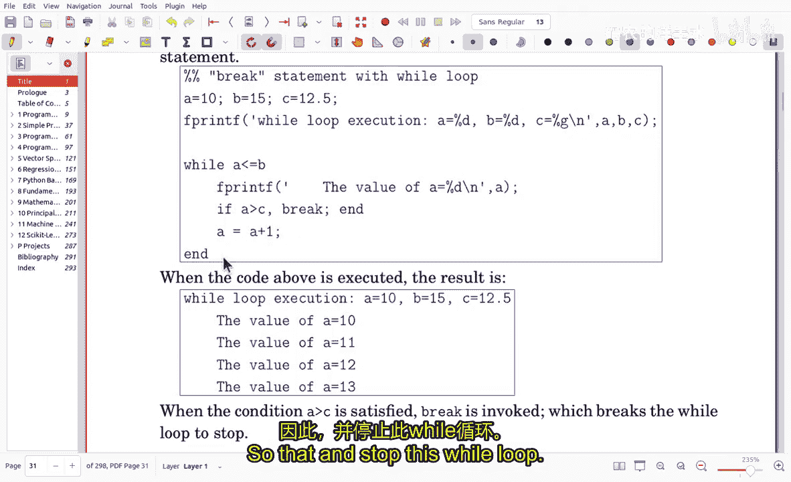

## 循环控制语句

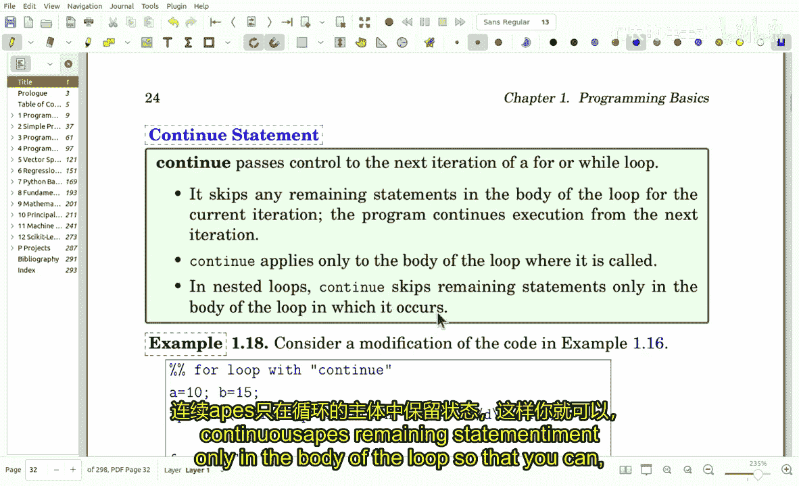

### Break 语句

一个常用的控制语句是 `break`。一旦循环遇到 `break`，循环就会被中断。

让我们看这个例子。我们修改了示例1.15的代码，加入了一个 `break` 语句。我们添加了另一个变量 `c = 12.5`。首先，我们打印出 `a`、`b`、`c` 的值，然后是这个 `while` 循环。我们添加了这一行：一旦 `a` 大于 `c`（`c` 是12.5），例如 `a` 是13，那么 `break` 语句将被执行，`while` 循环停止。所以这里的结果是，当 `a` 是10时，条件不成立，因为 `c` 是12.5，所以不执行。一旦 `a` 变成13，条件成立，`break` 被执行，循环停止。

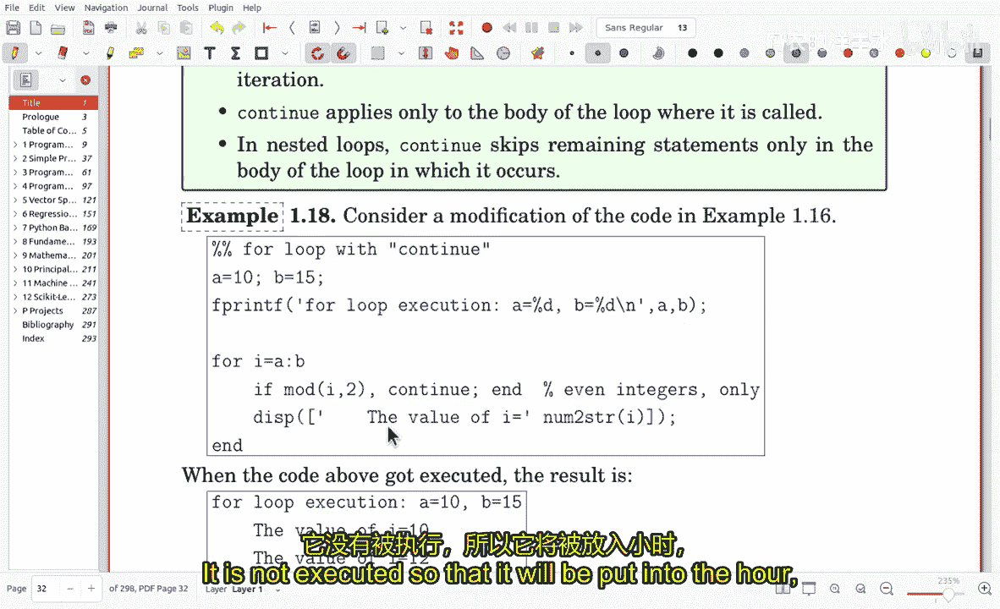

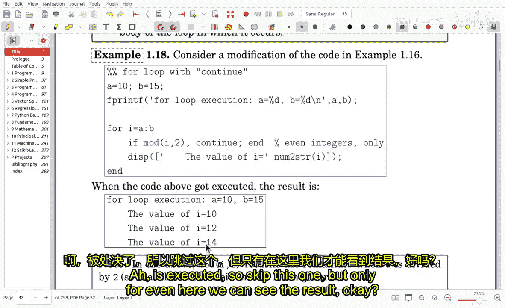

### Continue 语句

有时你想中断循环，但有时你想忽略循环中的某些部分并继续执行。这时你可以使用 `continue` 语句。`continue` 只应用于调用它的循环部分。在嵌套循环中，`continue` 仅跳过当前循环体中的剩余语句，使程序可以继续运行。

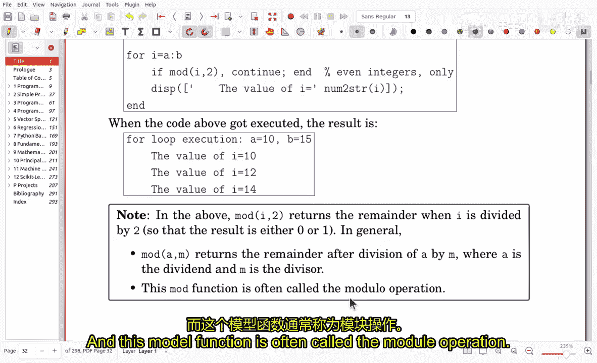

现在我们修改示例1.16的代码。这是一个 `for` 循环，我们添加了 `continue` 语句。`a = 10`，`b = 15`，与示例1.16中的代码相同。然后我们添加了这一行：如果 `mod(i, 2)` 的输出是1（即 `i` 除以2的余数），则执行 `continue`。所以对于奇数 `i`，余数为1，条件为真，`continue` 被执行，跳过打印部分。只有对于偶数 `i`，条件不成立，才会执行打印。因此，只有偶数 `i` 的结果会被输出。

`mod(i, 2)` 返回 `i` 除以2的余数，结果要么是0，要么是1。如果是0，则是偶数；如果是1，则等同于真，`continue` 被执行。一般来说，`mod(a, m)` 返回 `a` 除以 `m` 后的余数，其中 `a` 称为被除数，`m` 是除数。这个 `mod` 函数通常被称为模运算。

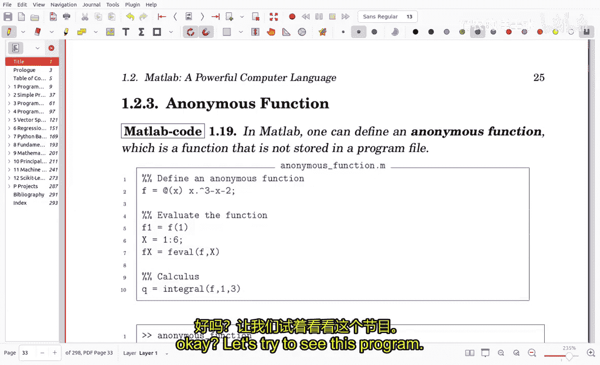

## 匿名函数

在MATLAB中，我们可以定义一个匿名函数。这是一个不存储在程序文件（M文件）中的函数。我们定义一个匿名函数 `f`：`@(x)` 表示 `x` 是变量，后面是函数体。我们尝试打印 `f(1)`，所以没有分号。如果你执行这个程序，`f(1)` 会输出。`X` 被定义为从1到6的整数。通过 `f(X)`，函数 `f` 在这些点上求值并保存结果。因为有分号，这些值不会显示。另外，对于这个函数 `f`，我们尝试求定积分。如果你熟悉微积分积分，那么这是函数从1到3的定积分，输出将保存到 `q`。这里没有分号，所以你会看到输出。让我们尝试运行这个程序。

在目录中，我们有一个匿名函数，执行相同的程序。在顶部，`close all` 和 `clear all` 用于关闭所有图形并清除旧变量。`format long` 意味着在输出中，如果不是整数值，则以长格式打印。我们可以运行它，这与键盘上的F5相同。然后它被执行，我们得到输出：匿名函数被执行，`f(1)` 是-2，`f(X)` 的6个值，最后一个是 `f` 从1到3的定积分。输出完全相同。

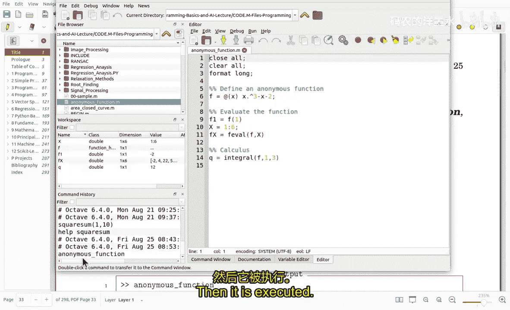

## 开源替代方案

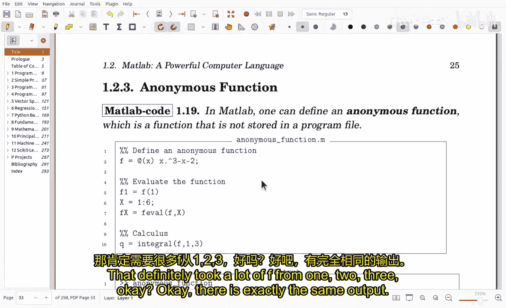

最后，在本节中，我们将考虑MATLAB的开源替代方案。Octave 是MATLAB最著名的替代品。实际上，Octave 和 MATLAB 并不完全相同。然而，大多数程序可以在MATLAB和Octave中无需修改地运行。有时需要少量修改，但你可以轻松理解需要更改的地方。因此，通过Octave，你可以运行MATLAB程序。

在Python中，NumPy 是科学计算的主要包。它组织得非常好，可以处理通用数组、复数矩阵变换和线性流体变换。此外，你可以用它来调用其他语言，如C、C++和Fortran。事实上，在计算语言中，Fortran 是最快的。NumPy 的组织方式模仿了MATLAB，所以一旦你理解了MATLAB，以后可以非常容易地使用NumPy。我们将在第7章考虑Python基础。

## 总结 🎯

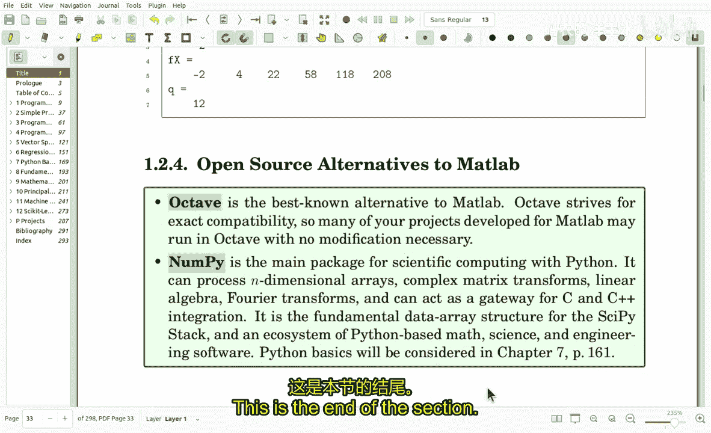

本节课我们一起学习了编程中的核心循环结构。我们介绍了 `while` 循环和 `for` 循环的基本语法与执行逻辑，探讨了如何通过嵌套循环处理更复杂的问题。同时，我们学习了 `break` 和 `continue` 这两个重要的循环控制语句，它们能帮助我们更灵活地控制程序流程。此外，我们还了解了MATLAB中匿名函数的定义与使用，并简要介绍了MATLAB的开源替代方案Octave和Python的NumPy库。掌握这些概念是进行高效科学计算和数据处理的基础。