# 007：第7讲 - 闭合曲线定义区域的面积估计 📐

在本节课中，我们将学习如何通过一系列定义闭合边界的点来估计一个区域的面积。这是一个在医学图像分析（如识别癌细胞区域）等领域非常实用的技术。我们将从简单的几何形状推导出通用公式，并通过编程示例来验证其准确性。

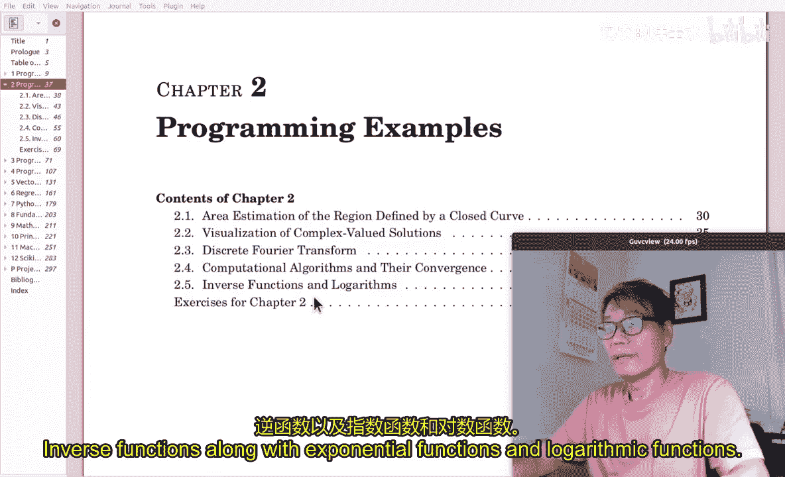

---

## 章节 2.1：闭合曲线定义区域的面积估计

在现实中，一个区域通常由一系列有序的点来界定。假设我们有 `n+1` 个点：`(x0, y0)`, `(x1, y1)`, ..., `(xn, yn)`，其中最后一个点 `(xn, yn)` 与第一个点 `(x0, y0)` 相同。这些点依次连接，形成一条闭合的折线，内部围成一个区域。我们的目标是计算这个区域的面积。

上一节我们介绍了问题的背景，本节中我们来看看如何推导出计算面积的公式。

### 公式推导：从矩形和三角形开始

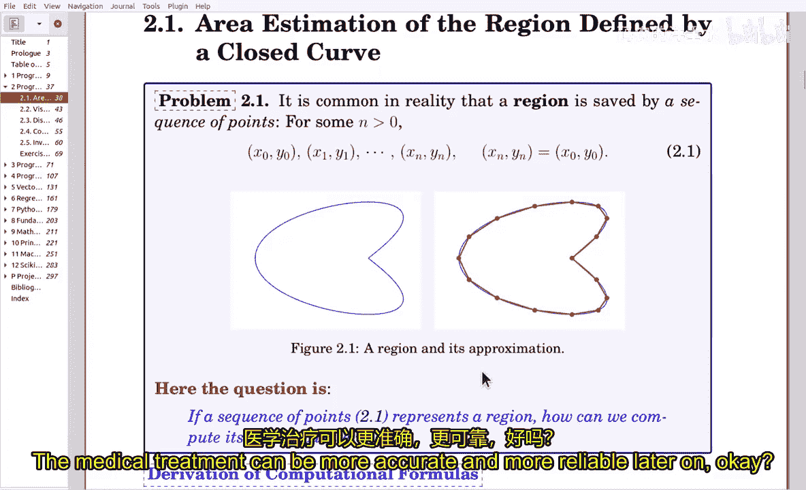

为了推导面积的计算公式，让我们从两个简单的形状开始：矩形和三角形。

**矩形面积**
考虑一个矩形，其左下角为 `(a, c)`，右上角为 `(b, d)`。我们知道其面积为：
`面积 = (b - a) * (d - c)`

这个结果可以重新组织为一种特殊的形式。如果我们沿着边界逆时针行走，并考虑每条线段中点的x坐标乘以该线段在y方向上的变化量，并对所有线段求和，也能得到相同的结果。这暗示了一个通用公式的可能性。

**三角形面积**
对于一个顶点为 `(a, c)`, `(b, c)`, `(b, d)` 的直角三角形，其面积为：
`面积 = 0.5 * (b - a) * (d - c)`

同样，使用“每条线段中点的x坐标乘以y方向变化量”的方法进行计算，经过代数整理，结果与已知面积公式一致。水平线段（y值无变化）对该求和没有贡献。

通过以上验证，我们猜测以下公式对于由折线定义的任何区域都成立。

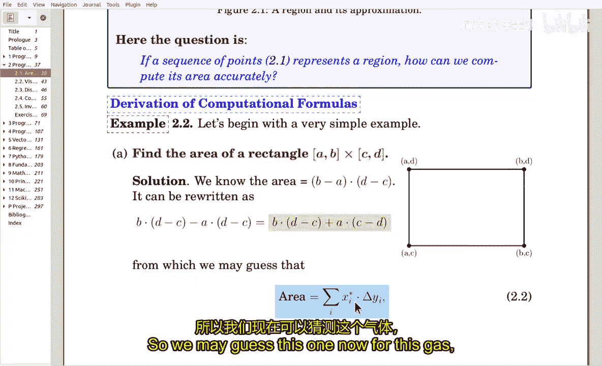

### 通用面积公式

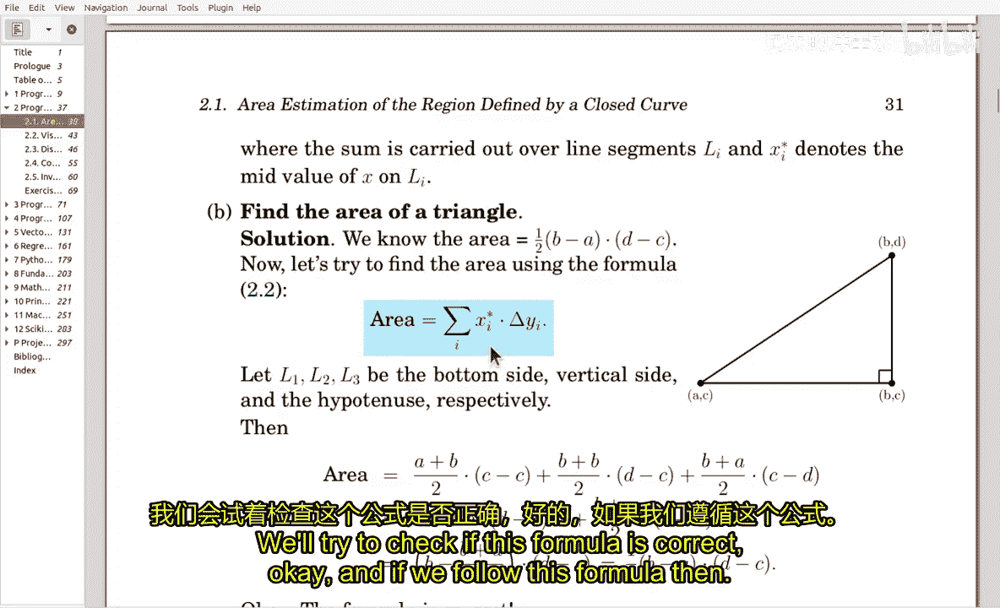

现在，我们可以总结出通用公式。

设区域 `R` 由一系列点 `(x0, y0)`, `(x1, y1)`, ..., `(xn, yn)` 定义，其中 `(xn, yn) = (x0, y0)`，形成一条闭合折线。共有 `n` 条线段，第 `i` 条线段连接点 `(x_{i-1}, y_{i-1})` 和 `(xi, yi)`。

那么，区域 `R` 的面积 `A` 可以通过以下公式计算：

```
A = 0.5 * Σ_{i=1}^{n} [ (x_{i-1} + x_i) * (y_i - y_{i-1}) ]
```

**公式解释：**
*   `(x_{i-1} + x_i) / 2` 是第 `i` 条线段中点的x坐标（公式中提取了系数0.5）。
*   `(y_i - y_{i-1})` 是该线段在y方向上的变化量。
*   求和 `Σ` 对所有线段进行。
*   点序列必须按**逆时针**顺序排列，以保证面积为正。如果是顺时针顺序，结果将为负值，取其绝对值即可。

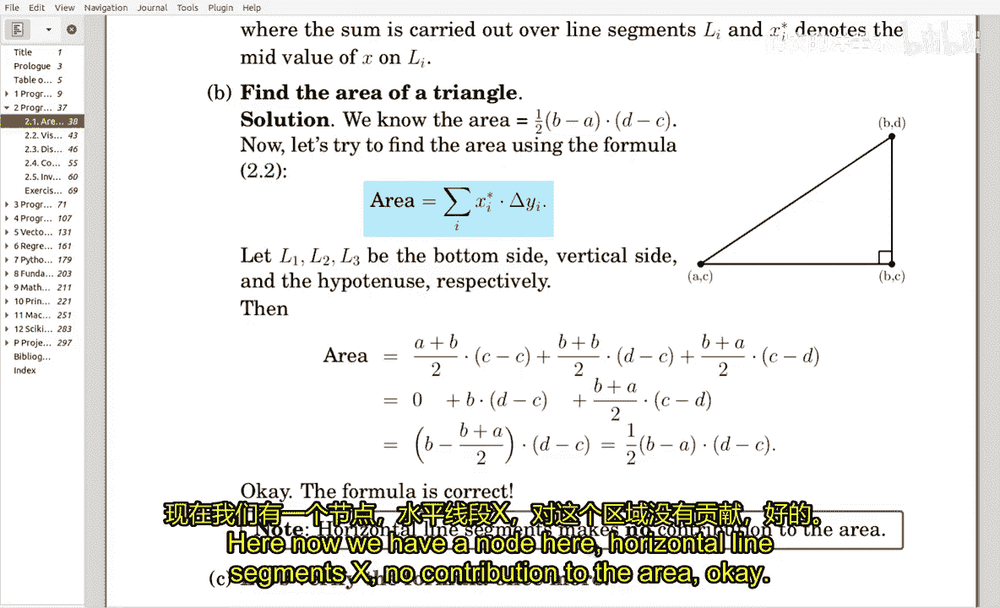

这个公式是**格林定理**的一个直接应用（面积 = 1/2 ∮(x dy - y dx)），当边界为分段线性时，该公式是精确的。

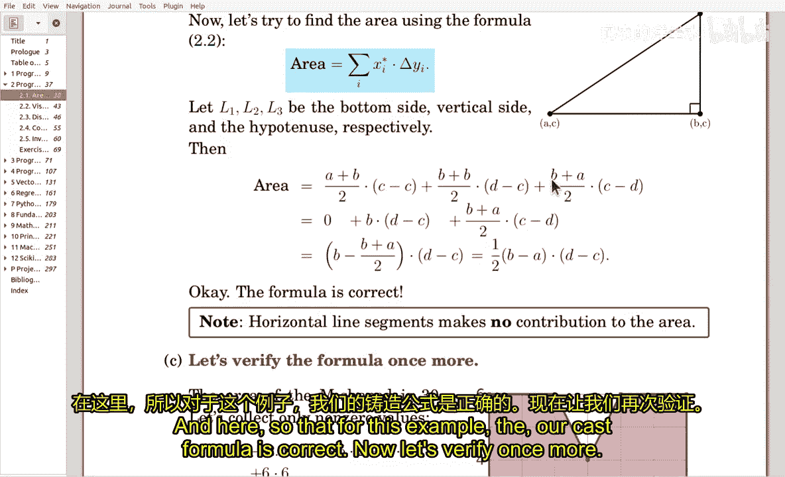

### 复杂形状验证

为了确保公式的有效性，我们将其应用到一个更复杂的L形区域上。

以下是计算步骤：
1.  列出按逆时针顺序排列的边界点。
2.  对每条线段应用公式中的项 `(x_{i-1} + x_i) * (y_i - y_{i-1})`。
3.  将所有项相加，最后乘以0.5。

通过计算，得到的结果与通过几何分割法（矩形面积相减）计算出的面积完全一致，从而验证了公式对于不规则多边形同样有效。

---

## 编程示例：估计圆的面积 🌀

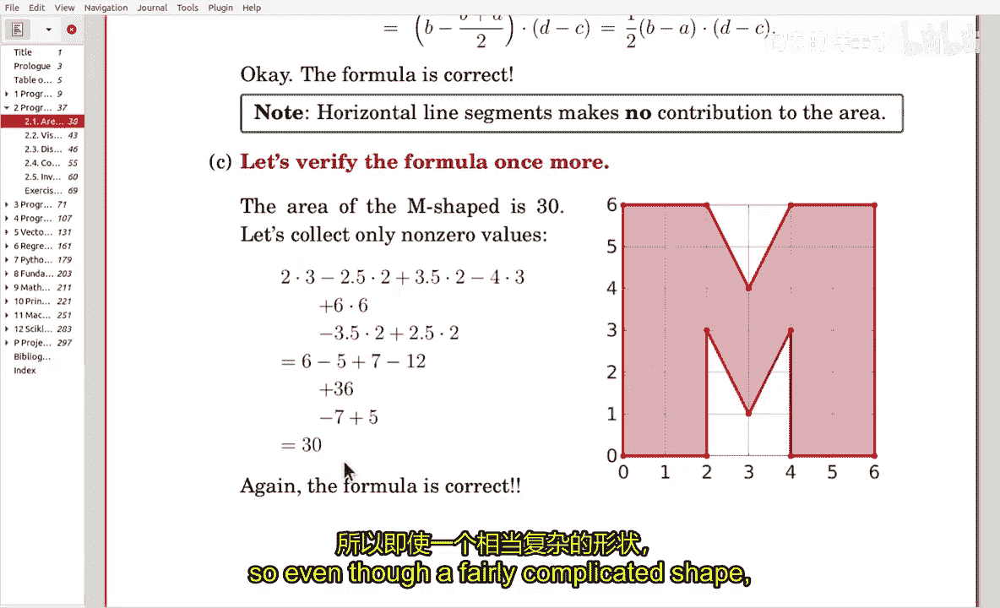

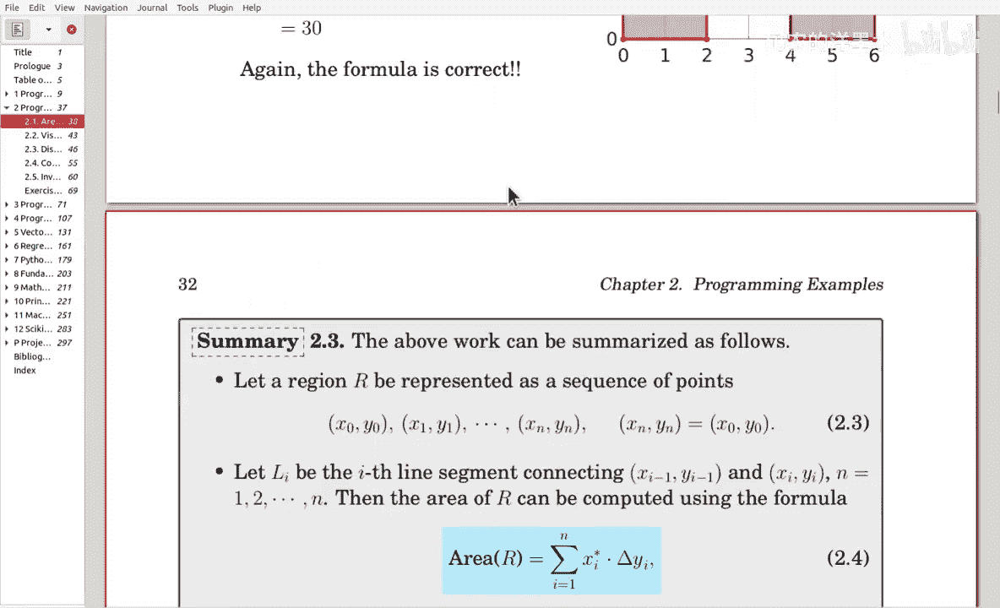

现在，我们将通过一个编程实例来应用这个公式，并观察当使用更多点来近似曲线边界时，面积估计值如何逼近真实值。

我们的目标是估计单位圆（半径为1）的面积，其真实值为 `π`。我们用正多边形来近似圆的边界。

### 数据生成与面积计算

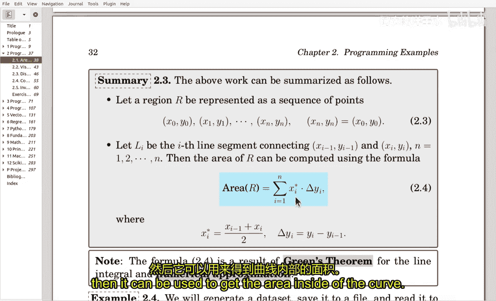

以下是实现该过程的核心步骤：

1.  **生成边界点**： 对于给定的分段数 `n`，在 `0` 到 `2π` 范围内均匀生成 `n+1` 个角度 `theta`。点的坐标为：
    `(xi, yi) = (cos(theta_i), sin(theta_i))`
    这形成了一个近似圆的正 `n` 边形。

2.  **应用面积公式**： 使用推导出的公式计算这个多边形的面积。

3.  **误差分析**： 随着 `n` 增大（点变密），多边形面积将趋近于圆的真实面积 `π`。我们可以观察误差 `|估计面积 - π|` 如何随 `n` 增加而减小。

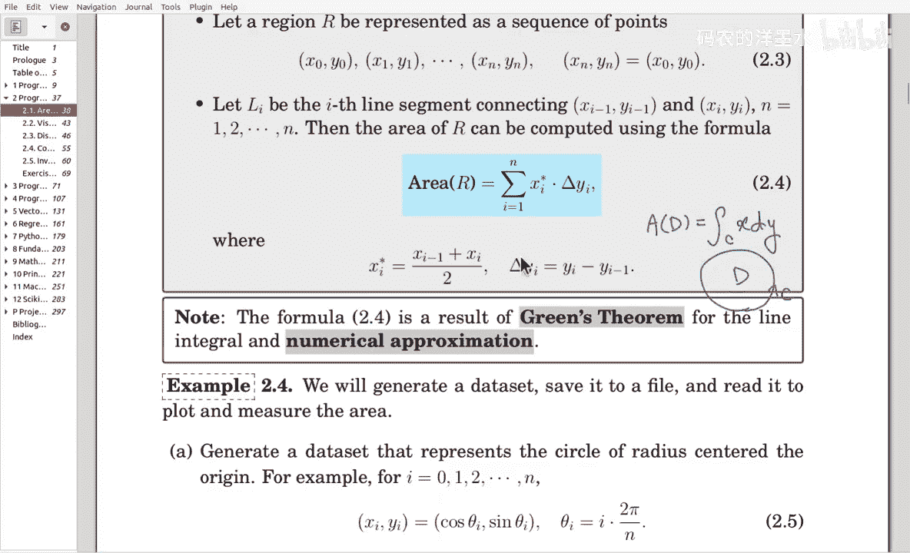

### 代码实现要点

以下是一个概念性的代码流程，展示了如何组织计算：

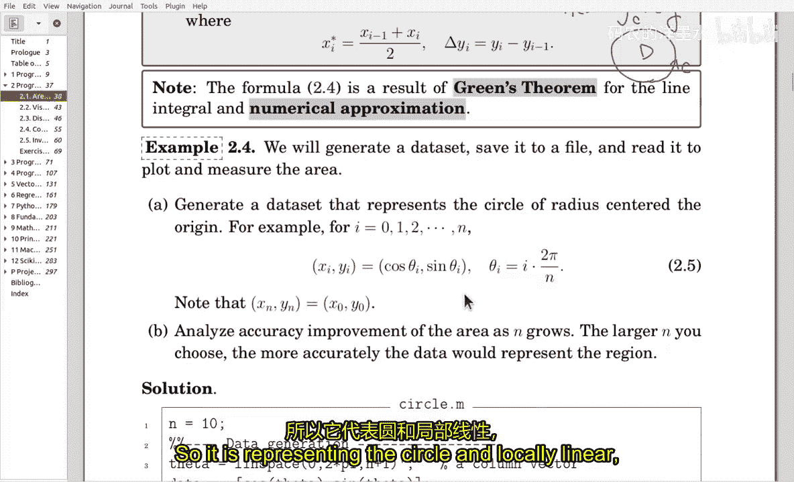

```matlab
function estimated_area = estimate_circle_area(n)
    % 生成 n+1 个点来近似圆
    theta = linspace(0, 2*pi, n+1); % 包含起点和终点
    x = cos(theta);
    y = sin(theta);

    % 应用面积公式
    area_sum = 0;
    for i = 1:n
        area_sum = area_sum + (x(i) + x(i+1)) * (y(i+1) - y(i));
    end
    estimated_area = 0.5 * abs(area_sum); % 取绝对值确保为正

    % 输出结果
    fprintf('n = %d, 估计面积 = %.6f, 误差 = %.6f\n', n, estimated_area, abs(estimated_area - pi));
end
```

运行该函数并增加 `n`（例如 `n=10, 20, 40, 80, 160`），可以观察到：
*   估计面积逐渐逼近 `π` (约3.14159)。
*   误差大致以 `1/n^2` 的速度减小。例如，当 `n` 翻倍时，误差减小到约原来的四分之一。这被称为**二阶收敛**。

### 文件操作与可视化

在实际程序中，我们通常还会：
*   **将数据写入文件**： 使用 `csvwrite` 或 `dlmwrite` 函数将生成的 `(x, y)` 坐标点保存到文本文件（如 `circle_data.txt`）中，以便后续使用或检查。
*   **从文件读取数据**： 使用 `load` 函数读回数据，验证读写正确性。
*   **绘制图形**： 使用 `plot` 函数分别绘制生成的折线（近似圆）和理想的平滑圆曲线，进行视觉对比。

---

## 总结 📝

本节课中我们一起学习了如何估计由闭合曲线定义区域的面积。

1.  **核心公式**： 我们推导并验证了用于计算由点序列 `(x0,y0), ..., (xn,yn)` 定义的多边形面积的通用公式：
    `A = 0.5 * Σ [ (x_{i-1} + x_i) * (y_i - y_{i-1}) ]`
    该公式要求点按逆时针顺序排列。

2.  **数学基础**： 此公式是矢量微积分中格林定理的一个特例，当边界为分段线性时，计算是精确的。

3.  **近似应用**： 对于弯曲的边界（如圆），我们可以用密集的点集生成一个近似多边形，然后应用上述公式来估计面积。随着点数的增加，估计值会收敛于真实面积。

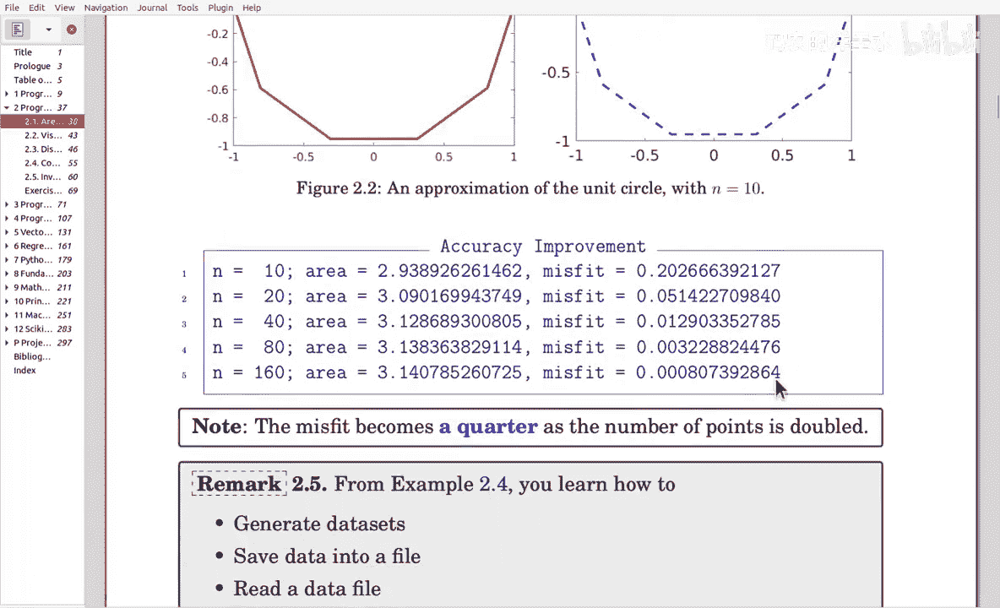

4.  **编程实践**： 我们通过估计单位圆面积的例子，演示了如何生成数据、应用公式、分析误差（观察到二阶收敛），并涉及了文件读写和图形绘制的基本操作。

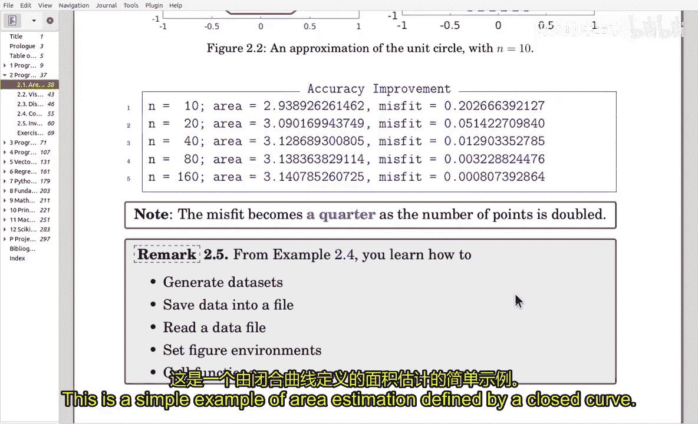

这个技术是许多实际应用的基础，例如从医学图像中量化特定区域的尺寸，为准确诊断和分析提供了数学工具。