# 008：Lecture 8 - 二次方程复值解的可视化 👁️

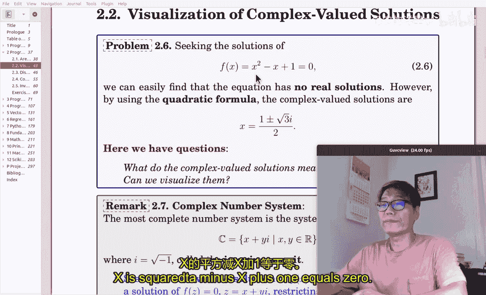

在本节课中，我们将学习如何可视化二次方程的复数值解。我们将从一个没有实数解的方程入手，探索其复数解的含义，并使用代码和图形来直观地展示这些解。

## 2.2：复数值解的可视化 📊

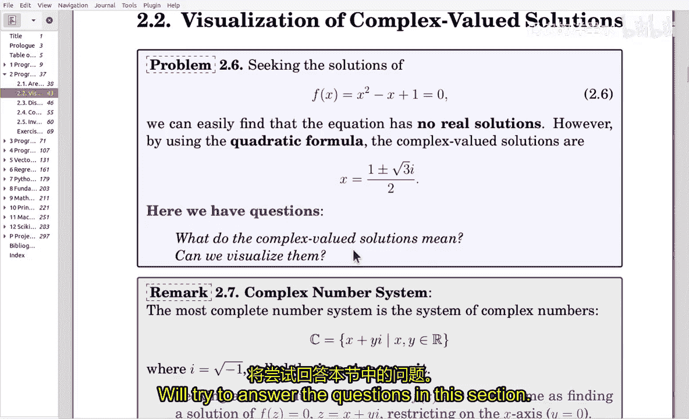

上一节我们介绍了二次方程及其解的基本概念。本节中，我们来看看如何可视化那些没有实数解的方程的复数值解。

例如，对于方程 **x² - x + 1 = 0**，我们可以很容易地发现它没有实数解。然而，如果我们使用二次求根公式，则可以找到它的复数解：**(1 ± √3 i) / 2**。

这里我们面临两个问题：这些复数值解意味着什么？我们能否将它们可视化？本节将尝试回答这些问题。

### 关于复数的说明

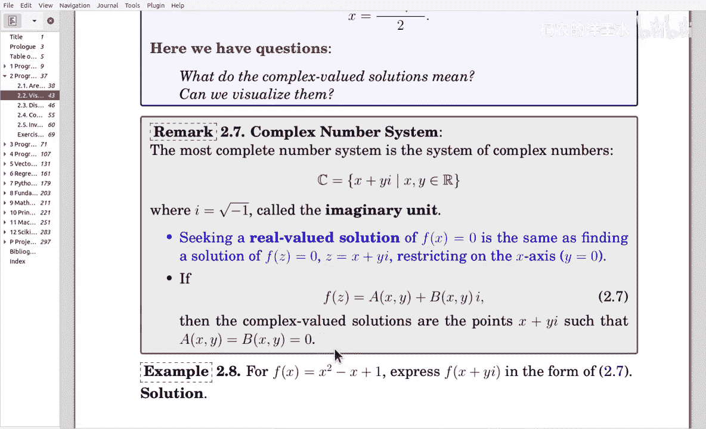

复数系统由形如 **z = x + yi** 的数字组成，其中 **x** 和 **y** 是实数，**i** 是虚数单位，定义为 **i² = -1**。

### 核心观察

寻找方程 **f(x) = 0** 的实数解，等同于寻找方程 **f(z) = 0** 的解，其中 **z = x + yi**，并且通过令 **y = 0** 将解限制在实数轴（x轴）上。

因此，当我们尝试求解 **f(z) = 0** 时，我们可以找到复数解并将其可视化。通过一些代数运算，我们可以将 **f(z)** 写成 **a + bi** 的形式，其中 **a** 和 **b** 都是实数。那么，复数解必须同时满足 **a = 0** 和 **b = 0**。

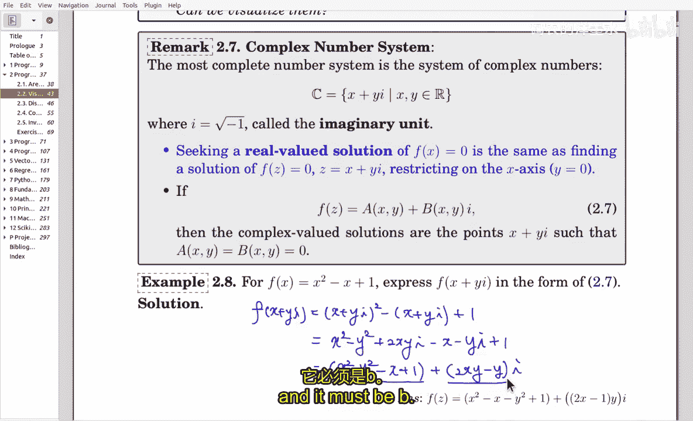

### 将函数展开为实部和虚部

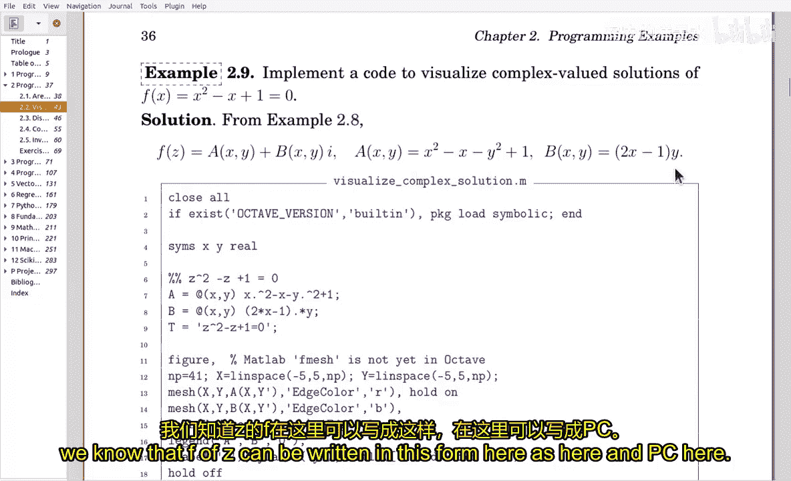

现在，让我们尝试将函数 **f(z) = z² - z + 1** 在 **z = x + yi** 处展开为 **a + bi** 的形式。

```
f(x + yi) = (x + yi)² - (x + yi) + 1
          = (x² - y² + 2xyi) - x - yi + 1
          = (x² - y² - x + 1) + (2xy - y)i
```

因此，我们得到：
*   实部 **a = x² - y² - x + 1**
*   虚部 **b = 2xy - y**

### 通过代码实现可视化

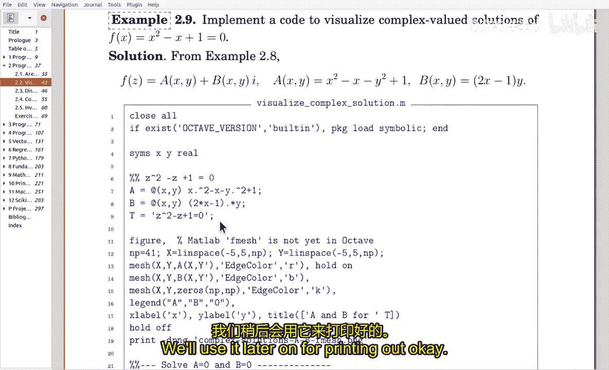

接下来，我们将通过编写 MATLAB/Octave 代码来可视化方程 **x² - x + 1 = 0** 的复数解。

以下是实现可视化的关键步骤代码：

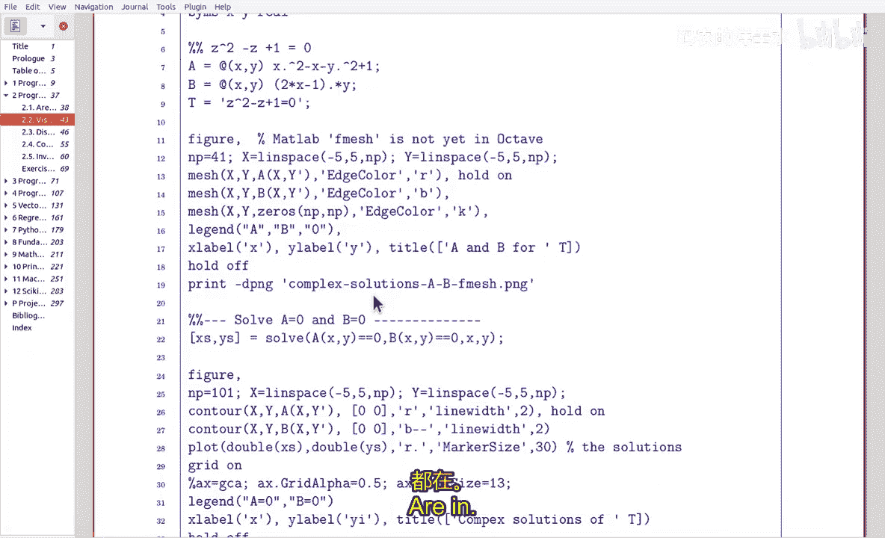

```matlab
% 检查并加载符号计算包（Octave需要）
if ~exist(‘OCTAVE_VERSION’, ‘builtin’)
    % 在MATLAB中，符号工具箱通常已自动加载
else
    pkg load symbolic % Octave需要手动加载
end

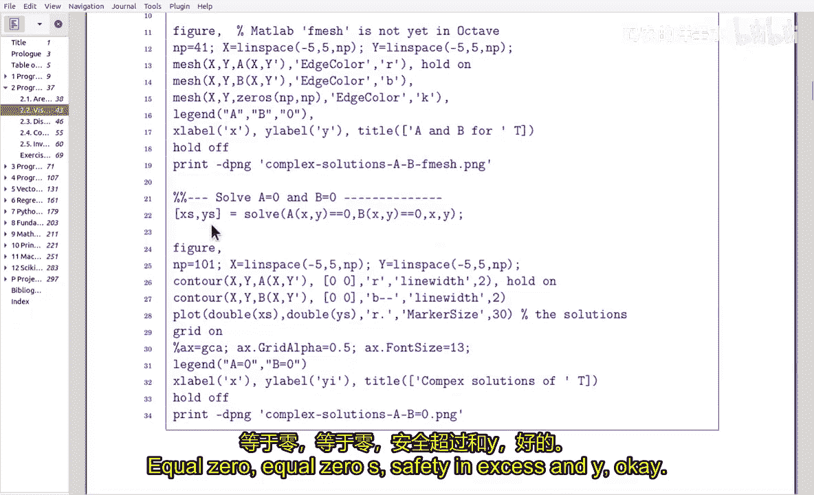

% 定义符号变量
syms x y real
% 定义复数 z 和函数 f(z)
z = x + 1i*y;
f = z^2 - z + 1;
% 提取实部(a)和虚部(b)
a = simplify(real(f));
b = simplify(imag(f));

% 为绘图和打印准备字符串
str_a = char(a);
str_b = char(b);
fprintf(‘实部 a = %s\n’, str_a);
fprintf(‘虚部 b = %s\n’, str_b);

% 创建网格数据用于绘图
[X, Y] = meshgrid(linspace(-2, 2, 50), linspace(-2, 2, 50));
A = eval(subs(a, {x, y}, {X, Y}));
B = eval(subs(b, {x, y}, {X, Y}));

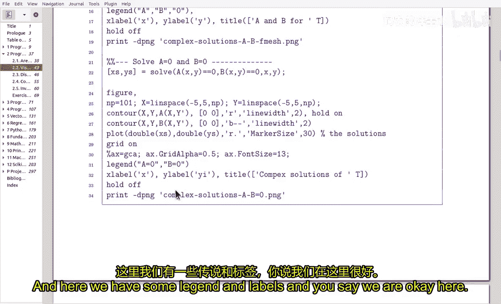

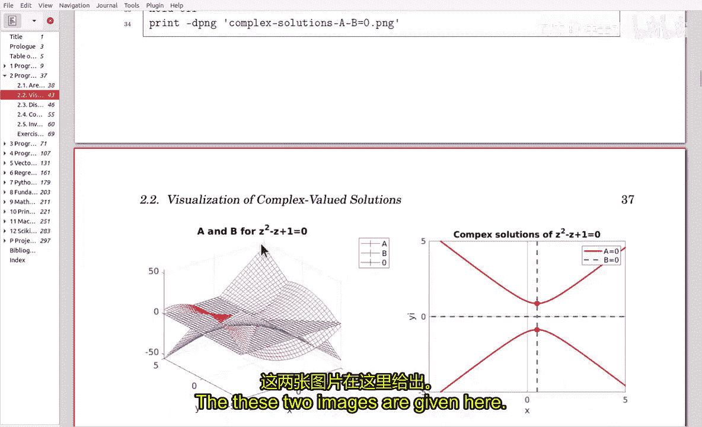

% 图1：三维曲面图
figure(‘Position’, [100 100 1200 500])
subplot(1,2,1)
mesh(X, Y, A, ‘EdgeColor’, ‘r’, ‘FaceAlpha’, 0.5); hold on;
mesh(X, Y, B, ‘EdgeColor’, ‘b’, ‘FaceAlpha’, 0.5);
mesh(X, Y, zeros(size(X)), ‘EdgeColor’, ‘k’, ‘FaceAlpha’, 0.1); % z=0平面
legend(‘z = a (实部)’, ‘z = b (虚部)’, ‘z = 0平面’)
xlabel(‘x’); ylabel(‘y’); zlabel(‘z’);
title(‘函数实部(a)与虚部(b)的三维曲面’)
view(30, 30)

% 计算并标记解
sol_x = [0.5, 0.5];
sol_y = [sqrt(3)/2, -sqrt(3)/2];
plot3(sol_x, sol_y, [0, 0], ‘ko’, ‘MarkerSize’, 10, ‘MarkerFaceColor’, ‘g’)

% 图2：等高线图（解是a=0和b=0两条线的交点）
subplot(1,2,2)
contour(X, Y, A, [0 0], ‘r-’, ‘LineWidth’, 2); hold on; % a=0的等高线
contour(X, Y, B, [0 0], ‘b--’, ‘LineWidth’, 2); % b=0的等高线
plot(sol_x, sol_y, ‘ro’, ‘MarkerSize’, 10, ‘MarkerFaceColor’, ‘r’)
legend(‘a=0’, ‘b=0’, ‘复数解’)
xlabel(‘x (实部)’); ylabel(‘y (虚部)’);
title(‘方程解的等高线可视化 (a=0 与 b=0 的交点)’)
grid on
axis equal
```

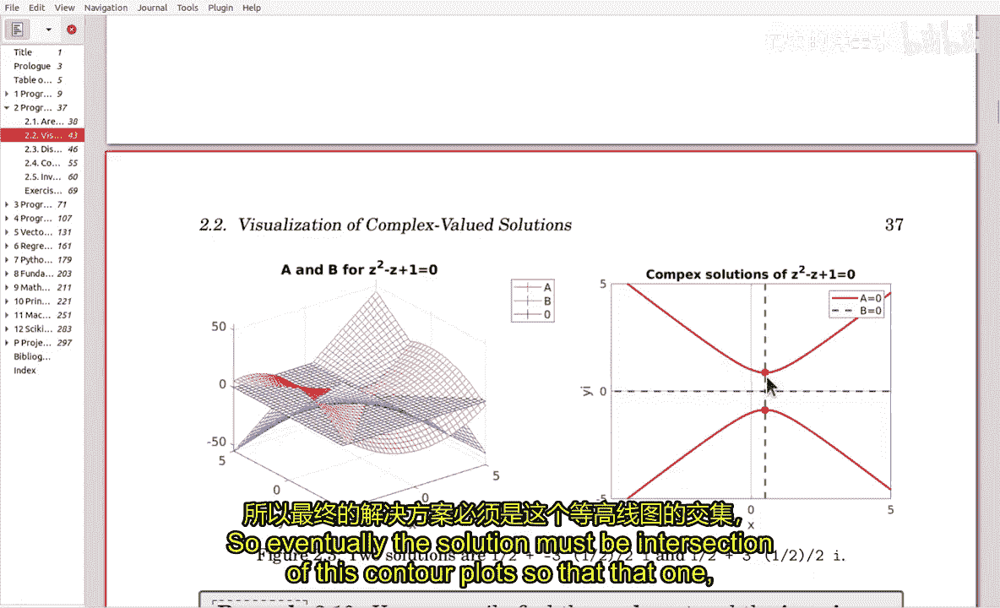

### 可视化结果解读

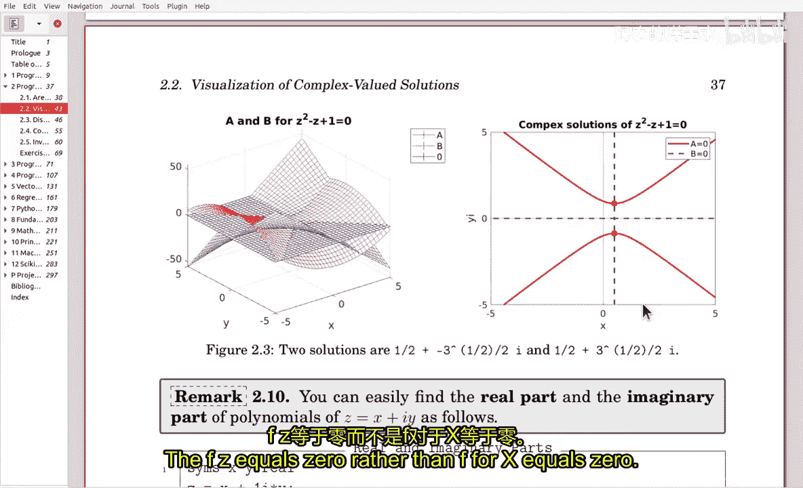

运行上述代码会生成两幅图：

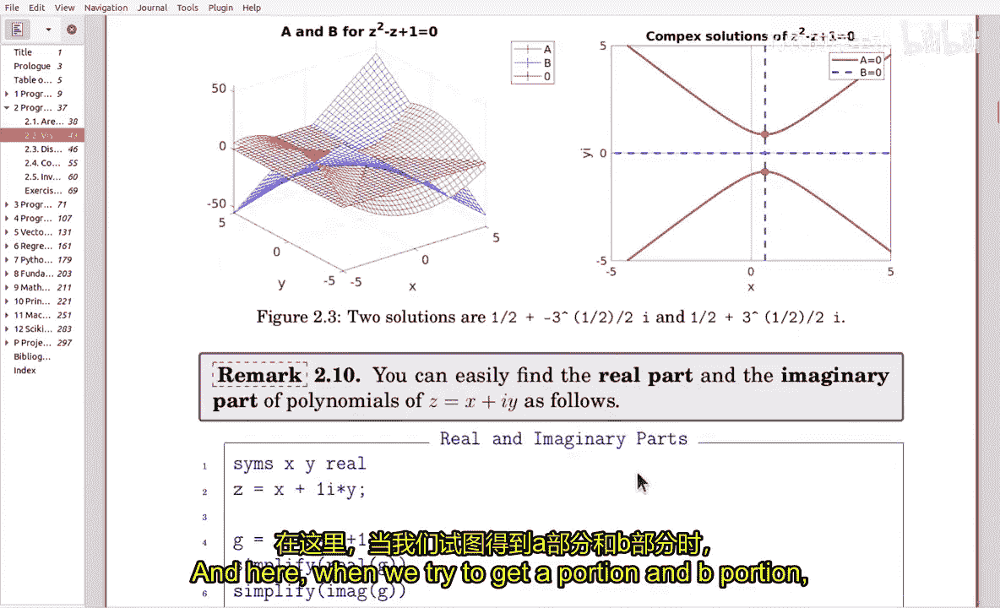

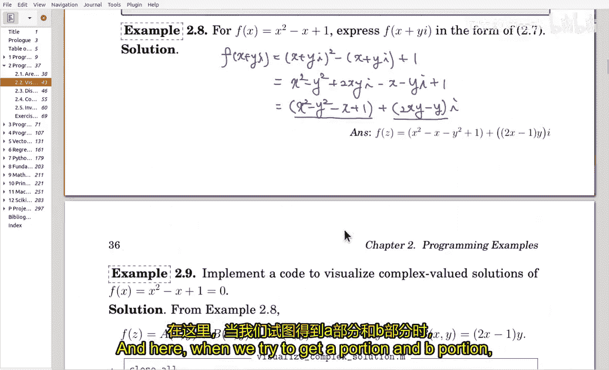

1.  **三维曲面图**：
    *   红色曲面代表实部 **z = a(x, y)**。
    *   蓝色曲面代表虚部 **z = b(x, y)**。
    *   黑色平面代表 **z = 0**。
    *   方程的解位于红色曲面和蓝色曲面同时与 **z=0** 平面相交的位置。绿色标记点标示了这些解。

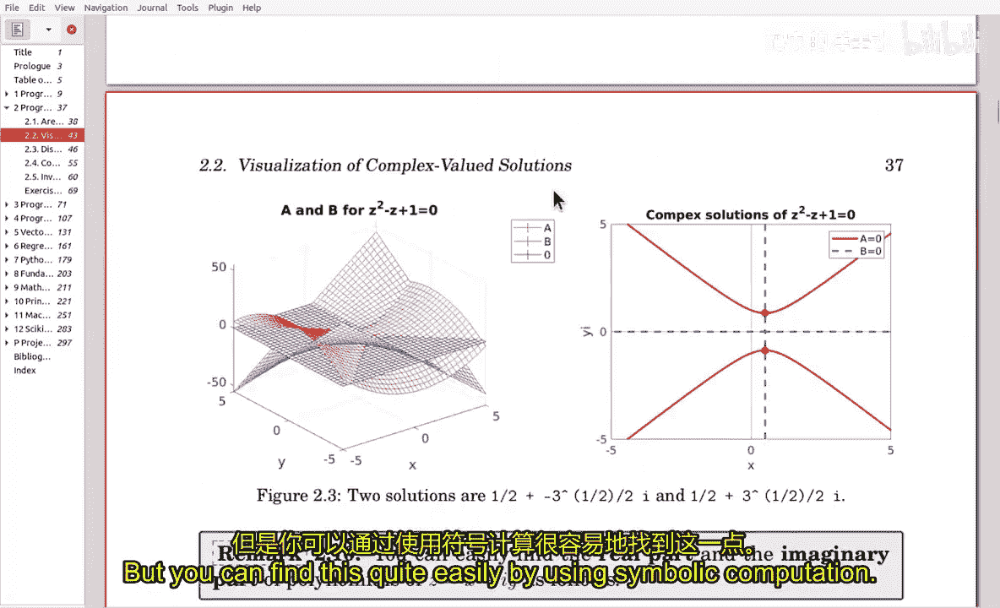

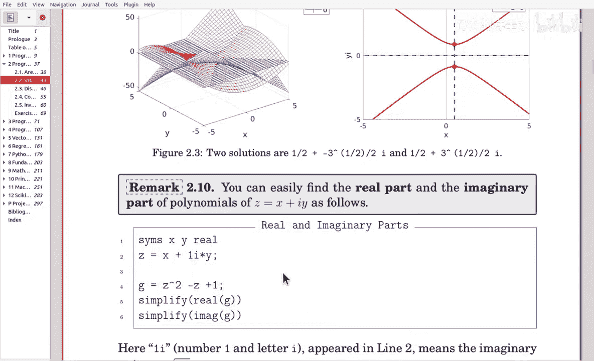

2.  **等高线图**：
    *   红色实线是 **a(x, y) = 0** 的等高线。
    *   蓝色虚线是 **b(x, y) = 0** 的等高线。
    *   这两条线的**交点**（图中红色圆点）就是方程 **f(z)=0** 的复数解，即 **(0.5, √3/2)** 和 **(0.5, -√3/2)**，对应 **z = 0.5 ± (√3/2)i**。

### 利用符号计算简化过程

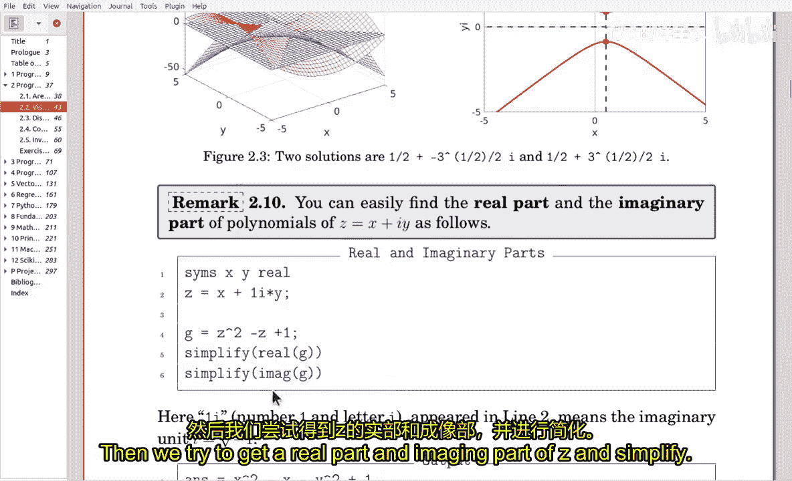

手动展开复函数可能很繁琐。我们可以直接使用符号计算工具箱来获得实部和虚部：

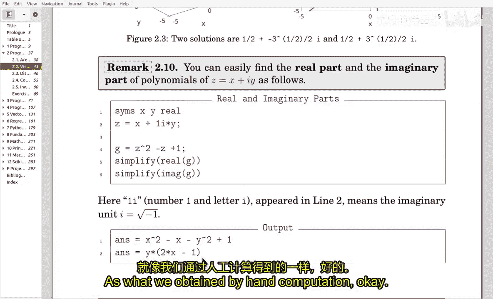

```matlab
syms x y real
z = x + 1i*y;          % 1i 代表虚数单位 i
f_expr = z^2 - z + 1;
a_sym = simplify(real(f_expr)); % 输出: x^2 - y^2 - x + 1
b_sym = simplify(imag(f_expr)); % 输出: 2*x*y - y
```
这与我们手动计算的结果完全一致。

## 总结 🎯

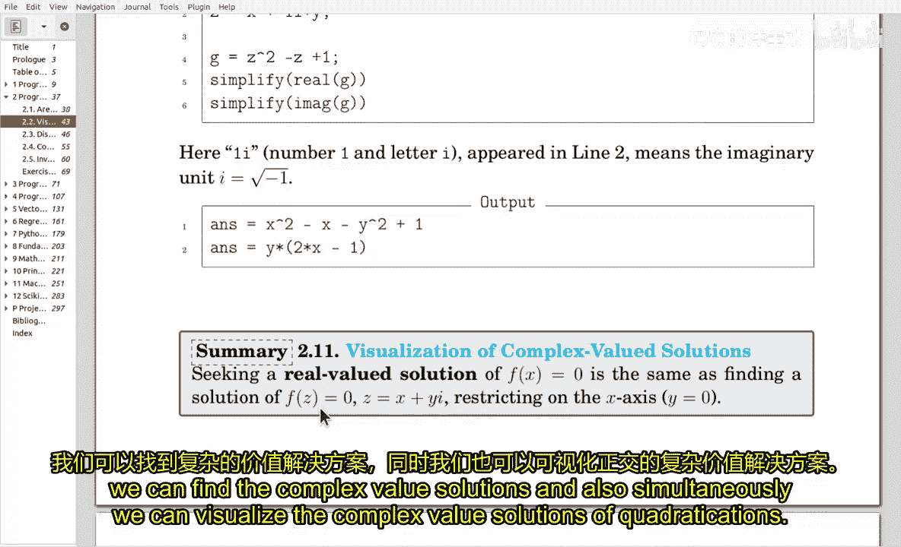

本节课中，我们一起学习了如何可视化二次方程的复数值解。核心要点在于：寻找 **f(x)=0** 的实数解，等价于在复数域中寻找 **f(z)=0** 的解（**z = x + yi**），并通过令虚部 **y=0** 来约束到实数轴。通过求解 **f(z)=0**，我们不仅能找到复数解，还能通过绘制其实部函数和虚部函数的零值等高线，在复平面上直观地看到这些解的位置（即两条等高线的交点）。这种方法将抽象的复数解转化为清晰的几何图像。