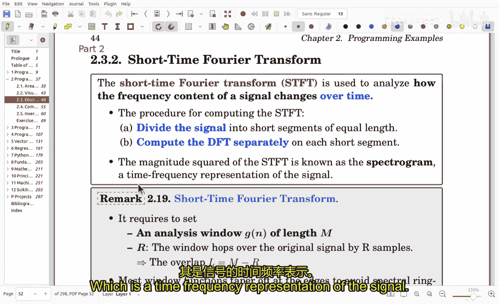
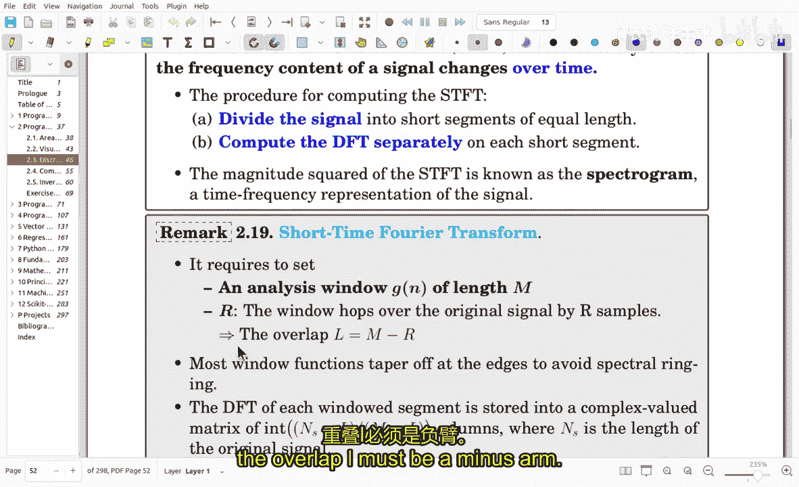
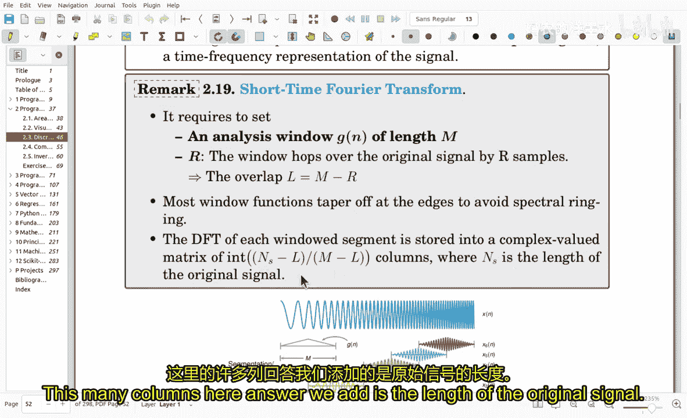
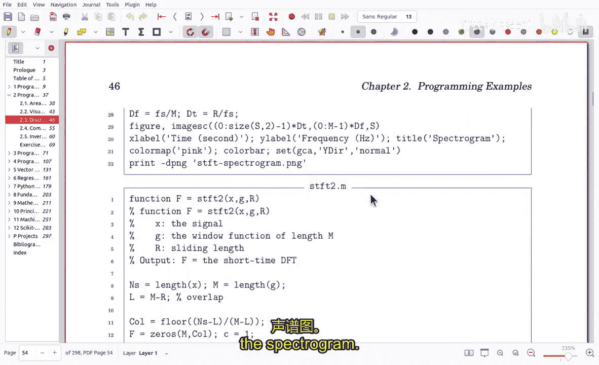
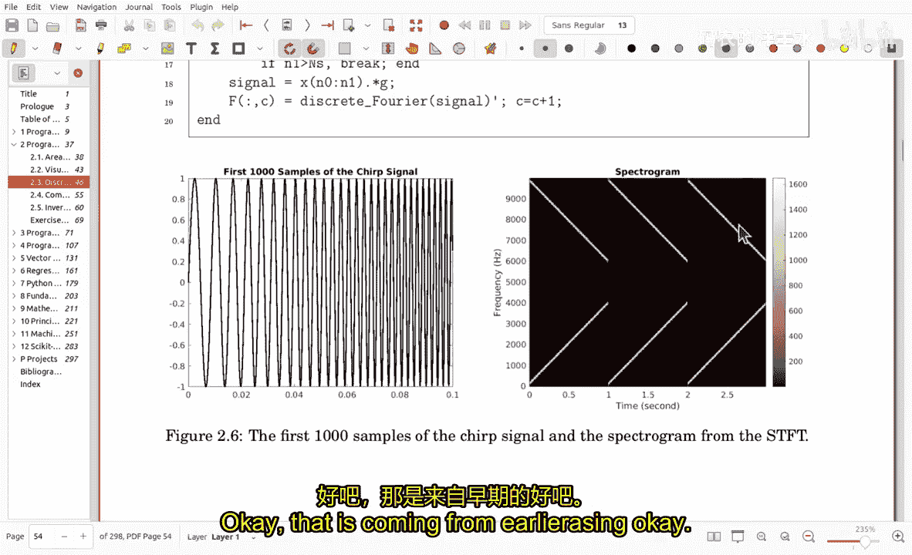
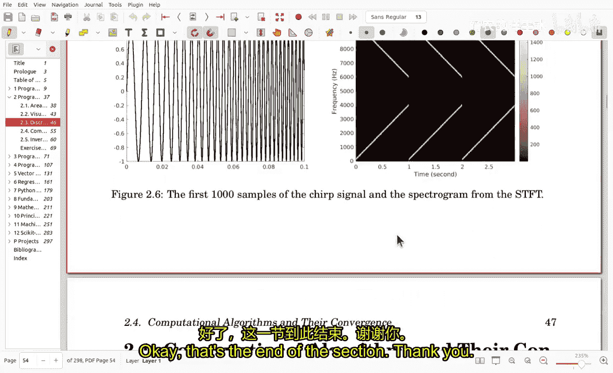

# 010：短时离散傅里叶变换 (STFT) 🎵

在本节课中，我们将要学习短时离散傅里叶变换。上一节我们介绍了离散傅里叶变换及其实现，本节中我们来看看如何将其应用于分析信号频率随时间变化的情况。

短时傅里叶变换用于分析信号的频率成分如何随时间变化。



以下是计算STFT的步骤：
首先，我们将信号分割成长度相等的短片段，然后对每个短片段分别计算离散傅里叶变换。因此，它是离散傅里叶变换的一个简单应用。



STFT的幅度平方被称为**谱图**，它是信号的时频表示。




计算短时傅里叶变换需要设置一个长度为 `M` 的分析窗口。你必须选择一个参数 `M`，同时还需要选择一个窗口函数 `G` 以及一个参数 `R`，即滑动长度。窗口以 `R` 为步长在原信号上滑动，在这种情况下，重叠长度必须为 `M - R`。


大多数窗口函数在边缘处会逐渐衰减至零，以避免频谱泄漏。这意味着窗口函数 `G` 的幅度在两端会变小。

每个片段的离散傅里叶变换结果被存储到一个复数值矩阵中，该矩阵有 `M` 行和许多列。这里，`N` 是原始信号的长度。


让我们看这张图。原始信号有 `N` 个样本。开始时，我们选择 `M` 个样本，然后乘以窗口函数 `G`。滑动 `R` 个样本后，我们再次取 `M` 个样本并乘以 `G`。如此重复，直到处理完整个信号。对于每个加窗后的信号片段，我们应用离散傅里叶变换。其频率分量的幅度将如这部分所示。对于低频部分，峰值出现在频率轴的低位置；对于高频部分，峰值出现在高位置。这些峰值会逐渐变高。每个片段的变换结果构成一列，这整个集合就称为**谱图**。

STFT很容易实现。MATLAB和Octave有内置的 `spectrogram` 函数，但我们将尝试在此详细实现。

首先，我们必须选择一个分析窗口。我选择了一个余弦窗，其中 `M = 150`。代码如下：
```matlab
% 生成余弦窗函数
t = linspace(0, 2*pi, M);
G = 0.55 - 0.45 * cos(t);
```
当 `t` 为 `0` 或 `2π` 时，`cos(t)` 为 `1`，因此 `G` 的值为 `0.1`。在中心点，值为 `1`。这就是窗口函数。

接下来是短时傅里叶变换的主要部分。我们设置采样频率 `Fs = 10000`，总时长 `T0 = 1` 秒。时间向量可以这样生成：
```matlab
t = 0:1/Fs:T0-1/Fs;
```
然后，我们创建一个所谓的“啁啾信号”，其频率从 `100 Hz` 线性增加到 `4000 Hz`：
```matlab
x0 = sin(2*pi*(100 + 3900*t) .* t);
```
这个小片段被复制 `30` 次以构成测试数据 `x`。

我们选择窗口长度 `M = 150`，滑动长度 `R = 6`。通过调用自定义函数 `STFT2` 并传入信号 `x`、窗口 `G` 和滑动长度 `R`，我们得到频率分量，其幅度平方即为谱图。

以下是 `STFT2` 函数的一个简单实现思路：
```matlab
function STFT = STFT2(x, G, R)
    N = length(x);
    M = length(G);
    L = floor((N-M)/R) + 1; % 计算谱图的列数
    STFT = zeros(M, L); % 初始化矩阵

    col = 1;
    for n0 = 1:R:(N-M+1)
        segment = x(n0:n0+M-1) .* G'; % 加窗
        STFT(:, col) = fft(segment); % 计算DFT
        col = col + 1;
    end
end
```
首先，我们测量信号长度 `N` 和窗口长度 `M`。`L` 是重叠段的数量，决定了谱图的列数。我们初始化一个 `M` 行 `L` 列的矩阵来存储频率分量。在循环中，我们从信号中取出 `M` 个样本，乘以窗口函数 `G`，然后使用 `fft` 函数计算其离散傅里叶变换，结果存入矩阵的当前列。

在MATLAB中，我们也有内置的 `stft` 函数，但这里我们将其与 `spectrogram` 函数分开实现。

让我们看一下绘图结果。第一张图显示了啁啾信号的前 `1000` 个样本，起始频率为 `100 Hz`。第二张图是窗口函数。最后一张是谱图。



在谱图中，你可以看到频率从 `100 Hz` 开始，在 `1` 秒内逐渐增加到 `4000 Hz`。这个由 `30` 份啁啾信号复制连接而成的测试信号，其谱图清晰地展示了这一变化。

只有前半部分的频率分量是有用且可靠的，后半部分在大多数分析中必须被丢弃。这是由混叠现象决定的。




本节课中我们一起学习了短时离散傅里叶变换的原理、实现步骤，并通过谱图观察了信号频率随时间的变化。这就是本节的结尾。




