# 011：误差、算法与收敛速率

## 概述
在本节中，我们将学习计算算法的基础概念，包括误差的定义、算法的稳定性，以及如何衡量序列的收敛速率。我们将通过具体的数学定义和例子来理解这些概念。

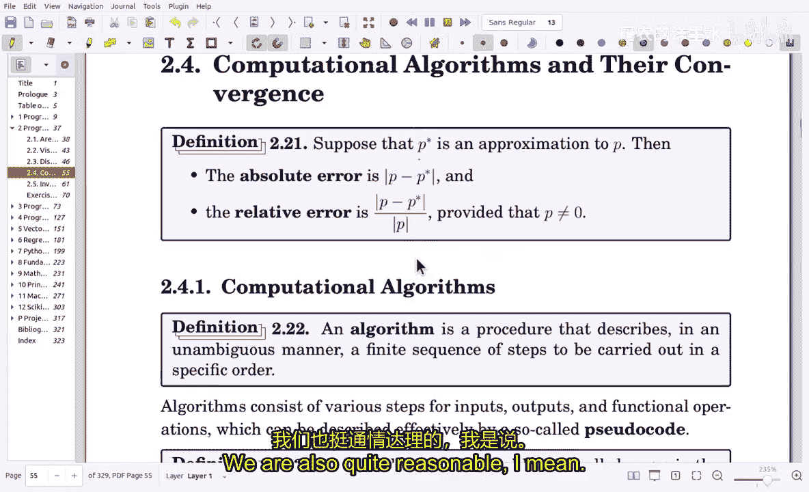

---

## 误差的定义
假设 `p*` 是 `p` 的一个近似值。`p*` 可以是某个计算算法的输出。

**绝对误差** 定义为真实值与近似值之差的绝对值：
\[
\text{绝对误差} = |p - p^*|
\]

**相对误差** 是绝对误差除以真实值的绝对值：
\[
\text{相对误差} = \frac{|p - p^*|}{|p|}
\]
当 `p` 不为零时，可以定义相对误差。在实际应用中，相对误差比绝对误差更常用。

例如，假设 `p = 1,000,000`，并且我们有一个近似值 `p*`，其绝对误差约为 `1000`。虽然绝对误差看起来很大，但其相对误差为 `1000 / 1,000,000 = 0.001`，即 `0.1%`。这个相对误差非常小，因此结果是可接受的。

---

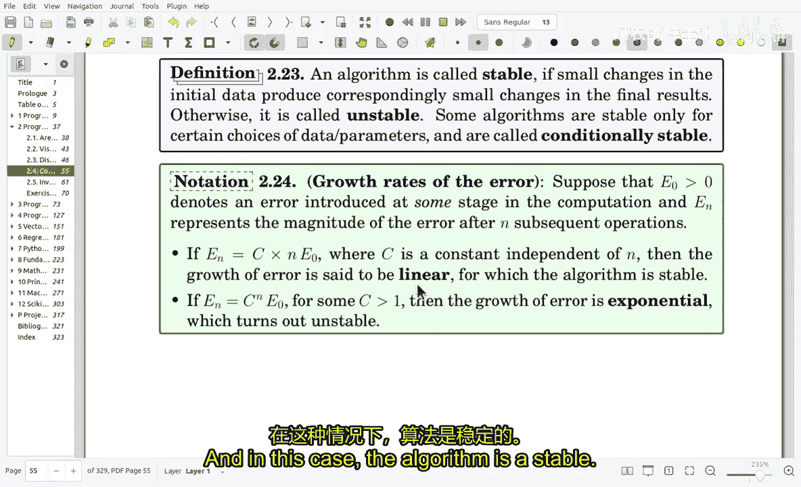

## 计算算法
**算法** 是一种以明确方式描述一系列步骤的过程，这些步骤需要按特定顺序执行。算法包含输入、输出和功能操作等多个步骤。

算法可以通过**伪代码**有效地描述。伪代码展示了主要操作，易于理解。在过去，算法通常隐藏在C或Fortran等语言的冗长代码中，难以理解。而使用伪代码，我们可以更有效地理解算法。在现代，虽然使用MATLAB或Python编写的代码可能很短，易于理解，但伪代码仍然被广泛用于更有效地描述算法。

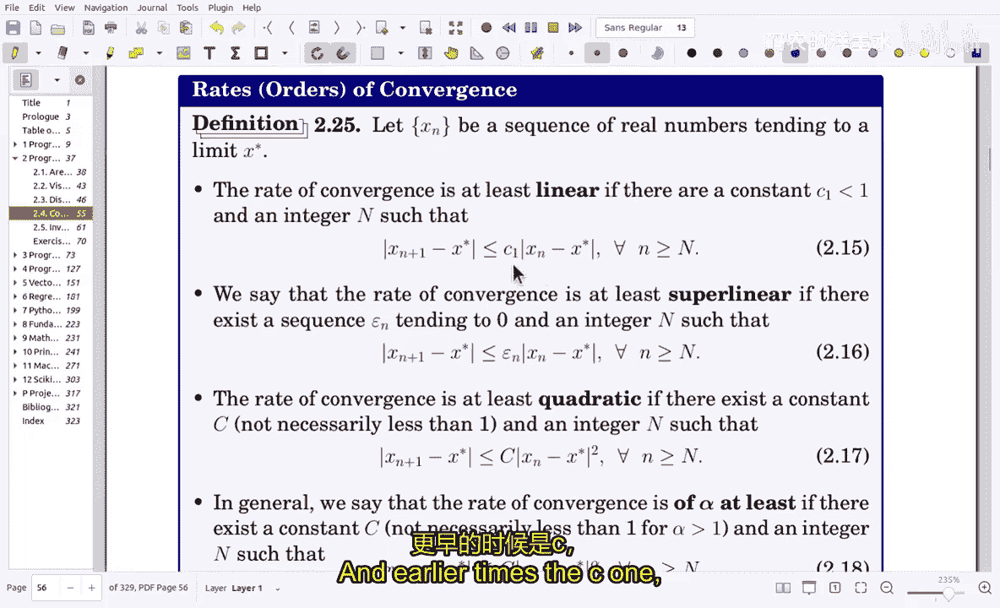

一个算法被称为**稳定的**，如果初始数据（输入）的微小变化只导致最终结果（输出）的微小变化。稳定算法对输入的小扰动不敏感。否则，该算法被称为**不稳定的**。有些算法仅对某些输入或参数选择稳定，这种情况称为**条件稳定**。

---

## 误差的增长速率
假设 `E` 是在某个阶段（可能是初始阶段）引入的误差，`E_n` 表示经过 `n` 次后续操作后的误差大小。

如果 `E_n` 大致为 `n` 乘以一个常数 `C` 和初始误差 `E`，即：
\[
E_n \approx C \cdot n \cdot E
\]
那么误差的增长是**线性的**。在这种情况下，算法是稳定的。

如果 `E_n` 以指数形式增长，对于某个 `C > 1`：
\[
E_n \approx C^n \cdot E
\]
那么误差的增长是**指数的**。在这种情况下，算法是不稳定的。

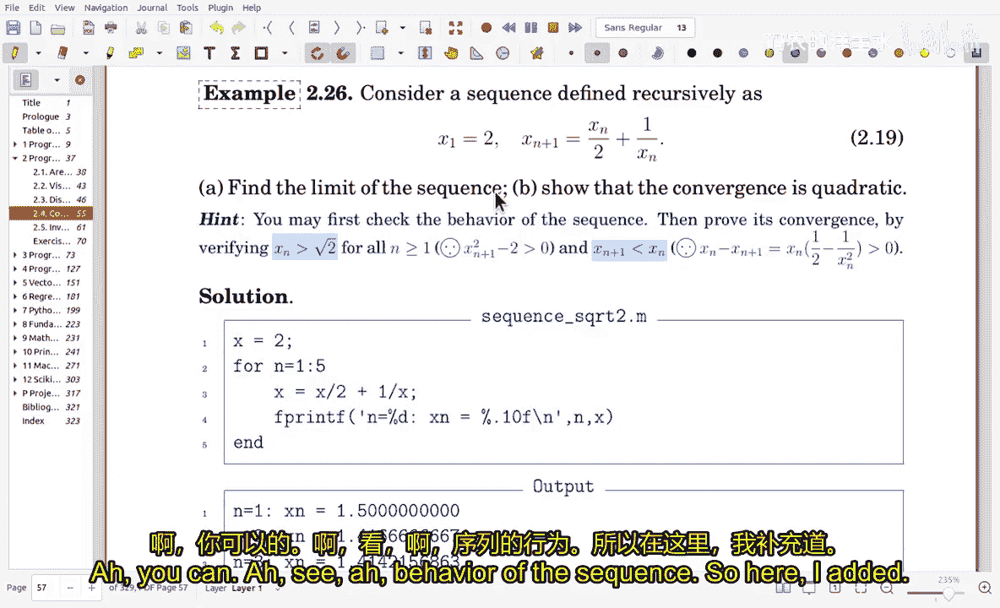

---

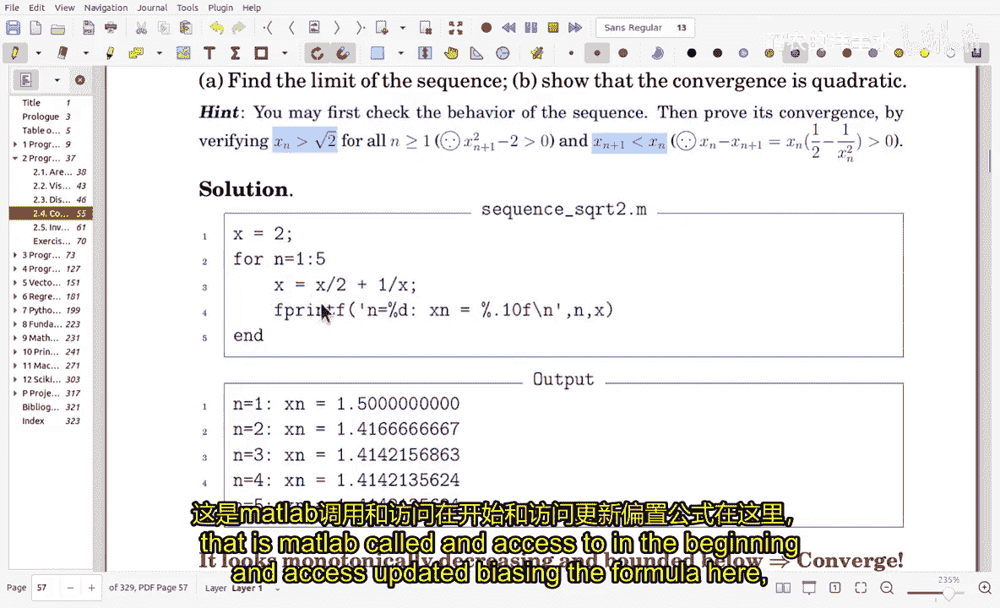

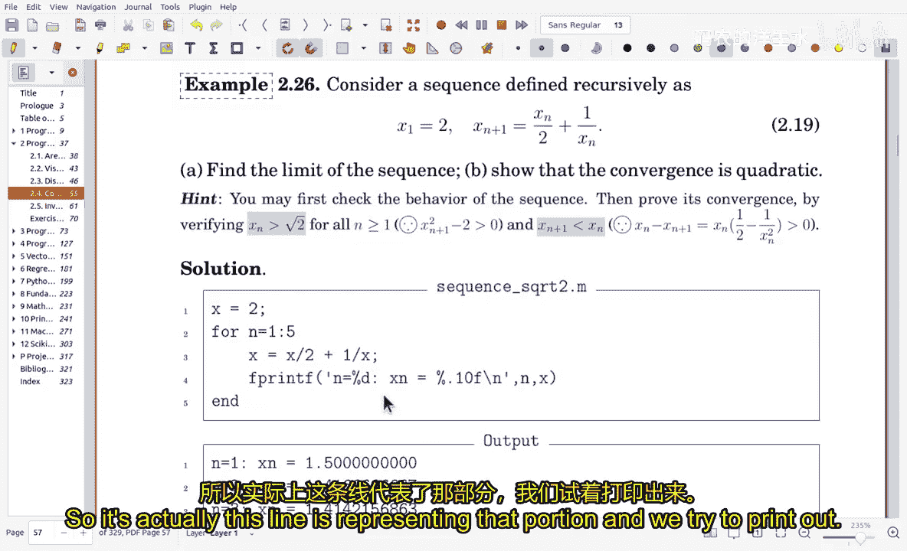

## 收敛的速率阶
设 `{x_n}` 是一个趋于极限 `x*` 的实数序列。`x_n` 可以是一个迭代算法的输出。

**线性收敛**：如果存在常数 `C`（满足 `0 < C < 1`）和整数 `N`，使得对于所有 `n ≥ N`，有：
\[
|x_{n+1} - x^*| \leq C \cdot |x_n - x^*|
\]
这意味着后续误差被前一步误差的一个固定比例（小于1）所限制，误差呈线性缩小。

**超线性收敛**：如果存在一个趋于零的序列 `{ε_n}`，使得：
\[
|x_{n+1} - x^*| \leq ε_n \cdot |x_n - x^*|
\]
那么误差的减少速度比线性收敛更快。

**二次收敛**：如果存在常数 `C` 和整数 `N`，使得对于所有 `n ≥ N`，有：
\[
|x_{n+1} - x^*| \leq C \cdot |x_n - x^*|^2
\]
二次收敛的速度非常快。例如，如果某步误差是 `10^{-2}`，下一步误差约为 `10^{-4}`，再下一步约为 `10^{-8}`，依此类推。

**一般情况**：如果存在常数 `C` 和整数 `N`，使得对于所有 `n ≥ N`，有：
\[
|x_{n+1} - x^*| \leq C \cdot |x_n - x^*|^{\alpha}
\]
则称收敛速率至少为 `α` 阶。当 `α=1` 时，要求 `C < 1`。

---

## 示例：证明二次收敛
考虑递归定义的序列：
\[
x_1 = 2, \quad x_{n+1} = \frac{x_n}{2} + \frac{1}{x_n}
\]

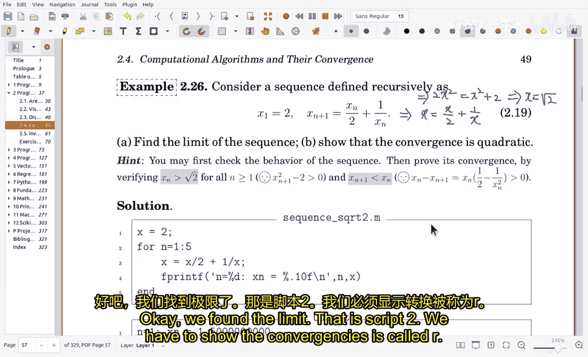

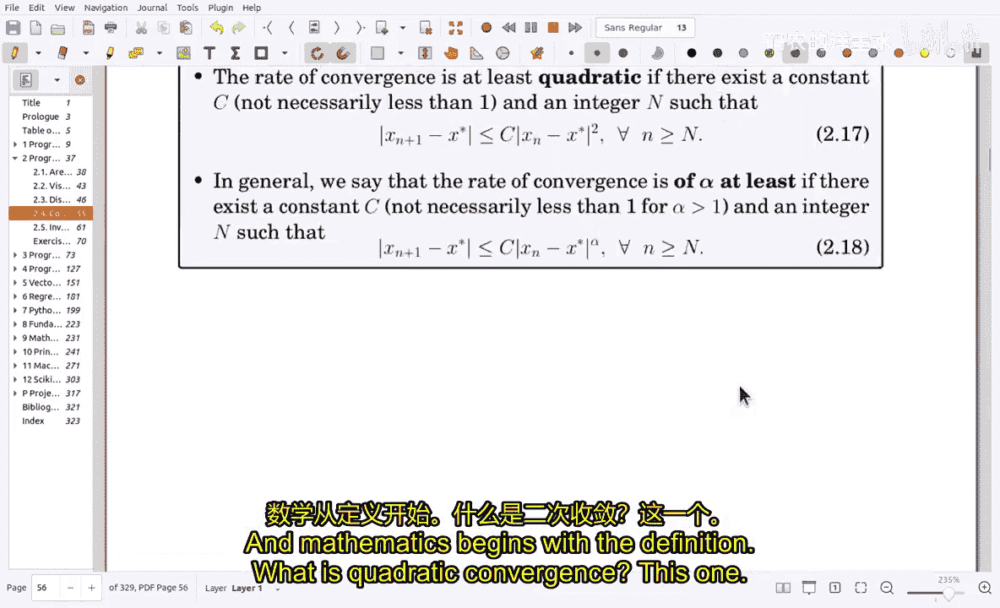

**第一步：观察序列行为**
通过计算（例如使用MATLAB或Python）前几项：
- `x_1 = 2`
- `x_2 = 1.5`
- `x_3 ≈ 1.416666...`
- `x_4 ≈ 1.414215...`
序列单调递减且有下界，因此它是收敛的。

**第二步：数学证明收敛性并求极限**
可以证明对于所有 `n`，有 `x_n > \sqrt{2}`，并且 `x_{n+1} < x_n`。因此序列单调递减且有下界，故收敛。
设极限为 `x`。在递归式两边取极限，得到：
\[
x = \frac{x}{2} + \frac{1}{x}
\]
解此方程：
\[
2x^2 = x^2 + 2 \quad \Rightarrow \quad x^2 = 2 \quad \Rightarrow \quad x = \sqrt{2}
\]
因此，序列的极限是 `\sqrt{2}`。

**第三步：证明收敛是二次的**
我们需要证明存在常数 `C`，使得：
\[
|x_{n+1} - \sqrt{2}| \leq C \cdot |x_n - \sqrt{2}|^2
\]
开始推导：
\[
\begin{aligned}
x_{n+1} - \sqrt{2} &= \left( \frac{x_n}{2} + \frac{1}{x_n} \right) - \sqrt{2} \\
&= \frac{1}{2x_n} \left( x_n^2 + 2 - 2\sqrt{2} x_n \right) \\
&= \frac{1}{2x_n} \left( x_n^2 - 2\sqrt{2} x_n + 2 \right) \\
&= \frac{1}{2x_n} (x_n - \sqrt{2})^2
\end{aligned}
\]
由于已知 `x_n \geq \sqrt{2}`，所以 `1/(2x_n) \leq 1/(2\sqrt{2})`。因此：
\[
|x_{n+1} - \sqrt{2}| = \frac{1}{2x_n} |x_n - \sqrt{2}|^2 \leq \frac{1}{2\sqrt{2}} |x_n - \sqrt{2}|^2
\]
取 `C = 1/(2\sqrt{2})`，我们就证明了该序列以二次速率收敛到 `\sqrt{2}`。

---

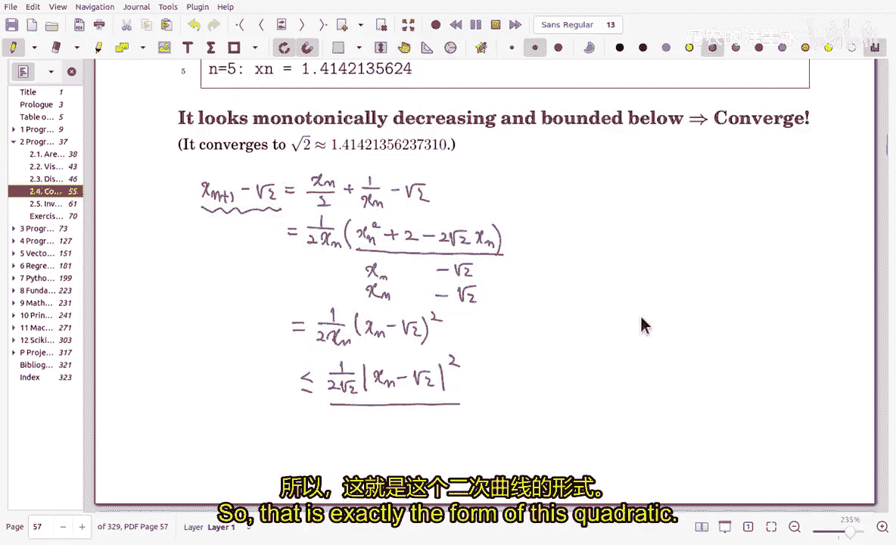

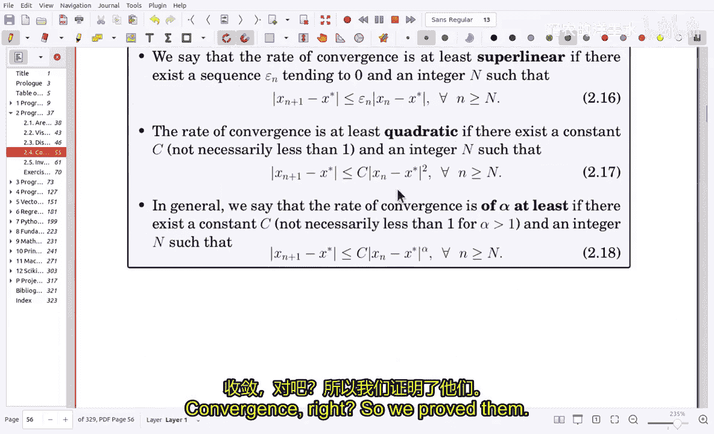

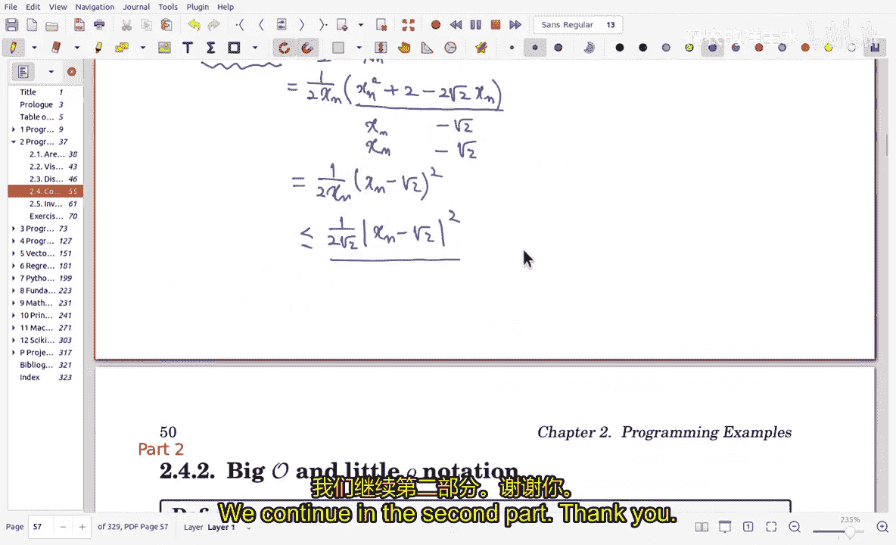

## 总结
本节课我们一起学习了计算算法的基础。我们定义了绝对误差和相对误差，理解了算法稳定性的概念，并探讨了误差的线性与指数增长。重点在于，我们学习了如何定义和判断序列的收敛速率，包括线性、超线性和二次收敛。最后，我们通过一个具体的序列例子，完整演示了如何证明其收敛性并确定其二次收敛的速率。理解这些概念对于分析和设计数值算法至关重要。