# 012：大O和小o符号 📊

## 概述
在本节课中，我们将学习用于描述序列和函数收敛速度的数学符号：大O符号和小o符号。这些概念对于分析算法复杂度至关重要。

---

## 大O符号（Big O Notation）🔍

上一节我们介绍了序列收敛的基本概念，本节中我们来看看如何精确描述其收敛速度。

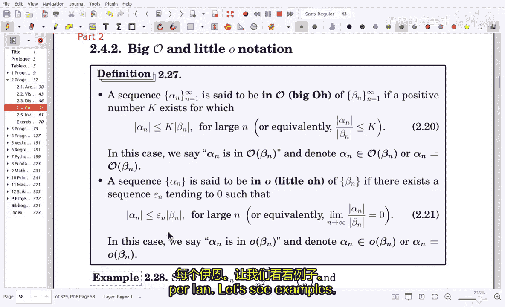

一个序列 `α_n` 被称为属于 `β_n` 的大O，记作 `α_n ∈ O(β_n)`，如果存在一个正数 `K`，使得对于足够大的 `n`，以下不等式成立：
```
|α_n| ≤ K * |β_n|
```
等价地，比值 `|α_n / β_n|` 的绝对值被常数 `K` 所界定。

在这种情况下，我们说 `α_n` 是 `β_n` 的大O，并使用符号 `α_n ∈ O(β_n)` 或 `α_n = O(β_n)`。

---

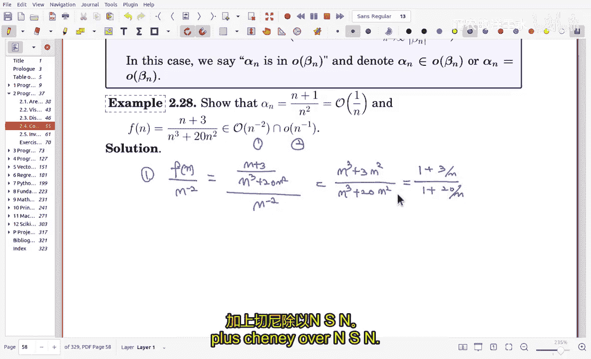

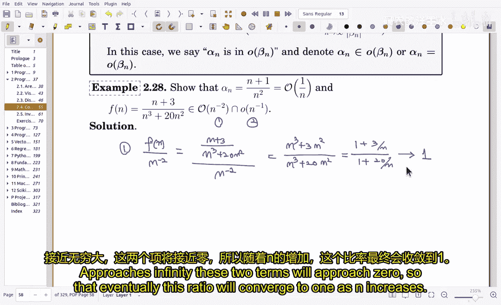

## 小o符号（Little o Notation）🐌

了解了大O符号描述的是“同阶或更低阶”的界限后，我们接下来看看小o符号，它描述的是“严格更低阶”的行为。

一个序列 `α_n` 被称为属于 `β_n` 的小o，记作 `α_n ∈ o(β_n)`，如果存在一个趋于0的序列 `ε_n`，使得对于足够大的 `n`，满足以下不等式：
```
|α_n| ≤ ε_n * |β_n|
```
这等价于极限条件：
```
lim (n→∞) α_n / β_n = 0
```
如果 `β_n` 是递增的，那么 `α_n` 的增长（或衰减）速度**严格慢于** `β_n`。我们使用符号 `α_n ∈ o(β_n)` 或 `α_n = o(β_n)`。

---

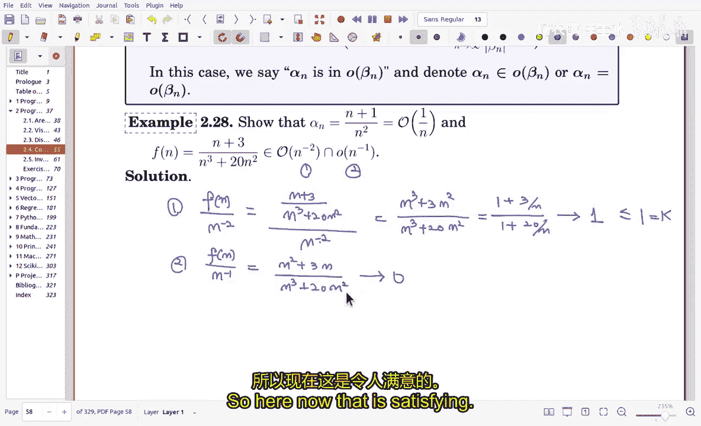

## 示例分析 💡

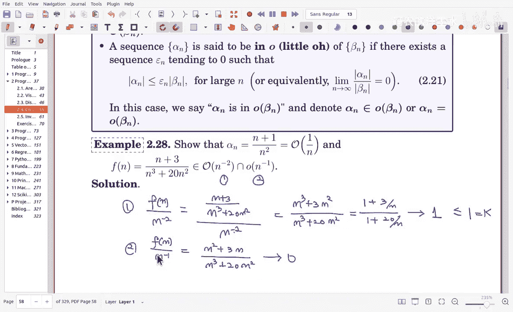

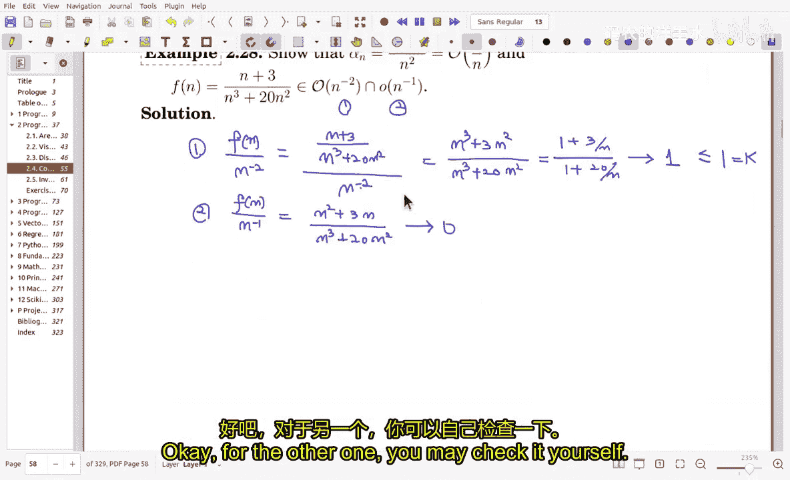

以下是应用这些定义的几个例子。

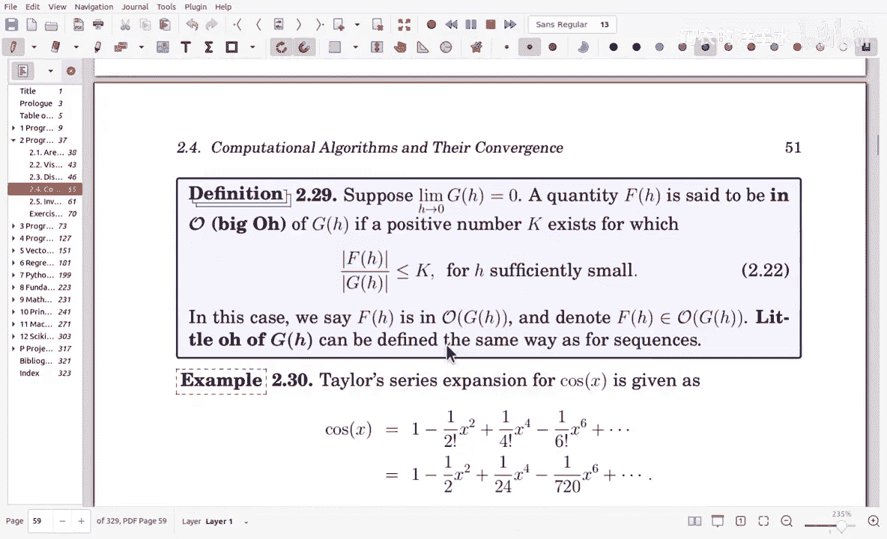

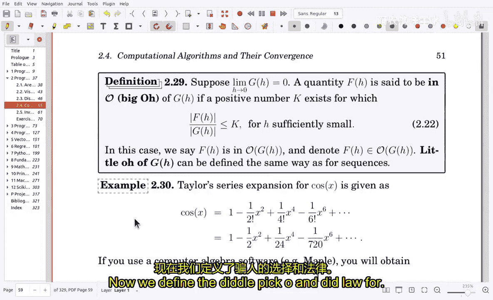

### 示例1：证明函数关系
考虑函数 `f(n) = (n^2 + 3n) / (n^3 + 20n^2)`。我们需要证明：
1.  `f(n) ∈ O(n^{-2})`
2.  `f(n) ∈ o(n^{-1})`

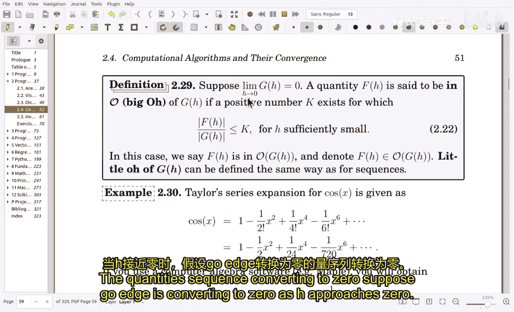

**第一部分证明 (`f(n) ∈ O(n^{-2})`):**
计算比值 `f(n) / n^{-2}`：
```
f(n) / n^{-2} = (n^2 + 3n) * n^2 / (n^3 + 20n^2) = (n^4 + 3n^3) / (n^3 + 20n^2)
```
化简后，当 `n → ∞` 时，该比值趋近于1。由于比值极限为有限常数（1），因此 `|f(n)/n^{-2}|` 有界，满足大O定义。

**第二部分证明 (`f(n) ∈ o(n^{-1})`):**
计算比值 `f(n) / n^{-1}`：
```
f(n) / n^{-1} = (n^2 + 3n) * n / (n^3 + 20n^2) = (n^3 + 3n^2) / (n^3 + 20n^2)
```
当 `n → ∞` 时，该比值趋近于1，**并非**趋近于0。等等，这里需要仔细检查原问题。原叙述是 `f(n) ∈ o(n^{-1})`，但根据计算，极限为1，不等于0。因此，原示例中的这个结论 `f(n) ∈ o(n^{-1})` **可能不成立**，除非 `f(n)` 的定义不同。正确的结论应为 `f(n) ∈ O(n^{-1})`。这提醒我们验证极限的重要性。

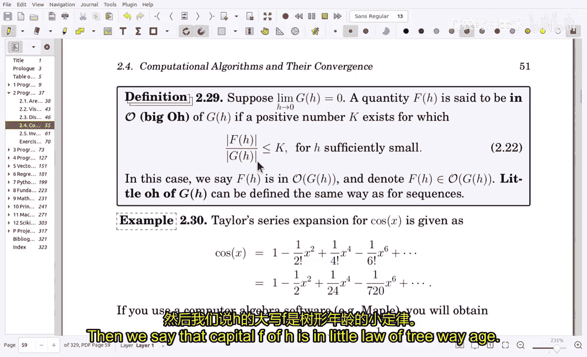

---

## 函数的大O与小o符号 📉

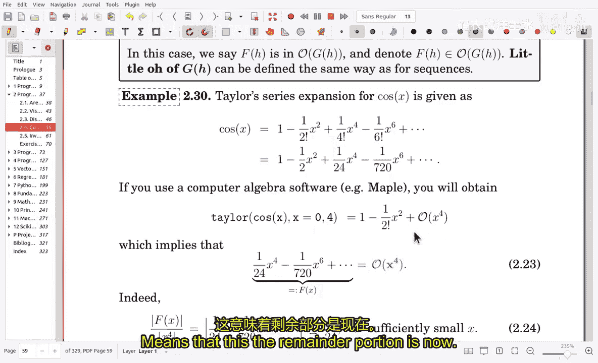

上述概念可以推广到函数（特别是当自变量趋于0时）。假设 `g(h) → 0` 当 `h → 0`。

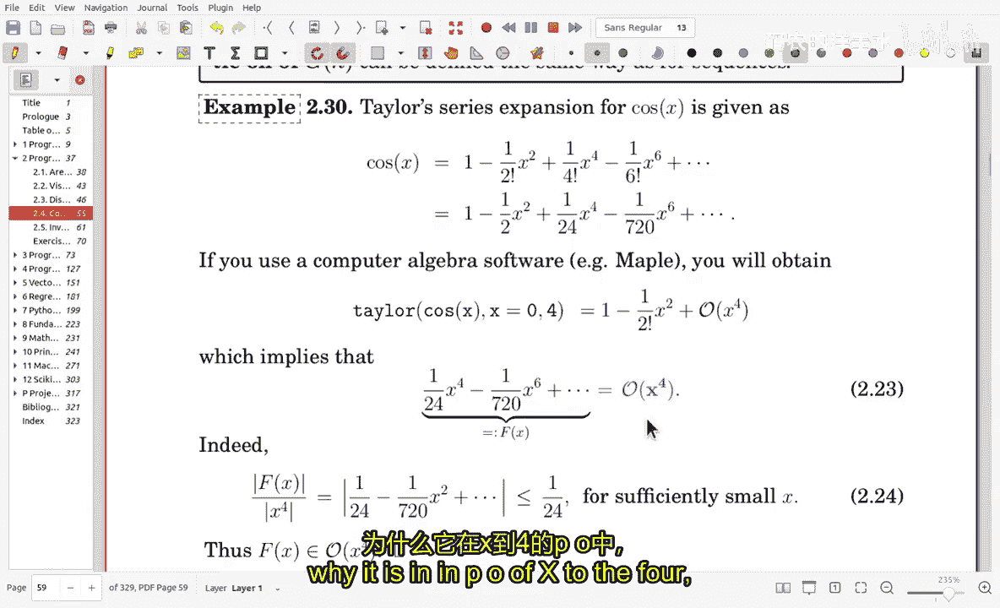

一个函数 `F(h)` 被称为属于 `g(h)` 的大O，如果存在正数 `K`，使得对于足够小的 `h`，有：
```
|F(h)| ≤ K * |g(h)|
```
记作 `F(h) ∈ O(g(h))`。

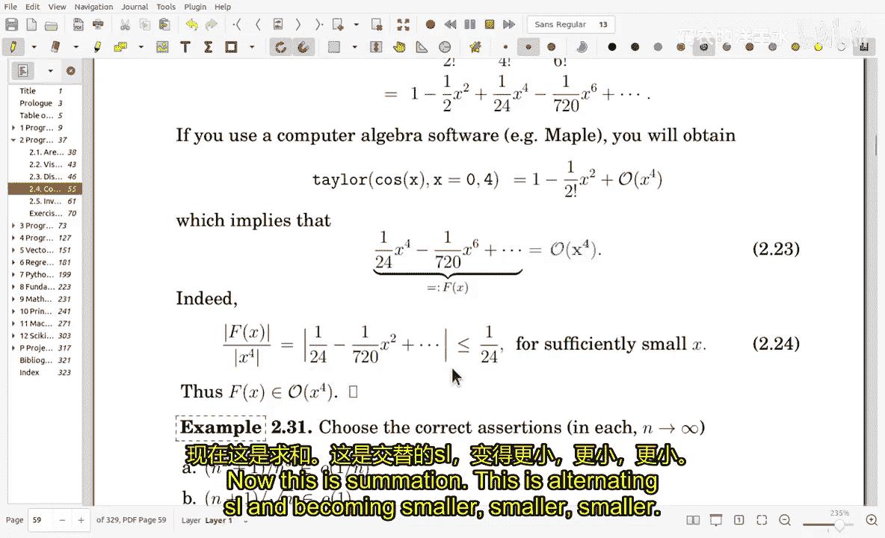

类似地，`F(h)` 被称为属于 `g(h)` 的小o，如果比值 `F(h)/g(h)` 在 `h → 0` 时趋于0：
```
lim (h→0) F(h) / g(h) = 0
```
记作 `F(h) ∈ o(g(h))`。

---

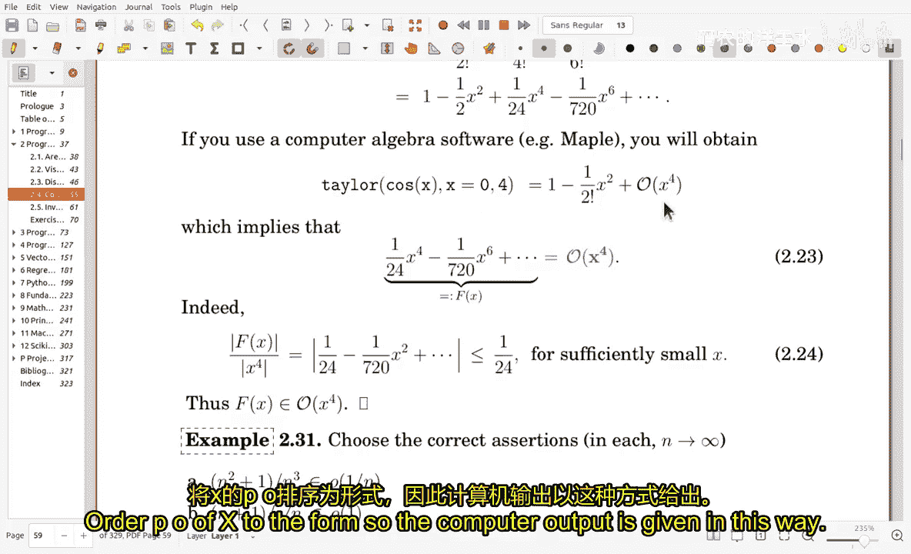

## 应用实例：泰勒展开 🔬

考虑余弦函数 `cos(x)` 在 `x=0` 处的泰勒展开：
```
cos(x) = 1 - x^2/2! + x^4/4! - x^6/6! + ...
```
如果取前四项（到 `x^6` 项），余项 `R(x)` 可以表示为：
```
R(x) = cos(x) - (1 - x^2/2 + x^4/24) = O(x^6)
```
但更常见的写法是，当展开到 `x^4` 项时，余项是 `x^5` 或更高阶的无穷小。实际上，由于 `cos(x)` 是偶函数，其展开式只包含偶次幂。因此，展开到 `x^4` 项后的余项是 `O(x^6)`。然而，原示例指出余项为 `O(x^4)`。我们来验证：
定义 `F(x) = cos(x) - (1 - x^2/2)`。则 `F(x)` 包含 `x^4/24` 及更高阶项。计算 `F(x)/x^4` 的极限，其绝对值被 `1/24` 界定，因此 `F(x) ∈ O(x^4)`。这说明余项是 `x^4` 阶的。

---

## 练习题与解析 ✅

以下是几个判断题，用于检验理解。

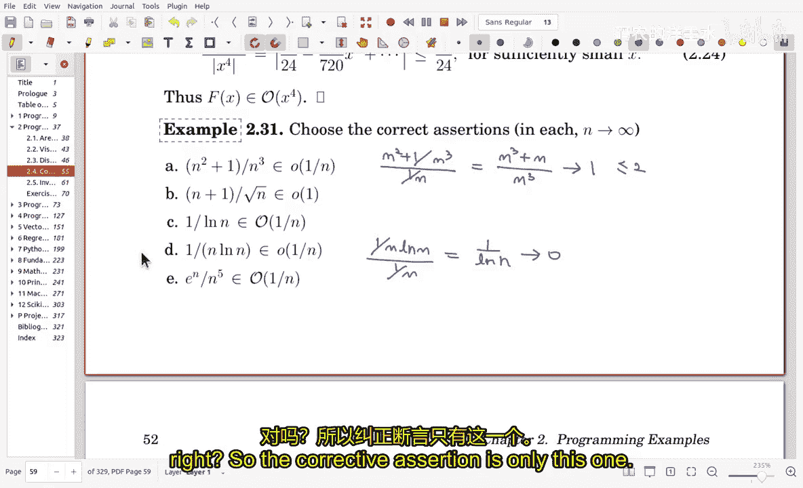

**题目：判断下列断言是否正确（`n → ∞`）。**

1.  `(n^3 + n) / (n^3 + 1) ∈ o(1/n)`
2.  `(n^3 + n) / (n^3 + 1) ∈ O(1/n)`
3.  `(log n) / n ∈ o(1/n)`
4.  `(log n) / n ∈ O(1/n)`

**解析：**

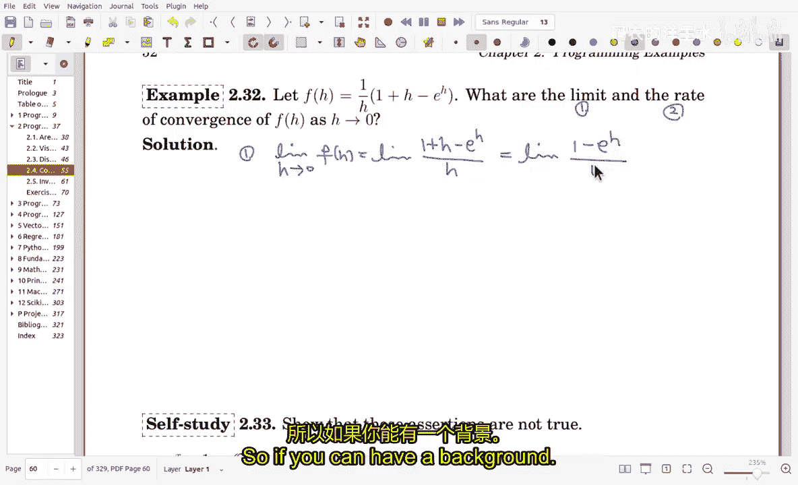

*   **断言1**：计算 `[(n^3+n)/(n^3+1)] / (1/n) = n*(n^3+n)/(n^3+1)`，当 `n→∞` 时趋于无穷大，不满足 `o(1/n)`（极限需为0）。**错误**。
*   **断言2**：同上，比值无界，不满足 `O(1/n)`（需有界）。**错误**。
*   **断言3**：计算 `[(log n)/n] / (1/n) = log n`，当 `n→∞` 时趋于无穷大，不满足 `o(1/n)`。**错误**。
*   **断言4**：计算 `[(log n)/n] / (1/n) = log n`，当 `n→∞` 时无界，不满足 `O(1/n)`。**错误**。
    *   *注：实际上 `(log n)/n` 是 `o(1)`，但比 `1/n` 收敛得慢。原题中所有断言似乎均不成立，这可能是为了强调仔细计算极限的重要性。*

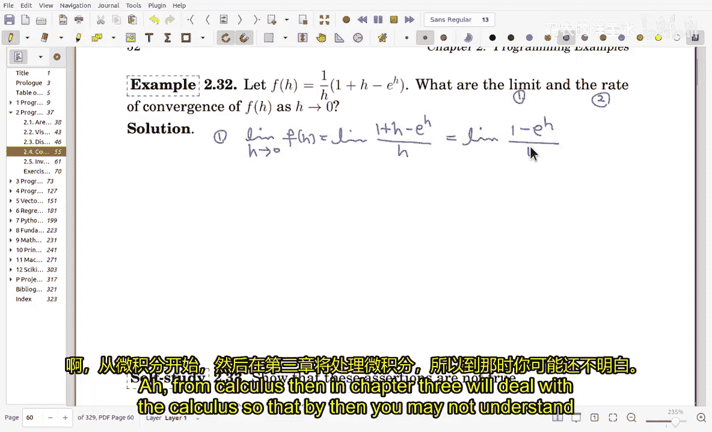

---

## 综合例题：极限与收敛速率 🧮

定义函数 `F(h) = (1 + h - e^h) / h`。

**1. 求极限：**
当 `h → 0` 时，分子分母均趋于0，应用洛必达法则：
```
lim (h→0) F(h) = lim (h→0) (1 - e^h) / 1 = 0
```
因此，`lim (h→0) F(h) = 0`。

**2. 求收敛速率（即找到最大的 `k` 使得 `F(h) ∈ O(h^k)`）：**
我们需要找到常数 `k`，使得 `F(h) / h^k` 在 `h→0` 时有界。
尝试 `k=1`：计算 `F(h)/h^1 = (1 + h - e^h) / h^2`。再次应用洛必达法则：
```
lim (h→0) (1 + h - e^h)/h^2 = lim (h→0) (1 - e^h)/(2h) = lim (h→0) (-e^h)/2 = -1/2
```
极限存在且为有限常数（-1/2），因此 `F(h) / h^1` 有界。所以 `F(h) ∈ O(h^1)`，即收敛速率是线性的 (`k=1`)。

尝试 `k=2`：计算 `F(h)/h^2 = (1 + h - e^h)/h^3`。应用洛必达法则后，极限趋于无穷大，因此 `F(h) ∉ O(h^2)`。

**结论：** `F(h)` 的收敛速率是 `O(h)`。

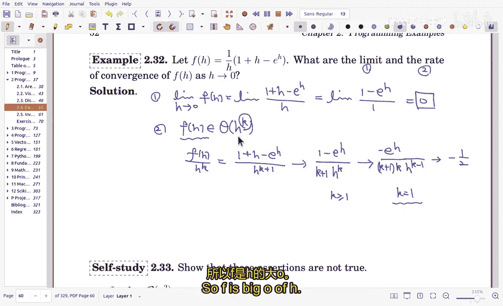

---

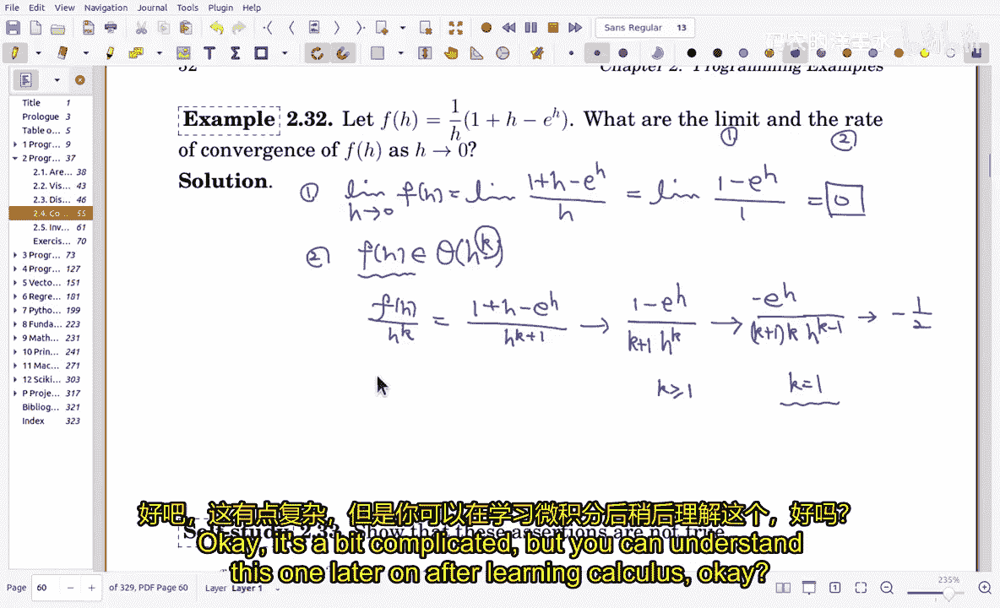

## 总结
本节课中我们一起学习了描述收敛顺序的核心工具：
*   **大O符号 (`O`)**：表示函数或序列的**增长（或衰减）速率不超过**另一个函数的某个常数倍。它描述了一个上界。
*   **小o符号 (`o`)**：表示函数或序列的**增长（或衰减）速率严格慢于**另一个函数。它描述了一个更紧的、非渐进等价的上界。
*   我们通过计算比值并观察其极限（是趋于有限常数还是0）来区分大O和小o。
*   这些概念适用于序列（`n → ∞`）也适用于函数（例如 `h → 0`），在算法分析、数值计算和泰勒展开余项估计中非常重要。

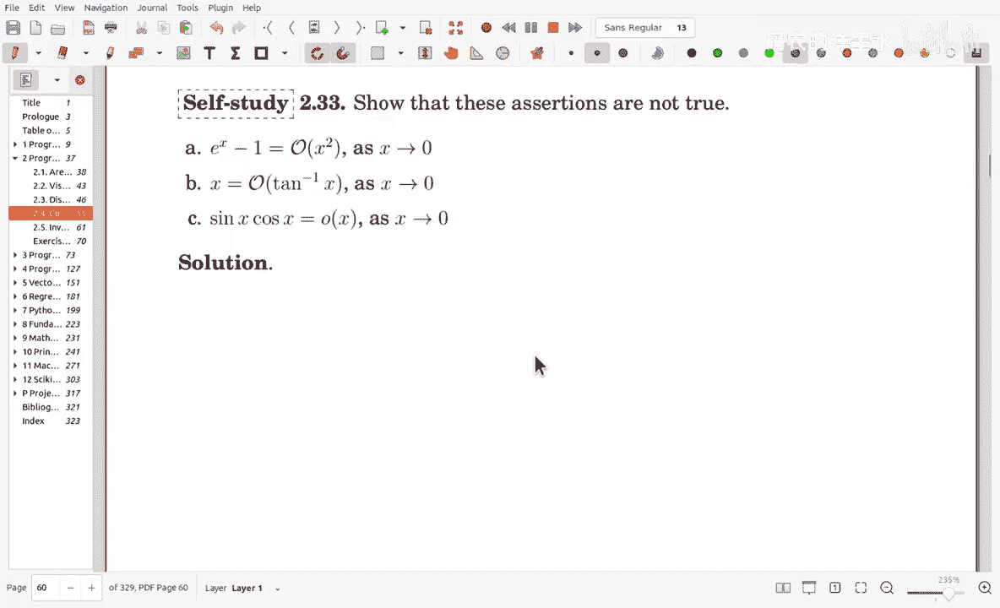

理解大O和小o符号，是分析算法效率和数值方法精度的基础。