# 014：对数函数 📈

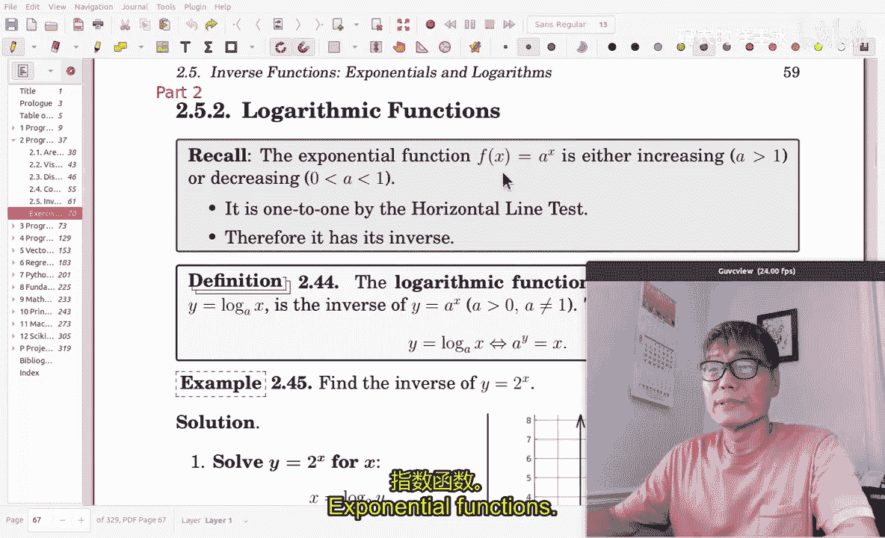

在本节课中，我们将要学习对数函数。我们将从回顾指数函数及其反函数开始，然后正式定义对数函数，并探讨其性质、图像、常用规则以及在实际计算中的应用。

---

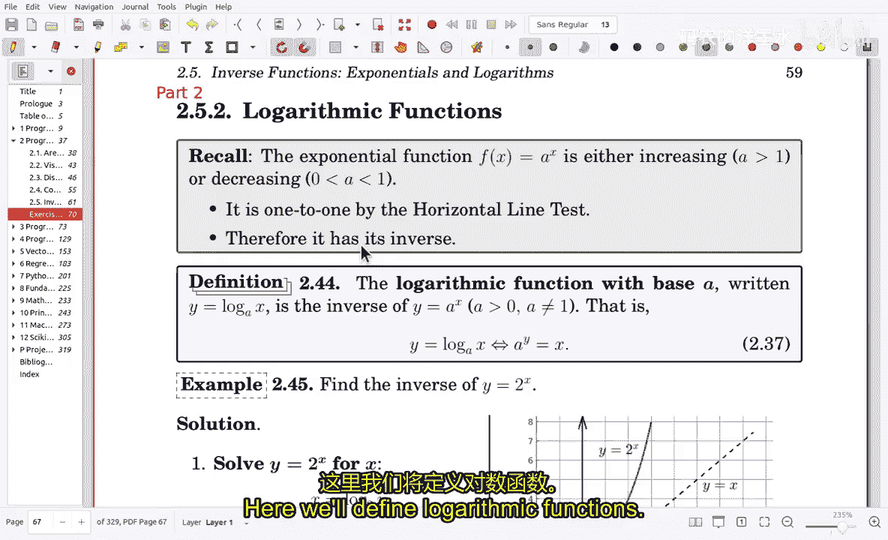

## 章节 2.05：对数函数

在上一节中，我们学习了反函数和指数函数。指数函数 **f(x) = a^x** 是单调的（递增或递减），因此它是一一对应的，可以通过水平线测试。这意味着指数函数存在反函数。本节中，我们将定义这个反函数——对数函数。

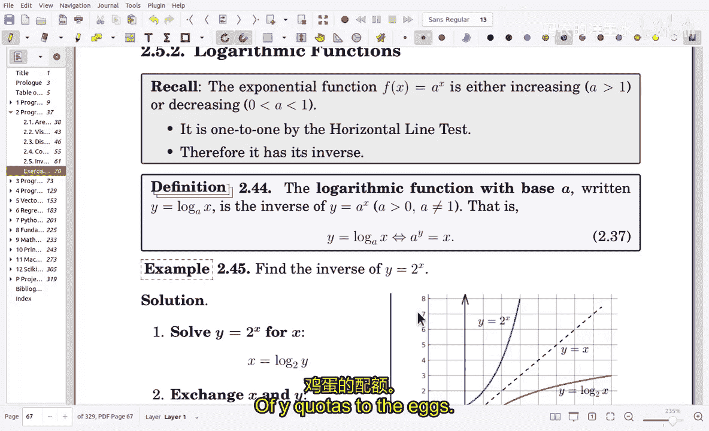

以 **a** 为底的对数函数，记作 **y = log_a(x)**，是函数 **y = a^x** 的反函数。这意味着，当你看到对数方程 **y = log_a(x)** 时，你必须理解为其等价形式是 **a^y = x**。

让我们通过一个例子来更具体地理解对数。

**示例：求 y = 2^x 的反函数。**

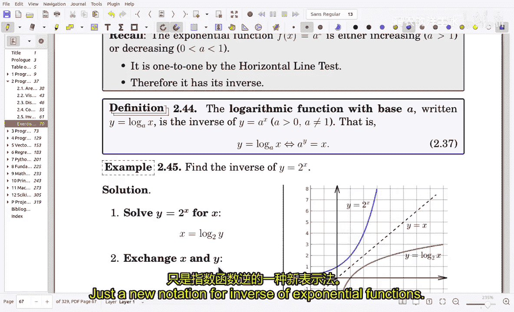

要找到一个函数的反函数，第一步是解方程求出 **x**，第二步是交换 **x** 和 **y**。然而，对于方程 **y = 2^x**，我们无法用常规代数方法解出 **x**。因此，我们引入新的记法 **log**，并写成 **x = log_2(y)**。然后，我们交换 **x** 和 **y**，得到反函数 **y = log_2(x)**。从这个过程可以看出，对数本质上是指数函数的反函数的一种新记法。

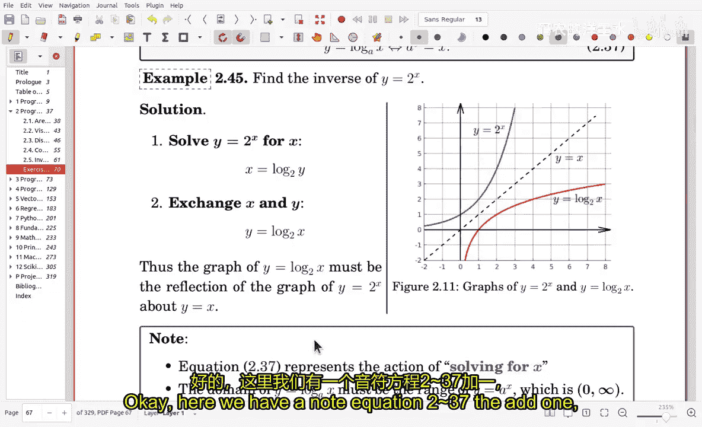

函数 **y = log_2(x)** 的图像，必然是指数函数 **y = 2^x** 的图像关于直线 **y = x** 的反射，如上图所示。给定函数（指数函数）与其反函数（对数函数）的图像总是关于 **y = x** 这条直线对称。

这里有一个重要的注意事项。方程 **a^y = x** 是解出 **x** 的关键步骤。并且，函数 **y = log_a(x)** 的定义域必须是其反函数 **y = a^x** 的值域，即 **(0, ∞)**，所有正数。这意味着对数函数只接受正数作为输入。如果 **x** 是 0 或负数，则对数没有定义。

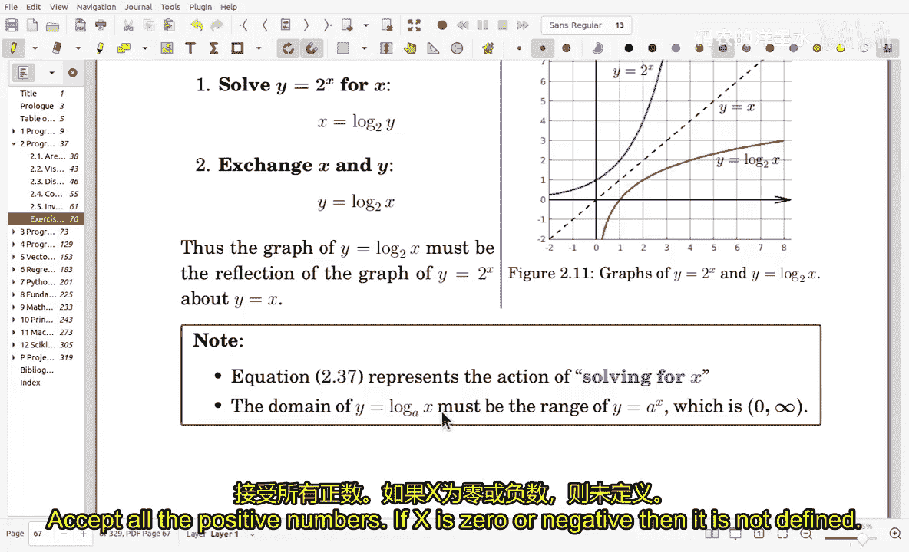

---

## 自然对数与常用对数

有两种特别重要的对数底数。

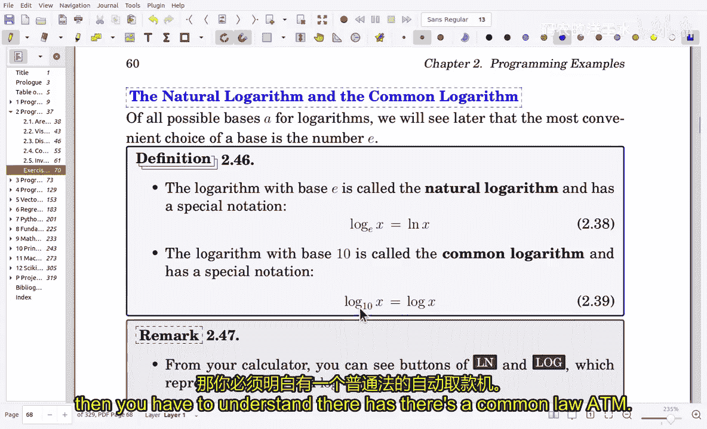

*   **自然对数**：以数学常数 **e**（约等于 2.718）为底的对数，称为自然对数，记作 **ln(x)**。即 **ln(x) = log_e(x)**。
*   **常用对数**：以 10 为底的对数，称为常用对数，通常简写为 **log(x)**。在数学公式中看到 **log(x)**，通常指的就是 **log_10(x)**。

在使用计算器或计算机程序时，需要注意记法的差异：
*   在大多数计算器上，**LN** 键代表自然对数，**LOG** 键代表常用对数（以10为底）。
*   在许多计算机编程语言（如MATLAB, Python）中，函数 **log()** 通常指自然对数，而常用对数则需要使用专门的函数，如 **log10()**。

---

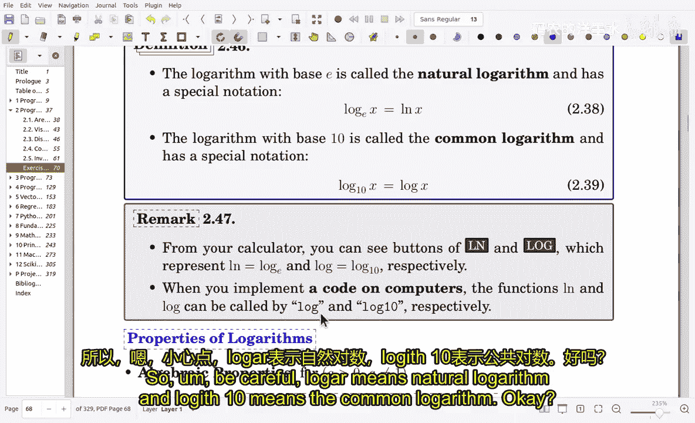

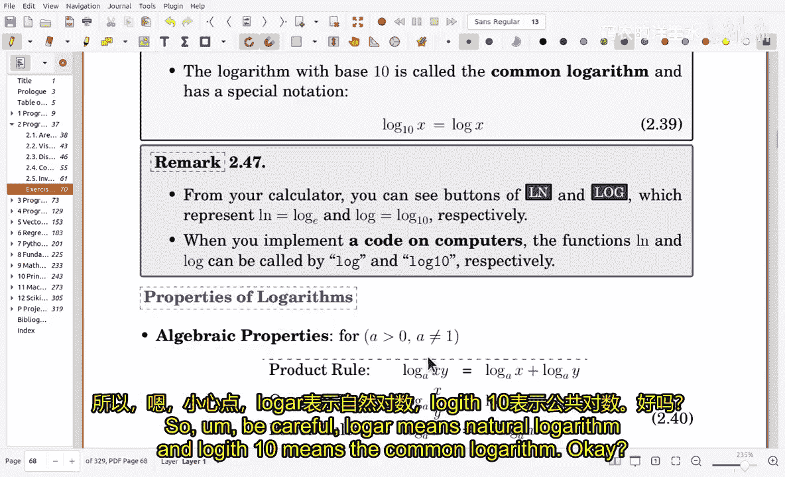

## 对数运算法则

以下是几个核心的对数运算法则，它们能帮助我们简化和计算对数表达式。

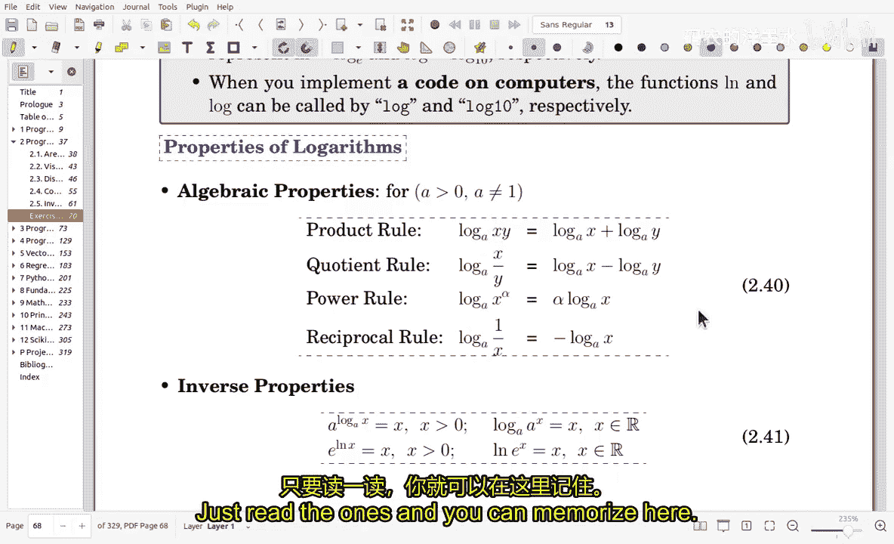

**乘积法则**：**log_a(xy) = log_a(x) + log_a(y)**
**商法则**：**log_a(x/y) = log_a(x) - log_a(y)**
**幂法则**：**log_a(x^r) = r * log_a(x)**
**换底公式**：**log_a(x) = ln(x) / ln(a)** （也可以用其他底数，如 **log_b(x) / log_b(a)**）

---

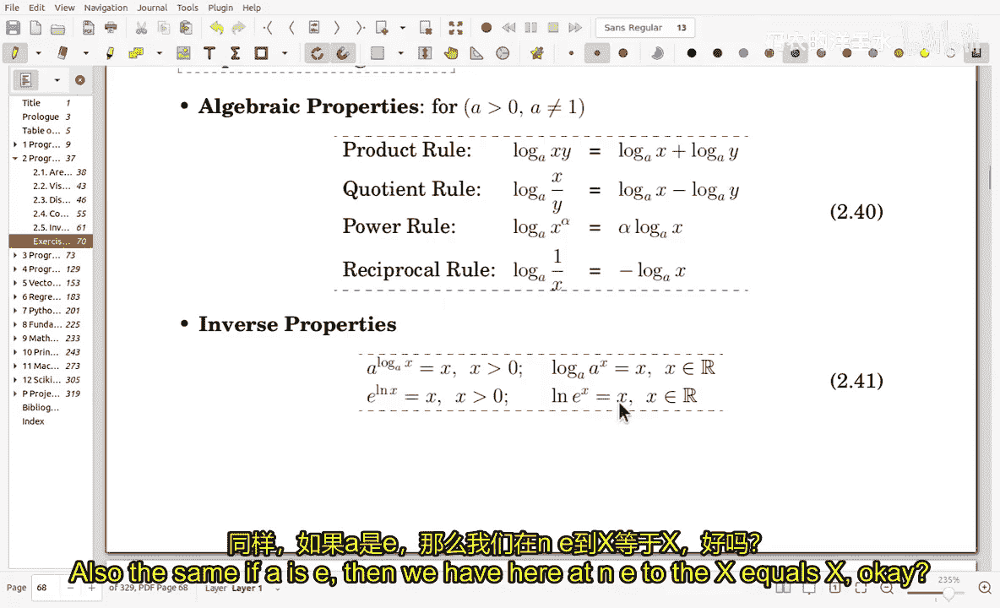

## 反函数性质

由于对数和指数互为反函数，它们具有相互“抵消”的性质。
*   **a^(log_a(x)) = x** （对于 **x > 0**）
*   **log_a(a^x) = x** （对于所有实数 **x**）

特别地，当底数 **a = e** 时：
*   **e^(ln(x)) = x** （对于 **x > 0**）
*   **ln(e^x) = x** （对于所有实数 **x**）

---

## 应用示例：解对数方程

让我们应用这些法则来解一个方程。

**示例：解方程 log_3(x) + log_3(x - 2) = 1。**

1.  **应用乘积法则**：将等式左边合并。**log_3(x) + log_3(x - 2) = log_3[x(x - 2)]**。
2.  **简化右边**：数字 1 可以写成 **log_3(3)**，因为 **log_a(a) = 1**。
3.  **得到等价方程**：现在方程为 **log_3[x(x - 2)] = log_3(3)**。
4.  **利用对数函数一一对应的性质**：如果 **log_a(M) = log_a(N)**，则 **M = N**。因此，**x(x - 2) = 3**。
5.  **解二次方程**：展开得 **x^2 - 2x - 3 = 0**，因式分解为 **(x - 3)(x + 1) = 0**。解得 **x = 3** 或 **x = -1**。
6.  **验证定义域**：对数函数要求其参数为正数，即 **x > 0** 且 **x - 2 > 0**，所以 **x > 2**。因此，**x = -1** 是无效解。
7.  **最终解**：方程的唯一解是 **x = 3**。代入原方程验证：**log_3(3) + log_3(1) = 1 + 0 = 1**，成立。

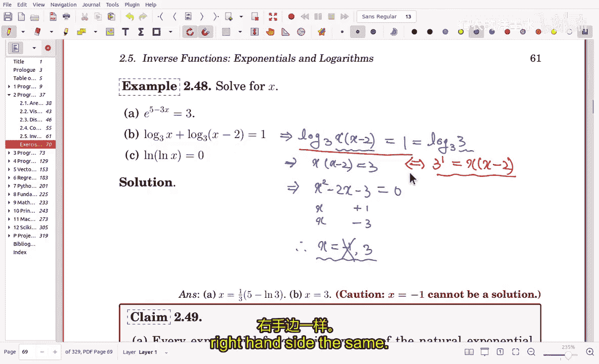

---

## 重要结论：与自然对数/指数函数的关系

这里有两个非常重要的结论：
1.  **任何指数函数都是自然指数函数的幂**。即，**a^x = e^(x * ln(a))**。
2.  **任何对数函数都是自然对数的常数倍**。即，**log_a(x) = ln(x) / ln(a)**。这正是前面提到的换底公式。

第二个结论的推导很简单：设 **y = log_a(x)**，根据对数定义，等价于 **a^y = x**。两边取自然对数：**ln(a^y) = ln(x)**。应用幂法则：**y * ln(a) = ln(x)**。最后解出 **y**：**y = ln(x) / ln(a)**，即 **log_a(x) = ln(x) / ln(a)**。

基于这些结论，**所有的指数和对数计算，最终都可以通过自然指数函数 (exp) 和自然对数函数 (ln) 来完成**。这在数学软件（如MATLAB中的 `exp` 和 `log` 函数）和编程中非常有用。

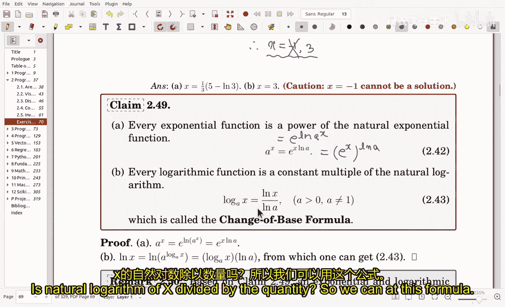

---

## 章节总结与预告

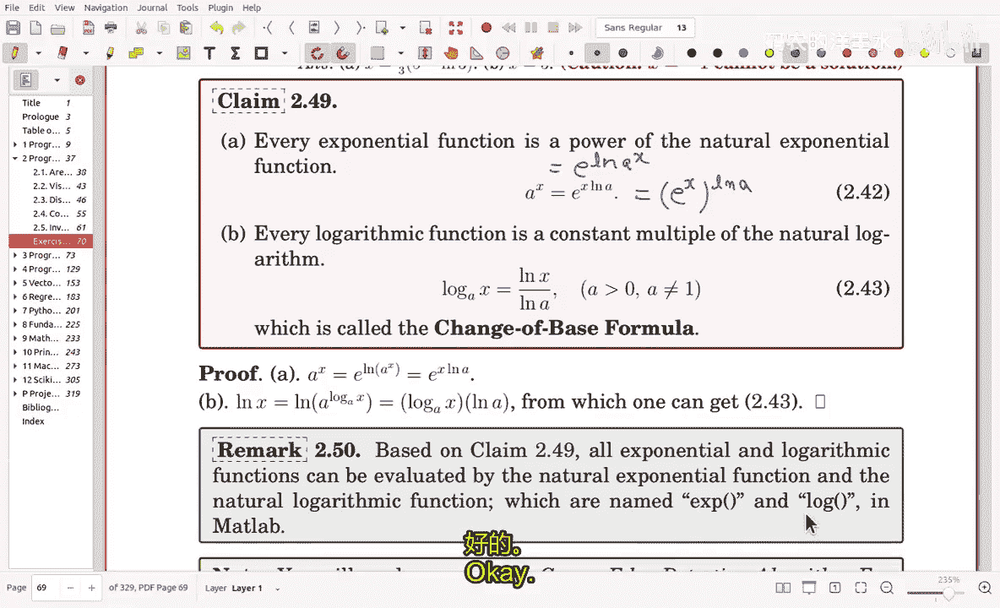

本节课中，我们一起学习了：
1.  **对数函数的定义**：作为指数函数的反函数。
2.  **对数的图像**：与对应指数函数图像关于 **y = x** 对称。
3.  **两种特殊对数**：自然对数 **ln(x)** 和常用对数 **log(x)**。
4.  **对数的核心运算法则**：乘积、商、幂法则及换底公式。
5.  **对数的反函数性质**：与指数函数相互抵消。
6.  **对数的通用性**：所有指数和对数函数都可以用自然指数和自然对数表示。

本章节到此结束。在接下来的章节中，你们将开始学习编程计算，并着手进行一个名为“彩色图像边缘检测算法”的项目。希望大家能将本章学到的数学知识应用到编程实践中。

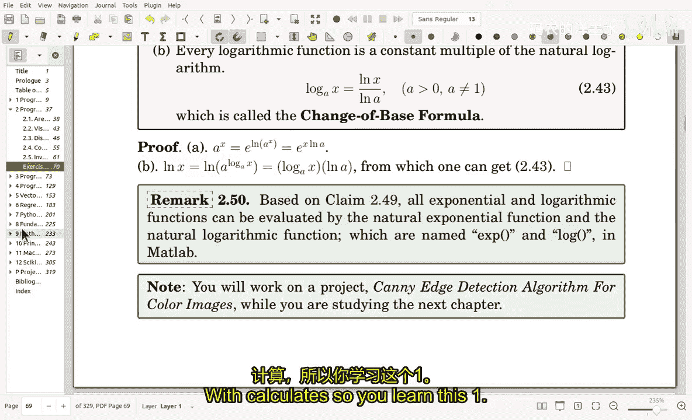

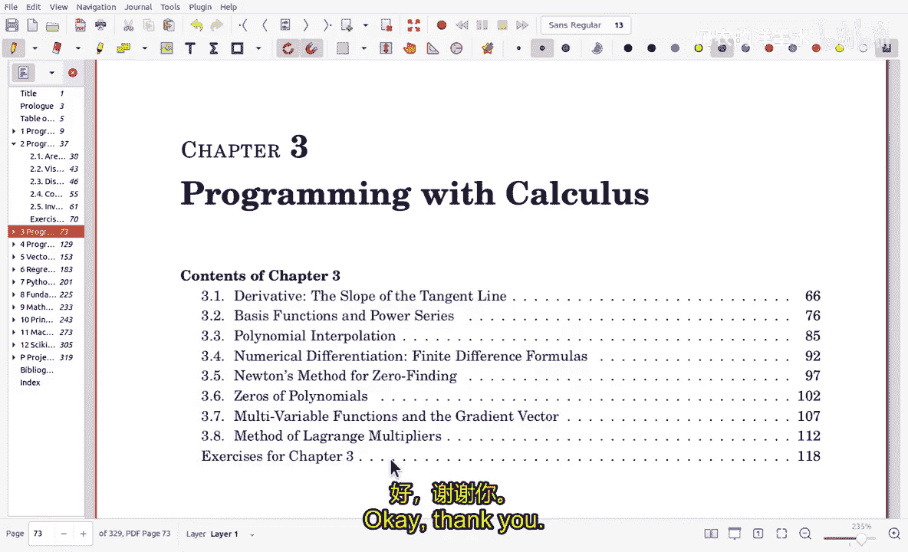

谢谢。