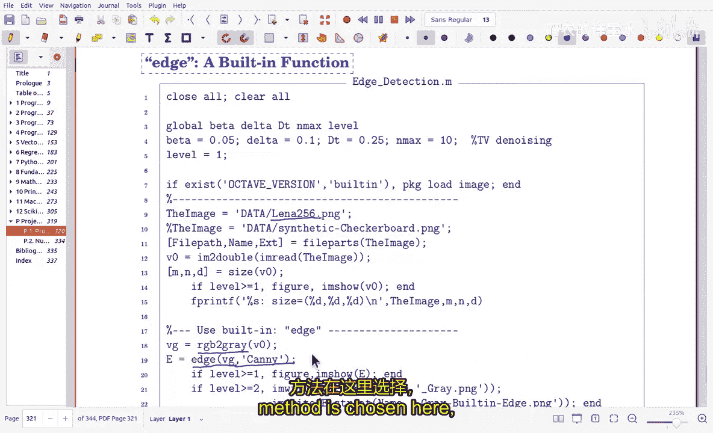
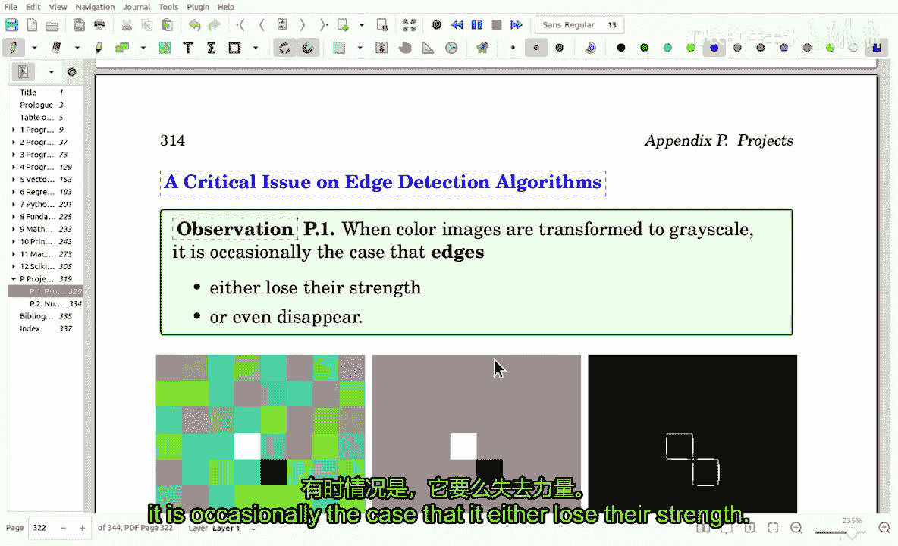
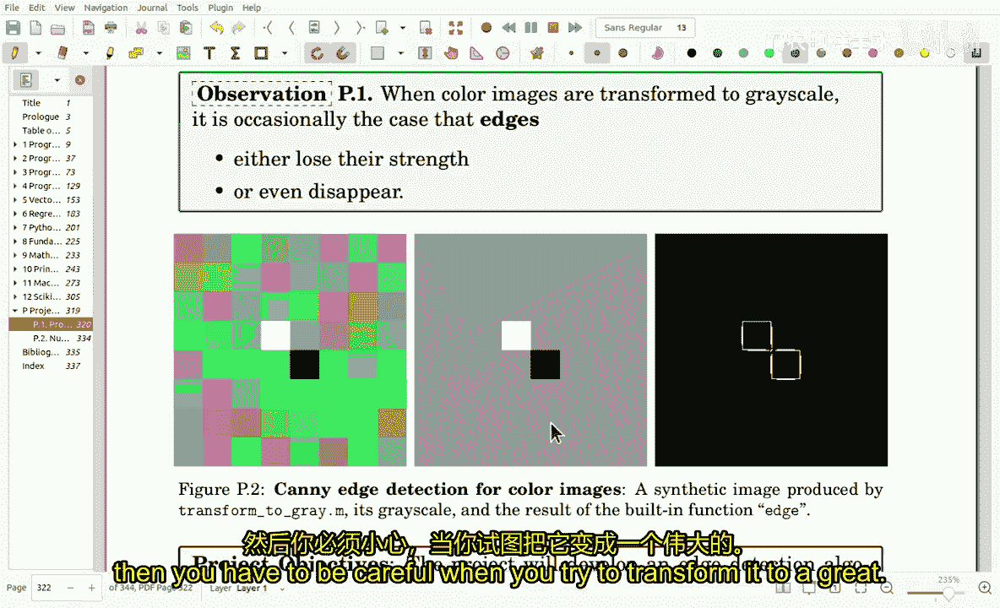
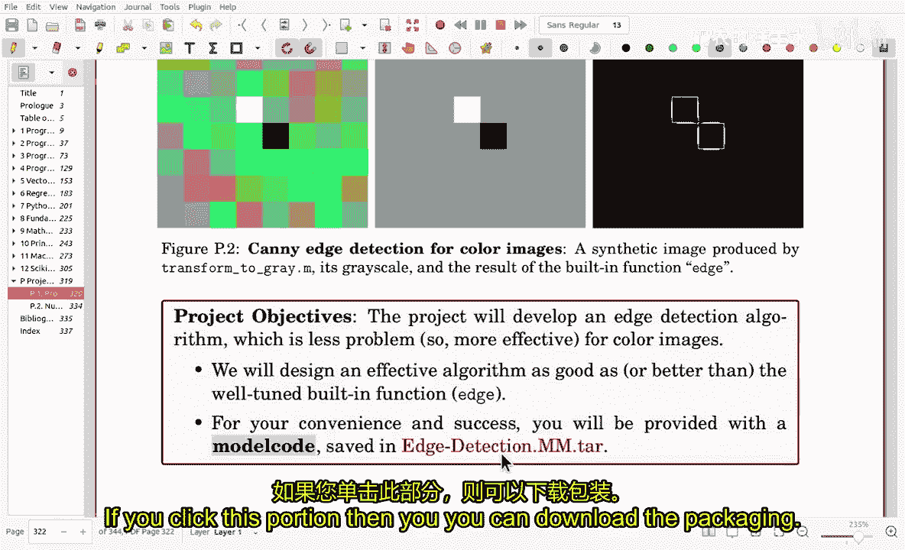
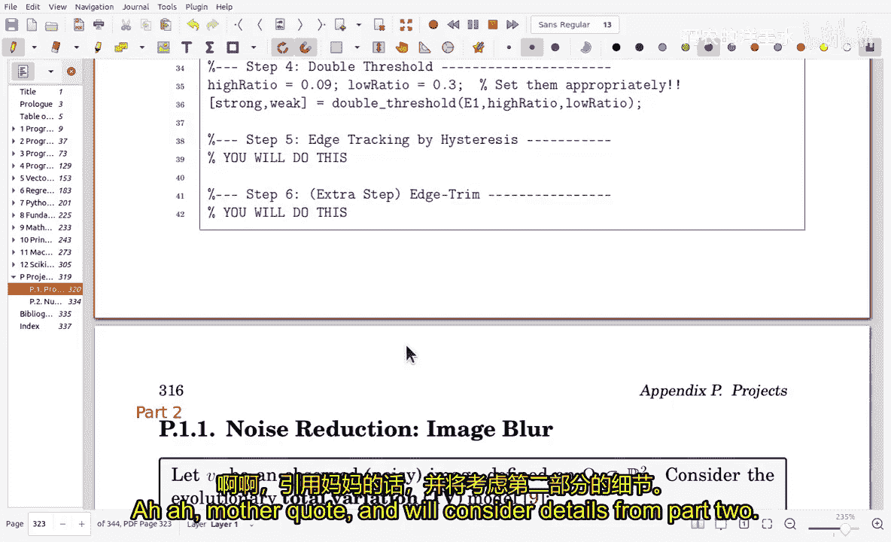

# 015：彩色图像的坎尼边缘检测算法（第一部分）📸

在本节课中，我们将要学习如何为彩色图像实现边缘检测算法。我们将从理解图像的基本概念开始，逐步探讨经典的坎尼边缘检测算法，并分析其在处理彩色图像时可能遇到的问题。最后，我们将介绍一个旨在改进彩色图像边缘检测效果的项目。

## 概述：什么是图像？🖼️

上一节我们介绍了课程背景，本节中我们来看看图像的基本定义。

图像是一个由像素组成的矩形阵列。对于彩色图像，每个像素拥有三个值：红色（R）、绿色（G）和蓝色（B）。在RGB表示法中，一幅图像可以被视为一个定义在图像域Ω上的函数。

例如，这是一个图像域，图像函数有三个分量，每个分量都是非负的，因此可以将其视为一个三维函数。

在实际中，图像域是整数有序对，这被称为**采样**。图像值也是介于0到255之间的整数，这被称为**量化**。相机采集的是连续信号，该信号被分离为RGB分量。为了有效存储，连续信号会被分割成整数值（0-255），这样信号可以更有效地保存在存储空间中，并且我们处理整数值也更加方便。

如果我们把图像看作一个对象I，那么：
`I ∈ ℝ^(M×N×D)`
其中，M是行数，N是列数，D是维度（1或3）。如果D=3，则为彩色图像；如果D=1，则为灰度图像。

彩色图像可以通过以下公式轻松转换为灰度图像：
`灰度值 = 0.2989 * R + 0.5870 * G + 0.1140 * B`
这是最常用的公式，在MATLAB中使用`rgb2gray`函数时也采用此公式。灰度值是RGB值的加权平均。

## 边缘检测算法概述🔍

大多数边缘检测算法是为灰度图像开发的。当然，你也可以将边缘检测算法应用于彩色图像，但通常需要先将彩色图像转换为灰度图像，然后再应用边缘检测算法。

边缘检测算法通常包含几个步骤。例如，坎尼边缘检测算法包含五个步骤。该算法由坎尼于1986年发表。

以下是五个步骤：
1.  噪声抑制
2.  梯度计算
3.  非极大值抑制
4.  双阈值处理
5.  滞后阈值处理

我们将学习坎尼算法，并详细实现每一个步骤。

## 实践：使用Python的`edge`函数👨‍💻

上一节我们了解了算法的理论步骤，本节中我们来看看一个具体的程序实现。

一个使用Python内置函数`edge`的程序。其主要部分是设置参数，然后选择图像。示例数据中选择了“Lena”图像。读取后，我们将其转换为双精度值数组。图像值将被缩放，使其介于0到1之间，而不是0到255的整数值。但它仍然是彩色的，因为每个像素有三个值。然后进行缩放和偏置处理，并使用RGB转灰度公式。现在我们得到了灰度图像。接着，我们调用Python的边缘检测算法，传入灰度图像并选择“canny”方法。

现在我们保存并查看结果。这是Lena图像的彩色版、灰度版以及`edge`函数处理后的结果。Lena女士对图像处理学会做出了贡献，她的图像被广泛用于各种图像处理任务。我们应该感谢她的捐赠和贡献。

检测到的边缘并不完美。例如，周围区域没有边缘，但它有一些边缘成分。虽然不完美，但可以接受。通过更合理地选择一些参数，可以忽略这部分。在许多地方，结果并不完美，例如这个部分可能应该被忽略，但在这里可以看到。这揭示了边缘检测算法在处理彩色图像时的一个关键问题。

## 彩色图像边缘检测的挑战🎨

当彩色图像转换为灰度图像时，边缘可能会减弱强度甚至消失。让我们看这张彩色图像。一旦它被转换为灰度图像，除了这两个色块，其他各种颜色都被转换成了几乎相同的灰度值，因此你看到的是一幅非常平坦的灰度图像（除了这两个色块）。所以，如果你应用`edge`函数，你只会得到这两个色块的边缘。这是一个警示。

然而，如果你尝试为彩色图像进行边缘检测，那么在将其转换为灰度图像时必须小心。

在我们的项目中，我们将开发一个边缘检测算法，旨在减少此类问题，从而对彩色图像更有效。

## 项目目标与框架🚀

上一节我们指出了问题，本节中我们将介绍解决该问题的项目框架。

项目目标是开发一个边缘检测算法，使其对彩色图像的问题更少、更有效。我们将设计一个有效的算法，使其效果与精心调优的Python `edge`函数相当或更好。

为了方便和确保成功，将提供一个保存在此文件中的模型代码。从讲义中，如果你点击这个部分，就可以下载该程序包。

让我们看看模型代码。在程序中，最后我们添加了一个新的尝试。有一个名为`edge_detection`的函数，我们调用`color_edge`并传入彩色图像，这是用于文本处理的。图像名称现在仍在此程序中使用。这里，彩色图像是一个新的尝试。现在这里有彩色图像，让我们再看一下主要部分。

主要部分如下：
*   **步骤1**：图像去噪或噪声抑制。你可以使用内置的高斯滤波算法。不过，我们也可以尝试使用TV去噪。我们稍后会看细节。
*   **步骤2**：逐通道计算。对于每个通道（从1到3），对去噪后的图像，我们尝试使用Sobel算子获取梯度幅值，并按分量保存。同时，为每个通道估算边缘方向（角度θ）。这样就完成了步骤1和2。

在进入步骤3之前，我们必须合成梯度强度。在这里，我们尝试从逐通道的梯度中选择最大值，并保存其索引，该索引用于从分量角度中选择对应的角度。现在，将其保存。然后，使用合成的梯度强度和相应的角度，我们尝试使用非极大值抑制方法进行边缘细化。我们也会详细看这个算法。

*   **步骤4**：进行双阈值处理。在此步骤中，你必须适当设置高阈值比率和低阈值比率这两个参数，然后调用双阈值函数。接着，查看被标记为强边缘、弱边缘和不相关边缘的像素，从而从中选择出强边缘像素。此函数已在程序包中实现。
*   **步骤5**：这是坎尼边缘检测算法的最后一步。你将通过实现一个函数来进行滞后阈值处理。我也会给你详细的信息。

现在我们将考虑另一个步骤X和步骤6，这是一个额外的步骤，你将会明白为什么我们需要它。

这就是项目的范围和模型代码，我们将在第二部分中考虑细节。

## 总结📝

本节课中我们一起学习了图像的基本概念，特别是彩色图像的RGB表示和量化过程。我们回顾了经典的坎尼边缘检测算法的五个步骤，并通过一个Python示例观察了其应用效果。更重要的是，我们认识到了将彩色图像简单转换为灰度图再进行边缘检测的局限性——可能导致边缘信息丢失。为此，我们引入了一个新的项目，该项目旨在开发一个直接针对彩色图像、更有效的边缘检测算法，并初步了解了其实现框架和主要步骤。在下一部分，我们将深入探讨算法每个步骤的具体实现细节。