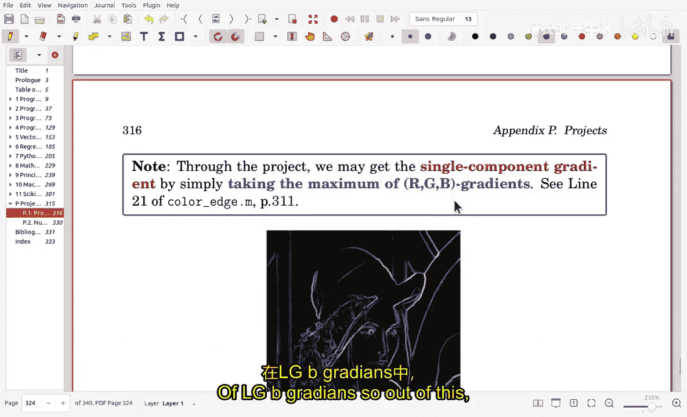
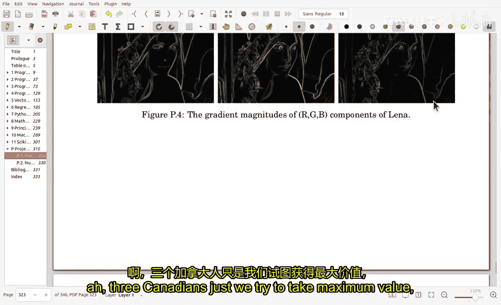
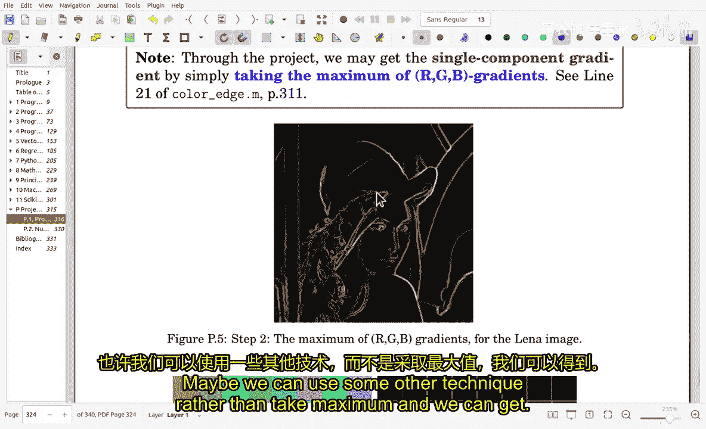
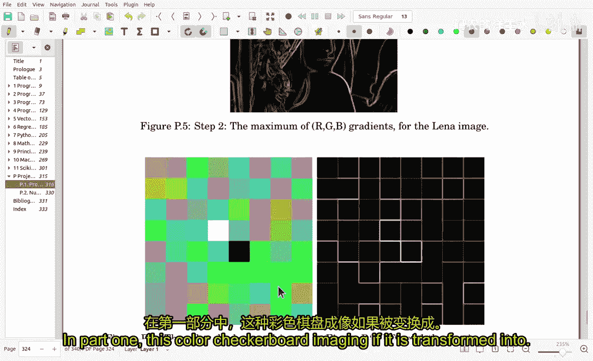
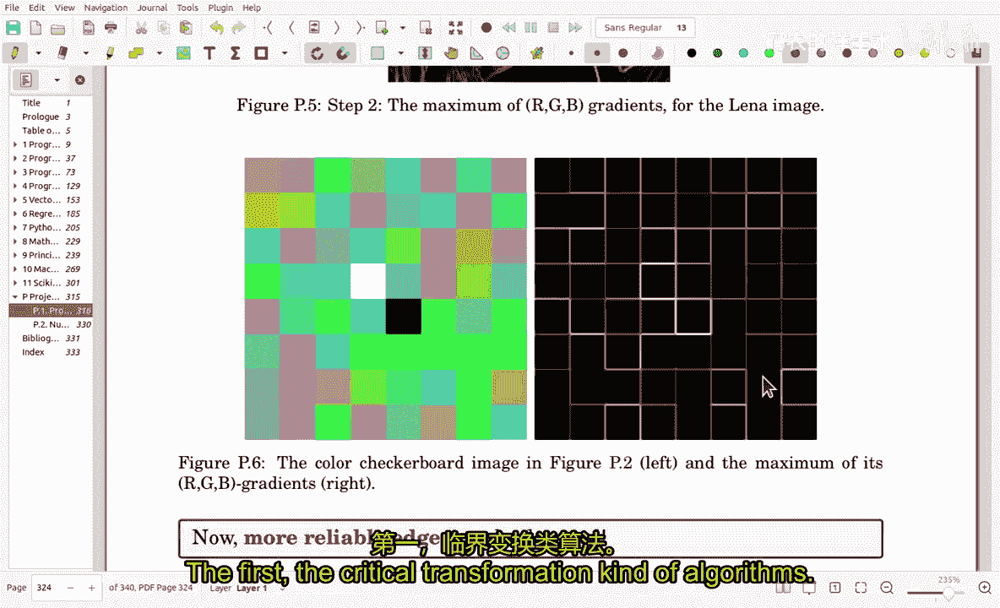
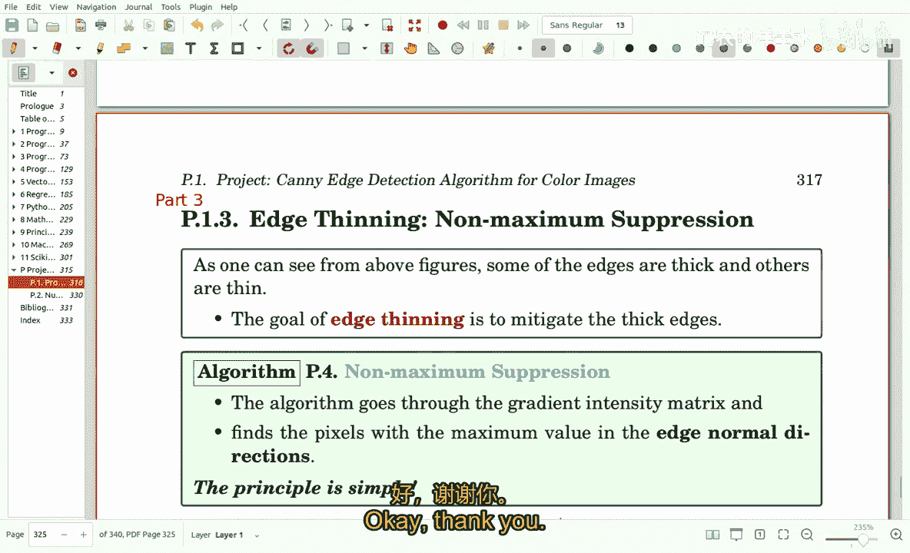

# 016：Lecture 16 - 彩色图像的坎尼边缘检测算法 Part 2

## 概述
在本节课中，我们将继续学习彩色图像的坎尼边缘检测算法。上一部分介绍了算法的整体框架，本节我们将深入探讨算法每一步的细节，并尝试寻找改进检测效果的新思路。

---

## 第一步：噪声抑制

上一节我们介绍了坎尼边缘检测算法。本节中我们来看看算法的第一步：噪声抑制。高斯滤波器是常用的方法，其公式为高斯函数。使用起来很方便，它是一种简单的平均算法，会平滑整幅图像。

然而，高斯滤波器不区分边缘像素和非边缘像素，因此可能会削弱边缘强度。我们将尝试另一种方法。

以下是另一种更好的方法：全变分模型。

全变分模型由这个偏微分方程给出。如果不熟悉偏微分方程，只需理解该模型的核心思想。公式中的 `∇·(∇u/|∇u|)` 是平均曲率，`β` 是一个约束参数，属于拉格朗日乘子的一种。我们将在第30节学习拉格朗日乘子技术。

全变分模型的主要特性是倾向于收敛到一个分段常数图像，这种现象称为“阶梯效应”。因此，全变分模型可以同时用于噪声抑制和边缘保持，能非常有效地在抑制噪声的同时不削弱边缘。

我们需要求解这个偏微分方程来得到解。可以应用简单的显式方法，即这里的欧拉方法。我们尝试通过求解该方程来获得新的 `n+1` 层解。

将 `u_n` 项移到右边，乘以 `Δt`，再将 `∇·(∇u/|∇u|)` 项移到右边，可以得到那个方程。现在，这个项被近似为 `u_n`。实际上，这是平均曲率负值的数值实现。通过使用该方程进行若干次迭代，我们可以得到解。

全变分模型要求设置 `Δt` 以保证稳定性。这意味着必须选择相当小的 `Δt`。如果选择较大的 `Δt`，解会发散。只需几次迭代，它就能有效减少噪声。

实现细节可以在 `TVdenoise` 函数以及 MATLAB 包中的 `Chambolle` 算法中找到。

以下是两种方法的比较。对于 Lena 图像，我们尝试对每个通道分别进行处理。对每个通道应用全变分去噪和高斯滤波，分别保存为 `U_tv` 和 `U_gauss`，然后保存最终图像。这是原始 Lena 图像，这是全变分去噪后的图像，那是高斯滤波后的图像。

从中间这张图可以看出，全变分模型在减少噪声的同时保留了边缘。例如，这里和这里的一些小噪点几乎消失了，然而边缘被很好地保留下来。对于高斯滤波器，如果选择较小的 `sigma`，例如 1，可以得到更清晰的图像。但无论如何，使用高斯滤波器时必须小心，因为它会模糊所有区域。

---

## 第二步：梯度计算

现在，我们进入坎尼边缘检测算法的第二步：梯度计算。Sobel 算子对应于检测像素强度的变化。最简单的方法是应用在水平和垂直方向上都能突出强度变化的滤波器。

以下是 Sobel 算子的计算算法，用于计算 `x` 和 `y` 方向的方向导数。通过使用所谓的 Sobel 核进行卷积来实现。这是 `x` 方向的 Sobel 核，这是 `y` 方向的 Sobel 核。

让我们看看它们是什么。这里我们考虑像素。更准确地说，图像值保存在每个格点上。对于这个点，这里的权重 `-1` 意味着这个值减去那个值。这代表了水平方向上的斜率。由于像素长度为 1，这个值本应除以 2，但这属于缩放问题，所以我们不除以 2。因此，这个值减去那个值代表了 `x` 方向导数的近似，而不是精确求值。这是水平方向的斜率，我们在这里取加权平均，这个权重为 2，那两个权重为 1，正好对应这个核。是的，两倍的斜率和一倍的斜率，由于总的贡献，我们本应除以 4，但这同样是缩放问题。所以，将这个滤波器与图像进行卷积，就会在这里得到 `U_x`，这是 `∂u/∂x` 的近似。对于 `U_y`，可以类似地考虑，这里的 `1` 和 `-1` 应代表垂直方向的斜率，这里测量那个斜率，然后对平均值赋予权重。通过与该滤波器进行卷积运算，可以得到 `U_y`。这就是测量 Sobel 梯度的方法。

然后，梯度有大小和方向。大小是 `sqrt(U_x^2 + U_y^2)`，角度是 `atan2(U_y, U_x)`。这个角度代表了边缘的法线方向。如果边缘沿着某个角度 `θ` 延伸，那么其法线方向就是那个方向。在 MATLAB 中，`atan2` 是内置函数，可以这样使用。实现细节可以在 `SobelGrad` 函数中找到，下一页也会看到。

在程序中，彩色图像的梯度幅值保存在 `G` 中，然后被归一化。归一化并非必须，只是为了绘图方便。我们尝试将最大值设为 1，将值归一化到这个范围，这样在绘图时可以方便地显示梯度幅值剖面。

如果尝试获取 `atan2` 的信息，使用 `help` 命令可以看到，可移植的输出在这个范围内。`atan2(Y, X)` 是 `X` 和 `Y` 的四象限反正切，结果在 `-π` 到 `π` 之间。这是根据坐标测量的。输出值在 `-π` 到 `π` 之间，例如这个角度，它指向这个方向。如果加上 `π`，方向将变为相反方向。但在我们的计算中，是这个方向还是那个方向并不重要，因为梯度大小才是关键。开始时，角度是通过 `atan2(U_y, U_x)` 测量的，但梯度大小是一个非负数。如果在这里使用部分非负数，可以转换成那种方式，所以没问题。无论如何，输出是 `-π` 到 `π`。

这是 `SobelGrad` 函数的代码。输出是梯度剖面和角度。可以看到，例如，`U_x` 在每个点用红色表示。我们使用索引 `p` 和 `q`，`p` 是垂直方向，`q` 是水平方向。`q-1` 是 `q` 的左点，`q+1` 是右点。对于 `p-1`，实际上是上方的点，因为 `p` 是垂直方向。这是左点和右点。然而，如果它变为 0，则使用 1；如果大于 `M`，则使用 `M`。所以 `max` 和 `min` 是为了处理边界，但主要思想是：`p-1` 是 `p` 减 1（如果未触及边界），`p+1` 是 `p` 加 1（如果未触及边界），对 `q` 同理。

对于 `U_x`，使用 `p, p` 和 `p, p`？这里，`p+1` 和 `p-1` 是第一个分量，然后 `q-1` 是水平方向左侧的差，`q+1` 是右侧的差。这是中心差分，水平方向的差。同样地，计算 `U_y`，然后将 `sqrt(U_x^2 + U_y^2)` 保存为梯度幅值 `G`，角度 `theta` 通过 `atan2(U_y, U_x)` 计算并保存。

得到梯度后，我们尝试查看每个 RGB 分量的幅值。显然，绿色分量的梯度幅值最大。然而，粉色分量也包含一些细节。这是 Lena 图像 RGB 梯度分量的幅值。

在整个项目中，我们可以通过简单地取 RGB 通道的最大值来获得单分量梯度。从这三个通道中，我们尝试取最大值。然后可以看到这个结果。

现在，我们尝试逐个通道计算梯度，然后尝试获得单值的梯度。在这种情况下，也许我们可以使用其他技术，而不是取最大值。我们得出了一个结论：显然有更好的算法。例如，在第一部分中的这个彩色棋盘图像，如果转换成灰度，这两个方块会有相同的灰度值。因此，传统方法无法检测这两个区域之间的边缘。然而，如果处理逐个通道的梯度，然后尝试从中获得一个单值梯度，就可能出现这种情况。在这个例子中，我们选择 RGB 梯度分量的最大值，但这里的结果相当好，我们可以得到更可靠的边缘。这是主要的好处和优势。

---

## 总结
本节课中，我们一起学习了彩色图像坎尼边缘检测算法的第二部分，重点探讨了噪声抑制的全变分模型和梯度计算的 Sobel 算子实现。全变分模型在去噪的同时能更好地保持边缘，而 Sobel 算子则用于计算图像梯度。我们还讨论了从多通道梯度信息中合成单值梯度的方法。在接下来的第三部分，我们将继续讲解算法的第三步、第四步和第五步。