# 017：彩色图像的坎尼边缘检测算法 Part 3 🖼️➡️📐

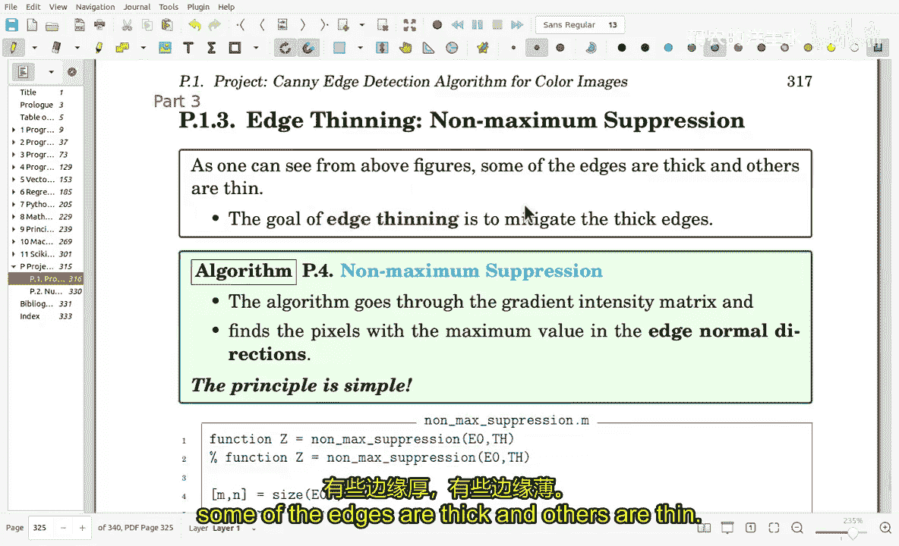

在本节课中，我们将继续学习彩色图像的坎尼边缘检测算法。上一节我们讨论了梯度计算，本节我们将重点介绍算法的后续三个核心步骤：非极大值抑制、双阈值处理和边缘跟踪。我们将详细解释每个步骤的原理与实现，并探讨如何优化参数以获得更好的边缘检测效果。

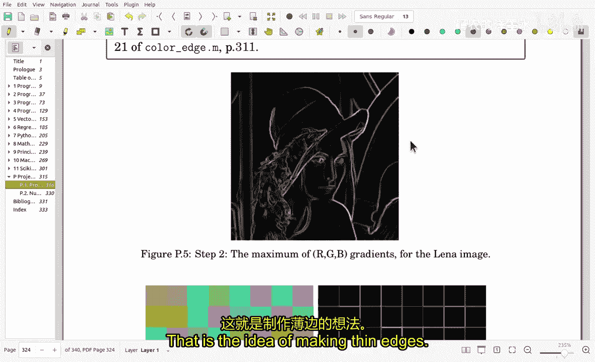

## 非极大值抑制 🎯

上一节我们得到了梯度幅值图像，但其中的边缘线条可能粗细不均。非极大值抑制的目标是细化边缘，只保留局部梯度幅值最大的点，从而得到单像素宽的边缘。

其核心思想是：真正的边缘中心点在其法线方向上应具有最大的梯度强度。因此，我们沿着边缘的法线方向进行比较，只保留梯度幅值为局部最大值的像素点，抑制其他非极大值点。

以下是该步骤的算法流程：

1.  **输入**：梯度幅值图像 `M` 和梯度方向图像 `theta`。
2.  **角度量化**：将梯度方向 `theta`（范围 -π 到 π）量化为四个离散方向（0°, 45°, 90°, 135°），分别对应边缘的四个法线方向。
    *   若 `theta` 为负值，则先加上 π 使其范围变为 0 到 π。
    *   将角度除以 π/4 并取整，再对 4 取模，得到 0, 1, 2, 3 四个方向索引。
3.  **比较与抑制**：根据量化后的方向，检查每个像素点沿其法线方向的两个相邻像素。
    *   如果当前像素的梯度幅值大于这两个相邻像素的幅值，则保留该点。
    *   否则，将该点的梯度幅值置为零（抑制）。

通过此步骤，我们得到了更细、更清晰的边缘。


*经过非极大值抑制后，边缘从粗细不均变为单像素宽度。*

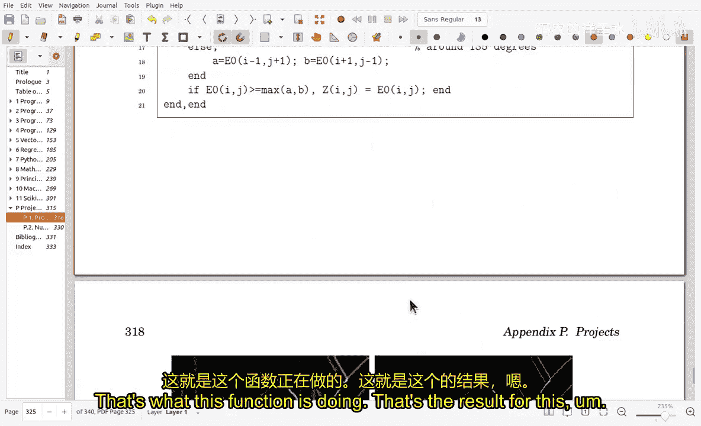

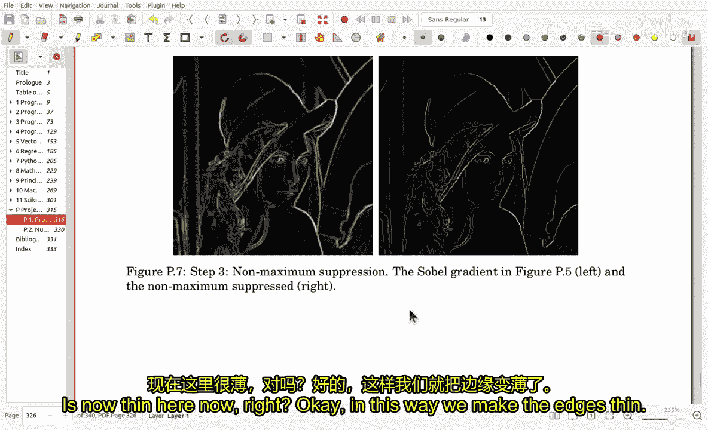

## 双阈值处理 🚦

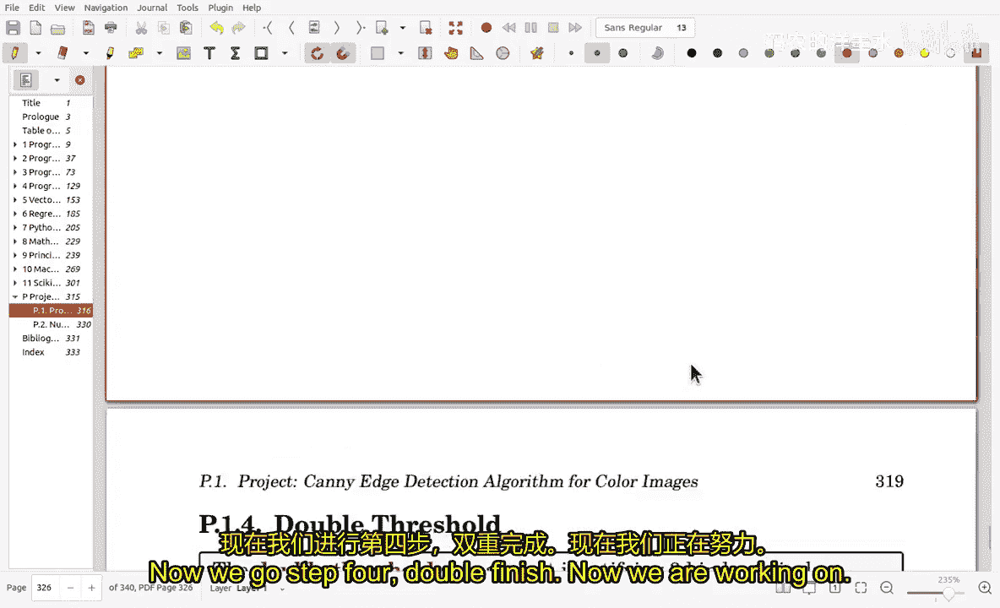

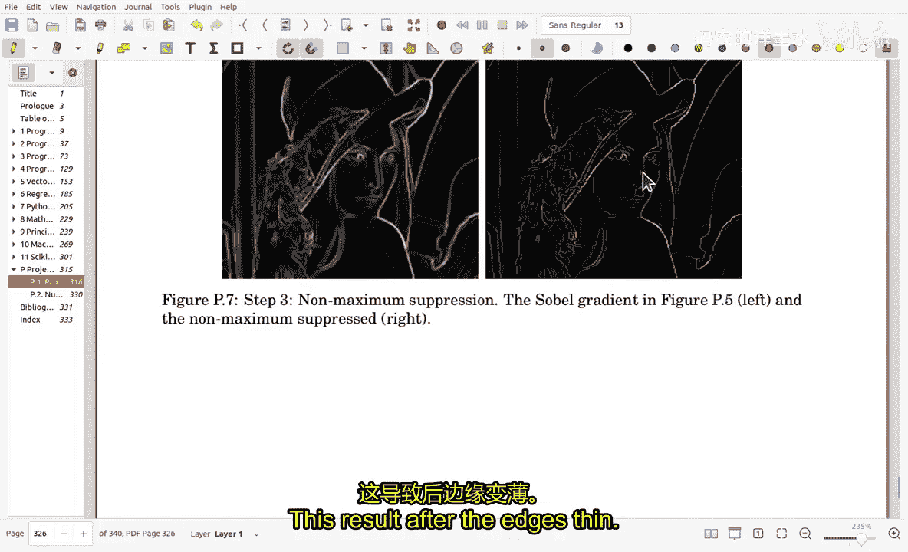

经过非极大值抑制后，图像中仍包含许多由噪声或弱纹理产生的边缘点。双阈值处理旨在通过设置高低两个阈值，将像素点分为三类，以区分强边缘、弱边缘和非边缘。

以下是该步骤的具体操作：

1.  **设定阈值**：设定一个高阈值 `T_high` 和一个低阈值 `T_low`。通常，`T_high` 用于识别强边缘像素，`T_low` 用于排除非边缘像素。
2.  **像素分类**：
    *   **强像素**：梯度幅值 >= `T_high`。这些被认为是确定的边缘部分。
    *   **弱像素**：`T_low` <= 梯度幅值 < `T_high`。这些可能是边缘，也可能不是，需要进一步判断。
    *   **非相关像素**：梯度幅值 < `T_low`。这些直接被丢弃，不作为边缘。

在实际实现中，阈值通常通过比例来设定。例如：
*   `T_high = high_ratio * max(gradient_magnitude)`
*   `T_low = low_ratio * T_high`

其中 `high_ratio` 和 `low_ratio` 是需要根据图像内容调整的参数。静态阈值适用于简单情况，但对于复杂图像，研究动态阈值（根据图像局部特性调整阈值）可能获得更好效果。

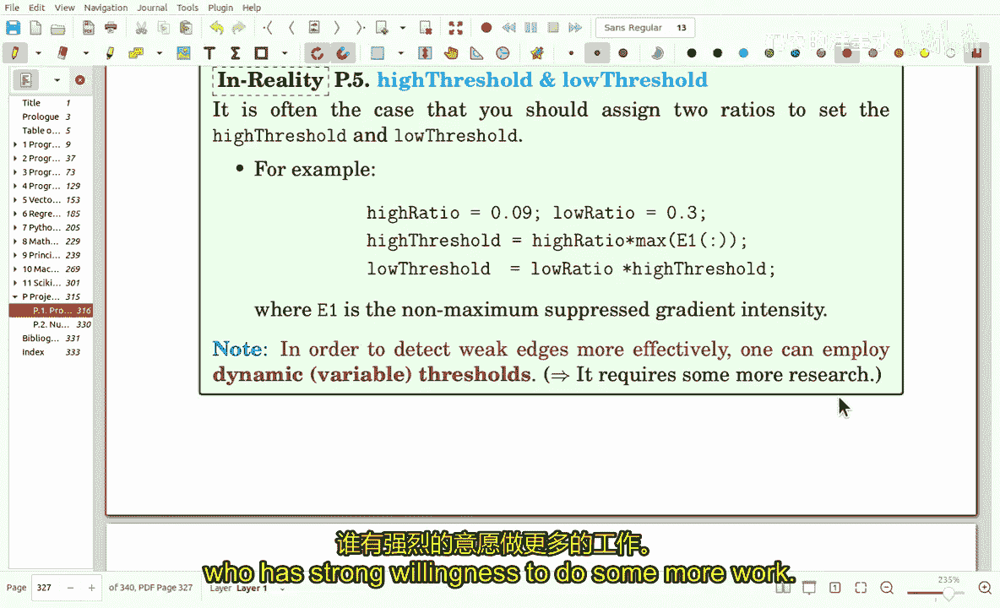

*双阈值处理将梯度幅值图像分割为强边缘、弱边缘和非边缘区域。*

## 边缘跟踪（滞回阈值）🔗


双阈值处理后，强边缘像素基本构成了最终的边缘，但可能不连续。边缘跟踪（也称为滞回阈值）的目标是将与强边缘相连的弱边缘像素“连接”起来，形成完整、连续的边缘。

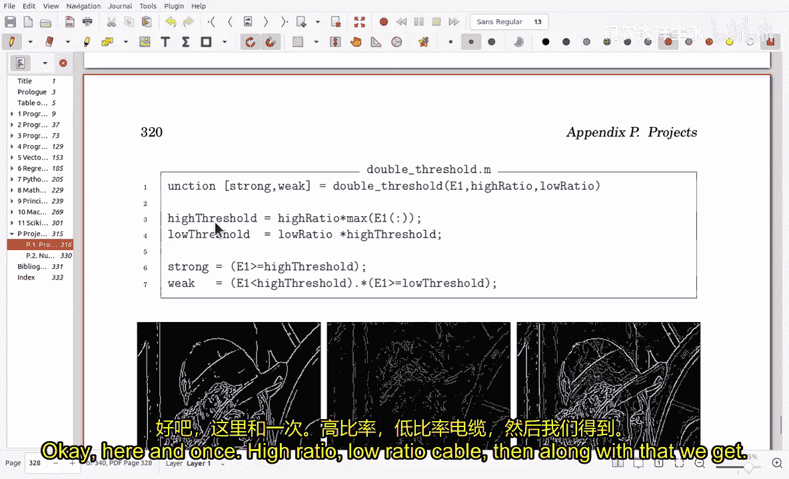

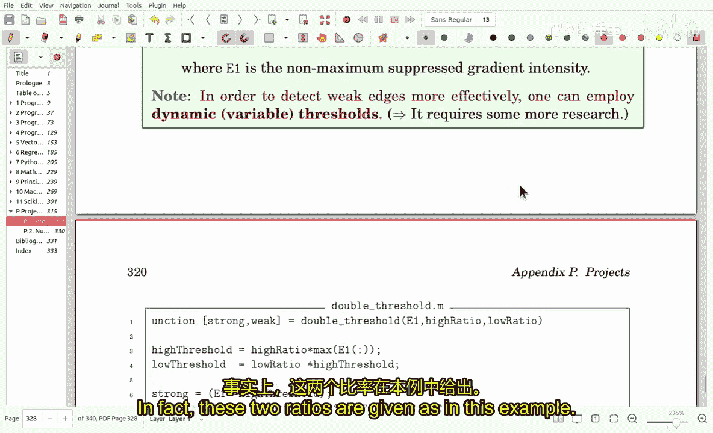

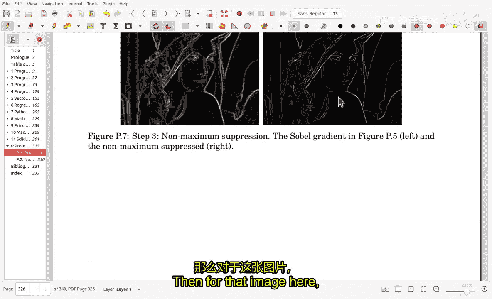

其规则非常简单：遍历所有弱像素，检查其8邻域（周围8个像素）。如果至少有一个邻域像素是强像素，则认为当前弱像素属于边缘，并将其提升为强像素。这个过程可以迭代进行，直到没有新的弱像素被转换。

以下是需要实现的 `hysteresis` 函数的核心逻辑伪代码：

```python
def hysteresis(strong_edges, weak_edges):
    # strong_edges, weak_edges 是布尔型图像，标记了强像素和弱像素的位置
    edges = strong_edges.copy()
    # 遍历弱像素，检查其8邻域是否有强像素
    for each pixel in weak_edges:
        if any neighbor in 8-neighborhood is in strong_edges:
            edges[pixel] = True # 将该弱像素加入最终边缘
    return edges
```

通过这一步，许多孤立的弱像素被剔除，而与强边缘相连的弱像素被保留，从而得到了更完整、连贯的边缘轮廓。

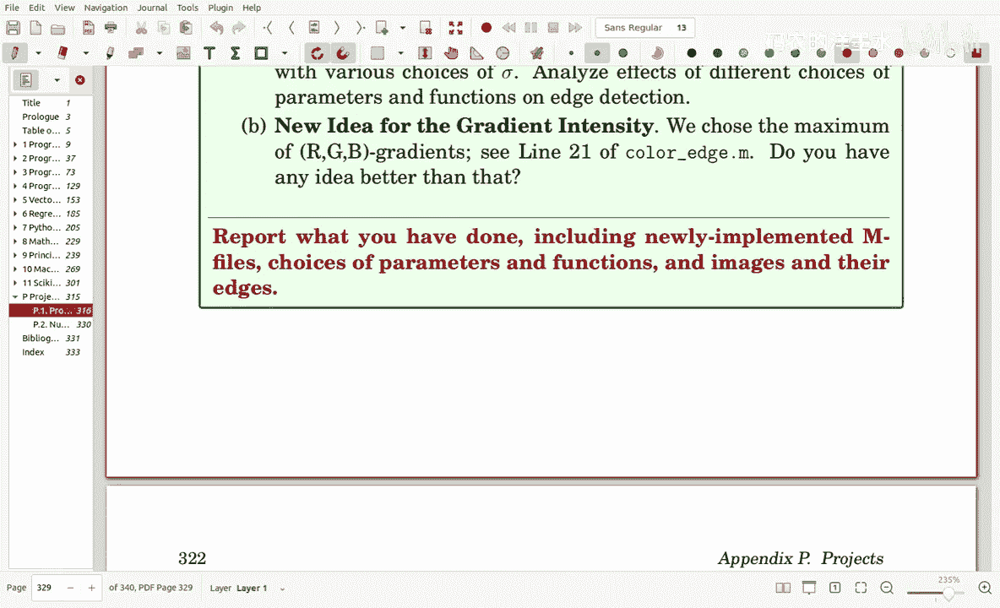

*经过边缘跟踪后，断裂的边缘被连接起来，形成了更完整的物体轮廓。*

## 实验任务与扩展思路 💻

基于以上原理，你的项目任务如下：

1.  **完成步骤4和5**：在提供的代码框架中，实现双阈值处理和边缘跟踪函数。
2.  **参数调优**：尝试不同的 `high_ratio` 和 `low_ratio` 组合，观察它们对最终边缘检测结果的影响。这些参数没有通用值，需针对具体图像调整。
3.  **后处理（可选加分）**：实现一个修剪函数，用于消除孤立的强像素或长度过短（例如小于等于3个像素）的边缘片段。这需要设计巧妙的算法。
4.  **尝试不同的去噪方法（可选加分）**：除了课程提到的全变分去噪，可以尝试使用高斯滤波（`imgaussfilt` 函数）配合不同的 `sigma` 值进行降噪，并分析不同去噪方法和参数对边缘检测效果的影响。
5.  **探索新的梯度幅值计算方式（可选加分）**：当前代码（`khan.m` 第21行附近）从RGB三个通道的梯度中取最大值作为该点的梯度幅值。你可以思考并提出更好的融合多通道梯度信息的方法。

请将你的实现过程、参数选择、测试图像及结果、以及任何有价值的发现整理到最终报告中。

## 总结 📝


本节课我们一起学习了坎尼边缘检测算法的后半部分。我们深入探讨了**非极大值抑制**如何细化边缘，**双阈值处理**如何区分强、弱边缘像素，以及**边缘跟踪**如何连接边缘形成完整轮廓。掌握这些步骤是理解经典边缘检测算法的关键。通过完成实验任务和探索扩展思路，你将能更灵活地应用该算法，并可能对其做出改进。