# 018：切线的斜率 📈

在本节课中，我们将要学习微积分中的一个核心概念——微分，特别是如何通过求极限来找到函数在某一点的切线斜率。这对于理解变化率至关重要，是现代科学计算，尤其是人工智能领域的基础。

## 概述

微积分和线性代数在高级科学计算任务中扮演着关键角色。本章节将介绍微积分中一些精选但至关重要的主题。我们将探讨基本概念及其实际应用，因此你无需具备任何微积分预备知识。

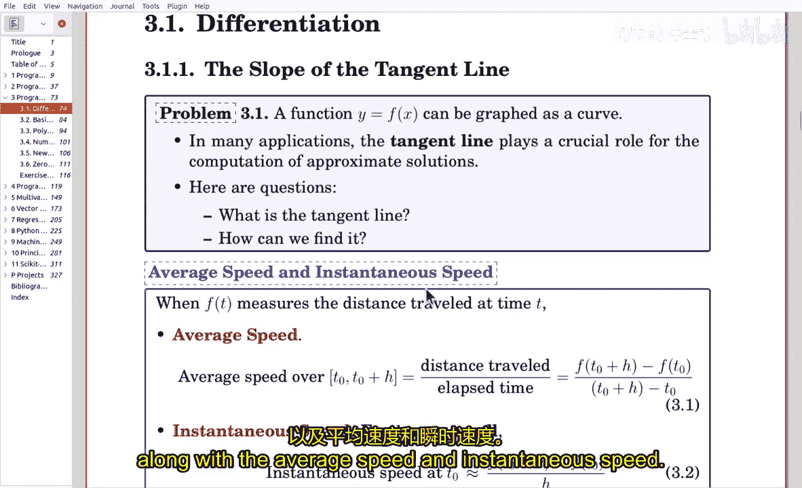

现在，让我们进入第30.1节：微分与切线斜率。

## 30.1 微分：切线的斜率

函数 **y = f(x)** 的图像可以表示为一条曲线。在许多应用中，切线对于计算近似解起着至关重要的作用。

这里我们有两个核心问题：什么是切线？以及我们如何找到它？

让我们通过平均速度和瞬时速度的例子来理解。

### 从平均速度到瞬时速度

假设 **f(t)** 是一个关于时间的函数，用于测量在时间 **t** 内移动的距离。

平均速度的定义如下：在时间区间 **[t₀, t₀ + h]** 内的平均速度，等于在该时间段内移动的距离除以所花费的时间。用公式表示为：

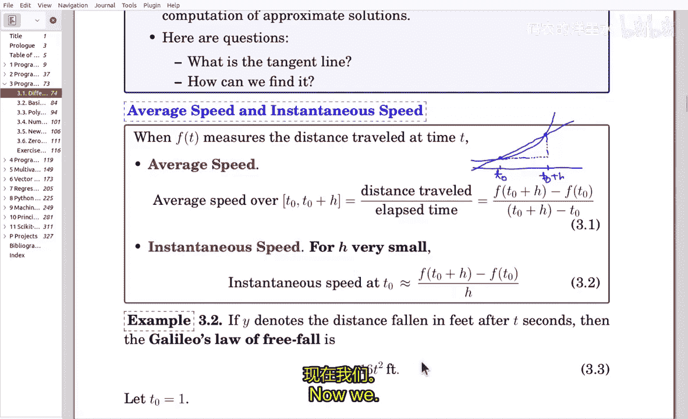

**平均速度 = [f(t₀ + h) - f(t₀)] / h**

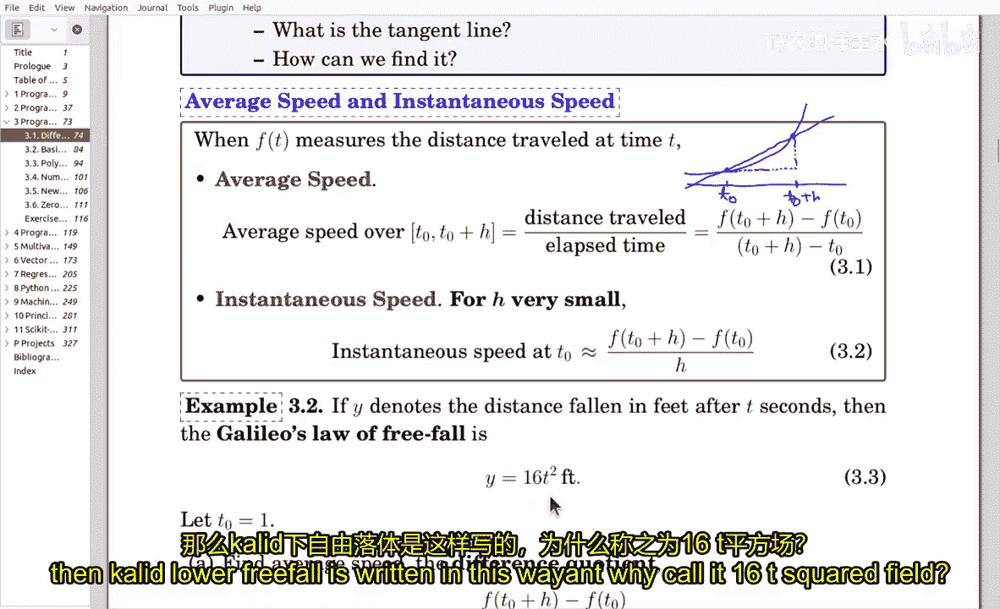

这个公式的几何意义可以通过图像来理解。在时间轴上，我们有 **t₀** 和 **t₀ + h** 两个点。假设函数 **y = f(t)** 的图像如图所示，那么 **f(t₀ + h)** 和 **f(t₀)** 就是曲线上对应的两个点。连接这两点的直线称为**割线**。

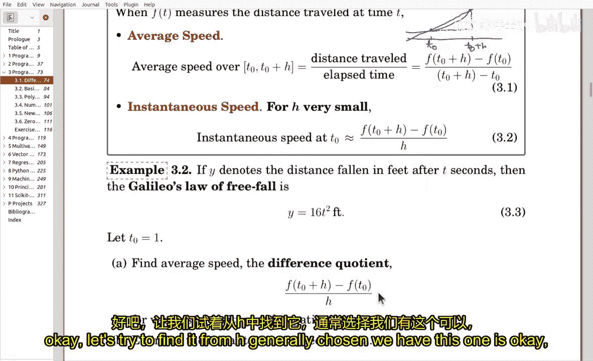

如果我们绘制一个直角三角形，其底边长度为 **(t₀ + h) - t₀ = h**，高度为 **f(t₀ + h) - f(t₀)**。那么，上述公式计算出的商，正是这条割线的**斜率**，它代表了在该时间区间内的**平均变化率**。由于 **f** 测量的是距离，这个商就是该区间的**平均速度**。

那么，**瞬时速度**呢？当 **h** 非常小时，在 **t₀** 时刻的瞬时速度可以用这个商来近似。瞬时速度与曲线在该点的斜率有关。一旦我们选择非常小的 **h**，这个商就能很好地近似瞬时速度。

### 具体示例：自由落体

我们用一个具体函数来处理这个例子。假设一个物体自由落体，在 **t** 秒内下落的距离（英尺）由以下函数给出：

**y = f(t) = 16t²**

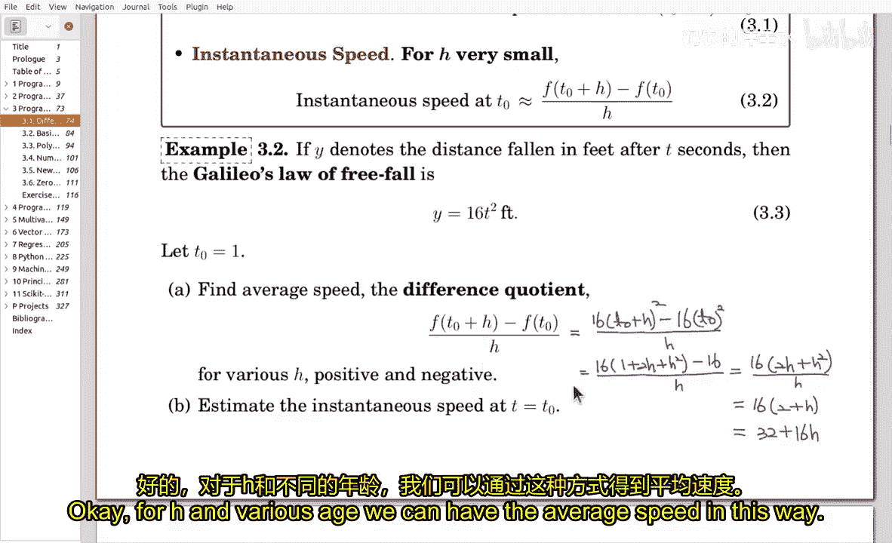

现在，设 **t₀ = 1**，我们需要找到平均速度，即差商。

以下是计算差商的一般过程。函数 **f** 定义为 **f(t) = 16t²**。因此，我们将 **t₀ + h** 代入函数：

**差商 = [f(1 + h) - f(1)] / h = [16(1 + h)² - 16(1)²] / h**

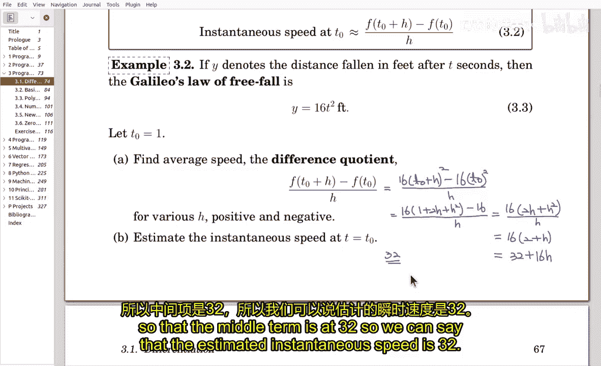

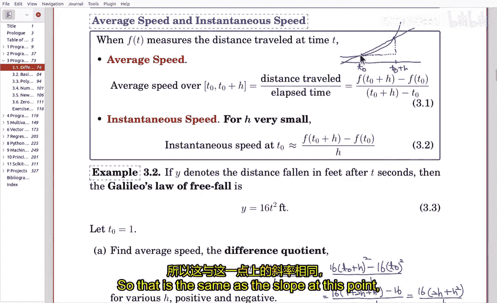

展开 **(1 + h)² = 1 + 2h + h²**，代入公式：

**= [16(1 + 2h + h²) - 16] / h = [16 + 32h + 16h² - 16] / h = (32h + 16h²) / h**

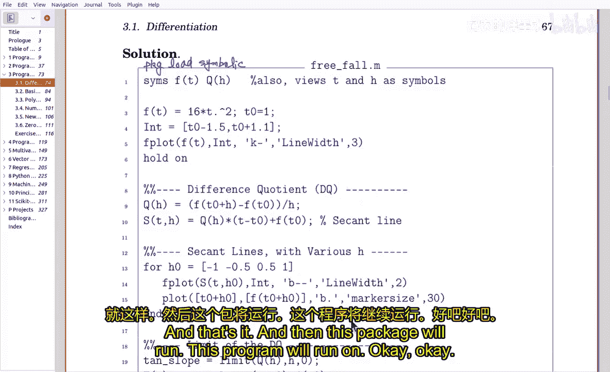

约去 **h**（假设 **h ≠ 0**）：

**= 32 + 16h**

因此，对于给定的 **h**，平均速度的公式为 **32 + 16h**。

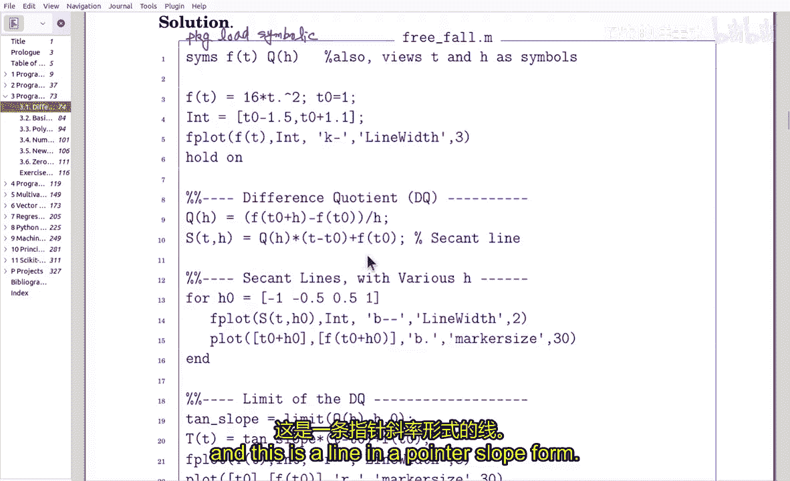

### 估计瞬时速度

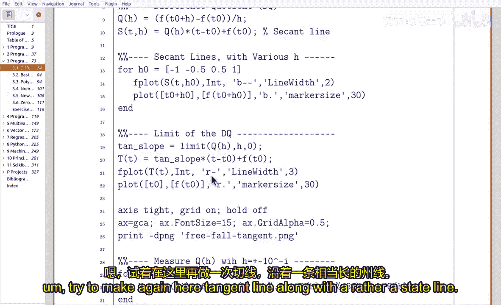

现在，估计在 **t = t₀ = 1** 时的瞬时速度。瞬时速度可以通过让 **h** 变得非常小来获得。

如果我们选择越来越小的 **h** 值（例如 0.1, 0.01, 0.001...），**32 + 16h** 这个值将趋近于 **32**。因为当 **h** 趋近于 0 时，**16h** 项也趋近于 0。

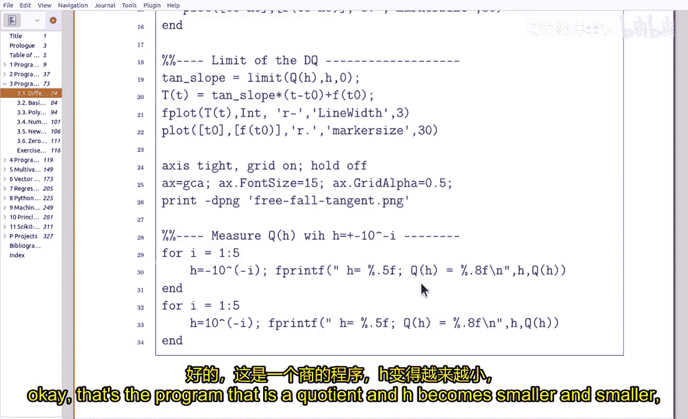

因此，我们可以估计在 **t=1** 时的瞬时速度为 **32**。这个值也正是曲线在 **t=1** 那一点的切线斜率。

### 通过编程验证

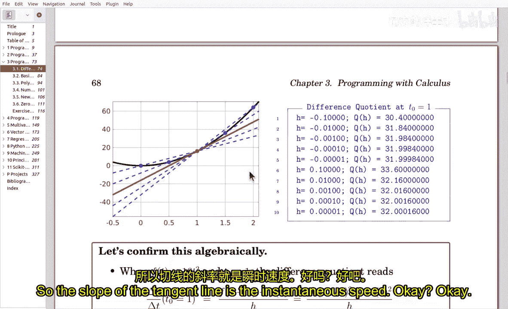

我们可以编写程序来验证这一过程。以下是一个概念性的程序描述（原示例使用特定符号计算包）：

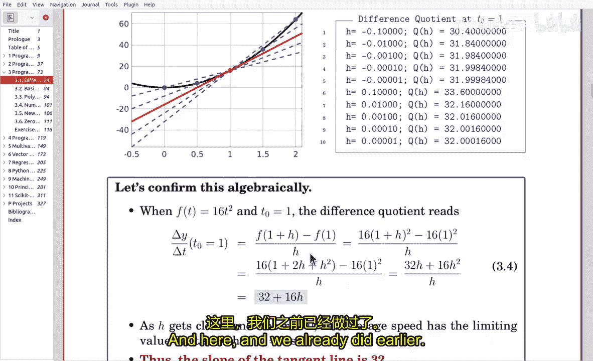

1.  定义函数 **f(t) = 16t²** 和点 **t₀ = 1**。
2.  为绘图目的，设定一个包含 **t₀** 的区间。
3.  定义差商函数 **Q(h) = [f(t₀ + h) - f(t₀)] / h**。
4.  对于给定的 **h**，计算割线的斜率和方程。
5.  让 **h** 取一系列趋近于 0 的值（正数和负数），观察 **Q(h)** 的极限。
6.  绘制函数曲线、不同 **h** 对应的割线以及最终的切线。

当 **h** 从正方向和负方向都趋近于 0 时，**Q(h)** 的值都趋近于 **32**。同时，图中蓝色的割线随着 **h** 变小，越来越接近红色的切线。切线的斜率就是瞬时速度 **32**。

### 求切线方程：另一个例子

求曲线 **y = x²** 在点 **x₀ = 2** 处的切线方程。

要找到切线方程，我们需要知道一个点和一个斜率。
*   **点**：当 **x₀ = 2** 时，**y₀ = f(2) = 2² = 4**。所以点是 **(2, 4)**。
*   **斜率**：通过差商并取极限来求。

函数是 **f(x) = x²**。差商为：
**斜率 ≈ [f(2 + h) - f(2)] / h = [(2 + h)² - 4] / h**

展开：**= [4 + 4h + h² - 4] / h = (4h + h²) / h = 4 + h**

当 **h** 趋近于 0 时，这个值趋近于 **4**。所以，切线的斜率 **m = 4**。

现在，使用**点斜式**方程：
**y - y₀ = m (x - x₀)**
代入 **y₀ = 4, m = 4, x₀ = 2**：
**y - 4 = 4(x - 2)**

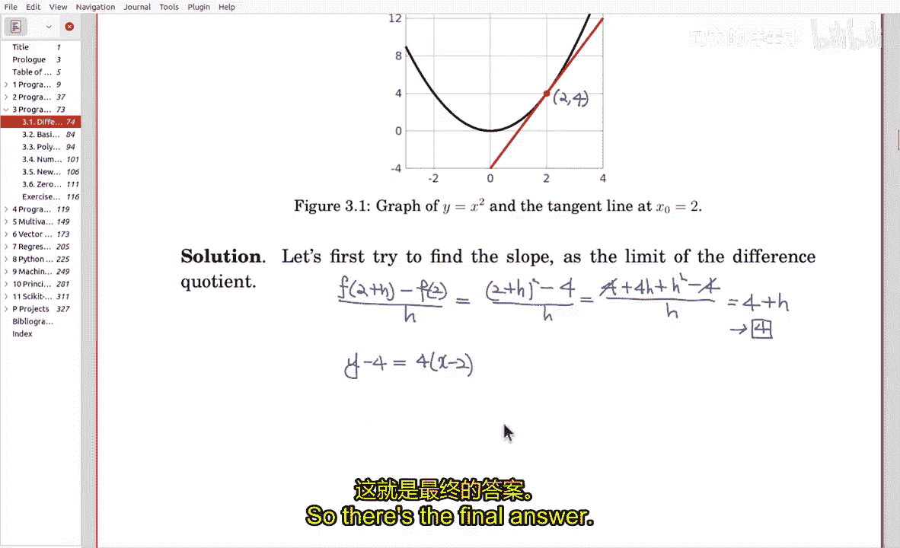

整理得到切线方程：
**y = 4x - 4**

### 切线的正式定义

现在，我们正式定义曲线 **y = f(x)** 在点 **P(x₀, f(x₀))** 处的切线斜率。

曲线在点 **P** 的切线斜率是以下差商的极限（如果该极限存在）：

**f‘(x₀) = lim_(h→0) [f(x₀ + h) - f(x₀)] / h**

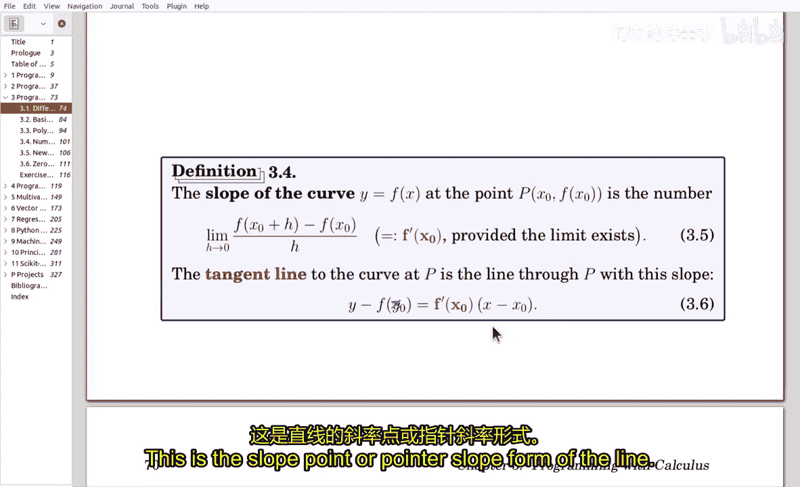

符号 **f‘(x₀)** 或 **dy/dx|_(x=x₀)** 表示函数在 **x₀** 处的**导数**，也就是切线的斜率。

因此，曲线在点 **P** 的切线方程可以写成点斜式：
**y - f(x₀) = f‘(x₀) (x - x₀)**

### 导数不存在的例子

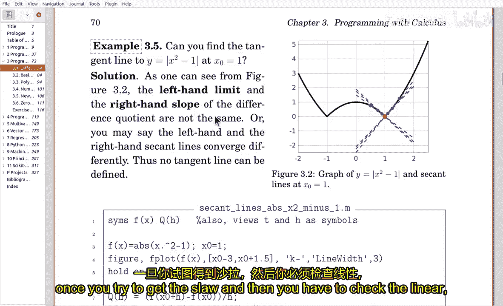

是否所有点都有切线？考虑函数 **y = |x³ - 1|** 在 **x₀ = 1** 处的情况。

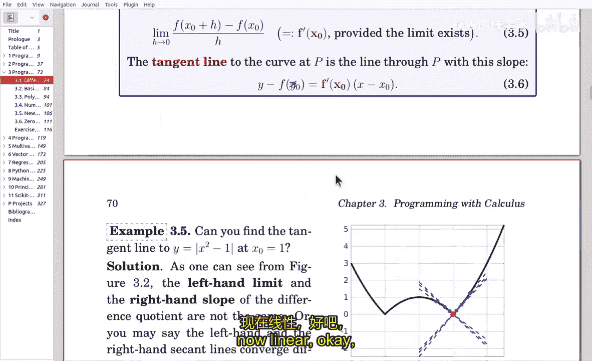

这个函数的图像在 **x=1** 处有一个“尖角”。为了求斜率，我们需要检查极限 **lim_(h→0) [f(1+h) - f(1)] / h**。

极限存在的条件是：当 **h** 从右侧（正数）趋近于 0 时的极限，和从左侧（负数）趋近于 0 时的极限**都存在并且相等**。

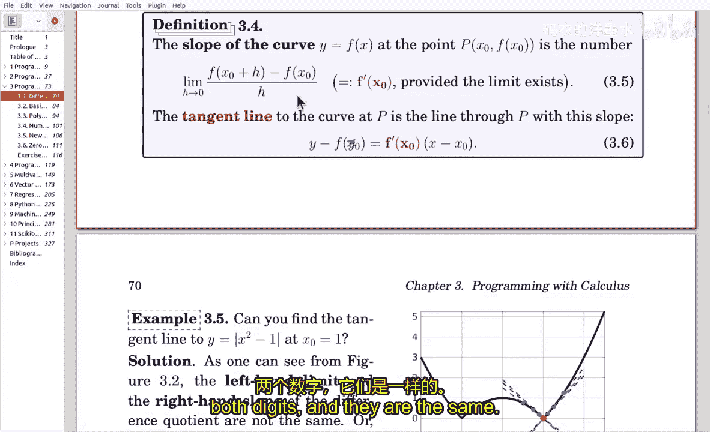

对于这个函数在 **x=1** 处：
*   从右侧（**h > 0**）逼近时，函数行为类似某条线，斜率是一个值。
*   从左侧（**h < 0**）逼近时，函数行为类似另一条线，斜率是另一个值。

由于左右极限不相等，因此在该点的导数（切线斜率）**不存在**。从几何上看，在“尖角”处无法画出一条唯一的切线。这样的点称为函数的**不可导点**。

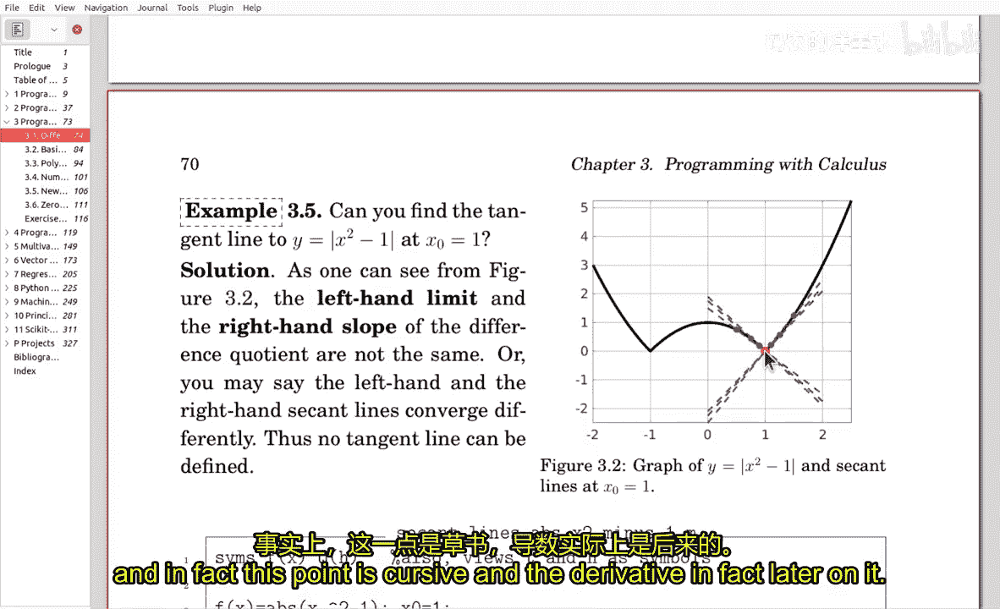

我们可以通过编程绘制函数图像来直观地看到这个尖角。

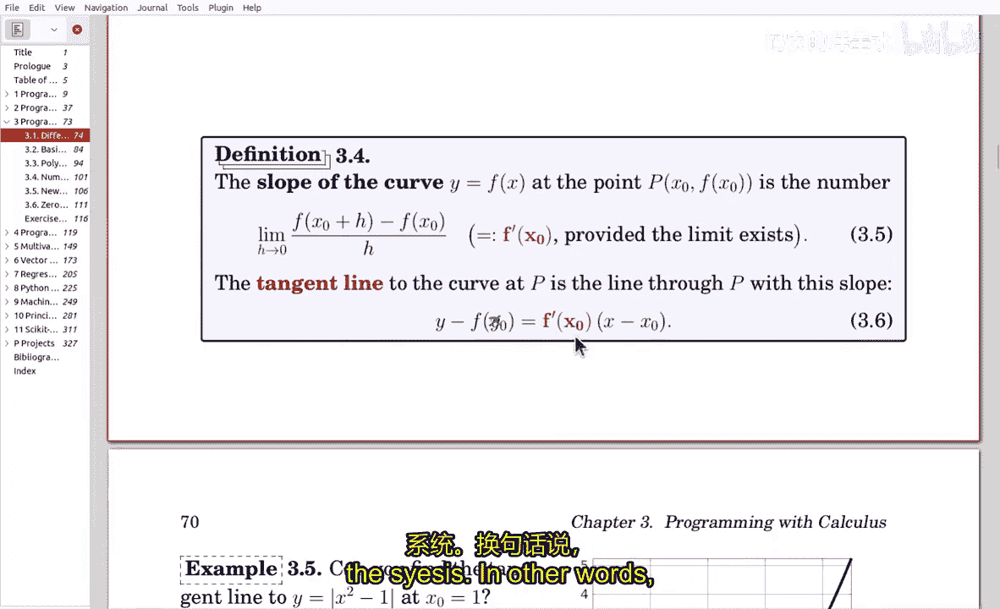

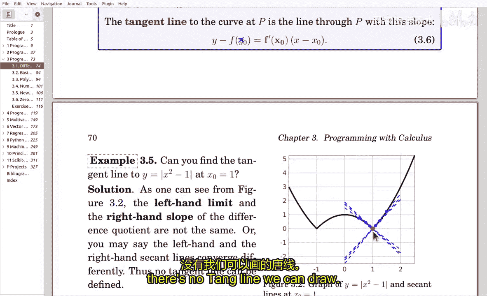

## 总结

在本节课中，我们一起学习了：
1.  **微分的基本思想**：通过让割线两点无限靠近，用极限来定义曲线在某一点的切线斜率。
2.  **导数的定义**：函数 **f(x)** 在点 **x₀** 的导数 **f‘(x₀)** 定义为差商当 **h→0** 时的极限，它几何上表示切线的斜率。
3.  **切线的应用**：我们通过**平均速度**和**瞬时速度**的例子，看到了导数如何描述瞬时变化率。并学会了如何利用导数求切线方程。
4.  **导数的存在性**：导数存在的必要条件是左右极限相等。在函数图像出现“尖角”或间断的点，导数可能不存在。

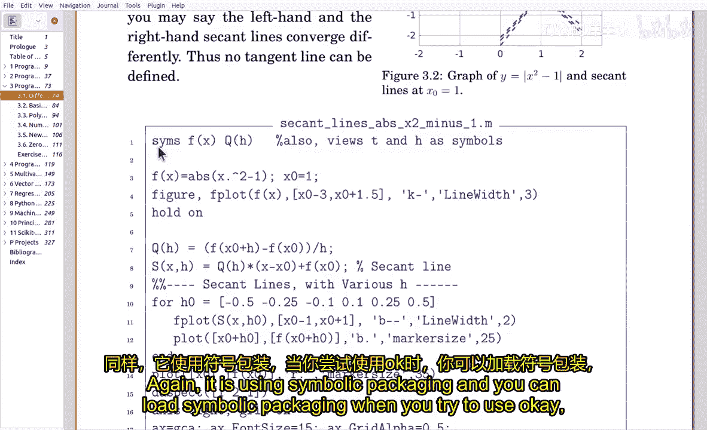

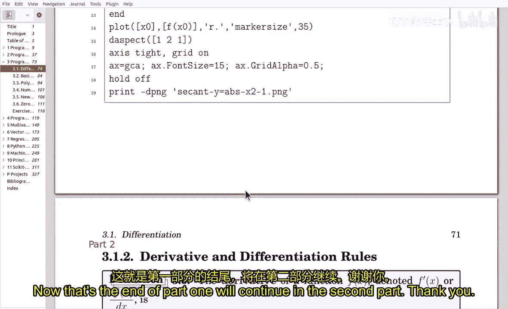

这是微分学第一部分的内容，我们将在后续部分继续探讨导数的计算规则和更多应用。