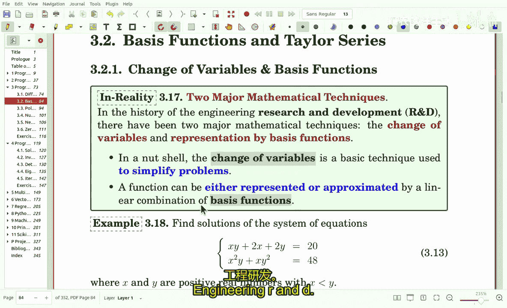
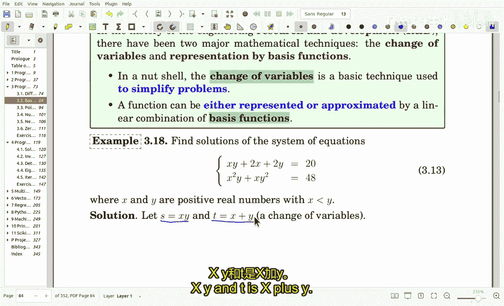
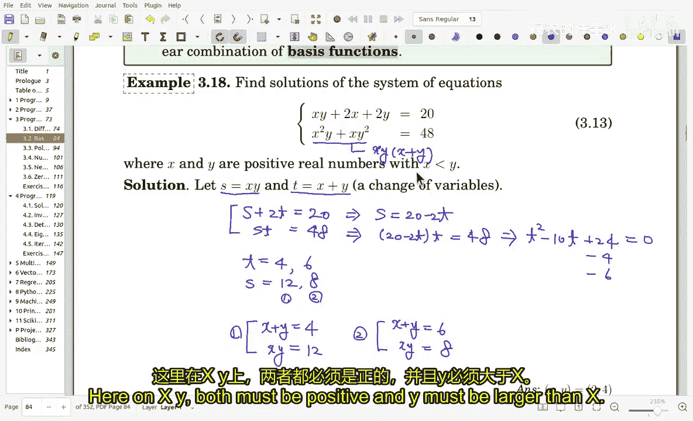
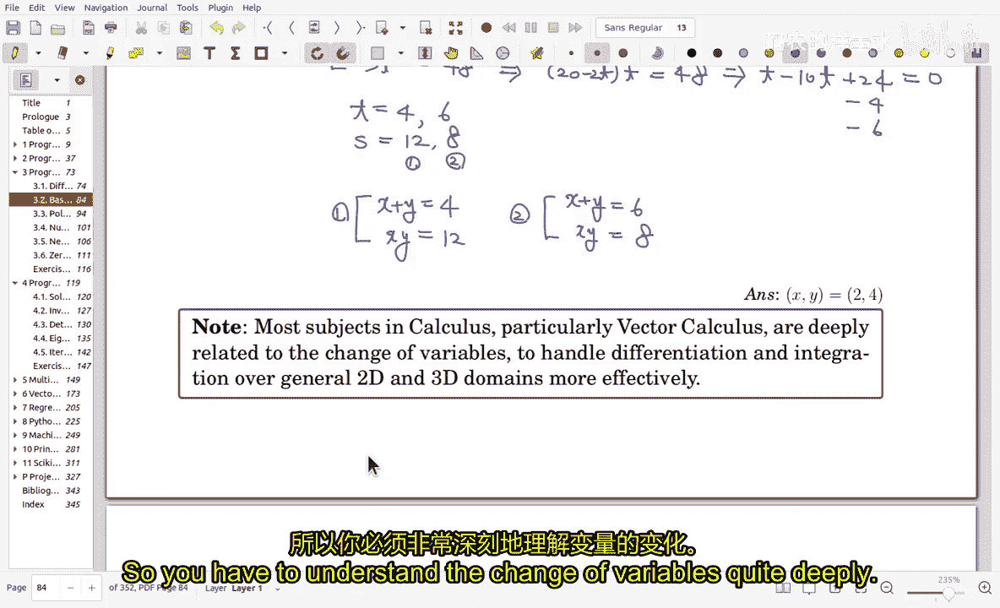
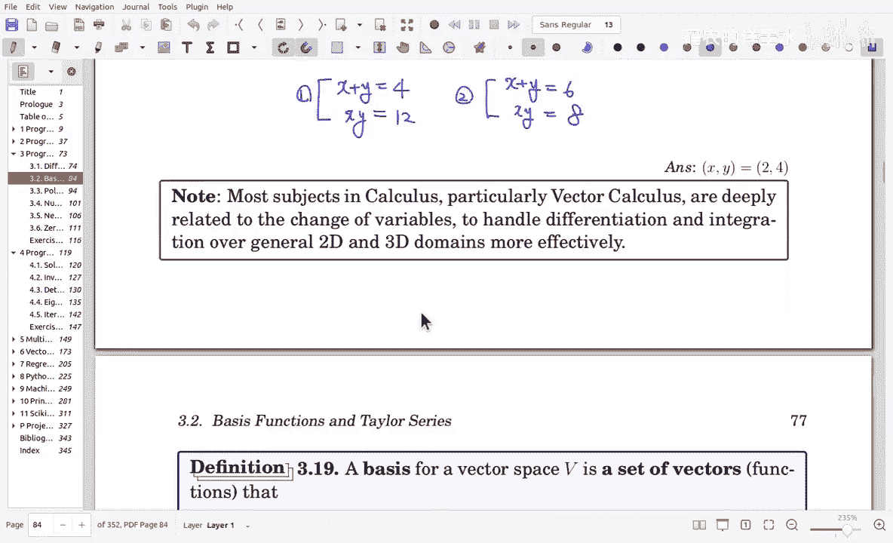
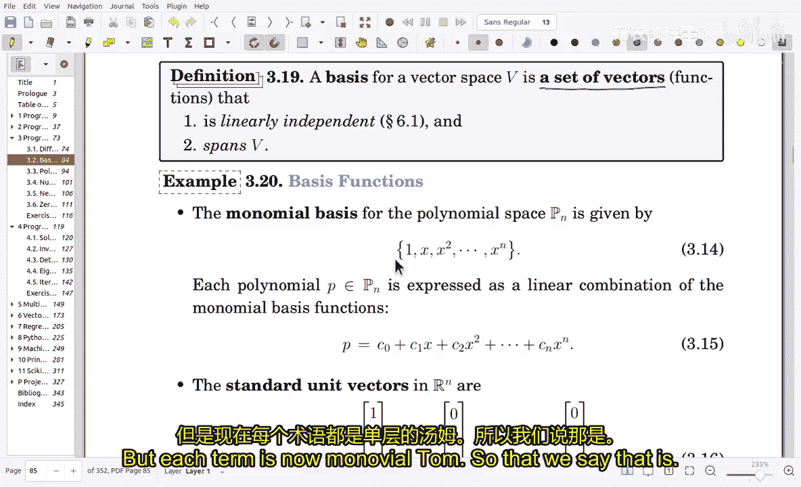
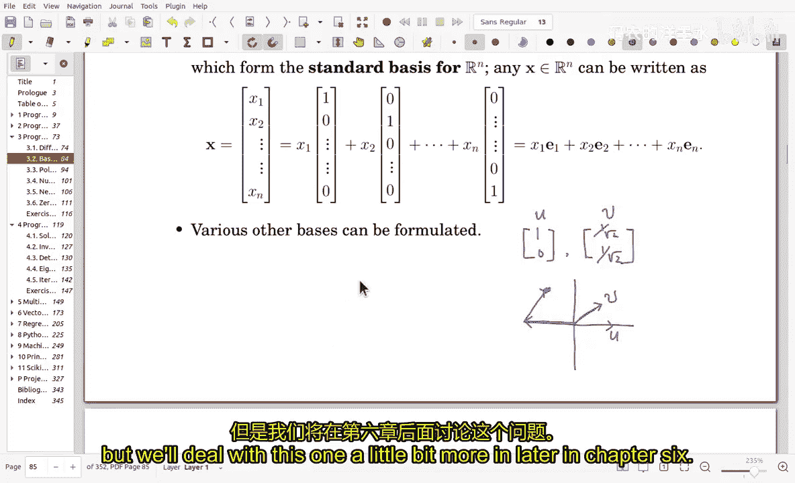
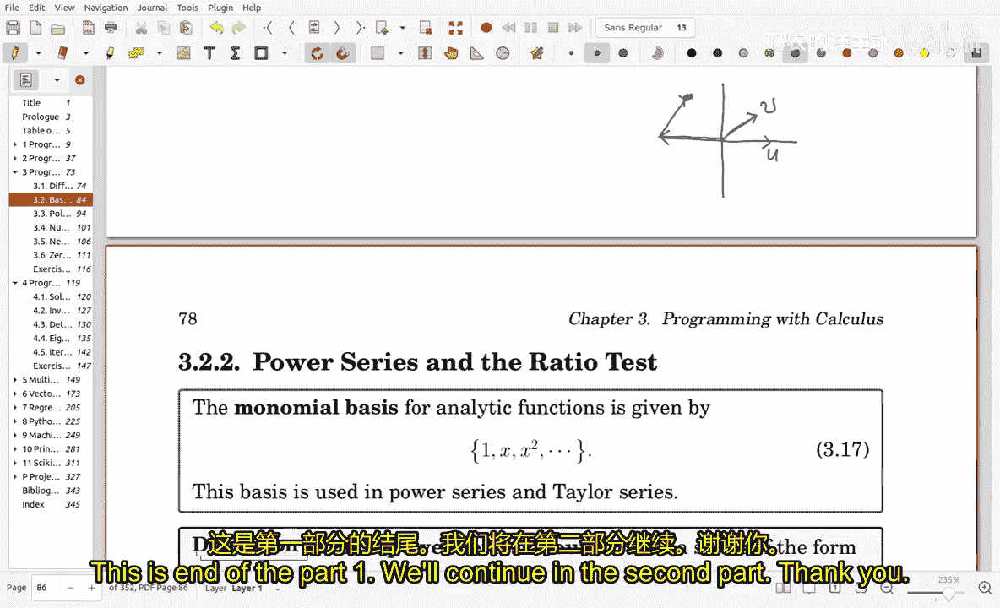

# 020：变量与基函数的变化

在本节课中，我们将学习工程与数学中的两个核心技巧：变量替换与基函数表示法。我们将通过具体例子理解它们如何简化问题，并探讨基函数在向量空间中的定义与作用。



---



## 30.2 基函数与泰勒级数

让我们从一个观察开始。在工程研发的历史中，有两种主要的数学技巧：**变量替换**和**基函数表示法**。

变量替换是用于简化问题的基本技巧。而一个函数可以通过一组**基函数**的线性组合来表示或近似。这就是基函数方法在工程研发中如此流行的原因。

### 变量替换示例

上一节我们介绍了变量替换的概念，本节中我们来看一个具体的例子。

**问题**：求解以下方程组，其中 `x` 和 `y` 为正数，且 `y > x`。
```
2x + 2y = xy
x + y = 4
```

**解法**：通过引入变量替换，我们可以更轻松地求解。令：
```
s = xy
t = x + y
```



利用新变量，原方程组可以简化为：
```
2t = s
t = 4
```





这是一个更简单的方程组。由第二个方程直接可得 `t = 4`，代入第一个方程得 `s = 8`。

现在，我们回到原变量：
```
x + y = t = 4
xy = s = 8
```

我们需要找到满足 `y > x > 0` 的解。解这个二次方程组，可以得到两组可能的解，但只有一组满足所有条件（`x=2, y=2` 不满足 `y > x`，`x≈1.55, y≈5.15` 等需验证）。最终满足 `y > x` 且均为正数的**唯一解**是 `x = 2, y = 2`？等等，计算有误，我们重新计算。

由 `x+y=4` 和 `xy=8`，构造二次方程：`z^2 - 4z + 8 = 0`。其判别式为 `16 - 32 = -16 < 0`，无实数解。这提示我们最初的替换或推导可能有问题。让我们检查原方程。

原方程为：
1. `2x + 2y = xy`
2. `x + y = 4`

将方程2代入方程1：`2*4 = xy` => `8 = xy`。所以方程组等价于：
```
x + y = 4
xy = 8
```
这正是我们上面得到的方程组，它确实没有实数解。因此，**在给定的正数且 `y > x` 条件下，原方程组无解**。这个例子说明了变量替换如何帮助我们发现方程组的性质（例如无解），即使它没有给出最终数值解。

在微积分，特别是向量微积分中，变量替换与高维度的微分和积分密切相关。理解变量替换对于有效处理多维问题至关重要。



### 基函数的概念

之前我们讨论了变量替换，现在我们来探讨**基函数**。基函数是构建更复杂函数或向量的“积木”。

**定义**：向量空间 `V` 的一组**基**是一个向量或函数的集合，它满足两个条件：
1.  **线性无关**：集合中的任何一个元素都不能表示为集合中其他元素的线性组合。
2.  **张成空间**：该空间 `V` 中的每一个向量或函数，都可以表示为这组基的线性组合。

以下是理解基函数的例子：

**1. 多项式空间的单项式基**
考虑所有次数不超过 `n` 的多项式构成的空间 `P_n`。一组自然的基函数是**单项式**：
```
{1, x, x^2, ..., x^n}
```
任何 `P_n` 中的多项式 `p(x)` 都可以写成这些基函数的线性组合：
```
p(x) = a_0 * 1 + a_1 * x + a_2 * x^2 + ... + a_n * x^n
```
其中 `a_0, a_1, ..., a_n` 是系数。这组基函数是线性无关的（例如，`x^2` 不能由 `1` 和 `x` 组合得到），并且张成了整个 `P_n` 空间。

**2. R^n 空间的标准基**
在 `n` 维欧几里得空间 `R^n` 中，**标准基**由以下**标准单位向量**组成：
```
e_1 = (1, 0, 0, ..., 0)
e_2 = (0, 1, 0, ..., 0)
...
e_n = (0, 0, 0, ..., 1)
```
`R^n` 中的任意向量 `x = (x_1, x_2, ..., x_n)` 都可以表示为：
```
x = x_1 * e_1 + x_2 * e_2 + ... + x_n * e_n
```
这组向量线性无关且张成 `R^n`。

**3. R^2 空间的另一组基**
标准基 `{e_1, e_2}` 并非唯一的选择。例如，以下两个向量也是 `R^2` 的一组基：
```
u = (1/√2, 1/√2)
v = (-1/√2, 1/√2)
```
这两个向量长度均为1，并且互相垂直（夹角90度）。平面上的任何点都可以表示为 `u` 和 `v` 的线性组合，并且它们线性无关。这表明，对于一个给定的向量空间，可以存在许多组不同的基。

---

## 总结

本节课中我们一起学习了：
1.  **变量替换**：通过引入新变量简化问题，是解决复杂方程和进行积分计算的有力工具。
2.  **基函数**：构成向量空间“骨架”的线性无关函数或向量集合。任何空间中的元素都可以唯一地表示为基函数的线性组合。我们以多项式空间和欧几里得空间为例，介绍了**单项式基**和**标准基**。





理解如何改变变量以及如何选择和使用基函数，是进行有效数学建模、简化问题以及后续学习更高级人工智能算法（如傅里叶变换、主成分分析等）的重要基础。